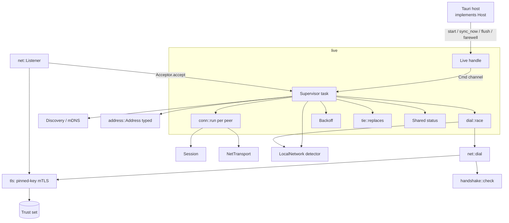
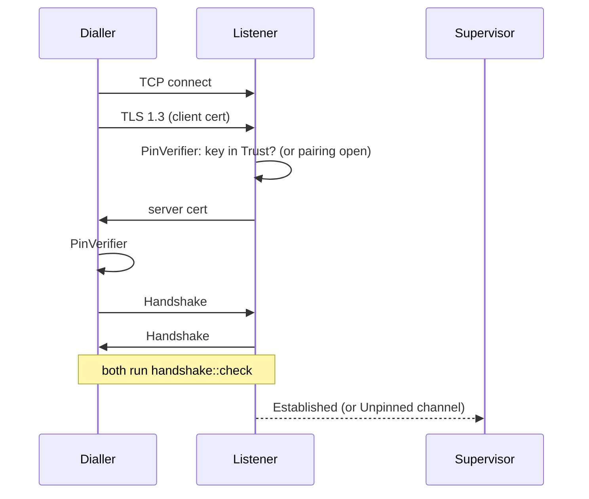
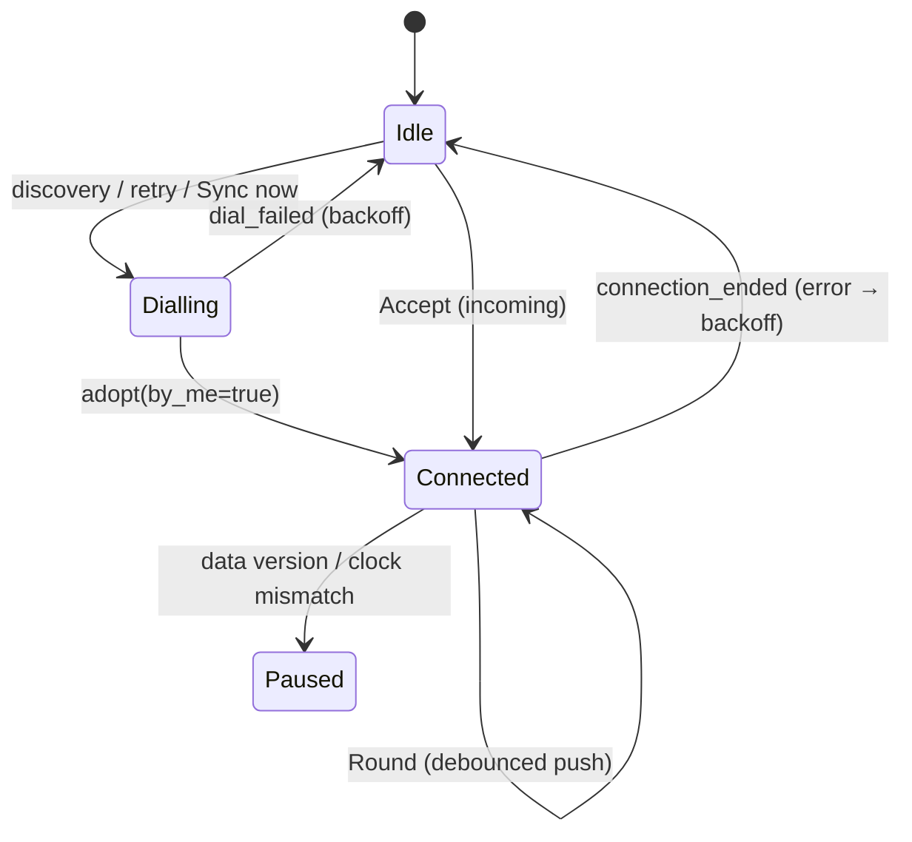
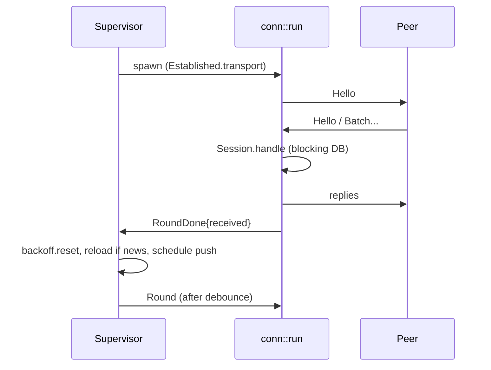

# Sync_Networking_and_Live

This module is the network half of the sync engine in `crates/sync`. It holds four things:

- A mutually authenticated TCP + TLS 1.3 transport between paired devices (`net/`).
- The "live" session manager (`live/`). It keeps one connection per reachable paired device, dials devices, and starts sync sessions.
- Parsing and resolving of the addresses a person may type for a device (`address.rs`).
- Detection of the OS blocking local-network access (`local_network.rs`).

The replication logic itself (sessions, merge, vector clocks, wire messages) lives in [Sync_Replication_Engine](../Sync_Replication_Engine.md) and its [core page](Sync_Replication_Engine_Sync_Replication_Engine.md). Pairing, which plugs in below the sync handshake, is in [Sync_Pairing](Sync_Pairing.md). Activity lines, device lists and forgetting are in [Sync_Activity_and_Devices](Sync_Activity_and_Devices.md). The Tauri commands that start and stop all of this are in [Sync_Connectivity_and_Pairing](../Tauri_Host_and_Command_Layer/Sync_Connectivity_and_Pairing.md).

## Architecture

## Network transport (`net/`)

| Layer | File | Role |
|---|---|---|
| Identity | `identity.rs` | Ed25519 key pair (PKCS#8, stored in a `0600` file `sync-key.pk8` next to `device.toml`, per Environment). `PublicKey` is the device identity, shown as 64 hex characters. `sign`/`verify` are used for group-wide notices such as revocation and rename. `key_err` maps key errors to `NetError::Key`. |
| TLS | `tls.rs` | rustls TLS 1.3 only. `PinVerifier` accepts a certificate only if its Ed25519 key is in the `Trust` set, on both client and server (mutual TLS). No chain, name or date check. Session tickets and resumption are disabled so a forgotten key cannot return on an old ticket. `tls_err` wraps errors as `NetError::Tls`. |
| Framing | `frame.rs` (not documented here) | 4-byte length-prefixed JSON frames, at most 8 MB (`MAX_FRAME`). |
| Handshake | `handshake.rs` | First frame each way. Both sides run `check` on the other's `Handshake`. |
| Link | `link.rs` (not documented here) | `Listener` (port 47311, else ephemeral), `dial`, `probe`, `secure_dial`, `NetTransport`. |
| Errors | `mod.rs` | `NetError`. It converts into `SyncError`: I/O, closed and timeout become `Disconnected`, the rest become `Protocol`. |

### Trust and pairing window

`Trust` is a shared, cloneable set of pinned key → device id. `pin` and `unpin` are called on pairing, forgetting and revocation. `set_pairing_open(true)` makes TLS also admit unpinned keys so a new device can connect. The sync handshake still refuses them, and they surface as `Incoming::Unpinned` for the pairing code ([Sync_Pairing](Sync_Pairing.md)).

### Handshake rules

`Handshake` carries the protocol version (`PROTOCOL_VERSION = 1`), app version, `Environment`, device id, group, per-Module `data_versions`, reachable addresses and `now_ms`. `check(local, remote, key, trust)` refuses with a `Refusal` in this order:

1. `Protocol`: the versions differ.
2. `Environment`: Production and Sandbox never talk.
3. `SelfDial`: the peer is this device.
4. `Unpinned`: the key is not pinned.
5. `WrongDevice`: the key is pinned under another device id.
6. `Group`: both sides have a group and the groups differ.

Differing data versions are not a refusal. They are returned as a list of Modules, and the supervisor pauses that device until the older side updates. The clock difference is checked too and pauses sync (see `Pause`).

The listener limits stranger input: at most 16 inbound handshakes are in flight (`MAX_PENDING`), and a handshake frame has a far smaller limit (`HANDSHAKE_MAX_FRAME`) than the 8 MB for session frames. The IPv4 and IPv6 listeners share one port, and a busy default port falls back to an ephemeral one (`fell_back()`).

`net/tests.rs` runs all of this over real loopback sockets with a small `Todoish` Module. It covers unpinned or wrongly pinned peers, the other Environment, oversized frames, forgotten peers (including TLS resumption), the pairing hook, port fallback, IPv6 and a full todo sync between two pinned peers.

## Typed addresses (`address.rs`)

A person may type `host`, `host:port`, an IPv4 address, or a bracketed IPv6 address (for example a Tailscale MagicDNS name). `Address::parse` returns an `AddressError` (`Empty`, `Host`, `Port`, `Brackets`) whose `message()` says what to fix. `normalized()` gives the stored form: lower case, IPv6 in brackets, the port only if typed. `port()` defaults to `DEFAULT_PORT`. `resolve(within)` looks a name up with a timeout and fails with `ResolveError::{NotFound, TimedOut}`. The rules are shared with the browser mock through `src/lib/ipc/fixtures/sync-rules.json` (see [IPC_Sync_Mocks](../IPC_Bridge_and_Browser_Mocks/IPC_Sync_Mocks.md)).

## Local network detection (`local_network.rs`)

macOS 15+ and Android 17 can keep an app off the local network. macOS gives no API, only `EHOSTUNREACH` ("No route to host"), which a switched-off neighbour also gives. The module therefore needs sustained evidence.

- `outcome_of_failure(addr, error)` classifies a failed dial as `Blocked`, `Worked` or `Unknown`. Only LAN addresses count. Loopback, Tailscale, public and scopeless link-local IPv6 addresses say nothing.
- `Detector` takes observations from two `Source`s, `Dial` and `Probe`. It declares "blocked" after `MIN_FAILURES` (3) consecutive failures spanning the `grace` period (30 s). Any success clears it. A working probe means a dial failure is about the device, not the permission.
- The probe, `probe_mdns_group`, sends an empty UDP datagram to `224.0.0.251:5353` (macOS only). It reports a network-unreachable error rather than a denial when no LAN interface exists.
- `LocalNetwork` is the shared state. It combines the detector with the OS report from `set_os_denied` (Android), `reset()` on a fresh start, and a `changed()` notification raised once per change. `Rhythm` sets the probe pace: fast, slow and steady.

## Live session manager (`live/`)

### Host trait

`live::Host` extends `PairingHost`. It is what the app gives the engine: `with_db` (the engine's own connection to the same database file), `registry`, `bus`, `automatic` ("Sync automatically"), `local_changes` (a `Notify` signalled on each local change), `status_changed`, `activity_changed` and `device_name`. The helpers `with_db` and `blocking` run database work on blocking threads so a slow transaction never stalls the async tasks.

`Pace` holds the timings: debounce 3 s, `dial_each` 3 s, and a `Schedule` for retries.

### Supervisor

`Live::start` spawns one `Supervisor` Tokio task. It owns a `JoinSet` of every dial and connection, so dropping `Live` aborts everything. The supervisor loop `select!`s over:

- Commands from the `Live`, `Acceptor` and `Leaver` handles: Accept, SyncNow, SyncNowOne, Resume, Flush, Refresh, Reconfigure, Farewell.
- `RoundDone` reports from connections.
- Finished tasks in the set.
- Local-change notifications, which set `push_at` to now plus the debounce.
- Discovery candidates (`next_found`).
- Timers: push (`wait_until(push_at)`), per-peer retry, and the local-network probe.
- Local-network state changes.

Key behaviours:

- **Dial sources.** `candidates` merges addresses found by discovery, remembered addresses (`peer_state::addresses_of`) and the address a person typed (`detail::typed_for_dial`, resolved inside the dial task so a slow name never holds up the others). `race` tries them with `dial_each` per address and reports failures and successes to `LocalNetwork`.
- **Duplicate connections.** When both devices dial at once, `tie::replaces` keeps the connection dialled by the lower device id on both sides. A dial that fails after a connection was adopted does not mark the device unreachable.
- **Backoff.** Failures schedule a retry with `Backoff`. Seeing the device again on the network, a "Sync now" or `resume()` resets it. A device that re-announces the same addresses is left to its backoff (`same_addresses`).
- **Sync automatically off.** Nothing is kept open or retried. "Sync now" marks peers `manual`, dials once, and the connection closes after one session. Incoming connections are closed unless a manual sync is pending.
- **Trust refresh.** `reload` reads paired devices, pins their keys and unpins revoked ones. A device that the group forgot dials and answers no one. After any round that received records, `reload` runs again so a forgotten device is dropped at once, and a push is scheduled so the news travels onward.
- **Pauses.** A handshake mismatch (`Pause::Update`, `Pause::Clock`), or `SyncError::ClockAhead` from a record stamped more than five minutes ahead (`Pause::Stamped`), marks the device paused and writes one Activity line. A stamped pause outlives a good handshake and ends only when a sync completes.
- **Task safety.** `task_died` recovers if a dial or connection task panics, so a device is never left marked connected or dialling.
- **Farewell.** `Leaver::farewell(limit)` runs one last session on every connection so a leaving device's final writes reach the others. `tell_everyone` re-asks if a connection was replaced before its session ran.

### Connection (`conn.rs`)

`conn::run(Conn)` drives one connection. Each round is a fresh `Session`: a side with something to say sends its `Hello`, and an idle side that receives a `Hello` answers with its own. Crossing Hellos are fine. Database work runs through `blocking`, one batch per transaction. Before each round it checks the peer is still paired. Before the first non-empty `Batch` from a device met only through an introduction, it takes a backup (`back_up_before_first_records`).

The loop handles transport messages, `ConnCmd` commands (`Round`, `Close`, `Farewell`) and a 60 s `SILENCE` timeout that closes a stalled session. When a session finishes, `peer_state::finished` is updated and a `RoundDone` goes to the supervisor. The `received` count there is `news(stats)`: stored records, plus the Activity line written, plus Activity merely received. A round that brought nothing ends the relay chain.

### Tests (`live/tests.rs`)

Two in-memory devices run over loopback sockets with no data to sync. The tests cover:

- Tie-break by lower id, whichever connection each side sees first.
- A panicking connection task.
- A failed dial after adoption.
- Dialling a remembered address when discovery finds nothing.
- A failing probe blocking once and clearing when it works.
- Loopback dials leaving local-network state untouched.

Higher-level behaviour (pairing, quiet period, widget refresh, groups) is covered by the `sync_live_tests`, `sync_pairing_tests` and `sync_groups_tests` suites described in [Sync_Connectivity_and_Pairing](../Tauri_Host_and_Command_Layer/Sync_Connectivity_and_Pairing.md).

## How it fits

- **Below:** `Session`, `Registry`, `peer_state`, `peers`, `revoke`, `activity` and `Pause` come from the replication core ([core page](Sync_Replication_Engine_Sync_Replication_Engine.md)) and [Sync_Activity_and_Devices](Sync_Activity_and_Devices.md).
- **Beside:** [Sync_Pairing](Sync_Pairing.md) uses `secure_dial`, `Incoming::Unpinned` and `Trust::set_pairing_open`.
- **Above:** the Tauri host implements `Host`, owns the `LocalNetwork`, calls `Live::{sync_now, flush, resume, options_changed, refresh_peers}` and shows `PeerLive` snapshots in the Devices tab. The frontend side is in [Sync_Frontend](../Sync_Frontend.md).
