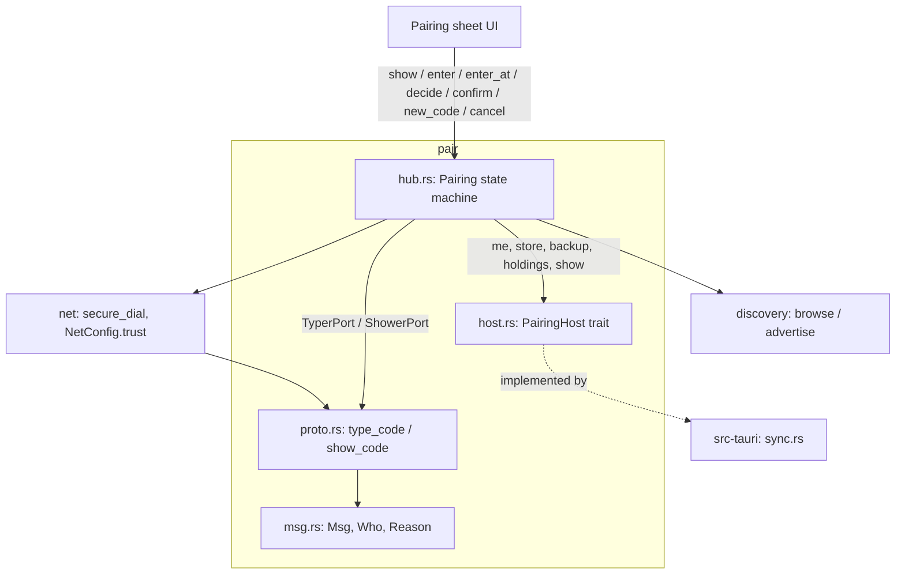
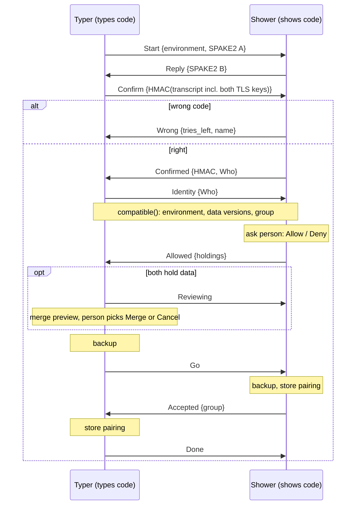
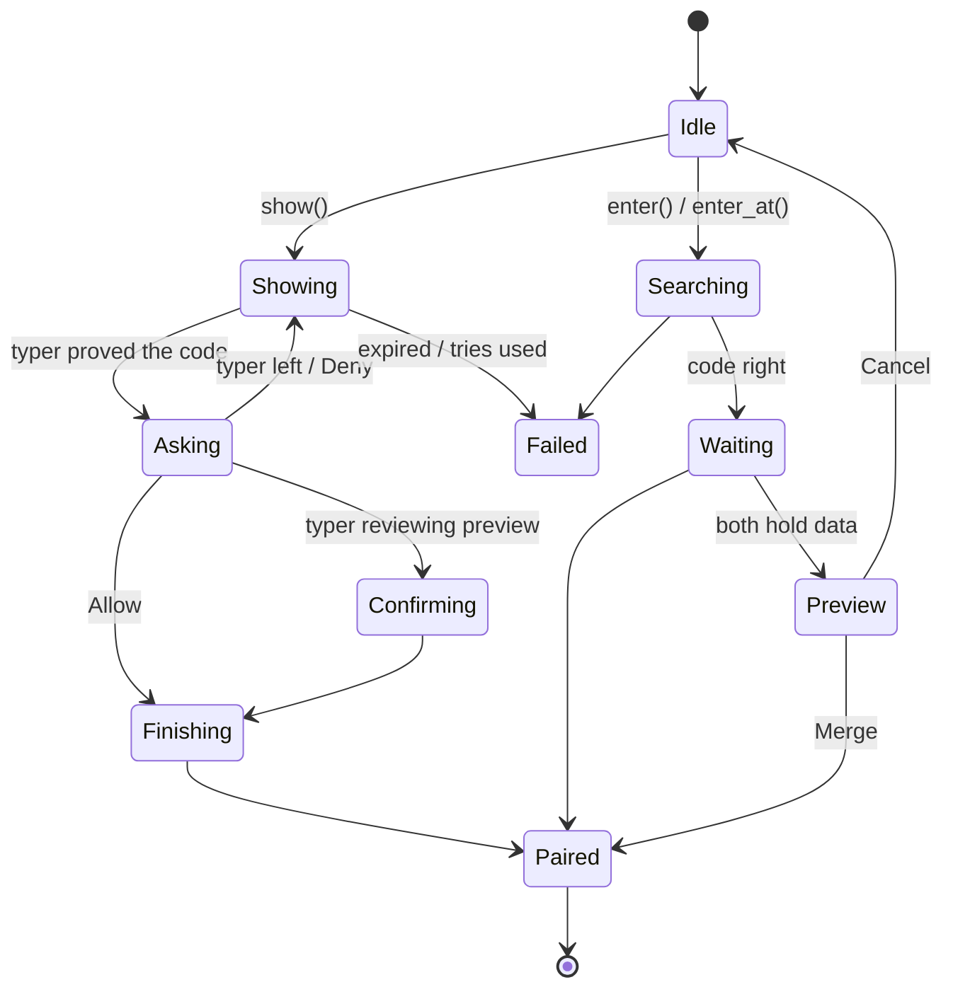

# Sync_Pairing

Sync_Pairing is the part of the sync crate (`crates/sync/src/pair/`) that lets two Mnemora devices trust each other. One device shows an 8-digit code. The other types it, either after discovering the device on the local network or by dialling a typed address. If the codes match, the person on the showing device presses Allow. Both devices then record the pairing, join one group and pin each other's TLS keys.

The crate does not touch the database or the window. Everything it needs from the app comes through the `PairingHost` trait. That trait is implemented in the Tauri host (see [Sync_Connectivity_and_Pairing](../Tauri_Host_and_Command_Layer/Sync_Connectivity_and_Pairing.md)). The UI side is in [Sync_Devices_and_Pairing](../Sync_Frontend/Sync_Devices_and_Pairing.md).

This page covers the files `host.rs`, `hub.rs`, `msg.rs`, `proto.rs` and `tests.rs`. It also uses code from the `code`, `preview` and `view` files in the same folder. Those files were not provided, so only their usage is described here.

Related modules:
- [Sync_Networking_and_Live](Sync_Networking_and_Live.md) provides the TLS layer and the listener. While pairing is open, TLS admits unpinned keys and hands them to `Pairing::handle_incoming`.
- [Sync_Activity_and_Devices](Sync_Activity_and_Devices.md) covers the peers, introductions and renames that follow a pairing.
- [Sync_Replication_Engine_Sync_Replication_Engine](Sync_Replication_Engine_Sync_Replication_Engine.md) covers the core record exchange that starts after pairing.

## Architecture

Layering:
- **`proto.rs`** runs one exchange over a `Channel`. It knows nothing about sockets, windows or databases. It reaches the outside only through `TyperPort` and `ShowerPort`.
- **`hub.rs`** holds `Pairing`, the state of the sheet. It implements both ports through `TypeSide` and `ShowSide`, owns the timers and tasks, and publishes a `PairingView` to the host after every change.
- **`host.rs`** defines what the app supplies: `me`, `handshake`, `visible`, `pinned`, `holdings`, `backup`, `store`, `show`, `remember_address` and `paired`.
- **`msg.rs`** defines the wire messages.

## Components

### `Msg`, `Who`, `Reason` (`msg.rs`)
`Msg` is tagged with `"pair"`, so no pairing message can parse as a `Handshake`. A unit test checks this. The listener relies on it to tell a pinned peer's handshake from a pairing attempt.

| Message | Direction | Purpose |
|---|---|---|
| `Start` | typer → shower | Environment and SPAKE2 message. The typer always speaks first. |
| `Reply` | shower → typer | The shower's SPAKE2 message. |
| `Confirm` | typer → shower | HMAC proof of the code and of both TLS keys. |
| `Confirmed` | shower → typer | The shower's own proof, plus its `Who`. |
| `Wrong` | shower → typer | The proof failed. Carries tries left and the shower's name. |
| `Identity` | typer → shower | The typer's `Who`. |
| `Allowed` | shower → typer | Allow was pressed. Carries the shower's `Holdings` for the preview. |
| `Reviewing` | typer → shower | The typer's person is looking at the merge preview. |
| `Go` | typer → shower | Merge. The typer has backed up. |
| `Accepted` | shower → typer | The shower has recorded the pairing. Carries the group id. |
| `Done` | typer → shower | The typer has recorded the pairing. |
| `Refuse` | either | Stops the exchange, with a `Reason`. |

`Who` is a device's self-description: id, name, platform, key, environment, group, per-module data versions and the group's other `members`. `Reason` is one of `Environment`, `Version`, `Groups`, `Declined`, `Expired`, `Cancelled`, `Busy` or `BackupFailed`. The `hex` and `unhex` helpers encode the binary fields.

### Protocol (`proto.rs`)

Security properties:
- The proofs are HMAC-SHA256 over a transcript made of a label (`typer` or `shower`), both TLS public keys and both SPAKE2 messages. A device in the middle has a different TLS key towards each end, so its proofs fail. This is what authenticates the keys.
- The `who.key` in each identity must equal the TLS key actually seen on the connection.
- A wrong code counts as a try. The proof is checked inside `ShowerPort::attempt`, under the same lock that counts the tries. Parallel connections therefore cannot check a proof after the last try is spent. The test `a_proof_is_not_checked_once_the_tries_are_spent` covers this.

`compatible()` applies three rules, in this order:
1. The environments must match (Production versus Sandbox).
2. The per-module data versions must be equal. A mismatch yields `Failure::Version`, with `Older::Me`, `Older::Them` or `Older::Both` and the names of the older modules.
3. If both devices already belong to a group, the groups must be the same.

Failure types:
- `Failure` has the variants `WrongCode`, `Refused`, `Environment`, `Version`, `Denied` and `Lost`.
- `Denied` means TLS turned the typer away because no code is open there.
- `Decision` is the shower person's answer: Allow, Deny, Expired, Cancelled or Busy.
- `Choice` is the typer person's answer on the preview: Merge or Cancel.
- `Attempt` is `Right`, `Wrong(n)` or `Dead`.

Data safety: nothing is stored until Merge. Both devices back up their databases before either records the pairing, and so before any record is exchanged. If a backup fails, the pairing is refused with `BackupFailed` and nothing changes. The preview is shown only when `needs_preview` says both sides hold data. If one side is empty, the exchange goes straight to the backups.

### `Pairing` hub (`hub.rs`)

`Pairing` owns one `Mutex<Inner>`:
- `show`: the code on display, with its expiry, tries left, an optional `dead` error and an optional `notice`.
- `asking`: the `Pending` question to the person on the showing device. It has `answered`, `confirming` and `stop` flags.
- `typing`: the abort handle of the typing task.
- `reviewing`: the channel for the preview choice.
- `timer`: the expiry timer.
- `generation`: bumped by every clear, so a late task can tell it is stale.
- `next_question`: the id source for questions.

State is published as a `PairingView`. The variants are `Idle`, `Showing`, `Asking`, `Confirming`, `Finishing`, `Searching`, `Waiting`, `Preview`, `Paired` and `Failed`.

**Public API:**
- `show` and `new_code` generate an 8-digit code with 3 tries and a life of `timing.code_life`. `new_code` does nothing if no code is on show or someone is being asked.
- `enter(input)` normalises the code. It browses discovery for adverts with `pairing_open` and tries each device address in turn.
- `enter_at(address, input)` dials a typed address, skipping discovery. On success the address is remembered as that device's typed address through `PairingHost::remember_address`.
- `decide(allow)` answers the question.
- `confirm(merge)` answers the preview.
- `cancel` closes the sheet and tells the other device.
- `shutdown` stops everything when Sync is turned off.
- `refresh_advert` re-announces the device, with the pairing-open flag only while a live code is shown.
- `state` reads the current view, and `tasks` counts live pairing tasks (used by tests to prove nothing leaks).

**Trust gate:** `sync_open` calls `config.trust.set_pairing_open(...)`. While a code is shown, being typed, or has expired but is still on the sheet, TLS admits unpinned keys. The expired-code case lets the typer be told that the code is dead, which is more useful than "nothing answered". The listener passes such connections to `handle_incoming`, which spawns `serve`, and `serve` runs `proto::show_code`.

**Choosing which error to show:** when several devices are tried, `rank` picks the most useful error. The order, from highest, is WrongCode, CodeExpired, DifferentEnvironment, Busy, ConnectionLost. `is_final` ends the search at once for errors that mean the right code was typed and something else is wrong (Declined, VersionMismatch, DifferentGroups, Cancelled, BackupFailed). `typer_error` maps a protocol `Failure` to a user-facing `PairingError`.

**Commit:** `commit` calls `host.store`, optionally `remember_address`, pins every key in `stored.pins` (the other device plus the members it brought), and then calls `host.paired()` so new devices can be connected to.

**Shower-side outcomes** (in `serve`): the code stays on screen with a `notice` for an environment, version, groups or backup problem, or when the typer cancelled the merge. Deny cancels the whole show.

### `PairingHost` and `Stored` (`host.rs`)
`PairingHost` is `Send + Sync + 'static`. `holdings` and `backup` have defaults (empty, and Ok). With the default `holdings`, no preview is shown. `Stored` reports back the name the other device has here (unique, so a clash gets a number), its platform, whether it was renamed, the `also_joined` device names, and the `pins` list.

## Pairing a whole group

The `Who.members` field carries the other devices of the group, so pairing with one member joins the newcomer to all of them. `Stored.also_joined` and `pins` carry this back to the hub. Further introductions to the rest of the group go through [Sync_Activity_and_Devices](Sync_Activity_and_Devices.md) (`introduce`).

## Tests (`tests.rs`)

The tests start two or more real `Network` instances over loopback sockets, each with an in-memory database. A `Dev` wrapper holds the test `Host` (which implements both `PairingHost` and the crate's `Host`), a `Fixed` discovery and the network. The helper `pair(shower, typer)` runs the whole happy path. The `until` helper polls the view.

| Area | Tests |
|---|---|
| Happy path | `the_right_code_pairs_both_devices_and_each_lists_the_other`, `a_name_that_clashes_gets_a_number`, `pairing_with_one_member_joins_the_whole_group` |
| Code handling | `a_code_must_have_eight_digits`, `a_wrong_code_reports_tries_left_and_the_right_one_still_works`, `three_wrong_tries_kill_the_code`, `a_proof_is_not_checked_once_the_tries_are_spent`, `new_code_makes_a_different_code_with_fresh_tries` |
| Expiry | `an_expired_code_is_refused_and_says_so`, `running_out_of_time_while_asking_tells_the_other_device`, the by-address expiry tests |
| Person's choice | `deny_tells_the_other_device_and_pairs_nothing`, `cancelling_while_asked_tells_the_typing_device`, `the_typing_device_leaving_returns_the_showing_one_to_its_code` |
| Compatibility | `sandbox_and_production_refuse_each_other`, `devices_on_different_data_versions_do_not_pair`, `two_devices_in_different_groups_do_not_pair` |
| Discovery and lifecycle | `nothing_nearby_is_reported_when_no_device_shows_a_code`, `the_pairing_flag_is_announced_only_while_a_code_is_shown`, `dropping_the_network_closes_the_port_and_stops_announcing` |
| One-sided forget | `a_device_that_still_pins_the_typer_can_be_paired_with_by_address` and the by-address expired-code tests. These come from a real-device failure. One side had forgotten the other, which still pinned it, and the two devices then misread each other's first frame. |

Command-level and multi-device pairing behaviour is tested in the app crate. This includes the merge preview and backups in `sync_merge_preview_tests.rs`, and the group and forget flows in `sync_groups_tests.rs` and `sync_forget_tests.rs`. See [Sync_Connectivity_and_Pairing](../Tauri_Host_and_Command_Layer/Sync_Connectivity_and_Pairing.md).

## Concurrency notes
- All hub state sits behind one mutex. `publish` is called with the lock held, so host events keep the order of the changes.
- Async tasks started through `Pairing::spawn` are counted (`TaskCount` decrements on drop) and can be aborted.
- A `generation` counter makes late tasks (timers, typing outcomes) harmless after a cancel or a new code.
- Once Allow is pressed, `expire` does not kill the pairing, because the merge preview may take longer than the code. `end_question` closes a code that ran out in the meantime.
