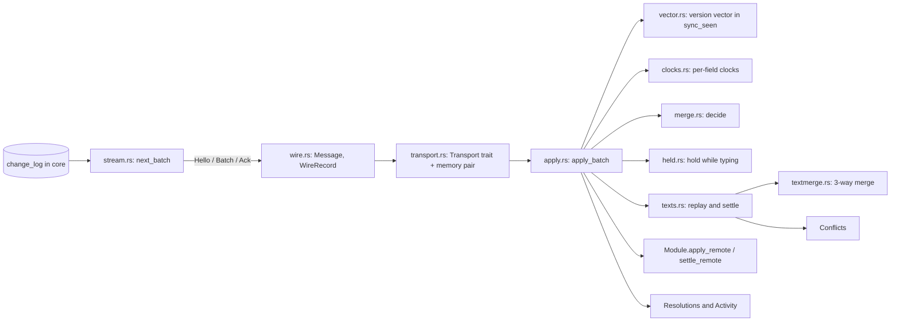
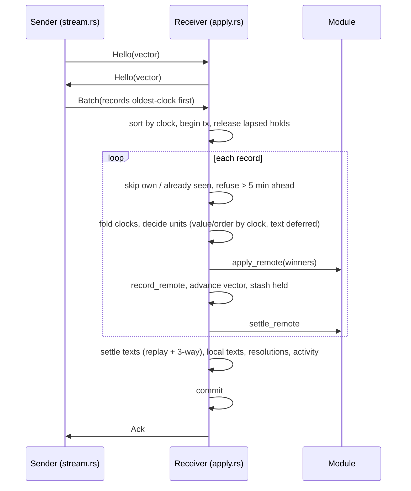

# Sync Replication Engine (core)

This page covers the replication core of the `mnemora-sync` crate (`crates/sync`). The core is the part that decides what two devices send each other and what each device does with it. Its integration tests live in `src-tauri/src/sync_*_tests.rs`. The neighbouring pages cover the rest of the crate:

- [Sync Conflicts and Resolutions](Sync_Conflicts_and_Resolutions.md)
- [Sync Activity and Devices](Sync_Activity_and_Devices.md)
- [Sync Networking and Live](Sync_Networking_and_Live.md)
- [Sync Pairing](Sync_Pairing.md)

Sync keeps a person's own devices in step, directly between them with no server. It is off by default and inert while off. It never imports the Journal or Todo crates. Those modules plug in through `mnemora_core::syncable` (`SyncEntity`, `RemoteChange`, `apply_remote` and `settle_remote`).

## Purpose

- Every local change is a record in the core `change_log`. It carries an origin device, an origin sequence and a hybrid logical clock (HLC).
- Two devices exchange the records the other lacks. A device can relay records it holds from a third device.
- Each device converges to the same state whatever order records arrive in.

## Architecture

### Components

| File | Role |
|---|---|
| `lib.rs` | `SyncModule`, which implements `Module`. It is disabled by default, owns the module migrations and registers the sync entities (conflict, resolution, activity, revocation, device, introduction). Its `on_startup` only adopts typed addresses into the log. It re-exports the crate API. |
| `migrations.rs` | Append-only schema: peers, `sync_seen` (version vector), `sync_field_clocks`, `sync_clock_marks`, `sync_held`, `sync_conflicts`, `sync_text_replay`, `sync_resolutions`, `sync_activity`, `sync_revocations`, `sync_introductions` and others. |
| `wire.rs` | The protocol. `Message` is `Hello{device, vector}`, `Batch{records, last, total}` or `Ack`, serialised as JSON. `WireRecord` carries only the changed fields, `prev` (what the change replaced) and `seen` (for deletes). |
| `transport.rs` | The `Transport` trait (`send`, non-blocking `try_recv`). The `memory` module has `pair()` and `Link::cut` and `cut_after` for fault tests. The TLS transport is in the [networking page](Sync_Networking_and_Live.md). |
| `vector.rs` | The version vector: highest origin sequence per entity and origin device (`of_entity`, `all`, `seen`, `advance`). |
| `stream.rs` | Outbound side. `next_batch` merges per-origin queues by clock order (`order_key`). A batch holds at most `BATCH_RECORDS` = 500 records or about `BATCH_BYTES` = 2 MiB. `placeholders` builds the SQL `NOT IN` list for local-only ids. `pending` counts the records still to send. |
| `apply.rs` | Inbound side. `apply_batch` runs everything in one `Immediate` transaction, so the whole batch and the vector advance are applied together or not at all. |
| `clocks.rs` | `fold` reads the change log into per-field clocks. `raise` and `load` keep and read them. |
| `merge.rs` | `Verdict::{Take, Keep}` from `decide`: the newest clock wins, and ties go by device id. Derived fields never take. |
| `held.rs` | Changes held back while an editor is open (`core::editing`). Values go into `sync_held`, and `release_ready` applies them when the hold ends. `Released` reports what changed. |
| `texts.rs` | A text is the replay of all its records in clock order, with a three-way merge where a record was made from an older text. Replay is memoised in `sync_text_replay`. `settle_unit` raises and supersedes Conflicts. `settle_local` replays this device's own saves. |
| `textmerge.rs` | Pure three-way merge: line first, then word. `Piece::{Agreed, Clash}`, `diff` and `DiffSpan` for Compare. |
| `state.rs` | Device settings: `SyncState`, `SyncOption`, `set_enabled`, `rename`, `set_option`. |
| `peer_state.rs` | Local memory per peer: route (`Route::Wifi` or `Tailscale`), last session counts, remembered addresses (at most 8 kept), `needs_first_backup`. |
| `check.rs` | The "Check" button. It dials a typed address with timeouts (lookup 3 s, each 4 s, total 10 s) and reports `CheckKind` in words (`Expect`, `Limits`, `check`). |

## Applying a batch

Key rules:

- **Units.** An ungrouped field is a unit on its own. A field group is atomic. For example, the "when" group (date, time, repeat) and the state and closed time are taken whole from the newest record and never mixed.
- **Field classes.** `Value` and `Order` are newest-wins by HLC. `Text` is merged by replaying records. `Derived` is recomputed locally.
- **Idempotent and order-independent.**
  - "Already seen" is read once per origin before the batch, so a record isn't skipped because a later one of its origin came first.
  - Duplicates are counted once.
  - Records arriving by two paths are stored once, and an interrupted exchange resumes exactly.
- **Clock safety.** A record more than `MAX_AHEAD_MS` (5 minutes) ahead rolls the transaction back and returns `SyncError::ClockAhead`. This pauses sync.
- **Holds.** Holds never delay a delete, because the `deleted_at` mark is never held. A hold ends when the editor closes, its lease lapses (about 2 minutes), or the app restarts. Held values are applied only if they are still the newest the clocks know.
- **Events.** Modules report `SyncEvent`s such as `TaskDeleted`, `EntryDeleted`, `TaskToInbox` and list merges. `apply` fills in the origin device. They feed Activity and Resolved-automatically lines. Details are in [Sync Conflicts and Resolutions](Sync_Conflicts_and_Resolutions.md) and [Sync Activity and Devices](Sync_Activity_and_Devices.md).
- **Privacy.** Field values and text are never logged.

## Text merge

`textmerge::merge(base, ours, theirs)` first merges by line and then re-merges overlapping lines by word. A word is anything between spaces, so "tomorrow!" differs from "tomorrow". Edits that only touch each other don't clash. Two different insertions at the same spot do. A clash resolves to the newer side (`theirs`) and is kept as a `Clash` for the Conflicts UI.

`texts::replay` carries each record onto the earlier result. A record made from the held text simply takes over. Otherwise it is merged, and a clash is recorded. `is_phantom` drops clashes that only appear because a session record was rewritten, so every device raises the same conflicts.

## Test suites (`src-tauri/src/sync_*_tests.rs`)

These run on a `Cluster` of `TestApp`s, each with its own database, synced pairwise through the in-memory transport. Every step is a real command, and every assertion reads back through commands.

- `sync_cluster_tests.rs` covers Todo task scenarios: merging per field, the "when" group, deletes against edits, repeating-task occurrences, relaying through a middle device, cut and resume with 1,200 tasks, and sync off. `three_devices_with_random_edits_end_identical` runs seeded random action mixes (Todo, Journal, AI, Lists, Comments, Preferences, addresses, conflicts) over `FIXED_SEEDS`. `MNEMORA_CONVERGE_SEED=n` runs one seed, and `MNEMORA_CONVERGE_SEEDS=n` with `MNEMORA_CONVERGE_FIRST` hunts a range.
- `sync_backfill_tests.rs` covers the first merge when the change log has no history (DV1/DV10): unlogged rows, tick-only records and old preferences. It also checks that a repeat writes nothing and that 3,000 rows backfill quickly.
- `sync_merge_fixture_tests.rs` runs `src/lib/ipc/fixtures/sync-merge-rules.json` on two real devices. The browser mock runs the same file, so the TypeScript copy of the rules can't drift (see [IPC Sync Mocks](../IPC_Bridge_and_Browser_Mocks/IPC_Sync_Mocks.md)).
- `sync_journal_tests.rs` covers Entries travelling, holds while editing (no jump, release, lease lapse, restart), relay of held data, undo after remote edits, and the DV3 order-independence sequence.
- `sync_lists_tests.rs` covers List name clashes (accent and case-insensitive merge into the older List), tasks moved into deleted Lists, Comments, Preferences (look and feel stays per device), and convergence in every delivery order of three devices.

## Where this fits

- It builds on [Core Foundation](../Core_Foundation.md): the change log, HLC, editing holds and the `syncable` traits.
- The host drives it through the commands in [Sync Connectivity and Pairing](../Tauri_Host_and_Command_Layer/Sync_Connectivity_and_Pairing.md) and [Sync Conflicts and Activity](../Tauri_Host_and_Command_Layer/Sync_Conflicts_and_Activity.md).
- Domain modules that sync through it are [Todo](../Domain_Modules_(Todo_and_Journal)/Todo_Tasks_and_Lists.md), [Journal](../Domain_Modules_(Todo_and_Journal)/Journal_Module.md) and the [AI module](../AI_Assistant_Backend/AI_Module.md).
- The UI side is [Sync Frontend](../Sync_Frontend.md).
