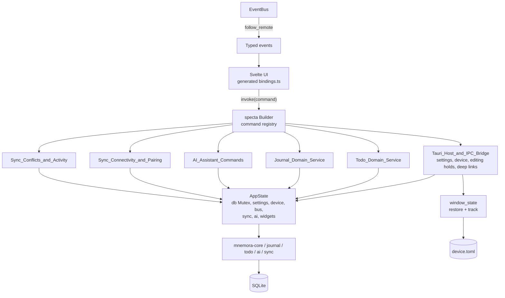
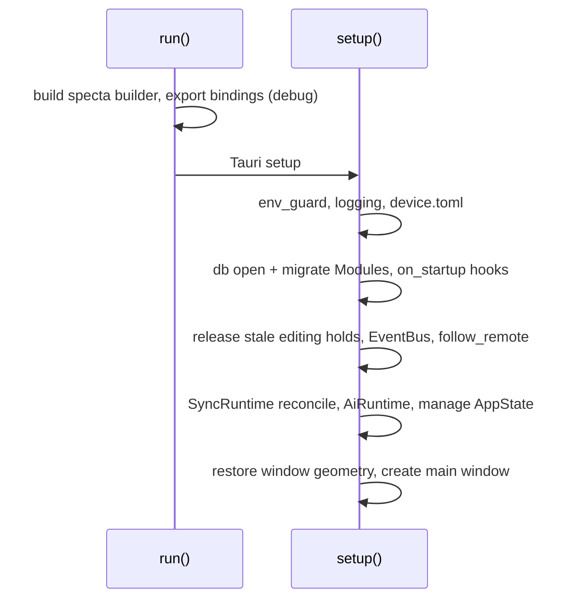

# Tauri_Host_and_Command_Layer

## Purpose

This module is the Rust app shell of Mnemora. It lives in `src-tauri/src` as the `mnemora_lib` crate. It connects the domain crates (`mnemora-core`, `-journal`, `-todo`, `-ai`, `-sync`) to Tauri and does four jobs:

- **Startup.** It runs the startup sequence: the environment guard, logging, database open and migration, and Module startup hooks.
- **Shared state.** It owns `AppState`, which holds the database connection, settings, device store, event bus, sync runtime and AI runtime.
- **Typed IPC.** It exposes a typed command and event surface to the Svelte frontend. TypeScript bindings are generated through `specta`.
- **Domain commands.** It provides thin command layers for Todo, Journal, AI and Sync, plus desktop window-geometry persistence.

The guiding rule is "Logic belongs in core, not here." Each command locks the database, calls one function in a domain crate and returns the result or an `AppError`. The module also holds the integration tests. They drive the real commands through Tauri's mock runtime with `TestApp` and `Cluster`.

## Architecture

### Startup flow

### How the parts relate

- **Host.** [Tauri_Host_and_IPC_Bridge](Tauri_Host_and_Command_Layer/Tauri_Host_and_IPC_Bridge.md) is the foundation. It provides `run`/`setup`, `AppState` and the poison-tolerant `lock` helper. It also provides the `specta_builder_for!` registry and the typed events, and `follow_remote`, which turns `EventBus` messages from Sync into typed events. It owns the cross-cutting commands too: settings, device settings, diagnostics, editing holds and `mnemora://` deep links. Finally, it provides the `TestApp` and `Cluster` test harness.
- **Domain command layers.** Todo, Journal and AI each lock `state.db` and delegate to their crate.
  - Todo routes every write through one `write` helper, which signals the Android widget after a successful change.
  - AI also owns `AiRuntime`. It runs each answer on its own thread and streams `AiRunEvent`s.
- **Sync command layers.** Connectivity and pairing live in one module and conflicts and activity in another. Connectivity and pairing also own the live network and Android power gating. Conflict resolution writes through the owning domain module's own edit functions, so a resolution syncs like any other edit.
- **Desktop window.** `window_state` restores the saved size and position at launch. It debounces writes back to `device.toml`.

## Child module documentation

| Module | Scope | Documentation |
|---|---|---|
| Tauri_Host_and_IPC_Bridge | Startup, `AppState`, command and event registry, settings, editing holds, deep links, test harness | [Tauri_Host_and_IPC_Bridge](Tauri_Host_and_Command_Layer/Tauri_Host_and_IPC_Bridge.md) |
| Todo_Domain_Service | `todo_*` commands, widget signalling, Todo command tests | [Todo_Domain_Service](Tauri_Host_and_Command_Layer/Todo_Domain_Service.md) |
| Journal_Domain_Service | `journal_*` commands: paging, search, soft delete and restore | [Journal_Domain_Service](Tauri_Host_and_Command_Layer/Journal_Domain_Service.md) |
| AI_Assistant_Commands | AI Run lifecycle, steering, Conversations, Providers, Models, Saved questions, `AiRuntime` | [AI_Assistant_Commands](Tauri_Host_and_Command_Layer/AI_Assistant_Commands.md) |
| Sync_Connectivity_and_Pairing | Sync settings, Devices tab, pairing, network lifecycle, Android power gating | [Sync_Connectivity_and_Pairing](Tauri_Host_and_Command_Layer/Sync_Connectivity_and_Pairing.md) |
| Sync_Conflicts_and_Activity | Conflicts, Compare, Activity log, "Use other instead", attention summary | [Sync_Conflicts_and_Activity](Tauri_Host_and_Command_Layer/Sync_Conflicts_and_Activity.md) |
| window_state | Desktop window geometry restore and debounced persistence | [window_state](Tauri_Host_and_Command_Layer/window_state.md) |

## Related modules

- Domain rules: Core_Foundation, Domain_Modules_(Todo_and_Journal), AI_Assistant_Backend and Sync_Replication_Engine.
- Frontend consumers: IPC_Bridge_and_Browser_Mocks and the Todo, Journal, AI and Sync frontend modules.
- Android and Home-Screen Widget platform: receives widget signals and `mnemora://` deep links.
- Backend_Integration_Test_Suites: exercise these commands.