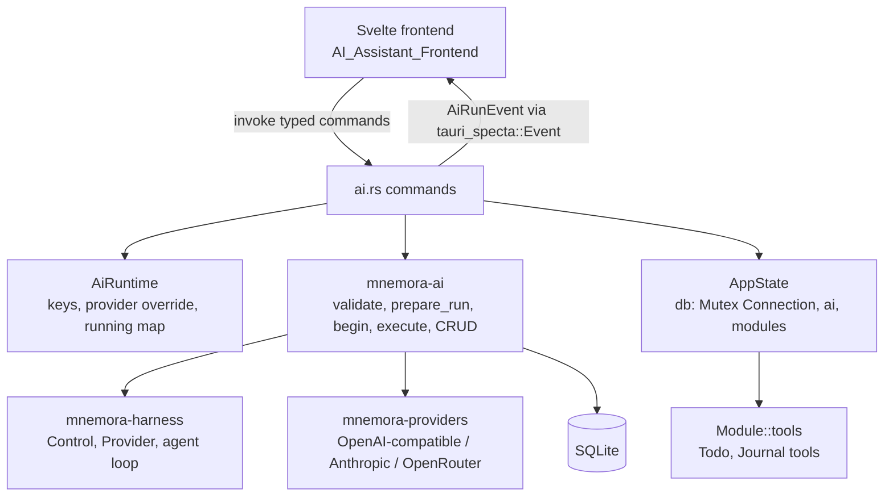
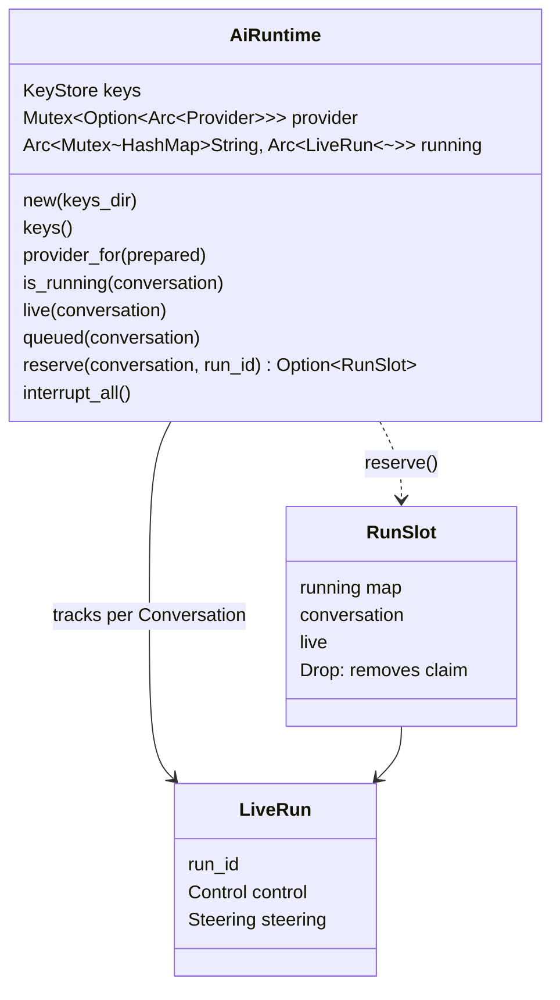
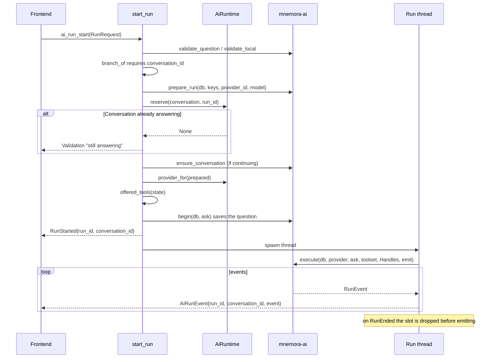
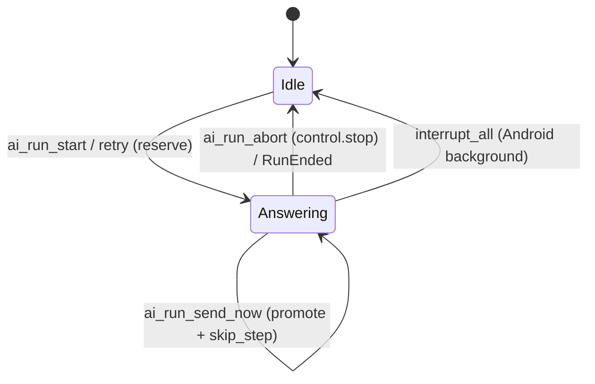

# AI_Assistant_Commands

`src-tauri/src/ai.rs` is the Tauri command surface for the AI assistant. It is deliberately thin: the rules (validation, persistence, prompting, tool execution) live in the `mnemora-ai` crate (see [AI_Module](../AI_Assistant_Backend/AI_Module.md)), the agent loop lives in `mnemora-harness` (see [Agent_Harness](../AI_Assistant_Backend/Agent_Harness.md)), and provider adapters live in `mnemora-providers` (see [LLM_Providers](../AI_Assistant_Backend/LLM_Providers.md)). This module's job is to:

1. Expose typed `#[tauri::command]` / `#[specta::specta]` functions to the frontend (see [AI_Assistant_Frontend](../AI_Assistant_Frontend.md) and [IPC_Bridge_and_Core_Mocks](../IPC_Bridge_and_Browser_Mocks/IPC_Bridge_and_Core_Mocks.md)).
2. Own the in-process runtime state of live Runs (`AiRuntime`, `LiveRun`, `RunSlot`).
3. Run each answer on its own thread and stream progress back as the typed `AiRunEvent`.
4. Keep network calls (connection test, Model search) off the command thread and out of the database lock.

Shared host state (`AppState`, the `lock` helper) is described in [Tauri_Host_and_IPC_Bridge](Tauri_Host_and_IPC_Bridge.md). Behaviour is verified by [AI_Run_Engine_Tests](../Backend_Integration_Test_Suites/AI_Run_Engine_Tests.md) and [AI_Data_and_Provider_Tests](../Backend_Integration_Test_Suites/AI_Data_and_Provider_Tests.md).

## Architecture

### Runtime state

- **`AiRuntime`** holds the device-local `KeyStore` (the config dir's `ai-keys`), an optional test-only `Provider` override, and a map Conversation id → `LiveRun`.
- **`LiveRun`** bundles the Run id, a `Control` (stop / interrupt / skip step) and `Steering` (queue of notes sent mid-run).
- **`RunSlot`** is an RAII claim: `reserve` returns `None` if the Conversation already has a Run, so only one Run answers per Conversation; dropping the slot removes the claim. Different Conversations may answer concurrently.
- `interrupt_all` ends every Run as interrupted; it is used when the app leaves the foreground on Android.

## Command groups

| Group | Commands | Delegates to |
|---|---|---|
| Run lifecycle | `ai_run_start`, `ai_run_retry`, `ai_run_abort` | `validate_question`, `validate_local`, `prepare_run`, `begin`, `execute`, `question_text` |
| Steering | `ai_run_steer`, `ai_run_unqueue`, `ai_run_send_now` | `LiveRun.steering`, `LiveRun.control` |
| Conversations | `ai_conversation_get`, `_list`, `_rename`, `_delete`, `_restore`, `_markdown` | `conversation`, `list_conversations`, `rename_conversation`, `delete_conversation`, `restore_conversation`, `conversation_markdown` |
| Branches | `ai_conversation_set_leaf`, `ai_conversation_show_branch` | `set_leaf`, `show_branch` (device-local, not synced) |
| Providers | `ai_provider_list`, `_create`, `_update`, `_delete`, `_key_set`, `_key_clear`, `_test` | `list_providers`, `create_provider`, `update_provider`, `delete_provider`, `set_key`, `clear_key`, `reachable`, `connection_test` |
| Models | `ai_models_search`, `ai_models_usage` | `matching_models`, `model_usage` |
| Saved questions | `ai_saved_list`, `_create`, `_update`, `_delete`, `_restore`, `_reorder` | `list_saved`, `create_saved`, `update_saved`, `delete_saved`, `restore_saved`, `reorder_saved` |

Most DB-writing commands follow one pattern: take the lock via `lock(&state.db)`, read `physical_now(&conn)` as the timestamp, and call the matching `mnemora_ai` function. Errors are `AppError` with an `ErrorCode`.

## Starting a Run

`start_run` (shared by `ai_run_start` and `ai_run_retry`) is the core of the module.

Key design points:

- **Returns at once.** The question is persisted via `begin` before the command returns, so the Conversation can be read immediately. The answer arrives as `AiRunEvent`s ending in `RunEnded`.
- **Survives navigation.** The Run lives on its own `std::thread`, so leaving the page does not stop it.
- **Claim before check.** The slot is reserved before `ensure_conversation` because a Run's first write happens on its thread, so a new Conversation might not be on disk yet.
- **Slot released before the end event.** The slot is dropped when `RunEnded` is seen, *before* emitting, so a read triggered by that event sees the Conversation as idle.
- **Retry.** `ai_run_retry` loads the old question text via `question_text` and starts a Run with `branch_of = entry_id`, creating a sibling question (the "Try again" pager).
- **Edit / branch.** `RunRequest.branch_of` makes the new question a sibling that follows what the original followed; it needs an existing Conversation.

### Tool offering

`offered_tools` reads the `disabled_modules` and `enabled_optional_modules` core preferences (via `preference_list`), then walks `state.modules`. Modules that `is_enabled` contribute their `tools()`; modules that are off but would have offered tools are named (via `capitalised`) in `off` so the prompt can say so. The result forms a `Toolset { tools, off }`. See [Domain_Modules_(Todo_and_Journal)](../Domain_Modules_(Todo_and_Journal).md) for the tools modules provide.

## Steering and stopping

- `ai_run_steer` validates the note, requires a live Run (else `not_answering`, a Validation error), and queues the trimmed text; the page is told via `QueueChanged`.
- `ai_run_unqueue` returns `NotFound` ("That note was already sent.") if the Run or note is gone.
- `ai_run_send_now` promotes the note and calls `control.skip_step()`: the current Step ends where it is, unrun Tools are skipped, and the note is sent next while the Run continues.
- `ai_run_abort` is a no-op when nothing is answering; otherwise it stops the Run, keeping what was written.
- `announce_queue` emits an `AiRunEvent` carrying `QueueChanged { notes }`.

## Conversations and guards

- `ai_conversation_get` merges the persisted view with runtime state: `running` from `is_running` and `queued` notes from the live Run's steering snapshot.
- `ai_conversation_delete` is refused while a Run is answering there, since the Run would save into a deleted Conversation. Restore has no such guard.
- `ai_conversation_markdown` returns the visible branch, or one answer (without citations) when `entry_id` is given.
- `ai_conversation_list` pages history newest first with a title filter.

## Providers and keys

Keys are write-only: `ai_provider_key_set` returns a `ProviderView` that never carries the key, and keys are stored in the device's `KeyStore`, not the database or sync log. `ai_provider_delete` removes the key with the Provider. Updating the address clears the key (enforced in `mnemora-ai`).

`ai_provider_test` and `ai_models_search` are `async`: they resolve `(record, key)` under the DB lock via `reachable`, release the lock, then run the HTTP work in `tauri::async_runtime::spawn_blocking`. A join failure maps through `join_error` to `ErrorCode::Internal` ("The AI service check stopped.").

## Request types

| Type | Purpose |
|---|---|
| `RunRequest` | question text, optional `conversation_id`, `provider_id`, `model`, `LocalContext` (calendar for the model), optional `branch_of` |
| `RetryRequest` | `conversation_id`, `entry_id`, `provider_id`, `model`, `local` |
| `RunStarted` | `run_id` and `conversation_id` returned to the caller |

All derive `specta::Type` so TypeScript bindings are generated (`make bindings`, see [Build_and_Config](../Build,_Tooling_and_Packaging/Build_and_Config.md)). The event type `AiRunEvent` and `AiChangedEvent` are declared in `lib.rs` (see [Tauri_Host_and_IPC_Bridge](Tauri_Host_and_IPC_Bridge.md)).

## Testing hooks

`AiRuntime::set_provider` (`#[cfg(test)]`) installs a scripted `Provider` that `provider_for` returns instead of building a real adapter. The integration suites listed above use it to drive Runs deterministically.
