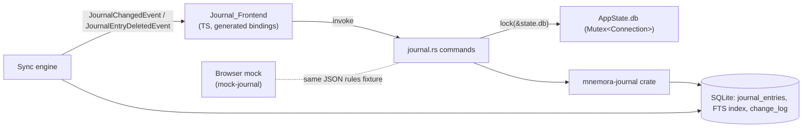
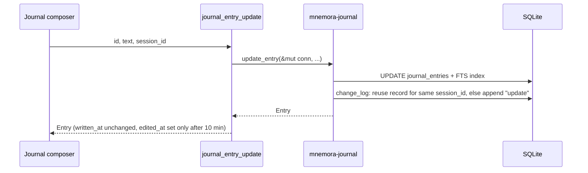

# Journal_Domain_Service

`src-tauri/src/journal.rs` is the Tauri command surface of the Journal module. It is deliberately thin: each of its ten `#[tauri::command]` functions locks the shared database connection, forwards to a function in the `mnemora-journal` crate, and returns the result or an `AppError`. All rules (validation, edited-mark logic, change-log recording, search ranking) live in the crate; see [Journal_Module](../Domain_Modules_(Todo_and_Journal)/Journal_Module.md). The file also holds a large integration-test suite that drives the commands through the real IPC dispatch against a `TestApp`.

Parent: [Tauri_Host_and_Command_Layer](../Tauri_Host_and_Command_Layer.md). Host wiring (state, event emission, command registration) is covered in [Tauri_Host_and_IPC_Bridge](Tauri_Host_and_IPC_Bridge.md).

## Architecture

Key points:
- Every command takes `State<'_, AppState>` and calls `crate::state::lock(&state.db)`. Read-only commands pass `&` and write commands `&mut` to the crate function.
- `#[specta::specta]` makes the signatures part of the generated TypeScript bindings (`make bindings`); registration happens in `src-tauri/src/lib.rs` (names such as `journalEntryCreate` ... `journalToday` appear in the exported list).
- Errors are `mnemora_core::error::AppError`, serialised with a `code` (`validation`, `not_found`, ...) that the frontend and tests match on.

## Commands

| Command | Delegates to | Purpose |
|---|---|---|
| `journal_entry_create(entry: NewEntry)` | `create_entry` | New Entry on a Page; rejects blank text, invalid dates, bad zone/offset (offset beyond ±14 h). |
| `journal_entry_update(id, text, session_id)` | `update_entry` | Replace text; `session_id` groups a composer session's saves into one change-log record. |
| `journal_entry_toggle_task(id, line)` | `toggle_task_line` | Tick/untick the checklist item on 0-based source line; never marks the Entry edited. Each tick is its own `tick` record with no session. |
| `journal_entry_delete(id)` | `delete_entry` | Soft delete (undoable). |
| `journal_entry_restore(id)` | `restore_entry` | Bring a deleted Entry back to its own Page. |
| `journal_entry_move(id, page_date)` | `move_entry` | Change only the Page date (future dates allowed); the written timestamp is untouched. |
| `journal_month_days(year, month)` | `month_days` | Dates with live Entries, for calendar dots. |
| `journal_pages(cursor, limit, direction)` | `list_pages` | Windowed Page listing; `PageDirection` is `older`, `from`, or `newer`. |
| `journal_search(query, from, to)` | `search` | Exact + typo-tolerant ("similar") search with optional date range. |
| `journal_today(today)` | `today` | Entry count and latest-written snippet for the Home card. |

### Paging semantics

Pages are always returned newest first, with Entries inside a Page oldest-written first. The cursor is a Page date:

- `older` – strictly before the cursor (continuation of the previous request's last Page); no cursor means the newest Pages.
- `from` – starts *at* the cursor (jump to a date); a date with no Page starts at the next older one.
- `newer` – the nearest Pages above the cursor (scrolling up after a jump); requires a cursor, otherwise `validation`.

A result shorter than `limit` means that end was reached. Chained `newer`/`from`/`older` windows tile the journal without gaps or overlap.

### Search semantics

Every word is required and prefix-matched; quoted text is an exact phrase (no prefix inside quotes); case and accents are ignored. FTS syntax in the query is plain text and never errors. `similar` holds typo-tolerant matches that are never repeated from `exact` (1 typo for 4–7 letter words, 2 for 8+, none for shorter; phrases stay exact), capped at 100 with `similar_truncated`. With a range and no words, every Entry in the range is listed. Snippets are plain-text spans with `matched` flags (markdown markers and link URLs are stripped). Deleted Entries never appear and return on restore.

## Data flow: writing an Entry

Behaviours pinned down by the tests:
- A create plus further updates in the same session leave one `create` record whose snapshot holds the latest state; a new session appends an `update` record.
- Updates within 10 minutes of `written_at` are not edits (`edited_at` stays null); later ones set `edited_at == updated_at` and move forward with each save.
- Delete and restore both bump `updated_at` and log `delete` / `restore` with snapshots carrying `deleted_at`. Operations on a deleted or unknown Entry return `not_found`; restoring a live Entry is also `not_found`.
- Move to the same date logs nothing; edits, moves and ticks keep the search index current.
- Entries deleted over 30 days ago survive a restart (startup hook) with their history, and Undo still works.

## Tests

The `tests` module uses `crate::test_support::TestApp` (`invoke`, `with_db`, `run_startup`) so commands run through the same dispatch as production. Coverage areas: validation, ordering, paging directions, counts, session/change-log behaviour, edited-mark rules, task toggling, soft delete/restore, month days, search (case/accent, prefix, phrases, ranges, typos, truncation, snippets, hostile input), Home summary, and the `journal.font` / `journal.width` / `journal.page_summary` preferences via `settings_save`/`settings_get_all`.

`the_shared_rule_fixtures_hold` loads `src/lib/ipc/fixtures/journal-rules.json` (ADR 0009) and replays each case against the real commands, comparing a normalised shape (seed indexes instead of ids/timestamps). The same file runs against the browser mock in `src/lib/ipc/mock-journal.test.ts`, keeping the mock and backend in step; see [IPC_Bridge_and_Core_Mocks](../IPC_Bridge_and_Browser_Mocks/IPC_Bridge_and_Core_Mocks.md).

## Relationships

- Rules and storage: [Journal_Module](../Domain_Modules_(Todo_and_Journal)/Journal_Module.md).
- Consumers: [Journal_Frontend](../Journal_Frontend.md), [Journal_Composer_and_Entry_Editing](../Journal_Frontend/Journal_Composer_and_Entry_Editing.md), [Journal_Search](../Journal_Frontend/Journal_Search.md).
- Remote changes: when sync applies Journal records, the host emits `JournalChangedEvent` (and `JournalEntryDeletedEvent` for deletions of open entries); see [Sync_Replication_Engine](../Sync_Replication_Engine.md) and sync tests in `sync_journal_tests.rs`.
- Sibling command layers: [Todo_Domain_Service](Todo_Domain_Service.md), [AI_Assistant_Commands](AI_Assistant_Commands.md).
