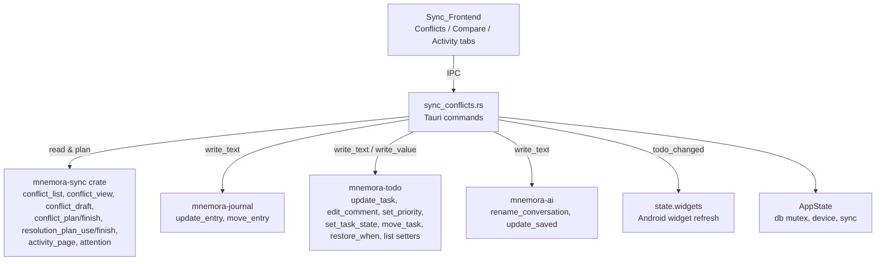
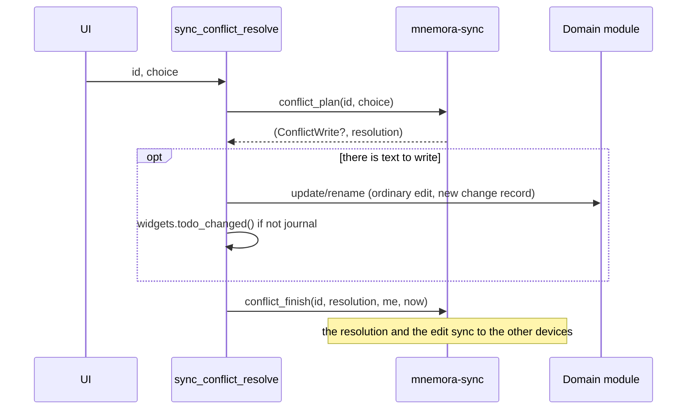

# Sync_Conflicts_and_Activity

## Purpose

This module is the Tauri command surface for the Sync **Conflicts** and **Activity** screens. It lives in `src-tauri/src/sync_conflicts.rs`. The commands are thin. The rules for detecting, merging, logging and paging are in the `mnemora-sync` crate (see [Sync_Conflicts_and_Resolutions](../Sync_Replication_Engine/Sync_Conflicts_and_Resolutions.md) and [Sync_Activity_and_Devices](../Sync_Replication_Engine/Sync_Activity_and_Devices.md)).

The module does three things:

1. It exposes read commands: the Conflicts tab, Compare, the Activity log and the "attention" summary.
2. It settles a Conflict or a "Use other instead" request. It does this by writing the chosen text or value through the **owning domain module's own edit function**, so that:
   - the write is validated,
   - it is recorded as an ordinary change,
   - it syncs like any other edit.
3. It holds the behavioural test suites for conflicts, auto-resolutions and the activity log. These run on a multi-device `Cluster` in `test_support`.

## Architecture

## Commands

| Command | Role |
|---|---|
| `sync_conflicts` | Returns the `ConflictList`: "Needs you" (open conflicts) and "Resolved automatically". |
| `sync_conflict` | Returns one `ConflictView` for Compare, or `None` if the id is unknown. |
| `sync_conflict_draft` | Builds the starting text for "Edit merged" from the agreed parts and a `ClashChoice` per clash. A clash with no choice takes the showing version. |
| `sync_conflict_resolve` | Settles a conflict with `keep_this`, `keep_other` or `merged`. |
| `sync_activity` | Returns one `ActivityPage` of the log, newest first. It takes a filter, a cursor and a limit. |
| `sync_attention` | Returns the `Attention` summary that the Home card, sidebar badge and palette hint read. |
| `sync_resolution_use_other` | "Use ‹other› instead" for an automatically resolved value. |
| `sync_resolutions_visited` | Marks the "Resolved automatically" rows as seen, so they stop showing as new. |

All commands take a `State<AppState>`. They lock `state.db` through `crate::state::lock`. They name the device using `state.device` (`my_name` falls back to `default_device_name`).

### Resolve flow

`sync_conflict_resolve` calls `conflict_plan` to get an optional `ConflictWrite` and a resolution. If there is a write, `write_text` dispatches on `entity`:

| Entity | Domain call |
|---|---|
| `journal_entry` | `mnemora_journal::update_entry`, as a new editing session |
| `todo_task` | `mnemora_todo::update_task`; the `notes` or `title` field is replaced and the other is kept |
| `todo_comment` | `edit_comment` |
| `ai_conversation` | `rename_conversation` |
| `ai_saved_question` | `update_saved` |

Any other entity returns `ErrorCode::Internal`. Non-journal entities also call `widgets.todo_changed()`. Then `conflict_finish` records the resolution under this device's id, so the Conflict reads resolved on every device.

### "Use other instead"

`sync_resolution_use_other` gets a `UsePlan` from `resolution_plan_use`. `write_value` then replays the replaced value through the owning module, dispatching on `(entity, unit)`:

- `todo_task`:
  - `priority`: `set_priority`.
  - `state`: `set_task_state`.
  - `list_id`: `move_task`.
  - `when`: `restore_when`, with a `DueChange` that rebuilds the whole date, time and `RepeatRule` group.
- `todo_list`:
  - `name`: `rename_list`.
  - `emoji`: `set_list_emoji`.
  - `task_sort`: `set_list_sort`.
  - `group_by`: `set_list_group`.
- `journal_entry`:
  - `page_date`: `move_entry`.

Anything else, or an unparsable value, returns a `Validation` error. `resolution_finish_use` then marks the row used on every device. A row cannot be used twice, and a repeating task's status cannot be reverted.

## Test suites

All three suites drive real commands and assert only through commands (ADR 0009). They use `Cluster::new(n)` with controllable clocks and `c.sync(a, b)` exchanges.

- **`sync_conflicts_tests.rs`: text merge and Conflicts.**
  - Edits to different words or lines merge silently and identically on every device.
  - Overlapping edits raise exactly one Conflict, which is the same on every device. The newest text shows.
  - Compare marks the differing words and shows the original. The draft supports `showing`, `other` and `both` choices, and edits made after the conflict was raised are kept.
  - Resolving on one device clears it on all of them. The resolution travels as an ordinary edit.
  - Task title and notes merge and clash independently. Comment bodies merge three-way and keep the "edited" mark.
  - Convergence holds across three devices in any sync order.
  - Edits made under `editing_hold` are merged when the editor is released.
  - Rewritten editing sessions are replayed correctly.
  - A conflict on an entry that is later deleted resolves as `deleted` without asking.
- **`sync_resolutions_tests.rs`: "Resolved automatically".**
  - A value clash (priority, status, due-date and repeat group) decided newest-wins is logged once, with the same row id everywhere. Detail strings follow the date and time format preferences.
  - Non-clashes are not logged: sequential changes, equal values, double delete and double complete.
  - Delete-versus-edit, a task moved into a list that was deleted elsewhere, and a text clash on a deleted entry each produce one row.
  - Order and preference changes fold into one line per sync session.
  - `fresh` rows clear on `sync_resolutions_visited`.
  - `sync_attention` follows the waiting conflicts.
  - The new-conflict toast fires only on a device with `toast_conflicts` set.
- **`sync_activity_tests.rs`: Activity log.**
  - Each session is logged once, with counts that read the right way round for each end and a breakdown that adds up and contains no content.
  - A sync that moved nothing is not logged.
  - Conflict raised/resolved, list-merge, rename, forget, leave, pause, resume, failed and local-network-blocked events are each one attributed line. Other devices read them with "· on <name>".
  - Repeated pauses and failures are de-duplicated.
  - A 450-row log pages newest first without gaps or repeats, filters by device or "this device", and clamps the page limit to between 1 and the limit.

## Related modules

- [Sync_Conflicts_and_Resolutions](../Sync_Replication_Engine/Sync_Conflicts_and_Resolutions.md): detection, `Resolution`, and the plan and finish logic.
- [Sync_Activity_and_Devices](../Sync_Replication_Engine/Sync_Activity_and_Devices.md): activity logging and paging.
- [Sync_Activity_Conflicts_and_Status](../Sync_Frontend/Sync_Activity_Conflicts_and_Status.md): the screens that call these commands.
- [Tauri_Host_and_IPC_Bridge](Tauri_Host_and_IPC_Bridge.md): the `AppState`, the lock helper and event registration.
- [Sync_Connectivity_and_Pairing](Sync_Connectivity_and_Pairing.md): sibling sync commands.
- [Journal_Module](../Domain_Modules_(Todo_and_Journal)/Journal_Module.md), [Todo_Tasks_and_Lists](../Domain_Modules_(Todo_and_Journal)/Todo_Tasks_and_Lists.md) and [AI_Module](../AI_Assistant_Backend/AI_Module.md): the modules that perform the actual writes.
