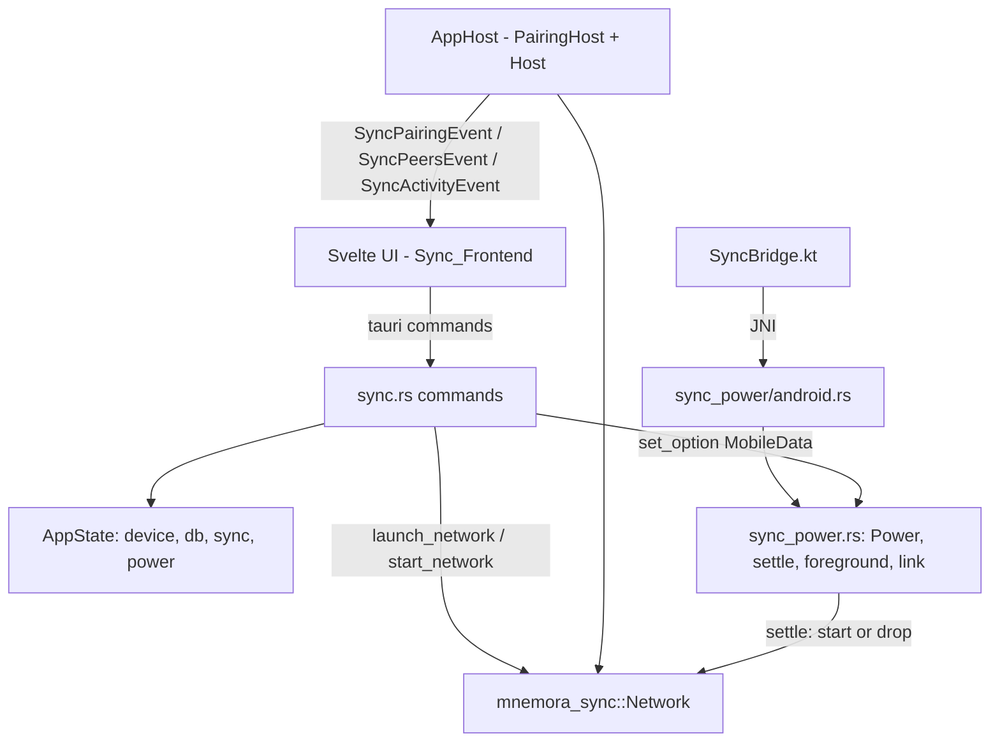
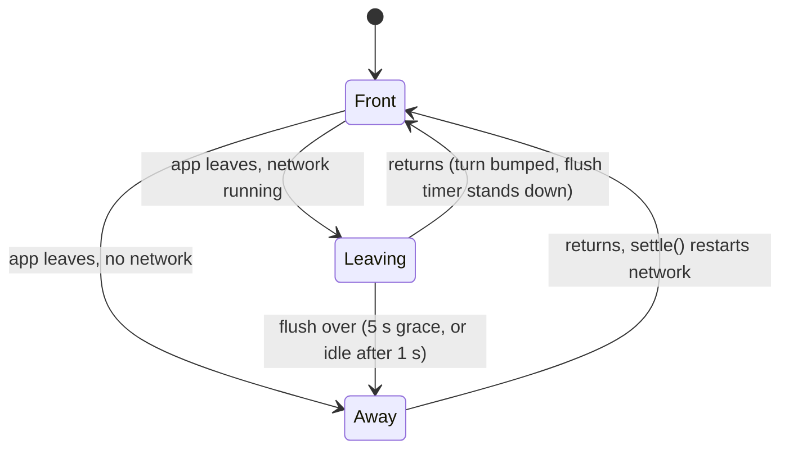
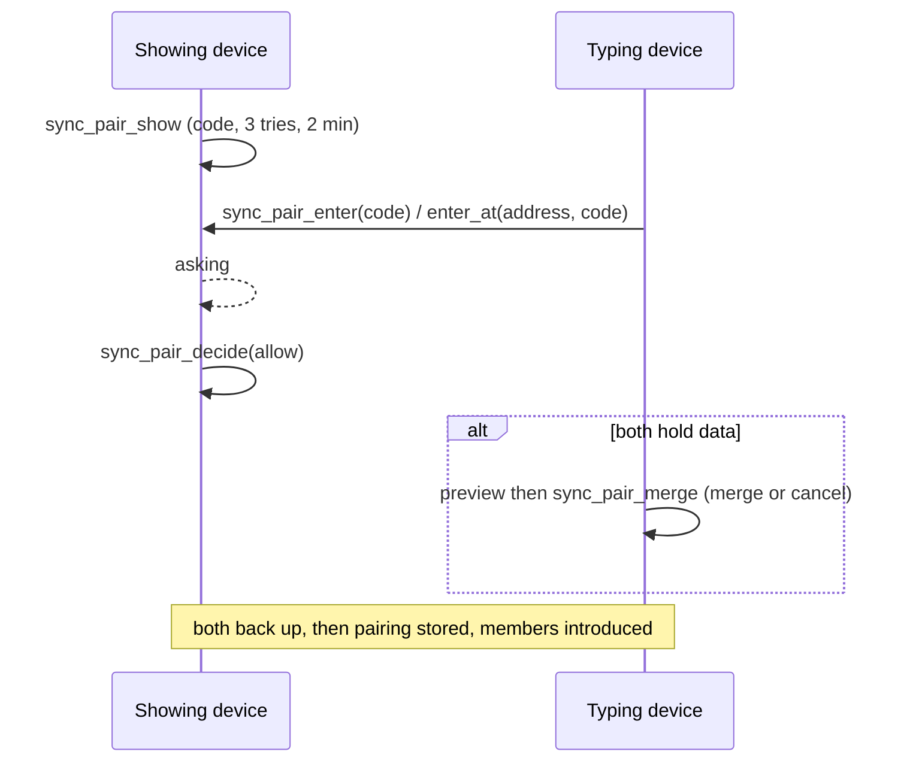

# Sync_Connectivity_and_Pairing

The Tauri-side layer of Sync. It exposes the Sync commands the UI calls, hosts the live network owned by the `mnemora-sync` crate, and decides when that network may run on Android. The rules (merge, wire format, pairing protocol) live in [Sync_Replication_Engine](../Sync_Replication_Engine.md); this module is deliberately thin.

Files: `src-tauri/src/sync.rs`, `sync_power.rs`, `sync_power/android.rs`, plus the integration test suites (`sync_power_tests`, `sync_pairing_tests`, `sync_merge_preview_tests`, `sync_forget_tests`, `sync_address_tests`, `sync_groups_tests`, `sync_live_tests`, `sync_pause_tests`).

Related pages: [Sync_Conflicts_and_Activity](Sync_Conflicts_and_Activity.md) (conflict/activity commands), [Tauri_Host_and_IPC_Bridge](Tauri_Host_and_IPC_Bridge.md) (app state, events), [Sync_Frontend](../Sync_Frontend.md) (the UI that calls these commands), [Sync_Networking_and_Live](../Sync_Replication_Engine/Sync_Networking_and_Live.md) and [Sync_Pairing](../Sync_Replication_Engine/Sync_Pairing.md) (engine internals).

## Architecture

## Components

### Commands (`sync.rs`)
- **Settings / identity:** `sync_get`, `sync_set_enabled` (device-only switch; turning on calls `launch_network`), `sync_set_option` (Automatic, MobileData, Visible, ToastConflicts), `sync_rename` (1–40 chars, unique in the group; logs and syncs the rename).
- **Devices tab:** `sync_devices`, `sync_device` (sheet; maps NotNearby to `PausedOnMobileData` or `BlockedByLocalNetwork`), `sync_device_rename`, `sync_device_address`, `sync_device_check` (dials a typed address and reports who answered), `sync_device_sync_now`, `sync_device_forget` (signed revocation, group-wide), `sync_leave` (tells connected members for up to 3 s, then forgets all; data is kept), `sync_now`, `sync_resume`.
- **Local network:** `sync_local_network_os` (Android denial, ignored while Sync is off), `sync_open_local_network_settings` (macOS: tries the Local Network pane, falls back to Privacy & Security).
- **Pairing:** `sync_pair_state/show/new_code/enter/enter_at/decide/merge/cancel`. They go through `pairing()`, which refuses with `PausedOnMobileData` when mobile data is the only reason nothing runs.

### `AppHost`
Implements `PairingHost` and `Host` for the engine. It supplies this device's `Who`/handshake, pinned keys, stores a pairing (`store_paired`, lifts revocations, introduces members signed by this device), computes holdings for the merge preview (after a backfill), takes the pre-merge backup, and emits events. Sync gets its own DB connection (`own_db`) so a big sync never blocks commands; tests use the app's single connection.

### Network lifecycle
`launch_network` (spawned async: mDNS discovery, falling back to `Fixed` if unavailable) → `start_network` (loads or creates the `DeviceIdentity` on a blocking thread, `Network::start`, `attach`). If Sync was switched off meanwhile, the network is dropped, closing its port.

### Power gating (`sync_power.rs`, `android.rs`)
`should_run(Conditions)` = enabled ∧ screen ≠ Away ∧ (link ≠ Mobile ∨ mobile_data allowed).

`foreground()` and `link()` are entered from JNI (`Java_com_hemang_mnemora_SyncBridge_nativeForeground/nativeLink`) because the WebView may be suspended. `Early` stores reports made before Tauri setup; `register_app` replays them. Leaving also interrupts AI runs. `settle()` starts or drops the network to match conditions; `paused_on_mobile_data` feeds the Devices tab. Desktop never receives lifecycle events, so it stays "Front".

## Pairing flow

Cancel at any stage tells the other device and changes nothing.

## Tests
Integration tests run two or more `TestApp`s over real loopback sockets (or in-memory `Cluster`s). Coverage:
- `sync_pairing_tests`: pairing, wrong codes, by-address and IPv6, network exists only while Sync is on.
- `sync_merge_preview_tests`: preview counts, backups, cancel paths.
- `sync_forget_tests`, `sync_groups_tests`: forget/leave, rename, address check, 3–4 device groups and introductions.
- `sync_address_tests`: group-shared typed addresses.
- `sync_live_tests`: connect, quiet-period debounce, widget refresh once per session, off/on cycles, local-network blocking.
- `sync_pause_tests`: data-version and clock (>5 min ahead) pauses with automatic resume.
- `sync_power_tests`: flush on leave, mobile-data rules, rapid leave/return.
