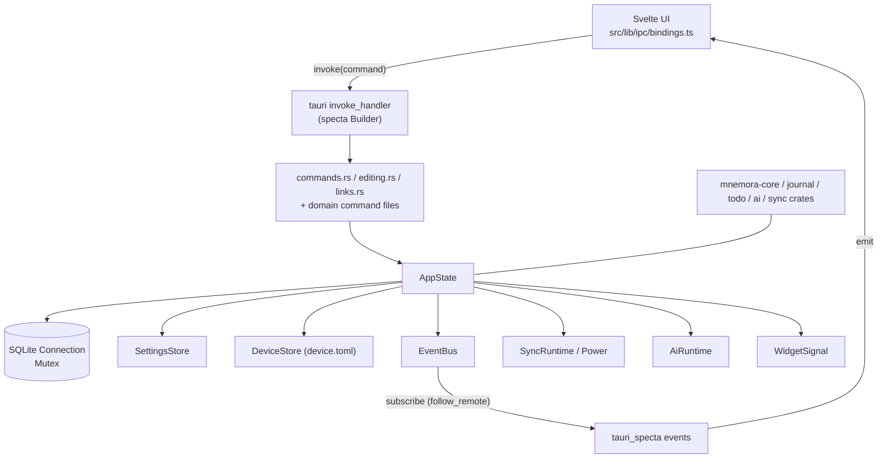
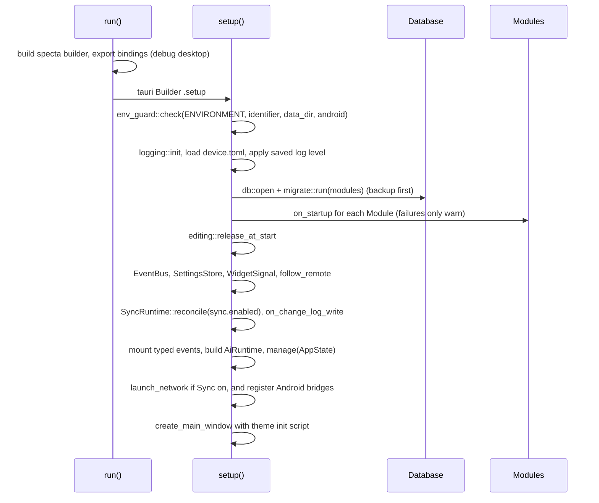
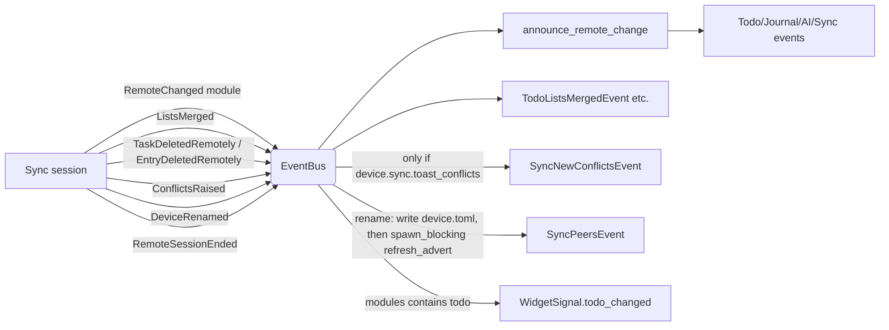
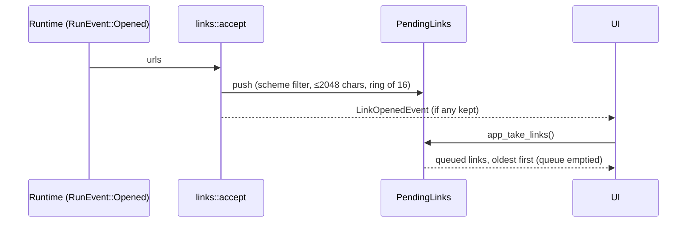
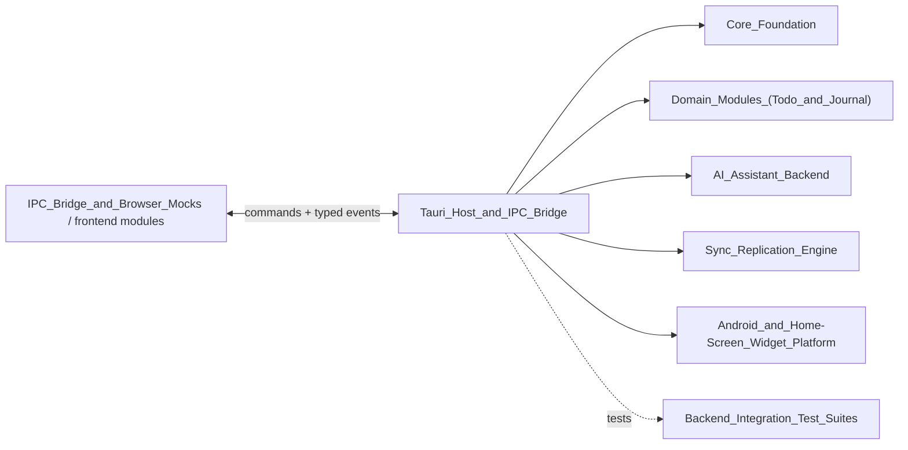

# Tauri Host and IPC Bridge

The `src-tauri` crate (library `mnemora_lib`) is Mnemora's app shell. It wires the domain crates (`mnemora-core`, `-journal`, `-todo`, `-ai`, `-sync`) into Tauri. It owns four things:

- the startup sequence;
- the shared `AppState`;
- the typed command and event surface exported to TypeScript;
- a small set of cross-cutting commands (settings, device settings, diagnostics, editing holds, deep links).

The guiding rule, stated in `lib.rs`, is "Logic belongs in core, not here." Commands are thin: they validate only what core does not, then delegate.

Domain command groups live in sibling pages:

- [Todo_Domain_Service](Todo_Domain_Service.md)
- [Journal_Domain_Service](Journal_Domain_Service.md)
- [AI_Assistant_Commands](AI_Assistant_Commands.md)
- [Sync_Connectivity_and_Pairing](Sync_Connectivity_and_Pairing.md)
- [Sync_Conflicts_and_Activity](Sync_Conflicts_and_Activity.md)
- [window_state](window_state.md)

This page covers the host itself.

## Files in this module

| File | Role |
|---|---|
| `main.rs` | Desktop entry point; calls `mnemora_lib::run()`. |
| `lib.rs` | `run`, `setup`, the `specta_builder_for!` command/event registry, typed events, remote-change fan-out. |
| `state.rs` | `AppState` and the poison-tolerant `lock` helper. |
| `commands.rs` | Settings, device settings, app info, UI error log, backup, open log folder. |
| `editing.rs` | `editing_hold` / `editing_release` and held-change settlement. |
| `links.rs` | `PendingLinks` queue and `app_take_links` for `mnemora://` deep links. |
| `env_guard.rs` | Refuses to start when the build Environment and the running app disagree. |
| `test_support.rs` | `TestApp` and `Cluster` harness that drive the real commands through Tauri's mock runtime. |
| `legacy_db_tests.rs` | Upgrade test against a previous-release database. |

## Architecture

The frontend side of this boundary is described in [IPC_Bridge_and_Browser_Mocks](../IPC_Bridge_and_Browser_Mocks.md). The Rust command surface is exported to `src/lib/ipc/bindings.ts`. In debug desktop builds `run()` regenerates that file on every start. The ignored test `regenerate_bindings` (`make bindings`) does the same without launching the GUI.

## Startup sequence (`setup`)

Key points:

- **Environment is compile-time.** `ENVIRONMENT` is `Sandbox` when the `sandbox` feature is set, otherwise `Production`. There is deliberately no runtime switch that could mix data sets.
- **`env_guard::check`** compares the Tauri config identifier with the build's expected identifier. On Android the Tauri CLI forces the identifier to match the Kotlin package, so Sandbox is distinguished by the package name in `data_dir`. The check uses a trailing-slash match so the Production package does not match inside the Sandbox path. A mismatch aborts startup.
- **Logging is initialised before anything else** so a corrupt `device.toml` is recorded. `run()` falls back to stderr when setup fails before tracing exists.
- **Modules** are registered in one place, `modules()`, in migration order: Core, Journal, Todo, AI, Sync. A failing `on_startup` does not stop the app.
- **Editing holds** from a previous run are released at start (`release_at_start`), because their editors died with it.
- **The first paint** reads look-and-feel from the device file alone (`settings.device_values()`), so it never waits on the database. The values are injected by `theme_inject::script`.
- **`PendingLinks` is managed in `run()`, not `setup`**, because a link can arrive before setup finishes.
- Sync starts only when the device has it on. Otherwise nothing is started.

## Shared state (`state.rs`)

`AppState` holds everything commands need:

- `env` and `paths`;
- `db: Mutex<Connection>`;
- `settings: SettingsStore` and `device: Arc<DeviceStore>`;
- `log: LogHandle`;
- `widgets: Arc<WidgetSignal>`;
- `sync: SyncRuntime` and `power`;
- `live_network`;
- `modules: Modules` and `bus: EventBus`;
- `ai: AiRuntime`.

`lock()` recovers a poisoned mutex via `PoisonError::into_inner`, so one panicking thread cannot brick every command for the rest of the session. Every command goes through it.

`live_network` is `true` in the app and `false` in tests, which start their own loopback network.

## Command registry and typed events

`specta_builder_for!($runtime)` is a macro rather than a function. `#[specta::specta]` cannot see a generic runtime parameter of an outer function. The app instantiates it with `tauri::Wry` and the tests with `MockRuntime`. The same macro supplies both the invoke handler and the exported TypeScript. Generic commands are registered with a turbofish, for example `commands::open_log_dir::<$runtime>`.

Typed events registered:

| Event | Meaning |
|---|---|
| `SettingsChangedEvent` | Mirrors core's `SettingsChanged`. |
| `TodoChangedEvent`, `JournalChangedEvent`, `AiChangedEvent` | A remote sync (or the widget) changed that Module's data, so refresh silently. |
| `TodoListsMergedEvent`, `TodoTaskDeletedEvent`, `JournalEntryDeletedEvent` | Remote merge or delete of something possibly open in the UI. |
| `SyncPairingEvent`, `SyncPeersEvent`, `SyncConflictsEvent`, `SyncActivityEvent`, `SyncNewConflictsEvent` | Sync UI state. |
| `AiRunEvent` | One step of an AI run with its run and conversation ids. |
| `LinkOpenedEvent` | A deep link is waiting in the queue. |

### Remote-change fan-out (`follow_remote`)

Core and Sync publish on an in-process `EventBus`. `follow_remote` subscribes handlers that translate those into typed IPC events.

Design notes:

- The widget redraws once per sync session (`RemoteSessionEnded`), not per batch, so a large sync does not flood it.
- A remote rename writes the device file before the session continues. Re-advertising happens off-thread because it needs the database lock the session holds. The window is told before and after.
- New-conflict toasts are suppressed unless the device is set to "Show a toast".

## Cross-cutting commands (`commands.rs`)

| Command | Behaviour |
|---|---|
| `settings_get_all` | `SettingsSnapshot` (values plus schema defaults) via `SettingsStore::get_all`. |
| `settings_save` | Atomic batch via `save_batch`. Emits `SettingsChangedEvent`. Errors use `AppError` codes such as `validation` and `unknown_key`. |
| `device_get` | Device-only settings from `device.toml`. |
| `device_set_sidebar` | Width clamped to 200–360 px, plus the rail flag. |
| `device_set_todo_open` | Remembers the Todo fold state in the sidebar. |
| `device_set_log_level` | Validates with `normalize_level`, applies live, and persists. |
| `device_set_spellcheck` | Per-device editor spellcheck. |
| `app_info` | Version, environment, data and log dirs, and the OS first name. |
| `log_ui_error` | Forwards a frontend error to the log (target `ui`), truncated to 8,000 characters each for message and stack. |
| `backup_now` | `db::backup::backup_now`, returns the path. |
| `open_log_dir` | Opens the log folder through `tauri_plugin_opener`. |

Details worth knowing:

- Look-and-feel keys (theme, density, text size, reduce motion, phone tabs) are stored in the device file and not in the database. They are never Preferences, so they do not sync. The tests assert zero `settings` and `change_log` rows for them.
- Other Preferences write a `setting` record into the change log, so they sync.
- `os_first_name` returns an empty string on mobile and for placeholder names ("anonymous", "unknown"). The UI then shows a plain greeting.

## Editing holds (`editing.rs`)

An open Journal entry editor or Task sheet field tells Rust what it is editing. Changes from other devices for that unit wait until the editor is done. The rules live in `mnemora_core::editing` and `mnemora_sync`.

- `editing_hold(entity, entity_id, scope)` validates the entity, scope (a field, a group, or `*` for the whole record) and id length (max 64) against the sync `Registry`. It returns `false` and writes nothing when Sync is off. The editor should renew about every 30 seconds. The hold lapses after two minutes, so a vanished editor cannot block changes forever.
- `editing_release` ends the hold and, in one transaction, calls `settle` (`mnemora_sync::release_held`). It then publishes `RemoteChanged` for each affected Module through `announce`, so screens refresh.
- `release_lapsed` runs when the app returns to the foreground. `release_at_start` runs at boot.

Frontend counterpart: `EditingHold` in [App_Bootstrap_and_Platform_Utilities](../Frontend_Platform_and_Shell/App_Bootstrap_and_Platform_Utilities.md). Behavioural tests: `sync_journal_tests` (see [Sync_Replication_Engine](../Sync_Replication_Engine.md)).

## Deep links (`links.rs`)

The Android runtime reports `mnemora://…` URLs (from Todo widget taps) as "opened URL" events. On a cold start these can arrive before setup is done and before the UI is listening. The flow:

The event carries no payload. Draining is the only way to read a link, so a link is never handled twice. A hostile intent cannot fill memory because of the scheme, length and count caps. The UI side is `startAppLinkBridge` in [Shell_and_Navigation](../Frontend_Platform_and_Shell/Shell_and_Navigation.md). The widget side is in [widget_bridge](../Android_and_Home-Screen_Widget_Platform/widget_bridge.md).

## Test harness (`test_support.rs`)

- **`TestApp`** builds a real `AppState` on an in-memory database migrated with every Module. It runs the Module startup hooks, mounts the full command registry on `MockRuntime`, and exposes:
  - `invoke(cmd, json)`, which goes through Tauri's IPC and returns the deserialised result or the serialised `AppError`;
  - `with_db`, `restart`, `set_pref`, `handle`, `widget_signals`, and `clock`.
  - Constructors: `new`, `syncing`, `upgrading(seed, device)` and `legacy(old, device)`.
- **`TestClock`** can be frozen, advanced or skewed, so tests can simulate devices with different clocks. It is installed with `db::set_time_source`.
- **`Cluster`** is several syncing `TestApp`s with clocks frozen at `START`, synced pairwise over the sync crate's in-memory transport (`try_sync` with an optional `cut_after`, `sync`, `sync_all`). The test suites that use it are described in [Sync_Replication_Engine](../Sync_Replication_Engine.md).
- Helpers such as `tasks_of`, `overdue_of`, `inbox_tasks_of` and `close_all_on` flatten grouped Todo views and pin closed times.

`legacy_db_tests.rs` builds a previous-release database by running each Module's own migrations only up to the old version (core 2, journal 2, todo 4). That way the old schema cannot drift from the real history. It then boots the app and checks that:

- all migrations apply, with integrity and foreign-key checks passing;
- change-log rows survive and get a stable order (`origin_device`, HLC, `seq`);
- comments edited before the upgrade still read as edited;
- look preferences move to the device file;
- Sync tables are empty and nothing is running until Sync is turned on;
- the screens still read old data.

## How it fits into the system

Build and packaging, including the `sandbox` feature, `src-tauri/build.rs` and `make bindings`, are covered in [Build_and_Packaging](../Build,_Tooling_and_Packaging/Build_and_Packaging.md).

## Extension guidance

- **Add a command.** Write it in the right domain file with `#[tauri::command]` and `#[specta::specta]`. Add it to `collect_commands!` in `specta_builder_for!`, run `make bindings`, and add a frontend mock for browser mode. Keep the logic in the domain crate.
- **Add an event.** Derive `Event` and `Type`, add it to `collect_events!`, and emit it from a bus subscriber in `follow_remote` (or from the relevant command).
- **Add a Module.** Register it in `modules()`, and add its change event to `announce_remote_change` if Sync can change its data.
- **Lock discipline.** Hold the database lock only briefly. `follow_remote` shows the pattern of moving slow work to `spawn_blocking` when a session already holds the lock.
