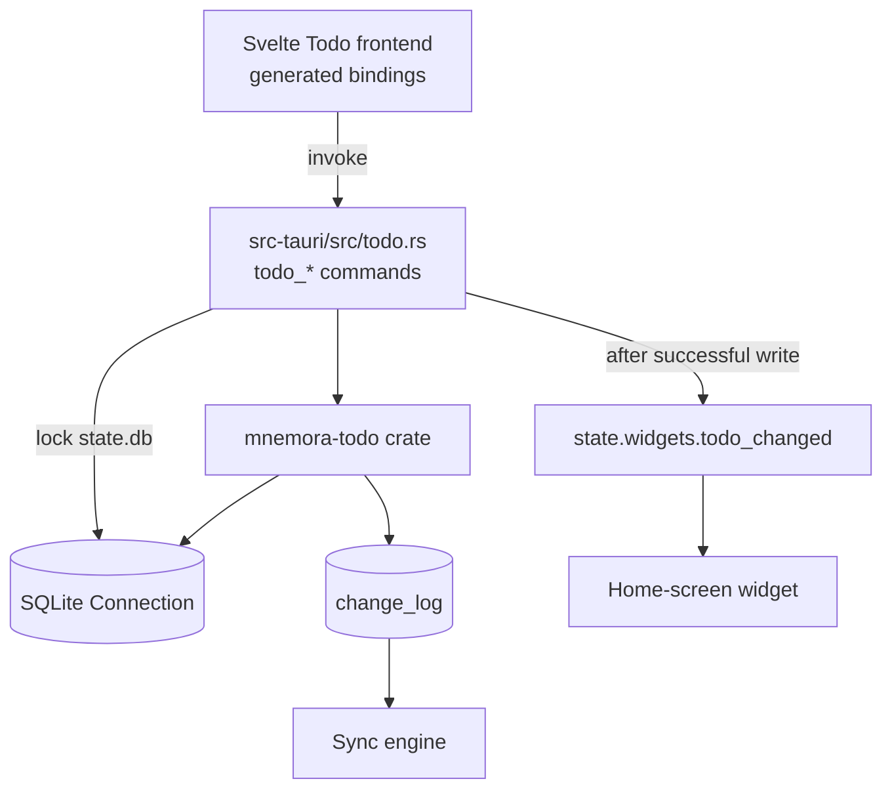
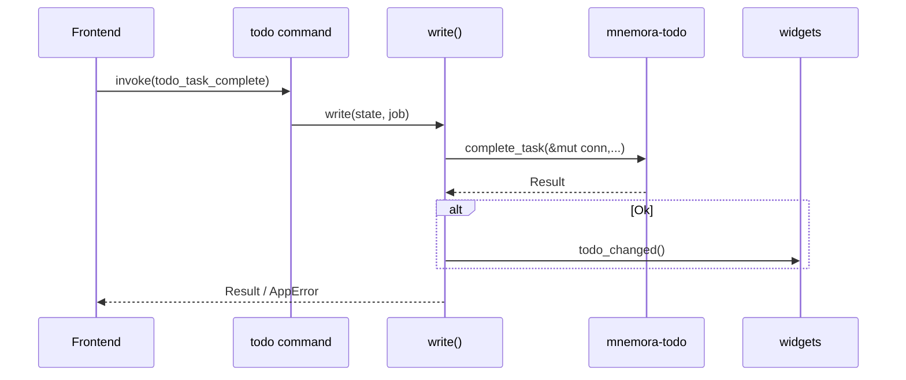
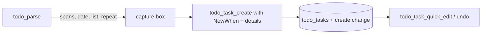

# Todo_Domain_Service

`src-tauri/src/todo.rs` is the Tauri command layer for Todo. It is deliberately thin: each `#[tauri::command]` locks the shared database connection, calls one function in the `mnemora-todo` crate, and returns the result as a typed `AppError`/DTO. All rules (validation, repeats, ordering, change-log records) live in the domain crate. See [Todo_Tasks_and_Lists](../Domain_Modules_(Todo_and_Journal)/Todo_Tasks_and_Lists.md), [Todo_Comments](../Domain_Modules_(Todo_and_Journal)/Todo_Comments.md) and [Todo_Widget](../Domain_Modules_(Todo_and_Journal)/Todo_Widget.md).

The module also owns the command-level integration tests (`todo_capture_tests.rs`, `todo_order_tests.rs`, `todo_search_tests.rs`, plus the tests inside `todo.rs`). They drive the real commands through the mock runtime (`TestApp`, ADR 0009) and share JSON fixtures with the browser mock (see [IPC_Todo_Mocks](../IPC_Bridge_and_Browser_Mocks/IPC_Todo_Mocks.md)).

## Architecture



Related: [Tauri_Host_and_IPC_Bridge](Tauri_Host_and_IPC_Bridge.md) (`AppState`, `lock`, events such as `TodoChangedEvent`), [Todo_Frontend](../Todo_Frontend.md), [Android widget platform](../Android_and_Home-Screen_Widget_Platform.md), [Sync_Replication_Engine](../Sync_Replication_Engine.md).

## The `write` helper

Every command that mutates Tasks or Lists goes through one private function:

```rust
fn write<T>(state: &AppState, job: impl FnOnce(&mut Connection) -> Result<T, AppError>)
```

It runs the job under the DB lock and, only when it returned `Ok`, calls `state.widgets.todo_changed()` so the widget redraws. Centralising this means a new write command cannot forget the widget. Comment commands and Settings do **not** use it (they do not change what the widget draws); read commands never signal. Tests in `widget_tests.rs` ([widget_tests](../Android_and_Home-Screen_Widget_Platform/widget_tests.md)) assert this signalling.



## Command catalogue

Read commands take a `LocalNow` (`today`, `now`, `offset_min`) because "today" is the device's day, not the server's. A malformed clock is a `validation` error.

| Area | Commands | Notes |
|---|---|---|
| Views | `todo_inbox`, `todo_today`, `todo_upcoming`, `todo_all`, `todo_list`, `todo_lists` (sidebar), `todo_counts` (badge/Home card), `todo_done` (paged by day with a cursor), `todo_day_counts` (dots in the When picker) | Grouping and sort follow Preferences; invalid saved values fall back to defaults |
| Task create/read | `todo_task_create`, `todo_task`, `todo_task_history`, `todo_search` | Create accepts `NewWhen` and `NewTaskDetails` (notes, priority, repeat, understood words) |
| Capture | `todo_parse`, `todo_task_quick_edit`, `todo_task_quick_edit_undo` | `todo_parse` writes nothing; quick edit is one `update` record |
| Task edits | `todo_task_update` (title+notes autosave by `session_id`), `todo_task_set_priority`, `todo_task_set_when`, `todo_tasks_restore_when`, `todo_tasks_move_overdue`, `todo_task_move`, `todo_task_reorder` | Past dates refused except via Undo; unchanged values log nothing |
| Completion | `todo_task_complete`, `todo_task_skip`, `todo_task_wont_do`, `todo_task_reopen`, `todo_task_delete`, `todo_task_restore` | Repeating tasks create a done copy; only the latest occurrence can be reopened |
| Comments | `todo_comments`, `todo_comment_add`, `_edit`, `_delete`, `_restore` | Up to 5000 chars, shown "edited" after change; not widget-signalling |
| Lists | `todo_list_create`, `_rename`, `_set_emoji`, `_set_sort`, `_set_group`, `_reorder`, `_delete`, `_restore` | Names unique ignoring case/accents, ≤ 60 chars; delete returns a `ListDeletion` that restore consumes |

### Notable behaviours

- **Repeating tasks.** Completing creates a `create` record for a done copy (which takes the comments) and a `tick` for the task, resets the checklist and moves the date: "fixed" mode steps from the due date (or the first date after today if late); "after" mode counts from the completion day. Reopening the latest occurrence deletes the copy, returns comments and rewinds the task, keeping notes edited since.
- **Skip / Won't do.** Skip moves a repeating task on and logs a `tick` marked skipped; Won't do on a plain task closes it without counting as done, on a repeating task it is a skip.
- **Undo contracts.** Deletes are soft (rows stay). `todo_list_restore` brings back the list, its deleted tasks and the moved ones; a restored task whose list is gone lands in the Inbox.
- **Reorder.** `todo_task_reorder` takes `before`/`after` neighbours and a `target` (`GroupKey`s: day, priority, list). Result is one change: `move` if the list changed, `update` otherwise, none if nothing changed; a refused reorder is atomic.
- **Search.** Every word required, prefix match, quoted phrases exact, accent/case-insensitive, open before done; returns `exact` and typo-tolerant `similar`. Never logs.



## Change-log contract

Each successful mutation records `create`, `update`, `move`, `tick`, `delete` or `restore` for the entities `todo_task`, `todo_list` or `todo_comment`; rejected writes and no-op writes record nothing. History lines (`todo_task_history`) are built from this log and never contain the task's own text. This is the input to the [Sync_Replication_Engine](../Sync_Replication_Engine.md).

## Tests

| File | Focus |
|---|---|
| `todo.rs` (`mod tests`) | Lifecycle, lists, counts, repeats, done paging, and `the_shared_rule_fixtures_hold` which runs `todo-rules.json` and `todo-order-rules.json` against the real commands |
| `todo_capture_tests.rs` | `todo_parse` against live lists, capture details validation, quick edit and undo, the `todo.parse_dates` preference |
| `todo_order_tests.rs` | Reorder logging/atomicity, list sort/group updates, Done-in-Lists preference, device-day handling, refused settings, sort-key migration |
| `todo_search_tests.rs` | Shared search fixtures, index following edits/deletes/restores, hostile input, snippet windowing |

See also [todo_sheet_tests](../Backend_Integration_Test_Suites/todo_sheet_tests.md) for the Task-sheet scenarios (comments, history, won't do).
