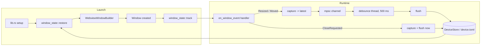
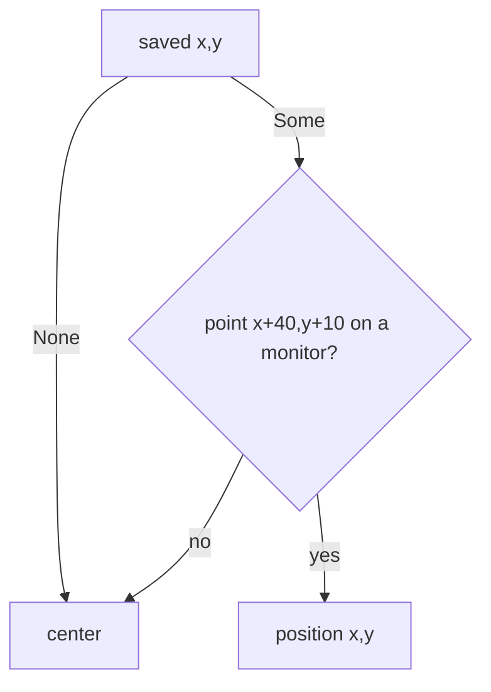
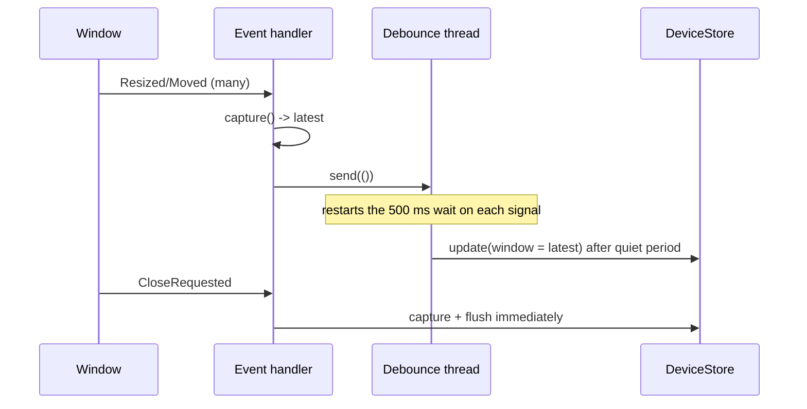

# window_state

`src-tauri/src/window_state.rs` persists desktop window geometry (size, position, maximized flag). On launch it applies the saved geometry to the main window builder (`restore`). While the app runs it watches resize and move events and writes the geometry back to the device settings file, `device.toml` (`track`).

The module belongs to the [Tauri Host and Command Layer](../Tauri_Host_and_Command_Layer.md). It is called from the host's `setup` in `src-tauri/src/lib.rs` (see [Tauri_Host_and_IPC_Bridge](Tauri_Host_and_IPC_Bridge.md)). The persisted data type, `WindowState`, and the store, `DeviceStore`, are defined in `mnemora_core::device` (see [Core_Foundation](../Core_Foundation.md)).

## Public API

| Function | Role |
|---|---|
| `restore(handle, builder, saved)` | Applies the saved size, position and maximized state to a `WebviewWindowBuilder` before the window is created. |
| `track(window, device)` | Starts persisting geometry changes for an existing window. It is called after the window is built (`lib.rs`). |

The core component documented here is `restore`. `track` is the matching public function in the same file.

## Architecture

## Restore on launch

`restore` takes the saved `DeviceSettings.window`:

1. It sets `inner_size(w, h)` from the saved values.
2. It checks whether a position was saved. If both `x` and `y` are `Some` and `is_on_screen` passes, it sets that position. Otherwise it calls `center()`.
3. It sets `maximized(w.maximized)`.

`is_on_screen` guards against a window saved on a monitor that has since been unplugged. It asks the `AppHandle` for `available_monitors()`. It converts each monitor's position and size to logical units using its scale factor. It then tests the point `(x + 40, y + 10)`, which is inside the window's title-bar area, against each monitor's rectangle. If monitor enumeration fails, it returns `false`, so the window is centered.

## Tracking and saving

`track` sets up three pieces of shared state:

- `latest: Arc<Mutex<Option<WindowState>>>` holds the most recent captured geometry that has not been written yet.
- An `mpsc` channel carries "something changed" signals from the event handler to a single long-lived debounce thread.
- A `flush` closure takes `latest` and writes it with `device.update(|d| d.window = state)`. A failed write is logged with `tracing::warn!` and is not propagated.

**Debounce thread.** It blocks on `rx.recv()`. After the first signal it keeps calling `recv_timeout(DEBOUNCE)`, where `DEBOUNCE` is 500 ms. Each new signal restarts the wait. When the wait times out, it flushes once, so a drag or resize burst becomes one disk write. If the sender is dropped, it flushes once more and exits.

**Window events.**
- `Resized` and `Moved`: capture the geometry into `latest`, then signal the channel.
- `CloseRequested`: capture and flush immediately, so the final geometry is saved without waiting for the debounce.

## Capturing geometry

`capture(window, previous)` produces the next `WindowState`:

- If the window is maximized, minimized or fullscreen (not "normal"), it returns `previous` with only `maximized` updated. The remembered normal size and position are not overwritten by maximized or minimized dimensions, or by a minimized window's off-screen coordinates.
- Otherwise it sets `maximized = false`. It reads `inner_size` and `outer_position`, converts both to logical units using the scale factor, and rounds them. Size is stored through `to_px`, which rounds and clamps to at least 1. Position is stored through `to_coord`, which rounds and clamps to `i32`, so negative coordinates on multi-monitor setups are preserved.

Saved values are in logical pixels, so they stay valid across displays with different DPI scaling. Both `restore` and `capture` use logical units.

The baseline `previous` is `latest` if it is set, otherwise the stored `device.get().window`.

## Concurrency notes

- `latest` is protected by the shared `crate::state::lock` helper (`src-tauri/src/state.rs`).
- Only one extra thread exists per tracked window. The window event handler never blocks on disk I/O, except on `CloseRequested`, where the flush is intentionally synchronous.

## Dependencies

- `mnemora_core::device::{DeviceSettings, DeviceStore, WindowState}`: the persisted model and store.
- `tauri`: `AppHandle`, `WebviewWindow`, `WebviewWindowBuilder`, `WindowEvent`, and the logical position and size types.
- `crate::state::lock`: the mutex helper.
- Related Android and widget platform pieces are in [Android_and_Home-Screen_Widget_Platform](../Android_and_Home-Screen_Widget_Platform.md). Window geometry applies to the desktop only.
