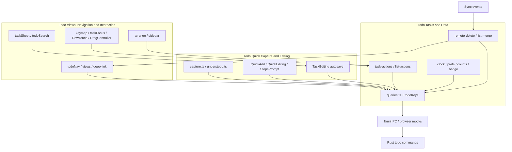
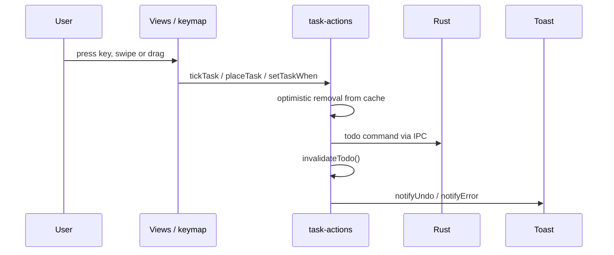

# Todo Frontend

The Todo frontend (`src/modules/todo/`) is the Svelte and TypeScript client for Mnemora's Todo feature. It covers Inbox, Today, Upcoming, All, Done and user Lists. It owns no business rules. The Rust `todo_*` commands (or the browser mocks) decide what is valid. This module asks Rust, caches the answers, words the results for the user, and handles all input: typing, keys, touch and drag.

## Purpose

- **Data and actions.** Query and mutation wrappers around the Rust commands, with optimistic removal, Undo toasts and cache invalidation. It also holds date and wording helpers, the Todo badge, the Home card, the clock, preferences, and reactions to sync events.
- **Capture and editing.** The capture box, Quick edit, the palette "Add task" action and the Task sheet's autosave. It turns typed words and property chips into final Task fields and keeps them in step with the Rust parser.
- **Views and interaction.** Which page is showing, deep links, the Task sheet's URL state, search sessions, grouping and sorting tables, bare-key shortcuts and the focus ring, touch swipes, and drag and drop.

## Architecture

The three sub-modules form layers:

1. **Views, Navigation and Interaction** sits at the top. It turns user gestures into calls to the actions below. `todoNav` holds the current view as state, since Todo is a single `/todo` route. The open Task sheet is derived from the `task` URL parameter, so reload, links and Android Back all work.
2. **Quick Capture and Editing** is mostly pure TypeScript. `capture.ts` and `understood.ts` decide which words stay as text and how `#List` suggestions work. They also merge typed words, chips and the opening place into Task fields (typed words win over chips, which win over the opening place). A shared JSON fixture keeps these rules in step with the Android widget (Kotlin and Rust). `TaskEditing` autosaves the title and notes after 600 ms of quiet, with one session id per sheet opening.
3. **Tasks and Data** is the foundation. `todoKeys` roots every cache key at `['todo', …]`, so `invalidateTodo()` refreshes everything. `task-actions` removes a Task from the cached page at once, calls Rust, then always invalidates. Complete, delete and date changes offer Undo through a toast.

## Typical flow

## Core component documentation

| Sub-module | Covers | Documentation |
|---|---|---|
| Todo Tasks and Data | `queries.ts`, `task-actions.ts`, `list-actions.ts`, `dates.ts`, `counts.ts`, `todoClock`, `todoPrefs`, sync reactions | [Todo_Tasks_and_Data](<Todo_Frontend/Todo_Tasks_and_Data.md>) |
| Todo Quick Capture and Editing | `capture.ts`, `understood.ts`, `palette-add.ts`, `QuickAdd`, `QuickEditing`, `StepsPrompt`, `TaskEditing`, `when-typed.ts` | [Todo_Quick_Capture_and_Editing](<Todo_Frontend/Todo_Quick_Capture_and_Editing.md>) |
| Todo Views, Navigation and Interaction | `todoNav`, `taskSheet`, `todoSearch`, `arrange.ts`, `reduceKey`, `taskFocus`, `RowTouch`, `DragController` | [Todo_Views_Navigation_and_Interaction](<Todo_Frontend/Todo_Views_Navigation_and_Interaction.md>) |

## Related modules

- Backend: Todo Domain Service and Todo Tasks and Lists (Rust), which own the commands and rules.
- Browser stand-ins: IPC Todo Mocks.
- Shared UI: UI When Picker and the Router utilities.
- Sync: Sync Replication Engine, the source of the `task-deleted` and `lists-merged` events.