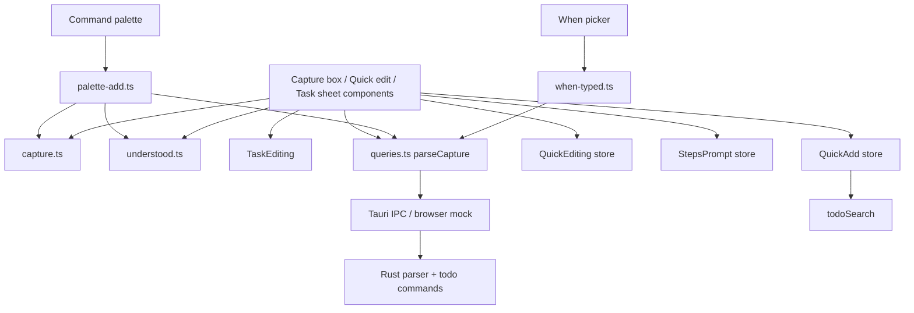
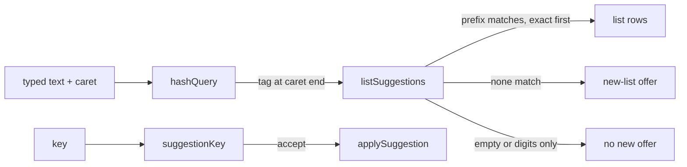
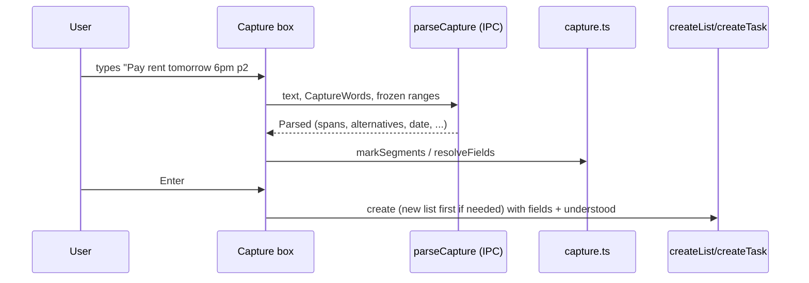
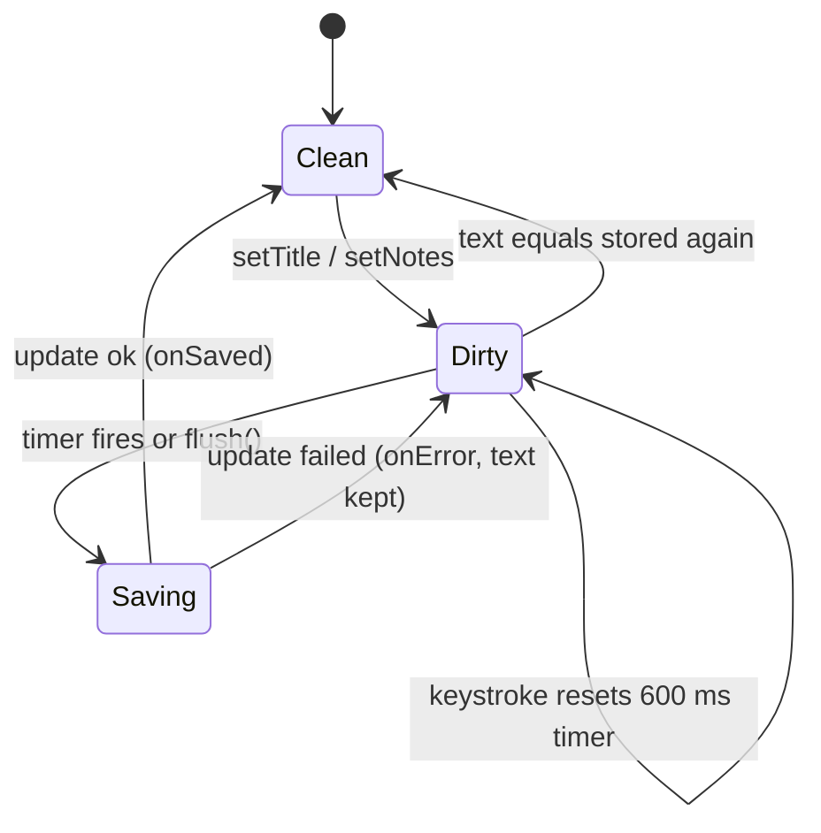

# Todo Quick Capture and Editing

This module is the front-end logic behind the Todo module's **capture box** (the "Add task" input), **Quick edit** (a Task row that turns into a capture box), the **palette "Add task"** action, and the **Task sheet's autosaving title and notes**. Natural-language reading (dates, times, repeats, priorities, `#List`) is done by the Rust parser. This module holds the pure TypeScript rules around it: which words the user keeps as text, how `#List` suggestions work, how pasted text is split, and how typed words and property chips combine into the final fields.

Related pages: [Todo_Tasks_and_Data](Todo_Tasks_and_Data.md) (queries, dates, prefs, task actions) and [Todo_Views_Navigation_and_Interaction](Todo_Views_Navigation_and_Interaction.md) (views, sheet, keyboard). For the Rust parser and commands see [Todo_Tasks_and_Lists](../Domain_Modules_(Todo_and_Journal)/Todo_Tasks_and_Lists.md) and [Todo_Domain_Service](../Tauri_Host_and_Command_Layer/Todo_Domain_Service.md). The When picker is in [UI_When_Picker](../Design_System_and_UI_Components/UI_When_Picker.md). The browser mock of the parser is in [IPC_Todo_Mocks](../IPC_Bridge_and_Browser_Mocks/IPC_Todo_Mocks.md).

## Files and responsibilities

| File | Responsibility |
|---|---|
| `capture.ts` | Pure helpers for the capture box: word decisions, ⌫ behaviour, `#List` suggestions, highlight segments, Quick-edit frozen ranges, paste handling, `resolveFields`. |
| `understood.ts` | The stored `Task.understood` record: parse, serialize, the "drift rule", meaning text, tooltip marks, merge after Quick edit. |
| `palette-add.ts` | ⌘K "Add task": preview line and the actual create. |
| `quick-add.svelte.ts` | `QuickAdd` store: Q key / "New task" routing and the floating box. |
| `quick-edit.svelte.ts` | `QuickEditing` store: which Task row is currently a capture box. |
| `steps-prompt.svelte.ts` | `StepsPrompt` store: the "N steps are still open" question on completing. |
| `task-editing.ts` | `TaskEditing`: autosave session for a Task's title and notes. |
| `when-typed.ts` | `typedWhen`: the When picker's "Type a date" reader using the Rust parser. |
| `*.test.ts` | Unit tests; `capture.test.ts` and `capture-ui.test.ts` also run shared JSON fixtures. |

## Architecture

The helpers in `capture.ts` and `understood.ts` are deliberately pure. The widget's native Quick add repeats them in Kotlin (`CaptureRules.kt`), and the Rust widget port runs the same cases. Both are kept in step through shared JSON fixtures (`capture-ui.json`, `capture-resolve.json`) that the tests here execute.

## Capture rules (`capture.ts`)

### Word decisions
`CaptureWords` = `{ ignored: string[]; prefer: Record<kind, key> }`, keyed by the parser's span `key`.

- `ignoreWord` keeps a word as text (× on chip, or ⌫) and forgets any "use instead" pointing at it.
- `recogniseAgain` reverses it ("kept as text ↺").
- `preferWord` picks a word over the winning one; one pick per kind.
- `ignoreKinds` is used when a property chip is set by hand: all words (spans and alternatives) of those kinds become text and their prefers are dropped, so the chip is not overruled.
- `pruneWords` forgets decisions about words no longer in the text.

### ⌫ after a recognised word
`backspaceTarget` returns the key of the word the caret directly follows (or follows by exactly one space). The first ⌫ un-recognises; the second (`justUnrecognised`) or any selection deletes normally.

### `#List` suggestions

- Names are folded (`foldTag`: NFD, accents stripped, lowercase, extras like `đ ø ł ı`) the same way Rust folds List names; `tagOf` keeps only letters, digits, `_`, `-`.
- `suggestionKey`: ↑/↓ wrap round, Enter/Tab accept (so Enter never adds the Task while suggestions show; Shift+Enter is left alone), Esc dismisses.
- `applySuggestion` replaces the typed tag (never duplicates), ensures a following space, and returns the new caret.

### Highlight and Quick edit
- `markSegments` cuts text into plain and recognised stretches for the highlight layer, skipping overlapping or out-of-range spans.
- `unchangedRanges(old, new)` returns the whole-word prefix and suffix that are untouched. Quick edit passes these as ranges to the parser so a week-old "tomorrow" is not re-read; only new text is.

### Pasting
- `pasteParts` (capture): first non-blank line is the title (max `MAX_TITLE` = 500 chars, overflow spills into notes), rest are notes. Single-line pastes are left to the field.
- `pasteIntoTitle` (Quick edit): lines are joined with single spaces and replace the selection, truncated to fit the title limit.

### Resolving fields
`resolveFields(parsed, hand, base)` gives precedence: **typed words > property chips > where the box opened**. `hand` fields use `undefined` for untouched and `null` for cleared. A time with no date keeps the opened day (e.g. an Upcoming day); only a box opened without a day takes the parser's today-or-tomorrow. A `#NewList` yields `newList` and a null `listId`. `fromText` lists the kinds set by the words.

## Understood words (`understood.ts`)
`Task.understood` stores JSON `{word, kind, value}[]` for kinds `date | time | repeat | prio | list`.

- **Drift rule** (`stillHolds`): a word stays "understood" (underlined with "Understood as …") only while the field it set still has the value it set. Repeats compare freq/every/mode, and `days` only for weekly rules.
- `parseUnderstood` treats anything unreadable as empty; `serializeUnderstood` returns `null` for empty.
- `meaningText` / `spanMeaning` render values in user terms (`Fri 23 Oct`, `9:30 PM`, `Every month`, `P1`, list name or "a List that is gone"; a new list shows as an offer).
- `understoodMarks` produces `WordMark` tooltips; words sharing text ("tonight" = date + time) merge into one mark.
- `understoodFromSpans` builds the record for a new Task, swapping a List name for its id (skipping lists without one).
- `mergeUnderstood` after Quick edit keeps old words still in the title and still holding, minus kinds replaced by newly typed words.

## Stores
- **`QuickAdd`** (`quickAdd`): `request(inTodo)` — inside Todo, and not while search covers the page, it focuses an already-open `[data-capture-box]` input, else clicks the first `[data-new-task]` row so the Task inherits that place; otherwise it opens the floating box (Inbox). `openFloating(date, listId)` lets Home's Add (today) and the phone's + (current view) preset a day and List; `close()` resets.
- **`QuickEditing`** (`quickEditing`): holds the single Task `id` whose row is a capture box.
- **`StepsPrompt`** (`stepsPrompt`): `ask(task)` / `close()`; the Todo page's dialog answers it every time a Task with open Checklist items is completed.

## Palette add (`palette-add.ts`)
`previewAddTask(text)` reads the text with the same parser (when `todoPrefs.parseDates` is on) and returns a summary such as "Tomorrow · 18:00 · P2" or "Inbox"; it never throws. `addTaskFromPalette(text)` resolves fields against an Inbox base (priority 4), creates a new List first if `#Name` is unknown, calls `createTask` with the serialized `understood`, invalidates Todo queries, and toasts `quickAddedMessage`; errors go to `notifyError`.

## Autosave (`task-editing.ts`)
`TaskEditing<T>` is one editing session for a Task's title and notes, with injected `update`, `setTimer`, `onSaved`, `onError` (so it is testable without a DOM).

- Saves after `SAVE_PAUSE_MS` (600 ms) of quiet, serialised through a promise queue, each sending the latest text and the **session id** so the change log keeps one record per sheet opening (one History line).
- Titles fold line breaks to spaces. A blank title is never saved: notes are saved under the stored title and `leaveTitle()` restores it.
- `adopt(task)` accepts externally changed text (e.g. a repeating Task's Checklist reset) as stored. `flush()` resolves true when nothing unsaved remains.

## Typed When (`when-typed.ts`)
`whenFromParse` accepts a parse only if it contains just date/time spans, has no alternatives, and leaves only whitespace/punctuation uncovered; otherwise the field reports it is not a date. A time alone drops the parser's guessed date. `typedWhen` calls `parseCapture` with empty word decisions.

## Testing
`capture.test.ts` covers each helper and the `capture-resolve.json` fixture against `resolveFields`; `capture-ui.test.ts` runs `capture-ui.json` against the word, tag, suggestion, segment and paste helpers; `understood.test.ts`, `task-editing.test.ts` and `when-typed.test.ts` cover their modules. Backend counterparts are in `todo_capture_tests.rs` (see [Todo_Domain_Service](../Tauri_Host_and_Command_Layer/Todo_Domain_Service.md)).
