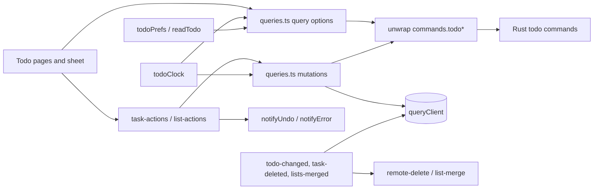
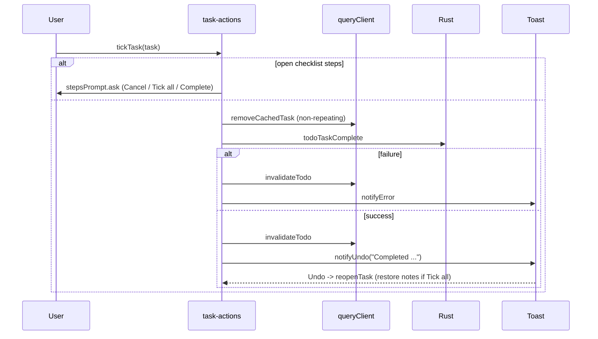
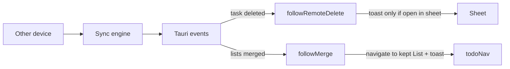

# Todo Tasks and Data

The data layer of the Todo frontend (`src/modules/todo/`). It does not draw anything. It holds the query and mutation wrappers around the Rust `todo_*` commands, the user actions built on them (complete, move, delete, with Undo), the date and wording helpers, and the small stores that keep Todo in step with the rest of the app. Rust owns the rules: this layer asks, caches, and words the result.

Related pages:
- [Todo Frontend](../Todo_Frontend.md): parent overview.
- [Todo Quick Capture and Editing](Todo_Quick_Capture_and_Editing.md): the capture box, the Task sheet editing and `parseCapture` consumers.
- [Todo Views, Navigation and Interaction](Todo_Views_Navigation_and_Interaction.md): the pages, `todoNav`, drag and keyboard handling that call the actions here.
- [Todo Domain Service](../Tauri_Host_and_Command_Layer/Todo_Domain_Service.md): the Rust commands wrapped here.
- [Todo Tasks and Lists (Rust)](../Domain_Modules_(Todo_and_Journal)/Todo_Tasks_and_Lists.md): the backend domain.
- [IPC Todo Mocks](../IPC_Bridge_and_Browser_Mocks/IPC_Todo_Mocks.md): the browser stand-ins for the same commands.

## Components at a glance

| File | Role |
|---|---|
| `queries.ts` | `todoKeys`, TanStack query options, mutation wrappers (`unwrap(commands.todo…)`), cache invalidation |
| `task-actions.ts` | Tick, untick, Won't do, skip, delete, move-overdue, priority, drag placement; each with toast and Undo |
| `list-actions.ts` | Create/delete List, sort menu, drag a List |
| `dates.ts` | Device-day helpers, row date labels, toast wording for dates |
| `tasks.ts` | Toast wording, `withoutTaskInGroups`, priority tone |
| `notes.ts` | Checklist progress, tick-all, note preview, `plainTitle` |
| `counts.ts` | Sidebar/tab badge, Home card model, capture summary |
| `badge.svelte.ts` | `useTodoBadge` |
| `clock.svelte.ts` | `todoClock`: today, minute and `LocalNow` |
| `prefs.svelte.ts` | `todoPrefs` mirrored from Settings |
| `settings.ts` | Typed `todo.*` preferences (`readTodo`) |
| `remote-delete.ts`, `list-merge.ts` | Reactions to sync events |

## Architecture

## Queries and cache keys

`todoKeys` roots every key at `['todo', …]`, so `invalidateTodo()` refreshes everything with one call. Views that depend on the date are keyed by the day string (`inbox`, `allView`, `lists`, `counts`, `list`, `today`, `upcoming`, `done`). When midnight passes the key changes and the view refetches. `listPages(id)` addresses every cached page of one List regardless of day.

| Query | Command | Notes |
|---|---|---|
| `inboxQuery`, `allQuery`, `listQuery`, `todayQuery`, `upcomingQuery` | `todoInbox/All/List/Today/Upcoming` | pass `todoClock.local()` |
| `listsQuery`, `countsQuery` | `todoLists`, `todoCounts` | sidebar counts; badge and Home card |
| `doneQuery` | `todoDone` | infinite query, 14 days per page, cursor `next_cursor` |
| `dayCountsQuery` | `todoDayCounts` | dots in the When picker |
| `taskQuery` | `todoTask` | `retry: false`; any state, for the sheet |
| `commentsQuery`, `historyQuery` | `todoComments`, `todoTaskHistory` | |
| `searchQuery` | `todoSearch` | `keepPreviousData` so typing never flashes empty |

Mutation wrappers (`createTask`, `completeTask`, `reopenTask`, `moveTask`, `setWhen`, `setPriority`, `wontDo`, `deleteTask`/`restoreTask`, `updateTask`, comment and List operations, `reorderTask`/`reorderList`, `setListSort`/`setListGroup`, `quickEdit`/`quickEditUndo`, `skipTask`, `moveOverdue`, `restoreWhen`) are thin: they unwrap the IPC result and throw `IpcError` on refusal. `savePreference` saves a `todo.*` setting, then invalidates `['settings']` and Todo.

`createTask` builds the `when` argument only if a date, time or repeat exists, and sends priority only when below 4. `parseCapture` forwards typed text, ignored/preferred words, frozen ranges and the date context to `todoParse`.

`removeCachedTask` patches every cached grouped view (`inbox`, `all`, `list`, `today`, `upcoming`) with `withoutTaskInGroups`, so a Task leaves the page before Rust answers.

## Action flow

Patterns shared by the actions:
- **Optimistic removal** for complete, Won't do and delete (not for repeating Tasks, which stay open on the next date).
- **Always `invalidateTodo()`** in `finally`/after, so the screen converges on Rust's truth.
- **Undo via toast**: complete reopens (an occurrence id when repeating); `setTaskWhen`/`skipRepeating`/`moveAllOverdue` restore `DueChange` snapshots through `restoreWhen`, which allows past dates; delete calls `restoreTask`.
- **Won't do on a repeating Task** is a Skip in Rust; the frontend only words and undoes it (`skipRepeating(task, wontDo)`).
- **Tick all and complete** first saves ticked notes in a fresh session id, then completes with `undoNotes`, so Undo writes the original notes back.
- On a phone, `completeNow` fires a light haptic tick immediately.
- `placeTask` / `placeList` pass neighbours and the group's `adopt` keys to Rust; they say nothing on success. `dropTaskOnSidebar` maps a drop on Today, the Inbox or a List to `dateTaskToday` or `moveTaskTo`.

`list-actions.ts`: `listSortItems` builds the "Sort Lists by" menu and saves `LISTS_SORT_PREF`; `createListAndOpen` creates then navigates (name refusals propagate for the field to show); `deleteListWithUndo` deletes with a `DeleteChoice`, leaves the List's page if open, drops its cached pages so a stale "gone" error cannot reappear, and Undo calls `restoreList` and reopens it.

## Dates and wording

- `localDate`, `localTime`, `localNow` define the device's day; every date-dependent command receives `LocalNow` (`today`, `now`, `offset_min`).
- `rowDateLabel` (Today, Tomorrow, Yesterday, weekday within a week, `28 Oct [year]`), `stampLabel`, `longDate`, `dayHeading`, `closedTime`, `whenChipLabel`, `landedIn`.
- `isOverdue`: open and before today. A Task due today is never Overdue; `timePassed` marks only its time red.
- Toast builders: `whenMessage`, `completedRepeatMessage`, `skippedMessage`, `movedAllMessage` (dates.ts); `completedMessage`, `deletedMessage`, `wontMessage`, `editedMessage`, `priorityMessage`, `quickAddedMessage` (tasks.ts). Titles pass through `plainTitle` (Markdown marks removed) and `quoted` (curly quotes, cut at 34 characters, by code point).
- `priorityTone` maps 1/2/3 to `p1`/`p2`/`p3`, otherwise `plain`.

`notes.ts` parses notes with the shared Markdown AST: `checklistProgress`, `openSteps`, `tickAllSteps`, and `notePreview` (first prose line, checklists skipped).

## Badge, Home card and capture summary

`useTodoBadge` subscribes the shared clock inside an `$effect`, runs `countsQuery`, and derives `badgeOf(counts)`: due today plus Overdue, red while anything is Overdue, `null` when zero or not loaded. The clock subscription keeps the count rolling over at midnight with no Todo page open.

`homeCardModel(counts, today)` returns up to the card's Tasks, the Overdue count, `more = max(0, due_today - tasks.length)`, and a `nothing` line ("Nothing due today · next: …") when none is due. `footerParts` gives "N overdue" and "+N more" separately so the overdue part can be red. `captureSummary` describes what the palette's Add task understood, or "Inbox".

## Clock, preferences and settings

- `todoClock` exposes `today` and `hm` as `$derived` strings from the shared clock, so readers update only on a minute or day change; `local()` reads a fresh `LocalNow` at call time.
- `followCoreSettings()` (called once from Todo's page) copies week start, time format, the Journal's `journal.font` (as plain data; Todo never imports the Journal) and `todo.parse_dates` into `todoPrefs`.
- `readTodo(values)` gives a typed view of `todo.parse_dates` and `todo.done_in_lists`, falling back to `today_shown` for unknown values. Rust validates writes.

## Reacting to sync

- `followRemoteDelete(openTaskId, e)` yields a message ("‘title’ was deleted on Pixel 8") only for the Task open in the sheet. `remoteDeletes` remembers told Tasks so the sheet does not also show "no longer exists".
- `followMerge(view, e)` moves someone on a merged-away List to the surviving one with a message; other views are untouched.

For the engine behind these events see [Sync Replication Engine](../Sync_Replication_Engine.md).

## Testing

Unit tests (`counts.test.ts`, `tasks.test.ts`, `task-actions.test.ts`) run without a DOM. `task-actions.test.ts` mocks `./queries`, toast, viewport and the clock, reads the Undo callback out of the toast, and checks the call order for Undo after "Tick all and complete": reopen first, then write back the original notes.
