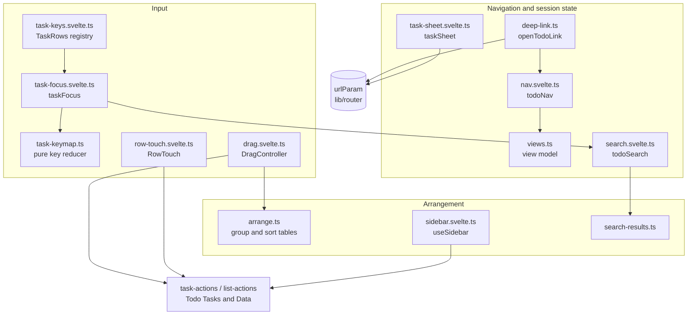
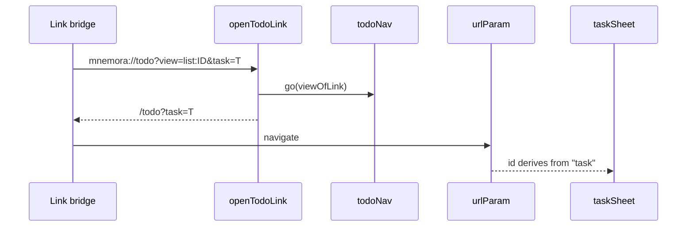
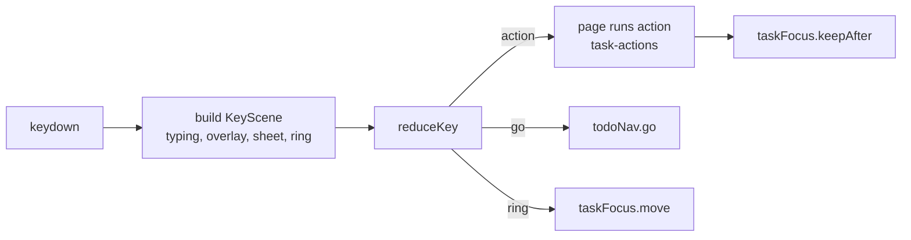
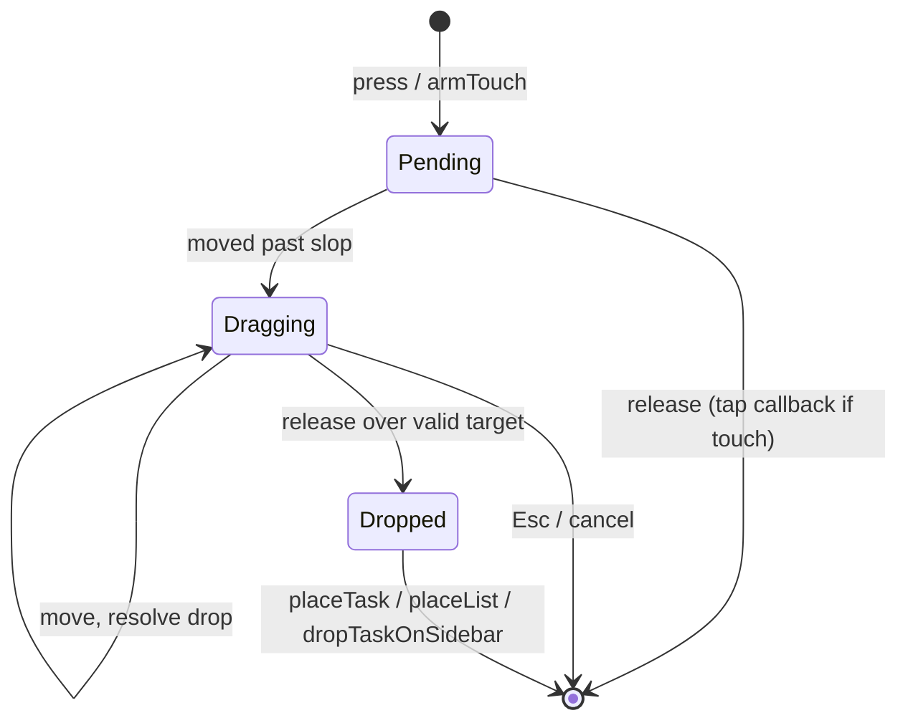

# Todo Views, Navigation and Interaction

This module is the part of the Todo frontend (`src/modules/todo/`) that decides **which page of Todo is showing, how the user moves between pages, and how the user acts on Task rows**. It covers view state, deep links, search sessions, the Task sheet, grouping and sorting tables, keyboard shortcuts and focus, touch gestures, and drag-and-drop.

It holds no data of its own. Data fetching, mutations and preferences live in [Todo Tasks and Data](Todo_Tasks_and_Data.md). Capture and editing of task text live in [Todo Quick Capture and Editing](Todo_Quick_Capture_and_Editing.md). Shared gesture and routing helpers come from [Router](../Frontend_Platform_and_Shell/Router.md) and [App Bootstrap and Platform Utilities](../Frontend_Platform_and_Shell/App_Bootstrap_and_Platform_Utilities.md). The Rust commands behind the actions are described in [Todo Domain Service](../Tauri_Host_and_Command_Layer/Todo_Domain_Service.md).

## Architecture

## Components

### View model: `views.ts`, `nav.svelte.ts`
- `TodoView` is either a smart view (`inbox | today | upcoming | all | done`) or a list view (`{kind:'list', id}`). Todo is a single `/todo` route, so the view is state, not URL.
- `viewCount` gives the sidebar count, with an alert flag when Today has Overdue tasks. `viewLabel` maps a smart view to its label.
- `activeSegment` and `swipedView` support the phone: three pinned segments (Today, Upcoming, Inbox) and a `more` (☰) bucket for All, Done and Lists. A swipe stops at the ends and does nothing from a non-segment view.
- `addPlaceFor` picks where the phone "+" adds: today in Today, tomorrow in Upcoming, the List in a List, otherwise the Inbox.
- `visibleOn` says whether a newly created task will appear on a view. `viewAfterListGone` falls back to the Inbox when the open List disappears.
- `TodoNav` (`todoNav`) holds `view`, a `slide` direction for transitions and a `topRequests` counter. `swipeTo` sets the slide direction, `go` clears it, and `home()` returns to Today and bumps `topRequests` (the Todo tab tapped again).

### Deep links: `deep-link.ts`
`openTodoLink(url)` handles `mnemora://todo?view=…&task=…`. Unknown views are ignored. A known view is applied through `todoNav.go`, and a task returns `/todo?task=<id>`. Otherwise any open `task` parameter is removed and `/todo` is returned. It is called from the shell link bridge (see [Shell and Navigation](../Frontend_Platform_and_Shell/Shell_and_Navigation.md)); the widget generates these links (see [Todo Widget](../Domain_Modules_(Todo_and_Journal)/Todo_Widget.md)).

### Task sheet: `task-sheet.svelte.ts`
`TaskSheetState` (`taskSheet`) derives the open task id from the `task` URL parameter. This means reload, links and Android Back all work. `open` pushes a history entry, or swaps the entry if a sheet is already open. `switchTo` swaps without pushing. `close` steps back over the pushed entry, or deletes the parameter. Closes within 400 ms of each other count as one, because Esc and the editor can both request a close.

### Search: `search.svelte.ts`, `search-results.ts`
`TodoSearch` keeps `query` (the field) and `committed` (what results follow). Typing commits after `SEARCH_DEBOUNCE_MS` (150 ms); `open(query)` commits at once. `escape()` clears the words first and closes on the second press. `search-results.ts` has pure helpers: `canSearch` (needs a letter or digit), `splitHits` (open tasks first, then done and won't-do), `litWords`, `spansText` and `resultsLabel`.

### Grouping and sorting: `arrange.ts`
Tables define the Group by choices per view (`GROUP_OPTIONS`), the defaults (`GROUP_DEFAULTS`), the preference keys (`GROUP_PREF_KEYS`) and the sort option lists. The set matches what Rust accepts.
- `groupHeading(key, ctx)` turns a `GroupKey` into a heading (none, label, day, or list).
- `groupButtonLabel` builds the `Group: Priority` text.
- `canDrag` is true only for manual sort.
- `groupTakesTasks` is false for the Overdue and "No date, in a List" groups.
- `addDefaults` returns the day and list a task added inside a group inherits. Priority is never inherited.
- `adoptSummary` describes in words what a drop would change.

### Sidebar data: `sidebar.svelte.ts`
`useSidebar()` runs `listsQuery` once and exposes Lists by id plus the raw sidebar view. Pages use it for list chips, group headings and drag labels.

### Keyboard: `task-keymap.ts`, `task-keys.svelte.ts`, `task-focus.svelte.ts`
- `reduceKey(state, event, scene, now)` is a pure reducer. It follows the bare-key rules from ADR 0011: no modifier, never while typing, and never with a menu or dialog open. It returns an action (`complete`, `wont`, `open`, `quick-edit`, `when`, `today`, `move-list`, `priority`, `reorder`, `delete`, `ring`, `sheet-step`, `go`, `search`, and so on) plus the "G then letter" chord state with a 1500 ms window.
- Per-row keys act only on the row with the focus ring, not a row the pointer rests on (ADR 0013). Edit, date, today and priority keys apply to open tasks only.
- Inside the sheet only Priority and Won't do apply. ⌘↑/⌘↓ step through tasks and ⌘↵ closes.
- `bareTodayFires` stops the bare T from going to Today when a Todo row is ringed.
- `moveRing` and `ringAfterRemoval` compute ring movement.
- `TaskRows` (`taskRows`) is a registry of mounted rows and their pickers (When, Move to list). `inSheetScope` and `overlayOpen` classify the key target.
- `TaskFocus` (`taskFocus`) reads rows from the DOM (`[data-task-scope]`, `[data-task-row]`). It walks the search results when search is active and the view otherwise. `focus` gives the row title real focus. `keepAfter` re-places the ring after a redraw, using a neighbour as fallback.

### Touch: `row-touch.svelte.ts`
`RowTouch` handles touch and pen on a row (not the mouse). Axis lock separates sideways swipes from scrolling. A right swipe completes and a left swipe opens When, with sides enabled per touch. A long press (via `LongPress`) lifts the row and fires `onhold`. After a gesture, `swallowsClick` stays true for 350 ms so the trailing click is ignored.

### Drag and drop: `drag.svelte.ts`
`DragController` (`drag`) drags tasks, and Lists in the sidebar. It is driven by `data-*` markers in the markup (`data-task-group`, `data-adopt`, `data-task-row`, `data-drop-nav`, `data-list-tree`, `data-list-row`).
- Mouse press passes a 5 px slop; touch is armed by `armTouch` with a 10 px slop. A lift without moving calls the tap callback, which opens the row menu.
- While dragging it edge-scrolls, shows a drop line and a summary, and highlights sidebar targets. Esc cancels, and the click after a drag is swallowed.
- Drop outcomes: `placeTask` between neighbours (adopting the group's day or list), `placeList`, or `dropTaskOnSidebar` for Inbox, Today or a List.
- `keyboardMove` implements ⌥↑/⌥↓ within a group and restores focus afterwards.

## Interaction flows

### Opening a task from a link

### Keyboard action

### Drag lifecycle

## Testing
The pure logic is covered by Vitest: `task-keymap.test.ts` (key table, chords, sheet scope, ring movement) and `search-results.test.ts` (splitting, folding, validation, labels). `drag.svelte.ts`, `row-touch.svelte.ts` and the state classes depend on the DOM and are exercised through the UI.
