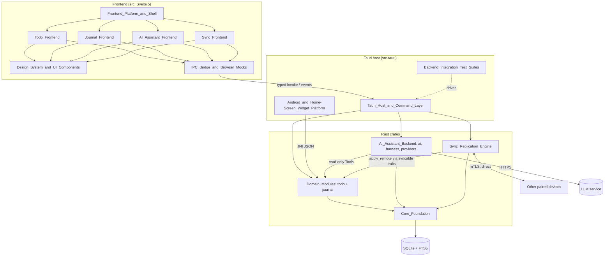
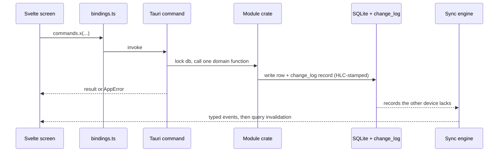

# Mnemora_v1

## Purpose

Mnemora is a local-first personal productivity app with a **Todo** Module and a **Journal** Module. It runs on macOS as a Tauri desktop app and on Android, where it adds a native Todo home-screen widget. It has these main features:

- **Todo and Journal.** Tasks, Lists and Comments, with natural-language capture. Dated Journal Pages, with Markdown Entries.
- **AI assistant (off by default).** An agent loop answers questions through read-only Tools over Todo and Journal data. It never writes that data.
- **Serverless device sync (off by default).** A person's own devices sync directly with each other. Pairing uses an 8-digit code (SPAKE2), and transport is mutual TLS 1.3. Conflicts and Resolutions are shown to the person.

The backend is a Rust workspace. The frontend is Svelte 5 with TanStack Query. Tauri joins the two through typed IPC generated by `specta`. The central design rule is that **Modules never import each other**. They share only the contracts in `mnemora-core` and the event bus.

## End-to-end architecture

### A request, from tap to disk

The Tauri command layer holds no business logic. Each command locks the database, calls one function in a domain crate and returns the result. Local writes are recorded in the core `change_log`. Sync exchanges those records between devices and applies them through each Module's own `apply_remote`. In a plain browser, Vitest and prototypes, `mockIPC` replaces the Rust side underneath the same `bindings.ts`.

## Core modules

| Module | Scope | Documentation |
|---|---|---|
| Core Foundation | `crates/core`: the `Module` trait, migrations, Settings, change log, sync contract, search and the AI `Tool` contract | [Core_Foundation](Core_Foundation.md) |
| Domain Modules | `crates/todo` and `crates/journal`: rules, storage, FTS5 search, merge rules, AI tools and the widget snapshot | [Domain_Modules_(Todo_and_Journal)](<Domain_Modules_(Todo_and_Journal).md>) |
| AI Assistant Backend | `crates/ai`, `crates/harness` and `crates/providers`: Conversations, Branches, the agent loop and the provider adapters | [AI_Assistant_Backend](AI_Assistant_Backend.md) |
| Sync Replication Engine | `crates/sync`: replication, pairing, mTLS networking, Conflicts, Activity and Devices | [Sync_Replication_Engine](Sync_Replication_Engine.md) |
| Tauri Host and Command Layer | `src-tauri/src`: startup, `AppState`, typed IPC and the Todo, Journal, AI and Sync commands | [Tauri_Host_and_Command_Layer](Tauri_Host_and_Command_Layer.md) |
| Android and Home-Screen Widget Platform | The Kotlin host, the JNI widget bridge and the widget tests | [Android_and_Home-Screen_Widget_Platform](Android_and_Home-Screen_Widget_Platform.md) |
| Backend Integration Test Suites | AI run, AI data and provider, and todo-sheet tests that drive the real commands | [Backend_Integration_Test_Suites](Backend_Integration_Test_Suites.md) |
| Frontend Platform and Shell | Bootstrap, theme, router, navigation shell, Home and Settings | [Frontend_Platform_and_Shell](Frontend_Platform_and_Shell.md) |
| IPC Bridge and Browser Mocks | Generated bindings, the event bridge and the dev-only browser mocks | [IPC_Bridge_and_Browser_Mocks](IPC_Bridge_and_Browser_Mocks.md) |
| Design System and UI Components | `src/lib/ui` Components, the When picker and the Markdown editor | [Design_System_and_UI_Components](Design_System_and_UI_Components.md) |
| AI Assistant Frontend | Conversations, Runs, Branches, history, Saved questions, Providers and Models | [AI_Assistant_Frontend](AI_Assistant_Frontend.md) |
| Journal Frontend | Composer, entry editing, feed, navigation and search | [Journal_Frontend](Journal_Frontend.md) |
| Todo Frontend | Tasks and data, quick capture and editing, views and navigation | [Todo_Frontend](Todo_Frontend.md) |
| Sync Frontend | Devices, pairing, Activity, Conflicts and status | [Sync_Frontend](Sync_Frontend.md) |
| Build, Tooling and Packaging | Makefile, scripts, manifests, lint config, Vite, Gradle and signing | [Build,_Tooling_and_Packaging](<Build,_Tooling_and_Packaging.md>) |

## How it is built and run

- **Workspaces.** A Cargo workspace holds the `crates/*` crates and the `src-tauri` shell crate (`mnemora-app`). A pnpm workspace holds the frontend. Versions are pinned exactly.
- **Entry points.** Everything goes through `make`: `dev`, `sandbox`, `build`, `test`, `lint`, `fmt`, `bindings`, and the `android*` targets. Targets run through `scripts/with-env.sh`, which sets the environment and cleans up child processes.
- **Dev.** Vite serves the frontend on port 47821, and `cargo tauri dev` wraps it. The Sandbox variant uses the Rust `sandbox` feature, so it can run beside Production.
- **Test and lint.** Rust tests include integration suites that run the real commands on Tauri's mock runtime. Vitest tests share JSON fixtures with the Rust tests. Biome, `rustfmt`, `clippy` and `scripts/check-colors.sh` enforce style and the UI token rules.
- **Packaging.** `cargo tauri build` produces the macOS `.app` and `.dmg`. `cargo tauri android build` runs Gradle with a Rust plugin and produces a signed arm64 APK. The signing scripts are `scripts/setup-signing.sh`, `scripts/signing-env.sh` and `scripts/setup-android.sh`.
- **Deployment.** The artifacts show no server component or CI deploy step. The app is built and signed locally.

For the scripts, manifests, Vite and TypeScript configs and the Gradle project, see [Build,_Tooling_and_Packaging](<Build,_Tooling_and_Packaging.md>). For Android packaging and the widget, see [Android_and_Home-Screen_Widget_Platform](Android_and_Home-Screen_Widget_Platform.md).