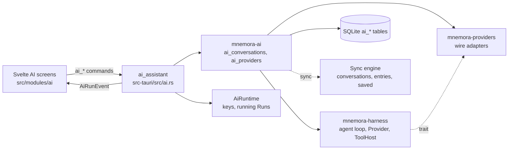
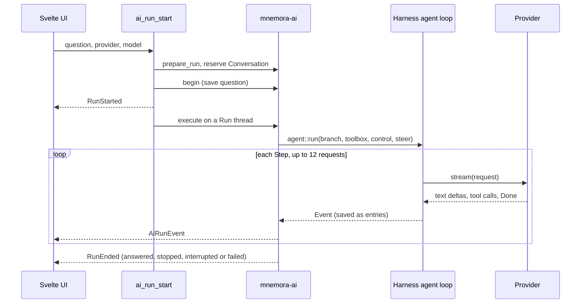

# AI Assistant Engine

## Purpose

The AI Assistant Engine lets the person ask questions of an AI model over their own Journal and Task data. It runs an agent loop in which the model can call read-only Tools, cite the items they return, and produce an answer. The engine keeps the Conversation history, the saved API keys and the configured Providers on the device. Only Conversations, their entries and Saved questions sync between devices.

The engine is split into layers with one-way dependencies:

- **Harness** (`crates/harness`): a provider-agnostic agent loop and the `Provider` and `ToolHost` contracts.
- **Providers** (`crates/providers`): HTTP and wire adapters for each AI service, plus address rules and a JSON envelope for text-only models.
- **AI Conversations and AI Providers** (`crates/ai`): storage and rules for Conversations, branches, Saved questions and Provider records. This crate also implements `ToolHost` for the Run.
- **AI Assistant command layer** (`src-tauri/src/ai.rs`): thin Tauri commands, one Run thread per question, and run controls.

## Architecture

The harness depends on no other part of the engine. The AI crate implements its `ToolHost`, and the providers crate implements its `Provider` trait. Both are reached only through those traits.

## Run flow

Each Run is limited by the harness: 12 model requests, 8 calls per Step, 100 000 bytes per request, and stops after repeated or invalid Steps. Stop, steer and send-now controls work during a Run.

## Core components

| Component | Role | Documentation |
|---|---|---|
| Harness | Agent loop, `Provider` trait, `ToolHost` contract, limits, failure and stop vocabulary | [Harness](AI_Assistant_Engine/harness.md) |
| Providers | OpenAI-compatible, OpenRouter and Anthropic adapters, address rules, JSON envelope, fake server for tests | [Providers](AI_Assistant_Engine/providers.md) |
| AI Conversations | Conversation tree, branches, Saved questions, Tool citations, sync rules for AI records | [AI Conversations](AI_Assistant_Engine/ai_conversations.md) |
| AI Providers | Provider kinds, field validation, key-state view, model usage, factories that build adapters | [AI Providers](AI_Assistant_Engine/ai_providers.md) |
| AI Assistant | Tauri command layer, Run threads, one Run per Conversation, controls, events | [AI Assistant](AI_Assistant_Engine/ai_assistant.md) |

## Key invariants

- **Keys stay on the device** in an owner-only key file, never in the database, and are never returned to the screen.
- **Plain HTTP is allowed only to local, LAN or Tailscale addresses**, so keys are not sent unencrypted over the internet.
- **Provider and usage data are not synced.** Only Conversations, entries and Saved questions are synced.
- **Citations are checked.** Every id an answer cites must have been returned by a Tool in the same Run.
- **Service error text never reaches the person.** Failures map to a typed `Failure` and a fixed sentence.