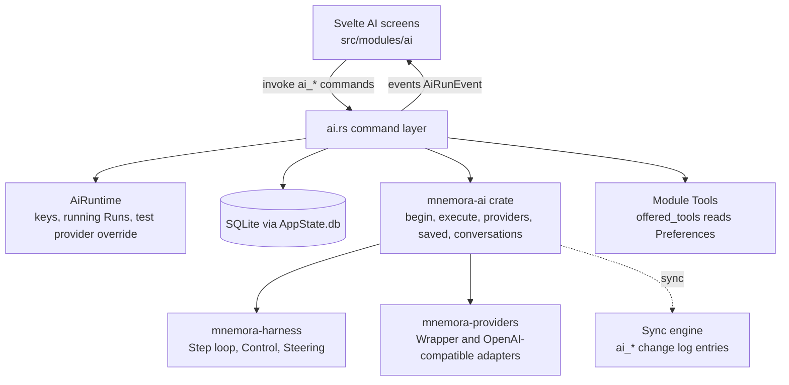
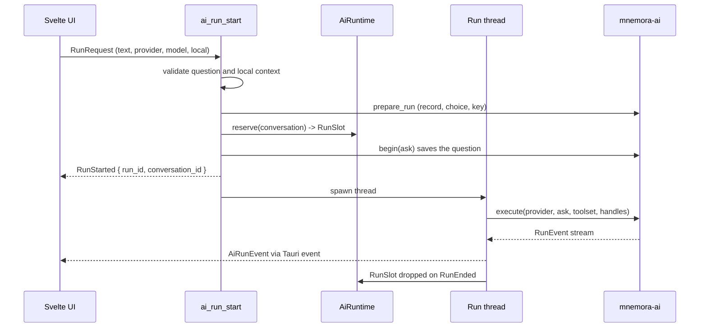
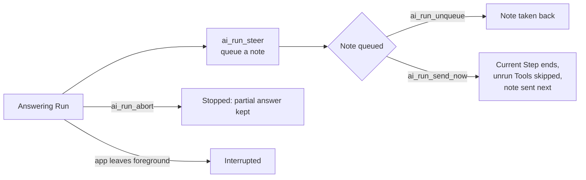

# AI Assistant (Tauri command layer)

## Introduction

The `ai_assistant` module is the thin Tauri command layer that exposes the AI Module to the Svelte front end. It lives in `src-tauri/src/ai.rs` and is covered by a family of command-level test files (`src-tauri/src/ai_*_tests.rs`). The rules themselves live in the `mnemora-ai` crate and the lower-level crates (`mnemora-harness`, `mnemora-providers`).

Core responsibilities:

- Accept front-end requests for Runs (questions), Conversations, Saved questions and Providers.
- Start each Run on its own OS thread so it keeps going when the person leaves the page.
- Enforce one Run per Conversation and expose live controls (stop, queue a note, send a note now).
- Stream typed `AiRunEvent`s back to the UI.
- Keep API keys, Provider usage and the visible Branch on the device; only Conversations, entries and Saved questions are synced.

## Architecture overview

### Run lifecycle

### Controls on an active Run

## Sub-modules

The command layer splits into three areas. Each is documented on its own page:

| Sub-module | Scope | Documentation |
|---|---|---|
| Runs and run control | Start, retry, steer, unqueue, send now, abort; the `AiRuntime` and `RunSlot` claim; the Tools offered to a Run | [ai_assistant/ai_assistant_runs.md](ai_assistant/ai_assistant_runs.md) |
| Conversations, branches and Saved questions | History, rename, delete/restore, Markdown copy, visible Branch and pager; Saved questions; sync tests for these | [ai_assistant/ai_assistant_conversations.md](ai_assistant/ai_assistant_conversations.md) |
| Providers, models and the wire | Provider CRUD, keys, connection tests, Model search and usage; Wrapper and Anthropic/OpenRouter wire behaviour | [ai_assistant/ai_assistant_providers.md](ai_assistant/ai_assistant_providers.md) |

Lower-level concerns are documented in sibling modules rather than repeated here:

- The Step loop, `Control`, `Steering` and typed events: [harness](harness.md).
- Provider adapters, address rules and the JSON envelope: [providers](providers.md).
- Conversation, Provider and Saved-question storage rules: [ai_conversations](ai_conversations.md) and [ai_providers](ai_providers.md).
- Sync of AI rows across devices: [Sync_Replication_Engine](../Sync_Replication_Engine.md).
- The Tauri host that registers these commands and events: [Tauri_Host_and_IPC_Bridge](../Tauri_Host_and_IPC_Bridge.md).
- The Svelte front end that calls them: [Feature_Client_UI](../Feature_Client_UI.md).
- The Journal and Todo Tools that a Run may call: [Task_and_Journal_Domain_Services](../Task_and_Journal_Domain_Services.md) and [Data_Foundation](../Data_Foundation.md).

## Key design rules visible in the command layer

- **Thin commands.** Each `#[tauri::command]` validates input, calls one `mnemora_ai` function and returns its result. Business rules are not duplicated here.
- **Off the command thread.** Long work runs on a spawned thread (Runs) or `spawn_blocking` (connection tests, Model search), and never while holding the database lock.
- **Claim before check.** `AiRuntime::reserve` claims a Conversation before the Run writes anything, so a second question to the same Conversation is refused while the first is answering.
- **Delete is refused while answering.** `ai_conversation_delete` refuses a Conversation with a live Run.
- **Tools follow Modules.** `offered_tools` includes only Tools of Modules that are on, and reports the names of off Modules so the prompt can say so.
- **Keys never leave the device.** Key commands return only a `ProviderView` with a `key_state`; keys live in the `ai-keys` folder under the config directory and are excluded from Android backups (checked by a test against `backup_rules.xml` and `data_extraction_rules.xml`).

## Testing

The command layer is covered by command-level tests that run the real commands through a mock runtime (`TestApp`). A scripted Provider (`mnemora_harness::scripted`) plays the Model in most tests; the wire tests use `mnemora_providers::testing::FakeServer` on loopback. No test reaches the network or a real Model. Build and test commands are in the repository `Makefile` (`make test`); see [Build_and_Packaging](../Build_and_Packaging.md).
