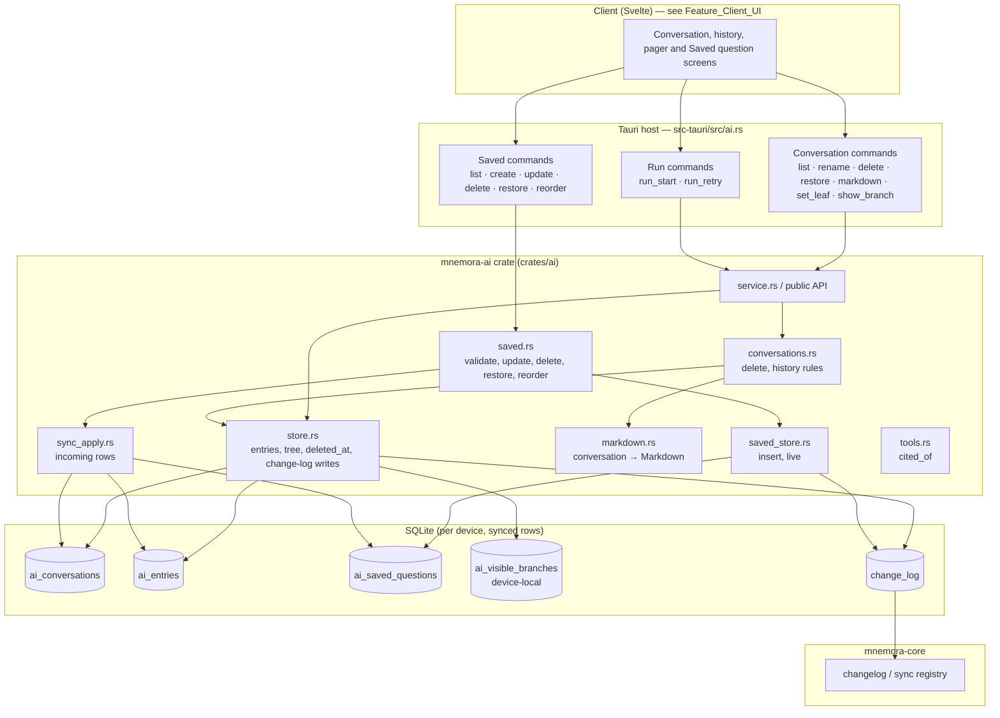
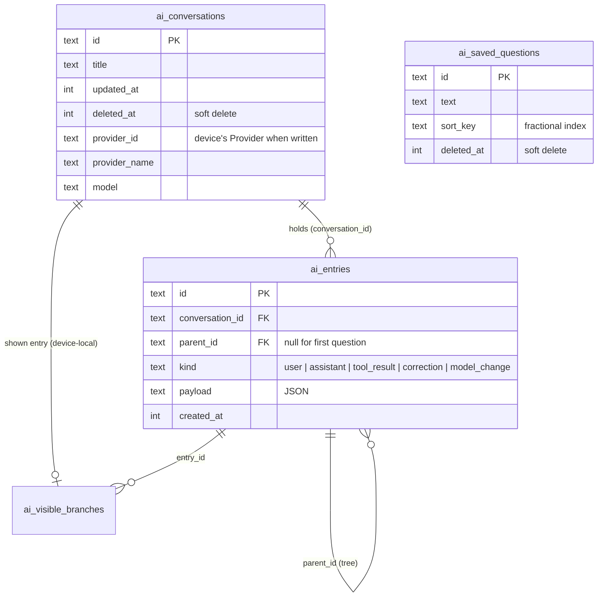
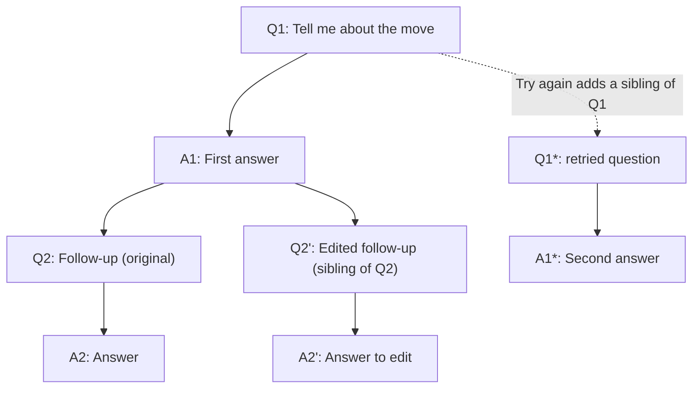
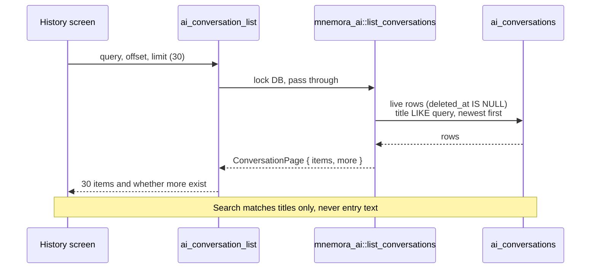
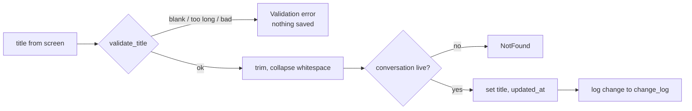
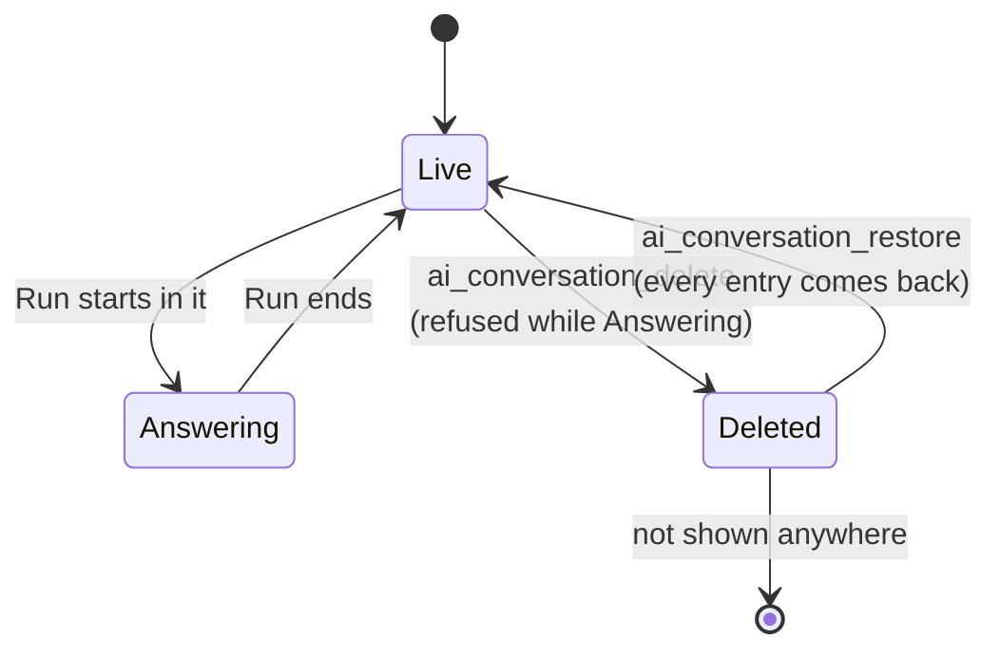
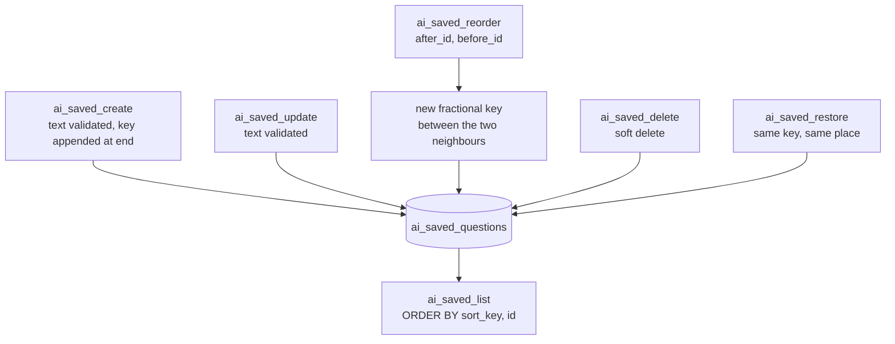
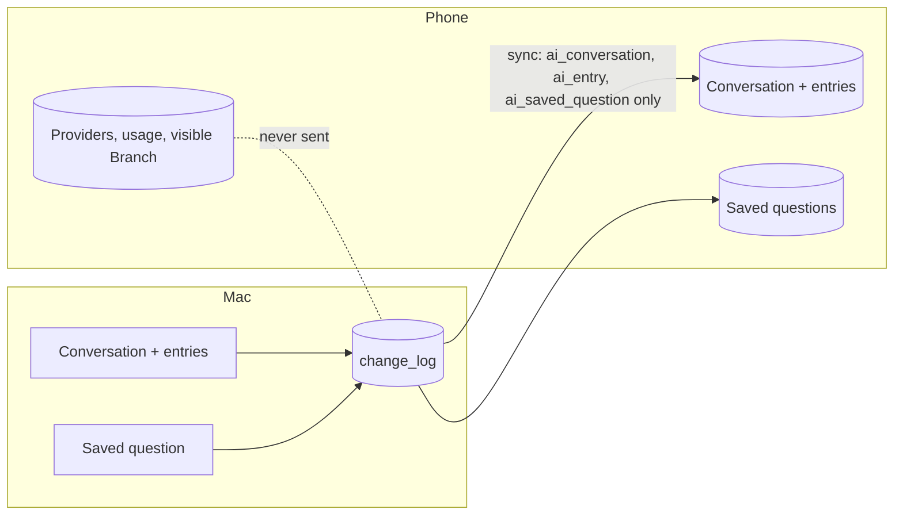

# AI Assistant Conversations

The `ai_assistant_conversations` module is the part of the AI Assistant that **keeps what people have asked and been answered**: the history of Conversations, the tree of questions and answers inside each one, the Branches that let a person try again or edit a question, the Saved questions they re-run, and the rules that let all of this sync across paired devices. It owns the storage shape and the Tauri commands that read and change that data. It does not run a Model (that is the Run layer, see [ai_assistant_runs](ai_assistant_runs.md)) and it does not manage Providers or keys (see [ai_assistant_providers](ai_assistant_providers.md)).

Parent module: [AI_Assistant_Engine](../ai_assistant.md) → [ai_assistant](../ai_assistant.md).

---

## 1. Purpose at a glance

| Concern | What this module does | Where it lives |
|---|---|---|
| History | Lists live Conversations newest first, 30 per page, filtered by title | `ai_conversation_list`, `mnemora_ai::list_conversations` |
| Conversation lifecycle | Rename (validated), soft-delete with Undo, restore whole | `ai_conversation_rename / delete / restore` |
| Tree of entries | Questions, answers, tool results, corrections and model-change markers form a tree via `parent_id` | `ai_entries` table, `store.rs` |
| Branches | Try again and Edit add sibling questions; a pager switches among them; "Branch from earlier" sets where the next question continues | `ai_conversation_set_leaf`, `ai_conversation_show_branch`, `ai_run_retry` |
| Copy as Markdown | Copies the shown Branch, or one answer without citation markers | `ai_conversation_markdown`, `markdown::conversation` |
| Saved questions | A manual, reorderable list of questions the person re-runs | `ai_saved_*` commands, `saved.rs`, `saved_store.rs` |
| Sync | Conversations, entries and Saved questions travel between devices; providers, usage and the visible Branch never do | `sync_apply.rs`, `store.rs` change-log calls |

---

## 2. Architecture and component relationships

Key points:

- `src-tauri/src/ai.rs` is deliberately thin: each command takes the database lock, reads the device clock with `physical_now`, and calls one function in `mnemora_ai`. The rules are in the crate.
- Every write to a synced table goes through a `sync::log_*` call in the same statement path, so each change leaves a row in `change_log`. The visible Branch is the one table that never does.
- `AiError` (`crates/ai/src/error.rs`) carries the three messages a person can see for this module: validation text, "That Conversation no longer exists", and a storage failure.

---

## 3. Data model

Rules that follow from the schema (`crates/ai/src/migrations.rs`):

- **Entries are insert-only.** They have no `updated_at` and no `deleted_at`. The tree is never edited, so an Edit or a retry is a new sibling, never a change to an old row.
- **Conversations are soft-deleted and renamable.** `deleted_at` hides them; restore clears it and brings back every entry.
- **Saved questions are ordered by a fractional `sort_key`** (ADR 0012), so a move writes one row and two neighbours never clash.
- **Entry payloads** are JSON with a `kind` tag. A `user` payload has `text`; an `assistant` payload has `text`, `stop`, `provider`, `model`, `calls`, `sources` and `budget_note`. Tool calls and results appear as their own entries.
- Indexes `ai_entries_conversation(conversation_id, created_at)` and `ai_entries_parent(parent_id)` serve history reads and Branch walks.

### Device-local tables

`ai_visible_branches` records which answer a Conversation shows on this device. It is written by `ai_conversation_set_leaf` and `ai_conversation_show_branch` and has **no change-log row and no sync entity**. When no row exists, the Conversation shows its newest entry. Providers (`ai_providers`), usage (`ai_model_usage`) and keys are also per device; see [ai_assistant_providers](ai_assistant_providers.md).

---

## 4. Branches: the tree of questions and answers

Each question has a `parent_id` pointing at the answer it followed (or `null` for the first question). Two questions with the same parent are **siblings**. A Branch is the path from the root to one leaf. The screen shows one Branch at a time and a pager counts the siblings.

How each action maps to data:

| Action | Command | Effect on the tree | Synced? |
|---|---|---|---|
| Try again | `ai_run_retry` | Adds a sibling of the question (same parent) and runs it | Entries yes |
| Edit | `ai_run_start` with `branch_of` | Adds an edited sibling; the Model is sent only what the sibling follows | Entries yes |
| Pager (show another question) | `ai_conversation_show_branch` (1-based `position`) | Changes only this device's visible Branch | **No** |
| Branch from earlier | `ai_conversation_set_leaf` | Changes the visible Branch so the next question continues from a chosen answer | **No** |
| Copy Branch | `ai_conversation_markdown` (no `entryId`) | Reads the shown Branch | — |

`show_branch` refuses a position outside the siblings beside the chosen question, and `set_leaf` refuses an entry that belongs to another Conversation or does not exist. Both are checked by `ai_branching_tests.rs` (see [Tests](#8-tests-that-document-behaviour)).

---

## 5. Process flows

### 5.1 Conversation history list

### 5.2 Rename

The rename rules are shared with a fixture (`src/lib/ipc/fixtures/ai-rename.json`), so the client mock and the Rust side agree. Titles are trimmed and internal whitespace is collapsed ("  Plans   for\n the move  " is saved as "Plans for the move").

### 5.3 Delete and restore

Deletion is a soft delete: `set_deleted` sets `deleted_at` and writes a `Delete` change; restore clears it and writes a `Restore` change. The command refuses while `state.ai.is_running(id)` is true, because the Run would otherwise write entries into a deleted Conversation. See [ai_assistant_runs](ai_assistant_runs.md) for how that claim is held.

### 5.4 Copy as Markdown

`markdown::conversation(title, branch)` produces:

- a `# title` heading,
- each question as `**You:** text`,
- each final answer (an `assistant` entry with no tool calls) with its citation markers stripped,
- and nothing for tool results, corrections or model-change markers.

With an `entryId`, only that answer is copied, again without citations. The copy follows the Branch the device shows, so a Branch not shown is never copied.

### 5.5 Saved questions

- A blank saved question is refused with "Type a question first." and nothing is saved.
- Reorder takes the two neighbours the screen showed, so the moved item lands between them; either neighbour may be none (top or bottom).
- Restoring a deleted question puts it back at its original `sort_key`, so Undo returns it to its place.
- Running a Saved question is an ordinary Run (see [ai_assistant_runs](ai_assistant_runs.md)): it starts a Conversation titled with the question. Running it does not change the Saved list.

---

## 6. Sync behaviour

The module registers three synced kinds, `ai_conversation`, `ai_entry` and `ai_saved_question`, in the change log (ADR 0019). Everything else stays on the device that made it.

Behaviours covered by `ai_sync_tests.rs`:

- A Conversation asked on one device reads identically on the other. Provider name and Model id travel as text, so the other device can show them even without that Provider.
- A continuation made on each device becomes **two Branches on both**; each device still shows the Branch it continued, and the pager lists both questions in the same order everywhere.
- Renaming the same Conversation on both devices is **one conflict** shown on both. The newest rename shows until resolved; `keep_other` writes the other title back and converges.
- Saved question text conflicts resolve the same way.
- Deleting a Conversation hides it on the other device; undo restores it there.
- Saved-question order converges when each device moves a different item; deleting and restoring returns an item to its place on both devices.
- Rows that predate the change log (old data) are sent at the first sync.
- Rows received while the AI Module is off are stored and appear when it is turned on.
- If the two devices run different AI data versions, sync pauses until the older one updates (the `_module_migrations` version for `ai`). See [Sync_Connectivity_and_Pairing](../../Sync_Connectivity_and_Pairing.md) for the pause mechanism.

Conflict handling itself belongs to the sync engine: see [Sync_Replication_Engine](../../Sync_Replication_Engine.md) and [sync_conflicts](../../Sync_Client_Surface/sync_conflicts_and_activity.md). Sync entity rules and the change log are in [Data_Foundation](../../Data_Foundation.md).

---

## 7. Interaction with other modules

| Need | Module | Why |
|---|---|---|
| Creating entries and running answers | [ai_assistant_runs](ai_assistant_runs.md) | `ai_run_start` and `ai_run_retry` write the question and answer entries this module reads. |
| Provider name and Model, keys | [ai_assistant_providers](ai_assistant_providers.md) | Conversations copy the provider name and model as text; keys and usage stay there. |
| Tool calls and tool results | [harness](../harness.md) and [providers](../providers.md) | Entries of kind `tool_result`, and `calls` inside assistant payloads, are defined by the harness step types. |
| Storage, migrations, change log | [Data_Foundation](../../Data_Foundation.md) | Migrations run via `crates/ai/src/migrations.rs`; `change_log` writes come from core. |
| Sync transport and conflicts | [Sync_Replication_Engine](../../Sync_Replication_Engine.md) | Applies the rows this module logs. |
| Screens | [Feature_Client_UI — ai-conversation](../../Feature_Client_UI/ai-conversation.md) | Calls these commands for history, rename, branch pager, copy and Saved questions. |
| IPC wiring | [Tauri_Host_and_IPC_Bridge](../../Tauri_Host_and_IPC_Bridge.md) | Registers the commands and the event bridge. |

---

## 8. Commands reference

| Command | Arguments | Returns | Notes |
|---|---|---|---|
| `ai_conversation_list` | `query`, `offset`, `limit` | `ConversationPage` | Newest first; title match only; `more` says whether another page exists. |
| `ai_conversation_rename` | `id`, `title` | — | Checked against shared rename rules. |
| `ai_conversation_delete` | `id` | — | Refused while answering; soft delete. |
| `ai_conversation_restore` | `id` | — | Brings back every entry. |
| `ai_conversation_markdown` | `id`, `entry_id?` | `String` | Shown Branch, or one answer without citations. |
| `ai_conversation_set_leaf` | `id`, `entry_id` | — | Device-local; "Branch from earlier". |
| `ai_conversation_show_branch` | `id`, `entry_id`, `position` | — | Device-local pager; 1-based position. |
| `ai_saved_list` | — | `SavedQuestion[]` | In manual order. |
| `ai_saved_create` | `text` | `SavedQuestion` | Appended at end. |
| `ai_saved_update` | `id`, `text` | `SavedQuestion` | Fails with not found once deleted. |
| `ai_saved_delete` / `ai_saved_restore` | `id` | — | Restore returns it to its place. |
| `ai_saved_reorder` | `id`, `after_id?`, `before_id?` | — | Moves between two neighbours. |

Command bodies are in `src-tauri/src/ai.rs`. The `ai_conversation_get` command and the Run commands are documented in [ai_assistant_runs](ai_assistant_runs.md).

Errors reach the client as `AppError` with a code (`validation`, `not_found`, `internal`) and a plain message.

---

## 9. Tests that document behaviour

The module's behaviour is specified mainly by command-layer tests that drive the real commands through a mock runtime (ADR 0009):

| File | What it pins down |
|---|---|
| `src-tauri/src/ai_conversations_tests.rs` | History paging (30 at a time), title-only search, rename validation against shared fixtures, delete/restore, Markdown copy, and refusing delete while answering. |
| `src-tauri/src/ai_branching_tests.rs` | Try again and Edit as siblings, pager positions, Branch from earlier sending only the context up to the chosen answer, too-long Conversations, and that the visible Branch writes nothing to the change log. |
| `src-tauri/src/ai_saved_tests.rs` | Order of creation, reorder between neighbours, delete and restore in place, blank refusal, and that running a Saved question does not alter the list. |
| `src-tauri/src/ai_sync_tests.rs` | Two-device sync of Conversations, Branch convergence, rename and Saved-question conflicts, delete/undo, order convergence, device-only data staying put, and data-version pauses. |

Test helpers (`ask`, `get`, `install`, `until_end`, scripted Providers) are shared from `ai_tracer_tests.rs`. Shared fixtures in `src/lib/ipc/fixtures/` keep the Rust and the client mock on the same rules.

---

## 10. Maintenance notes

- **Adding a new kind of entry** means extending `EntryKind`, `kind_text` in `store.rs`, and the payload enum; `markdown::conversation` must then decide whether the kind is copied (currently only `user` and final `assistant` answers are).
- **Adding a synced field** to Conversations, entries or Saved questions requires a `change_log` path in `store.rs` / `saved_store.rs` and a sync apply path in `sync_apply.rs`, plus a migration. Remember the AI data version so older builds pause rather than corrupt.
- **Never sync** providers, keys, usage or `ai_visible_branches`. The sync tests assert the change log only ever holds the three AI entity kinds.
- Entries are insert-only. If a change seems to need editing an entry, add a sibling instead.
