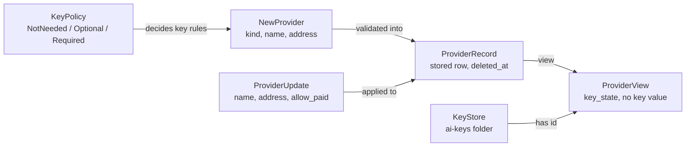
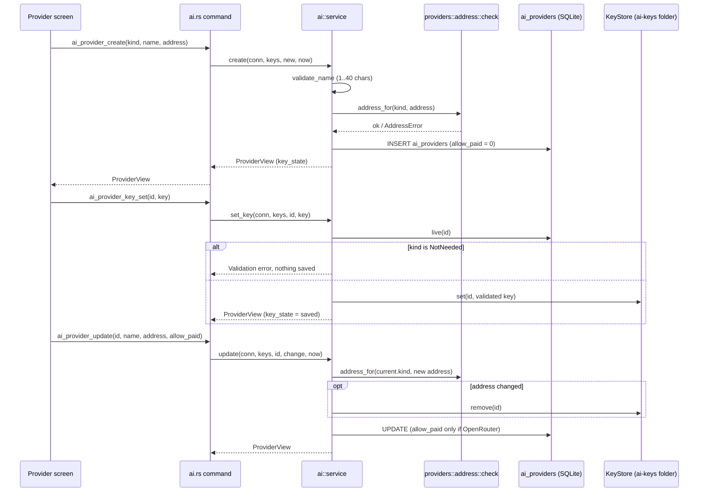
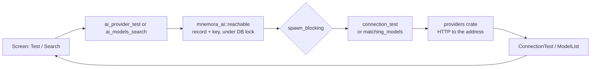
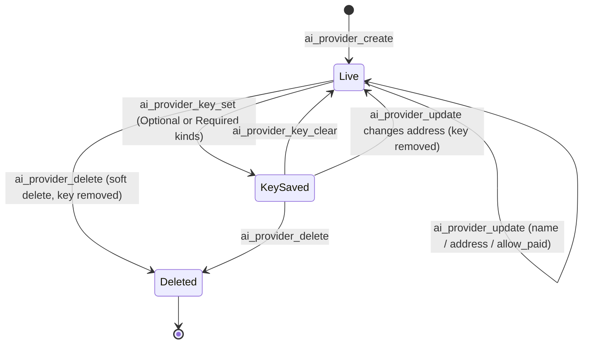
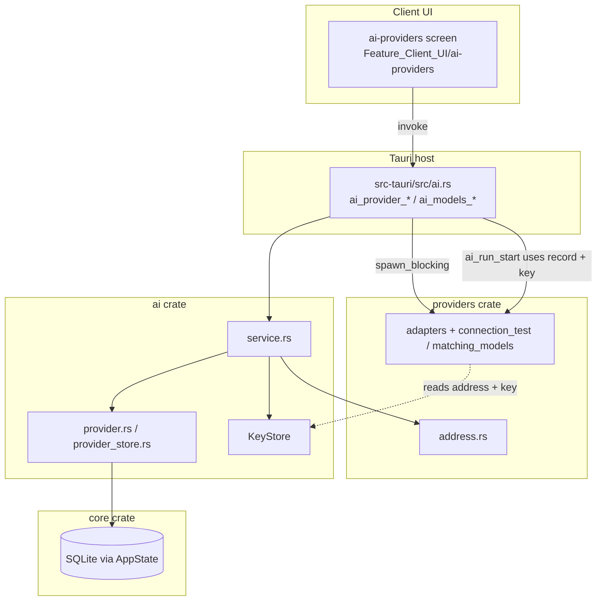

# ai_assistant_providers

## Introduction

`ai_assistant_providers` is the part of the AI Assistant that manages **Providers**: the places a question is sent to. A Provider has a kind (for example Anthropic, OpenAI-compatible, OpenRouter, or the Wrapper), a name, an address, and optionally a key. This page covers how Providers are created, edited, deleted, keyed, tested, and searched for Models, and how their usage is recorded. It does not cover how a question is answered once a Provider is chosen; that is described in [ai_assistant_runs](ai_assistant_runs.md) and the [harness](../harness.md).

Providers are kept on the device only. They never sync (see [ai_assistant_conversations](ai_assistant_conversations.md) for the sync-related rules and the [AI Assistant overview](../ai_assistant.md) for the module as a whole).

---

## Scope of the module

| Layer | Location | Responsibility |
|---|---|---|
| Tauri commands | `src-tauri/src/ai.rs` | Thin IPC wrappers: `ai_provider_*`, `ai_models_*` |
| Domain service | `crates/ai/src/service.rs` | Validation, address/key rules, view construction |
| Types | `crates/ai/src/provider.rs` | `KeyPolicy`, `NewProvider`, `ProviderUpdate`, `ProviderRecord`, `ProviderView` |
| Storage | `crates/ai/src/provider_store.rs` | SQL on `ai_providers` and `ai_model_usage` |
| Address rules | `crates/providers/src/address.rs` | `check()` for scheme/host rules |
| Command tests | `src-tauri/src/ai_provider_tests.rs`, `src-tauri/src/ai_wire_tests.rs` | Behaviour through the commands |

The Provider-level HTTP work (connection tests, Model lists, and chat requests) lives in the [providers crate](../providers.md).

---

## Core concepts

### Kinds and key policy

Each kind declares a `KeyPolicy` (`crates/ai/src/provider.rs`):

| Policy | Meaning | Example behaviour |
|---|---|---|
| `NotNeeded` | The kind never takes a key | Wrapper: `ai_provider_key_set` is refused with "This kind of Provider does not use a key." |
| `Optional` | The kind may take a key | OpenAI-compatible: a key is sent as `Bearer` when saved; creation reports `key_state: "not_needed"` until one is saved |
| `Required` | The kind cannot work without one | Anthropic and OpenRouter: created with `key_state: "missing"`; a run refuses to start without a key |

The kind also decides whether the address is editable:

- **Anthropic** is created at its fixed address `https://api.anthropic.com/v1`; any other address is refused with a validation error.
- **OpenRouter** is created at its fixed address `https://openrouter.ai/api/v1`, regardless of the address sent. It also supports a paid-Model switch (`allow_paid`).
- **Wrapper** and **OpenAI-compatible** take an address the person types.

### Records and views

- `ProviderRecord` is the stored row (`ai_providers`): `id`, `name`, `kind`, `address`, `created_at`, `updated_at`, `allow_paid`, plus `deleted_at` for soft delete.
- `ProviderView` is what the screen receives. It carries the key *state* (`saved`, `missing`, `not_needed`) and never the key itself. Every create, update, and key command returns a `ProviderView`.

### Keys

Keys are stored outside the database, in the device's `ai-keys` config folder, one entry per Provider id (`KeyStore`). They are:

- **Write-only.** `ai_provider_key_set` returns the view, not the key; the key is never logged.
- **Excluded from backup.** The Android backup and data-extraction rules exclude the `ai-keys` folder of both Production and Sandbox environments (asserted by `the_android_backup_rules_exclude_the_key_folder_of_both_environments`). The rule files live under `src-tauri/gen/android/app/src/main/res/xml/`.
- **Removed with their Provider.** Deleting a Provider removes its key at once.
- **Cleared on address change.** When an update changes the address, the key is removed, because a key must not follow the person to a different server.

---

## Command surface

All commands are in `src-tauri/src/ai.rs` and take the shared `AppState`.

| Command | Purpose | Notes |
|---|---|---|
| `ai_provider_list` | Every live Provider, oldest first | Never carries a key |
| `ai_provider_create` | Adds a Provider of a chosen kind | Name and address validated; `allow_paid` starts `false` |
| `ai_provider_update` | Changes name and address (and `allow_paid`) | Address change clears the key; `allow_paid` only sticks for OpenRouter |
| `ai_provider_delete` | Soft-deletes a Provider and removes its key | `not_found` when already deleted |
| `ai_provider_key_set` | Saves a key | Refused for `NotNeeded` kinds; write-only |
| `ai_provider_key_clear` | Removes a key | Returns the updated view |
| `ai_provider_test` | Connection test: connected or not, and model count | Runs on `spawn_blocking`, without the database lock |
| `ai_models_search` | Model ids containing a query | Asked only when the person browses or searches; runs off the command thread |
| `ai_models_usage` | Recently used and most-used Models | Max 5 each; deleted Providers dropped |

### Create / edit / key flow

### Rules enforced

| Rule | Where | Observed result |
|---|---|---|
| Name is required and at most 40 characters | `validate_name` in `service::create` / `update` | Validation error; nothing saved |
| `http` only for local addresses | `providers::address::check` | "Plain http ..." validation error for public hosts |
| Only `https` / `http` schemes | `check` | `ftp://` refused |
| No bare host without scheme, no query string | `check` | Refused as invalid |
| Trailing `/` removed | `check` | `http://192.168.1.20:8080/v1/` stored as `.../v1` |
| Anthropic address fixed | `address_for` | Other addresses refused |
| Key refused for `NotNeeded` kind | `set_key` | Nothing written to the key folder |

The address rules are checked against a shared fixture (`src/lib/ipc/fixtures/ai-addresses.json`) that the browser mock also uses, so the Rust and TypeScript sides cannot drift apart. Failure wording is checked the same way against `ai-failures.json`.

---

## Connection test and Model search

Both commands follow the same pattern: resolve the record and key while holding the database lock briefly, then run the network call on a blocking thread without it.

- **Connection test** returns `connected`, a `models` count, a message such as `Connected · 3 models`, or a `failure` kind with a fixed sentence. Raw text from the Provider is never shown, which is asserted with a fixture containing a secret string.
- **Model search** returns the ids that contain the query (case-insensitive). For OpenRouter it also lists paid Models separately (`paid_models`), so the screen can show them as paid.
- Nothing is fetched in the background. The test `model_search_asks_the_provider_only_when_called_and_filters_by_text` checks that no request is made until the screen asks.

Failure kinds that reach the screen from these calls include `unreachable`, `key_rejected`, and `model_unavailable`. Their wording is defined in `crates/ai` and matched to the browser mock. See [providers](../providers.md) for how HTTP status codes map to these kinds.

---

## Usage and paid Models

- `ai_model_usage` records one row per provider and model, with `uses` and `last_used_at`. Rows are written when a run starts (see [ai_assistant_runs](ai_assistant_runs.md)).
- `ai_models_usage` returns two lists of up to five: `recent` (by `last_used_at`) and `most_used` (by `uses`, then recency). Rows whose Provider is deleted are dropped by the join.
- **Paid Models** exist only for OpenRouter. `allow_paid` defaults to `false`. While it is off, a paid Model is listed as paid and a run for it is refused before any chat request is sent. Turning it on (`ai_provider_update` with `allow_paid: true`) lets paid routes be sent; free routes always carry a zero price cap, so the provider never bills for them.

---

## Provider lifecycle

Deletion is soft: the row keeps `deleted_at`, so existing conversations still show the Provider's name (asserted by `a_deleted_provider_keeps_its_conversations_readable`), while the Provider no longer appears in `ai_provider_list` or the Model usage lists.

---

## Relationships with other modules

| Related page | Relationship |
|---|---|
| [AI Assistant Engine](../../AI_Assistant_Engine.md) | Parent module |
| [ai_assistant](../ai_assistant.md) | Module that owns the Tauri commands for conversations, runs and Providers |
| [ai_providers](../ai_providers.md) | Crate-level provider types and store (`crates/ai`) that this page documents from the command side |
| [providers](../providers.md) | Wire adapters, address checks, and HTTP failure mapping |
| [harness](../harness.md) | Runs the Provider's Steps once a run starts |
| [ai_assistant_runs](ai_assistant_runs.md) | Uses the Provider and Model chosen here to start a run |
| [ai_assistant_conversations](ai_assistant_conversations.md) | Conversations keep their Provider name after deletion |
| [Data_Foundation core](../../Data_Foundation/core.md) | Database and settings access used by the store |
| [Tauri host and IPC bridge](../../Tauri_Host_and_IPC_Bridge/app_shell.md) | Registers the commands and the shared `AppState` |
| [Feature client UI](../../Feature_Client_UI.md) | The Provider screen that calls these commands |

Links to pages that are not in this folder use paths relative to this page.

---

## Testing

Behaviour is tested at the command layer:

- `src-tauri/src/ai_provider_tests.rs` covers create/list/edit/delete, name and address rules, key refusal for `NotNeeded` kinds, connection test outcomes, Model search being on demand, usage ordering, and the Android backup exclusion rules. Failure wording and address rules are checked against the shared fixtures.
- `src-tauri/src/ai_wire_tests.rs` covers the real adapters against a loopback fake server: OpenAI-compatible keys sent as Bearer and bound to their address, the Anthropic fixed address and `x-api-key` header, OpenRouter's fixed address, the zero price cap on free routes, and paid Models refused while the switch is off.

The tests use the `TestApp` harness and `FakeServer`, so they need no network access and no real Model.

---

## Maintenance notes

- To add a kind, add a variant with its `KeyPolicy`, its address rule in `address_for`, and an adapter in the providers crate. Then add a command test and extend the shared address fixture.
- Never return or log a key. Keep any new Provider-level data out of sync payloads; Providers and usage stay on the device.
- Keep the address check as the single source of truth. The browser mock reads the same fixture, so changing a rule means changing the fixture too.
