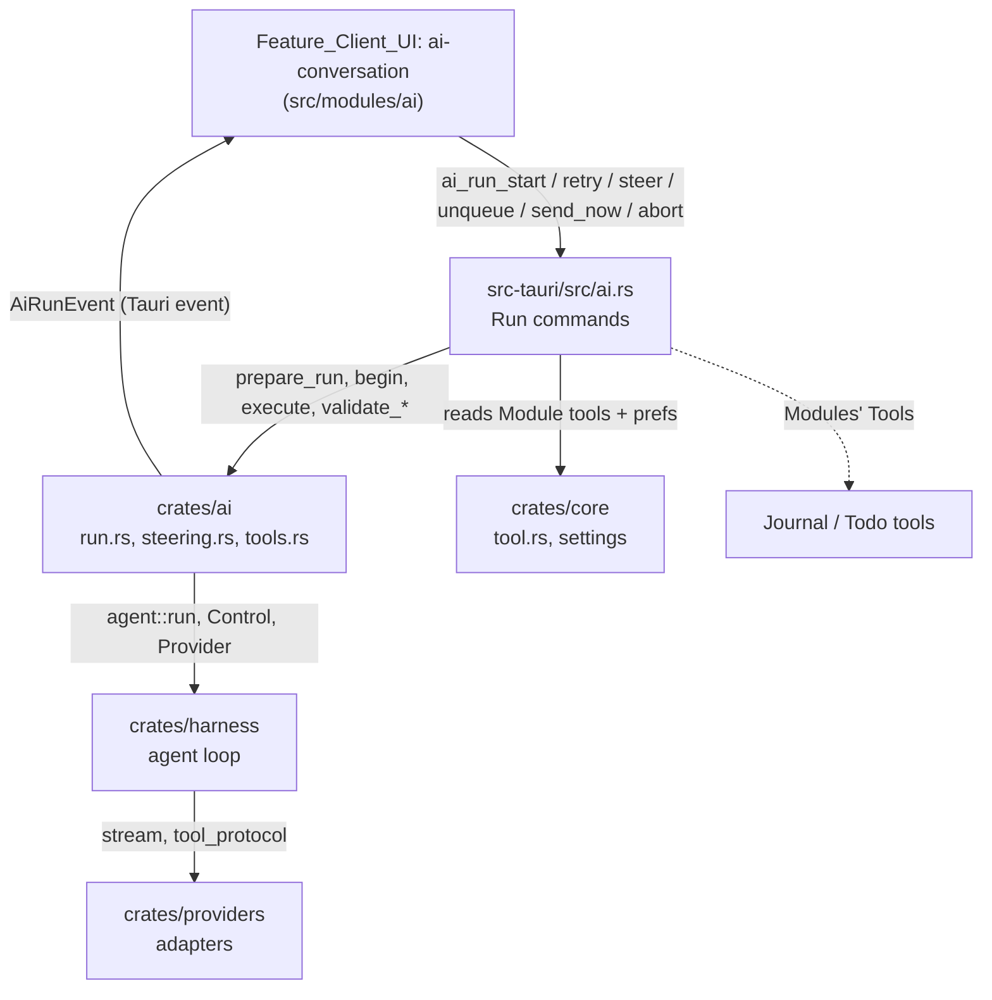
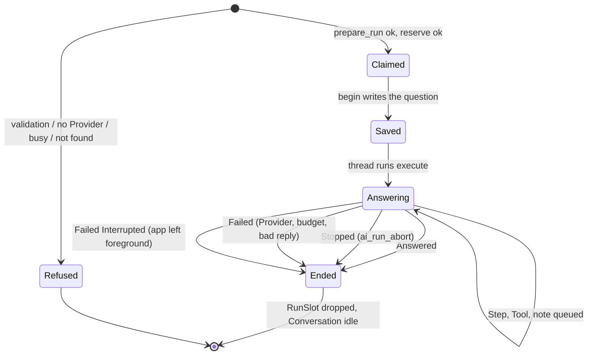
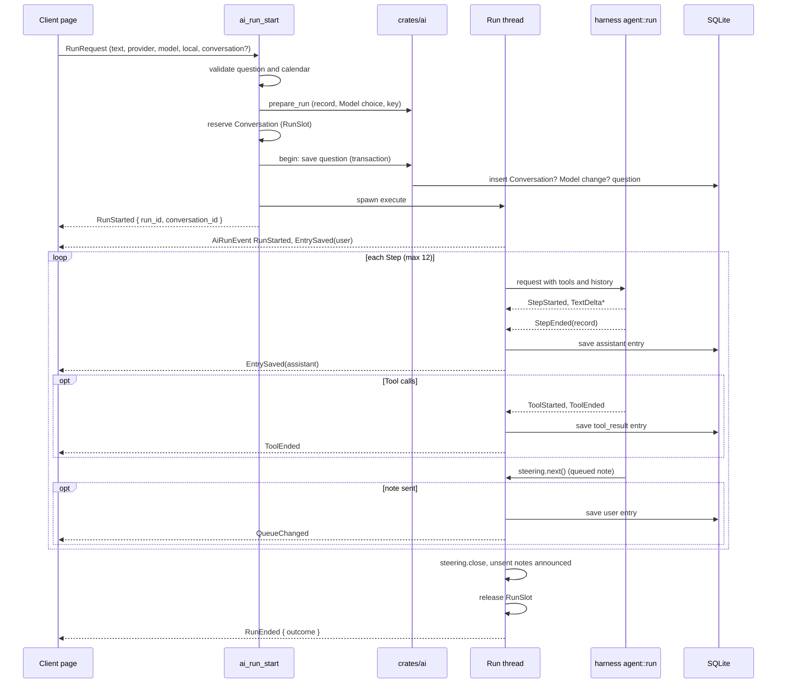
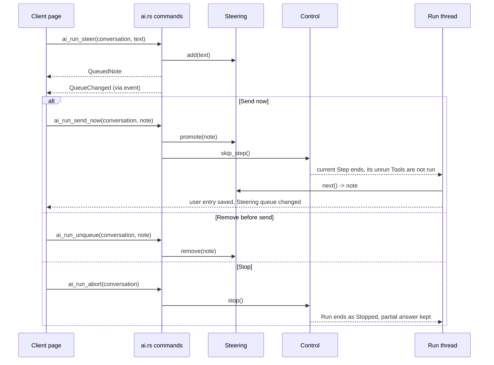

# ai_assistant_runs

## Introduction

`ai_assistant_runs` is the part of the AI Assistant that answers a question. A **Run** takes a question, saves it into a Conversation, asks the configured Provider for an answer (possibly over several Steps, calling read-only Tools in between), saves every entry as it happens, and reports progress as typed events. While a Run answers, the person can stop it, queue notes for the Model, or send a queued note immediately.

The module is the Tauri command layer over the Run logic in `crates/ai`, which in turn drives the agent loop in `crates/harness`. It owns:

- the per-Conversation registry of answering Runs (`AiRuntime`, `LiveRun`, `RunSlot`);
- the commands that start, retry, steer, unqueue, send-now and abort a Run (`src-tauri/src/ai.rs`);
- the per-Run queue of notes (`Steering`, in `crates/ai/src/steering.rs`);
- the tests that pin down Run behaviour end to end (`src-tauri/src/ai_tracer_tests.rs`, `ai_run_control_tests.rs`, `ai_tools_tests.rs`).

Conversation storage, Provider records and keys, Saved questions and the history screen are documented in [ai_assistant_conversations](ai_assistant_conversations.md) and [ai_assistant_providers](ai_assistant_providers.md). The agent loop, Provider adapters and wire formats are in [harness](../harness.md) and [providers](../providers.md). The parent overview is [ai_assistant](../ai_assistant.md).

---

## Where it sits

The command layer stays thin. The rules (question validation, branch placement, Model-change entries, entry saving, outcome mapping, failure wording) live in `crates/ai`. Only the threading, the registry of live Runs and the event emission live in `ai.rs`.

---

## Components

### `AiRuntime`, `LiveRun` and `RunSlot`

`AiRuntime` is the state the Tauri app holds for AI work:

| Field | Purpose |
|---|---|
| `keys: KeyStore` | Keys saved on this device (`ai-keys` directory). |
| `provider: Mutex<Option<Arc<dyn Provider>>>` | Test-only override; tests install a scripted Provider. |
| `running: Arc<Mutex<HashMap<String, Arc<LiveRun>>>>` | The Runs answering now, keyed by Conversation id. |

`LiveRun` holds what the person can do to a live Run: its `run_id`, a harness `Control` (stop / skip step / interrupt) and its `Steering` queue.

`reserve(conversation, run_id)` claims a Conversation for one Run and returns a `RunSlot`. It returns `None` when another Run already holds that Conversation, which is how the one-answer-per-Conversation rule is enforced. `RunSlot` removes the claim in its `Drop`, so the claim is released however the Run thread ends.

`interrupt_all()` tells every live Run it was interrupted. It is called when the app leaves the foreground on Android (see [Interruption](#interruption-on-android)).

### Run commands (`src-tauri/src/ai.rs`)

| Command | Behaviour |
|---|---|
| `ai_run_start` | Starts a Run for a new or existing Conversation. Returns `RunStarted { run_id, conversation_id }` at once. |
| `ai_run_retry` | Asks the same question again as a sibling of itself (`branch_of = entry_id`). The question text is read from the Conversation. |
| `ai_run_steer` | Queues a note for the Run answering in the Conversation. Refused with "No answer is being written…" when none is. |
| `ai_run_unqueue` | Removes a queued note that has not been sent. Refused as "already sent" otherwise. |
| `ai_run_send_now` | Promotes a queued note to the front and asks the Step in progress to end (`skip_step`). |
| `ai_run_abort` | Calls `control.stop()` on the live Run. Silent when none is answering. |
| `ai_conversation_get` | Returns the Conversation view and fills `queued` from the live Run's queue, so a page opened mid-Run shows waiting notes. |

Helpers in the same file: `answering()` and `not_answering()` produce the refusal for a missing Run; `already_sent()` is a `NotFound`; `announce_queue()` emits a `QueueChanged` event with the current queue; `join_error()` maps a failed blocking task to an `Internal` error.

### `start_run`

`start_run` is the shared path for `ai_run_start` and `ai_run_retry`. It runs in this order:

1. Validates the question text and the person's calendar (`validate_question`, `validate_local`).
2. Refuses `branch_of` without a `conversation_id`: a new Conversation has no question to branch from.
3. Resolves the Conversation id (a fresh id when none is given).
4. Calls `prepare_run` to resolve the Provider record, the Model choice and its key. This is the only place a missing Provider becomes `not_found`.
5. Reserves the Conversation **before** any write. The comment in the code gives the reason: a Run's first write happens on its own thread, so a Conversation that is answering may not be on disk yet.
6. If the Conversation continues, calls `ensure_conversation`, so a missing Conversation is `not_found` before anything runs.
7. Builds the Tool set: `offered_tools` collects the Tools of every Module that is on, and the names of Modules that are off and would have offered Tools.
8. Calls `begin` to save the question synchronously, so the Conversation can be read as soon as the command returns.
9. Spawns a thread that calls `execute`, forwarding each `RunEvent` as an `AiRunEvent` tagged with `run_id` and `conversation_id`.

The `RunSlot` is moved into the thread. It is released just before the `RunEnded` event is emitted, so a read that follows the end event always finds the Conversation idle.

### Tool offering

`offered_tools` reads two core Preferences: `disabled_modules` and `enabled_optional_modules`. A Module contributes its Tools when `is_enabled` says so. A Module that is off but has Tools is listed by its capitalised id in `off`, and the system prompt then tells the Model that the Module is turned off (`turning_a_module_off_removes_its_tools_and_the_prompt_says_so`). See [Data_Foundation](../../Data_Foundation.md) for the Preference store.

### `Steering` (`crates/ai/src/steering.rs`)

`Steering` is the queue of notes a person types during a Run. It is shared between the Run thread and the commands.

| Method | Effect |
|---|---|
| `add(text)` | Appends a note with a new id. Returns `None` once the queue is closed. |
| `remove(id)` | Drops an unsent note. Returns whether it was there. |
| `promote(id)` | Moves a note to the front. |
| `next()` | Pops the next note to send. Used by the agent loop at Step boundaries. |
| `snapshot()` | Lists waiting notes in order. |
| `close()` | Stops accepting notes and returns the ones never sent. |

### `Recorder` and `execute` (`crates/ai/src/run.rs`)

`execute` is the Run body. It emits `RunStarted`, then `EntrySaved` for the question, then runs `agent::run` with:

- `steering.next` as the source of queued notes;
- a `Recorder` that turns each harness `Event` into a saved entry and a `RunEvent`.

When the loop ends, `execute` closes the queue first, so a note sent at that moment is refused rather than lost, then emits `QueueChanged` with any notes that were never sent. It maps the harness outcome to a `RunOutcome`:

| Harness outcome | `RunOutcome` |
|---|---|
| `Answered` | `Answered` |
| `Stopped` with `control.interrupted()` | `Failed { Interrupted }` |
| `Stopped` otherwise | `Stopped` |
| `Failed(kind)` | `Failed { kind, message }` |

A failure that the Recorder cannot save (`broken`) overrides the outcome with `Failed { Unexpected }`. `failure_message` supplies the one plain sentence the person reads; the Provider's own text is never shown.

---

## Run lifecycle

`Refused` ends before anything is written, so no Conversation is created or changed.

---

## Sequence: asking a question

Every entry is written in its own transaction, after the one before it. The database lock is held only for those writes and for reading the branch. It is not held while the Provider streams or a Tool reads, so other screens stay responsive.

---

## Sequence: steering a live Run

Notes are sent only at Step boundaries, after the Step's Tools finish. "Send now" is different from stopping: the Step is ended, the note is sent next, and the Run goes on. Its interrupted Step is saved with `stop = "stop"`, not as stopped.

---

## Behaviour rules

These are the rules the code enforces, with the tests that check them.

**One answer per Conversation.** A second question or a delete while a Run answers is refused. Two different Conversations can answer at once (`a_second_conversation_answers_while_the_first_is_still_going`). Delete is refused by `ai_conversation_delete` through `is_running`; see [ai_assistant_conversations](ai_assistant_conversations.md).

**Stopping keeps what was written.** The partial answer is saved with `stop = "aborted"`. The next question is sent to the Model with the partial answer as an assistant message (`stopping_a_run_keeps_what_was_written_and_the_conversation_can_go_on`). A Run stopped before any text leaves an empty answer and does not forward it (`a_run_stopped_before_it_wrote_anything_is_marked_stopped_and_leaves_no_empty_answer_behind`).

**Stopping during a blocked reply ends at once.** The Run does not wait for a late reply, and a late reply never reaches the Conversation (`stopping_a_run_waiting_on_a_blocked_reply_ends_it_at_once_and_the_late_reply_is_never_written`).

**Stopping mid-calls keeps the calls.** Calls that were streamed but not run are saved as error `tool_result` entries with the text "stopped before this call ran", so the transcript stays valid (`stopping_in_the_middle_of_the_calls_keeps_the_ones_not_run_as_stopped_results`).

**Notes go after the Tools.** A queued note is sent after the Step's Tools finish, never in the middle of them. A removed note is never sent. Notes still queued when the Run ends are handed back in a `QueueChanged` event (`a_note_still_queued_when_the_run_stops_is_handed_back_and_not_sent`). A Run that has ended accepts no more notes.

**Send now on the forced answer.** When the budget forces the final answer, "Send now" ends that answer and the note is handed back, because no Step is left to send it (`send_now_on_the_answer_the_budget_forces_ends_the_run_and_hands_the_note_back`).

**Step budget.** A Run makes at most 12 requests (`MAX_REQUESTS`). The twelfth has no Tools, and its answer carries `budget_note` = "Answered after 12 steps; there may be more to find" (`the_twelfth_request_has_no_tools_and_its_answer_says_it_may_be_incomplete`). Up to eight calls run per Step, in order; the ninth is an error result (`at_most_eight_calls_run_per_step_and_they_run_in_order`).

**Model changes are entries.** When the question's Provider or Model differs from the Conversation's, a `model_change` entry is written before the question, so the branch shows which Model answered after it (`a_second_question_continues_the_branch_and_the_model_is_sent_all_of_it`).

**Branch placement.** Without `branch_of`, the question follows the visible branch. With `branch_of` (retry or edit), it follows what that question followed, and only a question can be asked again.

**Failures are one plain sentence.** Each `Failure` maps to a fixed message in `failure_message`. An unreachable Provider or a bad reply ends the Run with its kind and keeps the question (`each_failure_ends_the_run_with_its_kind_and_keeps_the_question`).

---

## Interruption on Android

When the app leaves the foreground, `interrupt_all()` sets the interrupt flag on every live Run. The harness then stops the Run, and `execute` maps it to `Failed { Interrupted }`, whose message is "The answer was interrupted. Try again." (`leaving_the_app_in_the_background_interrupts_the_run_and_says_so`). The lifecycle of that signal is described in [Tauri_Host_and_IPC_Bridge](../../Tauri_Host_and_IPC_Bridge.md).

---

## Events the client receives

Every event is an `AiRunEvent { run_id, conversation_id, event }`. The `event` is a `RunEvent`:

| Event | Meaning |
|---|---|
| `RunStarted` | The Run has begun. |
| `EntrySaved { entry_id, kind }` | An entry was written (`user`, `assistant`, `tool_result`, `correction`, `model_change`). |
| `StepStarted` / `TextDelta { text }` | A Step began; text is streaming. |
| `ToolStarted` / `ToolEnded` | A Tool call began or finished; `ToolEnded` carries `is_error` and a summary. |
| `QueueChanged { notes }` | The waiting notes changed. |
| `RunEnded { outcome }` | Final event. `Answered`, `Stopped`, or `Failed { kind, message }`. |

The client gets `ConversationView.queued` from `ai_conversation_get` when it opens. After that, it keeps up to date through `QueueChanged`.

---

## Tests

All three test files drive the real commands through the mock runtime, with a scripted Provider standing in for the Model (per ADR 0009).

| File | What it covers |
|---|---|
| `ai_tracer_tests.rs` | A question answered and saved as one Conversation, events in order; titles; the second question's context; date and time zone in the prompt; refusals; a failed step; the busy refusal. |
| `ai_run_control_tests.rs` | Stop keeps partial text; stop before output; stop mid-calls; notes after Tools; send now; unqueue; queue handed back; background interrupt; two Conversations at once; the budget and send-now. |
| `ai_tools_tests.rs` | The six read-only Tools against real Journal and Todo data; paging; deleted rows skipped; errors that keep the Run going; repeats; citation correction; length stops; the eight-call limit; the too-long budget; a Provider without native Tools; a Module turned off. |

Related command tests in the same area are documented with their own features in [ai_assistant_conversations](ai_assistant_conversations.md) and [ai_assistant_providers](ai_assistant_providers.md).

---

## Maintenance notes

- **Adding a command.** Keep it thin: validate, call into `crates/ai`, and emit events only from the Run thread. Do not hold the database lock across a Provider call or a Tool call.
- **Changing a failure.** Add the variant in `crates/harness`, map it in `failure_message`, and add a test to `ai_tracer_tests.rs` that pins the sentence.
- **The reservation must come before writes.** Moving `reserve` after `begin` or `ensure_conversation` breaks the one-answer-per-Conversation guarantee.
- **Event order is a contract.** The client depends on `RunEnded` being last and on `QueueChanged` after a Step's notes are sent. Tests check both.
