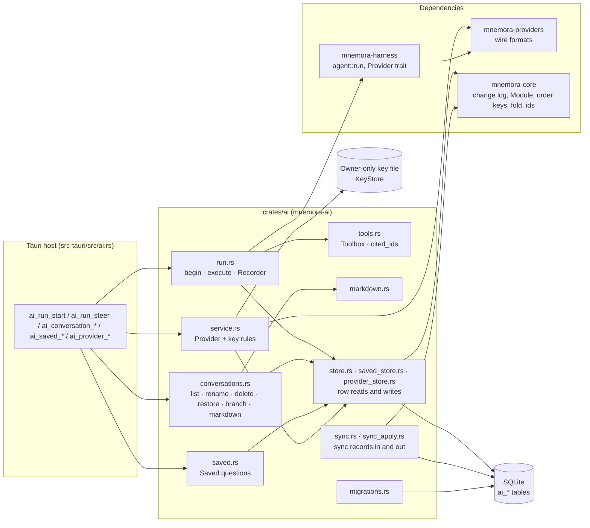
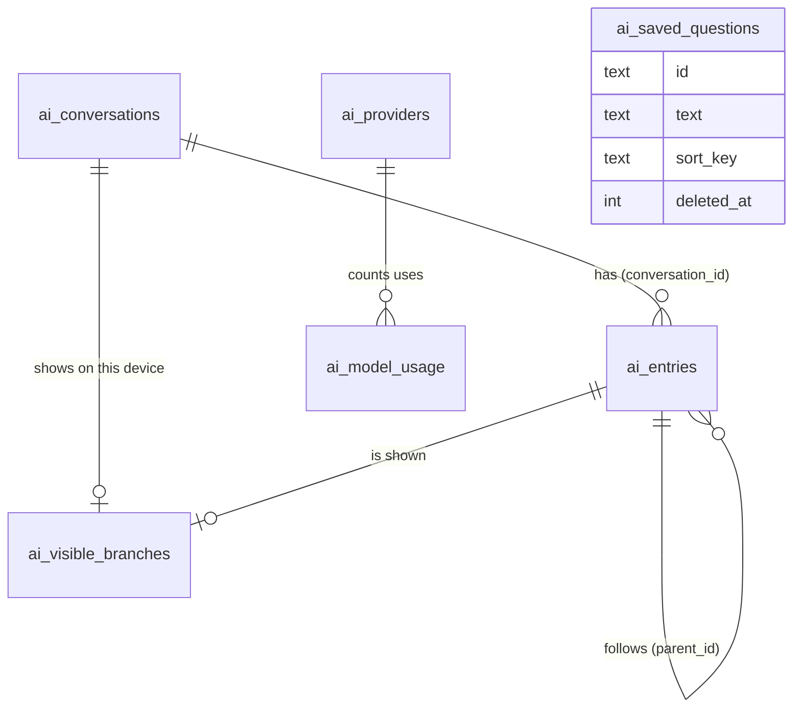
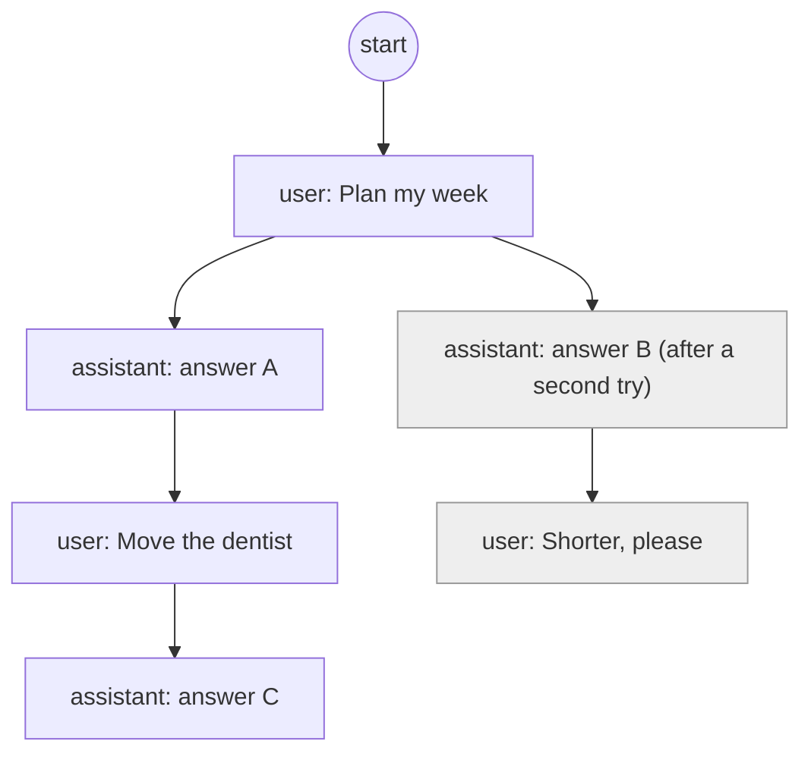
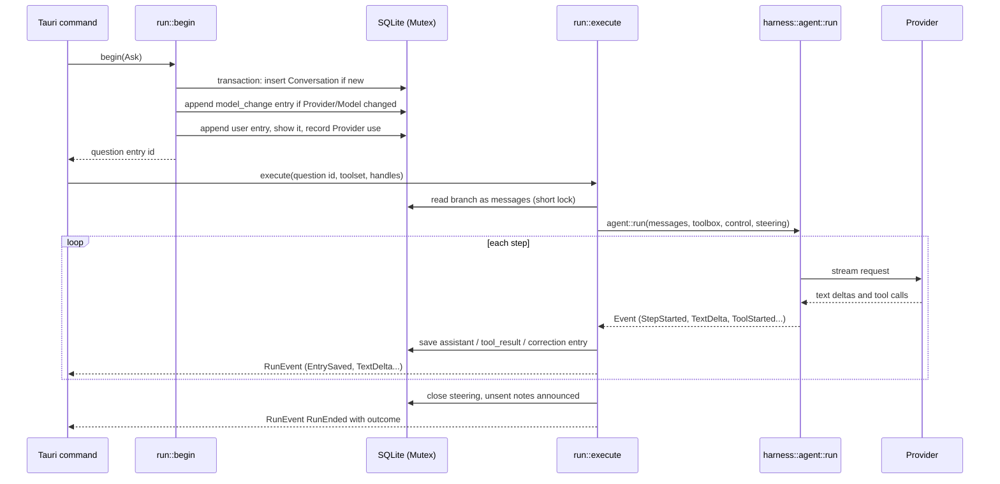
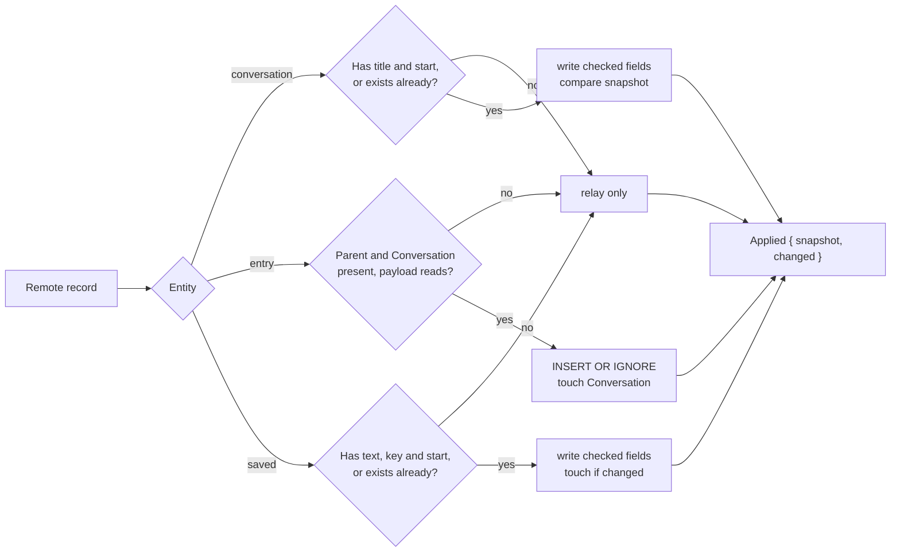

# AI Conversations (`mnemora-ai`, `crates/ai`)

The AI Conversations module stores and manages the AI Assistant's conversations: their entries, branches, saved questions, and the Provider/Model each one used. It also runs one question at a time through the harness and writes each step as it happens. It is the storage and rules layer behind the AI Assistant; it does not own the agent loop or the HTTP wire format.

The crate is read-only with respect to Journal and Task data. It only reads them through Tools (see [Tools and citations](#tools-and-citations)).

Related pages:

- [AI Assistant Engine (parent)](../AI_Assistant_Engine.md)
- [Harness: the agent loop and Provider contract](harness.md)
- [Providers: wire formats and addresses](providers.md)
- [AI Providers: Provider records, keys and usage](ai_providers.md)
- [AI Assistant: IPC commands and tests in the Tauri host](ai_assistant.md)
- [Sync Replication Engine](../Sync_Replication_Engine.md), which carries AI records between devices
- [Data Foundation (core)](../Data_Foundation/core.md), for the change log, `Module` trait and settings

## Scope

| Concern | Where it lives |
|---|---|
| Conversation and entry tables, migrations | `src/migrations.rs`, `src/store.rs` |
| Start a Conversation, write a question, run and record steps | `src/run.rs` |
| History list, rename, delete, restore, copy as Markdown, branch switching | `src/conversations.rs`, `src/markdown.rs` |
| Saved questions (ordered one-tap questions) | `src/saved.rs`, `src/saved_store.rs` |
| Provider and key orchestration (used by the Run and the Tauri commands) | `src/service.rs` |
| Applying AI records received from another device | `src/sync_apply.rs`, `src/sync.rs` |
| Tool execution bookkeeping and citation checks for a Run | `src/tools.rs` |
| Public surface and the `AiModule` registration | `src/lib.rs` |

`AiModule` is off by default (`default_enabled` returns `false`) and has no settings of its own. Its `Module` hooks are:

- `migrations()`: the append-only schema in `src/migrations.rs`.
- `sync_entities()`: three entities only: `CONVERSATION_SCHEMA`, `ENTRY_SCHEMA`, `SAVED_SCHEMA`.
- `apply_remote()`: delegates to `sync_apply::apply`.
- `backfill_log()`: delegates to `sync::backfill`, which logs existing rows for the first sync.

Build configuration for this crate is in `crates/ai/Cargo.toml`. It depends on `mnemora-core`, `mnemora-harness`, `mnemora-providers`, `rusqlite`/`rusqlite_migration`, `serde`/`serde_json`, `specta` (derive, for IPC types), `thiserror` and `tracing`. Workspace lints apply.

## Architecture

Keys are never in the database. `KeyStore` (`src/keys.rs`) keeps them in an owner-only file, and `ai_providers` has no key column. Providers and their usage are per device and are not synced (see [Sync](#sync)).

## Data model

Migrations are append-only (`src/migrations.rs`). Their order determines the schema:

1. `ai_conversations` and `ai_entries`. Conversations are soft-deleted and may be renamed. Entries are insert-only: there is no `updated_at` or `deleted_at` on them (ADR 0019).
2. `ai_providers` and `ai_model_usage`. Adds `provider_id`, `provider_name` and `model` to `ai_conversations`, so a Conversation records the Provider and Model it last used.
3. `ai_saved_questions`, with a fractional-index `sort_key` (ADR 0012) and soft delete so Undo restores the question in its old place.
4. `allow_paid` on `ai_providers` (paid OpenRouter Models are off by default).
5. `ai_visible_branches`: the entry each Conversation shows on this device. It is device-local, so it has no change-log row.
6. An index on `ai_entries(parent_id)` for branch walks and synced-parent lookups.

Entry kinds are `user`, `assistant`, `tool_result`, `correction` and `model_change`. The payload is JSON (`EntryPayload` in `src/types.rs`) and its `kind` must match the row's kind when applied from sync.

### The entry tree and branches

An entry follows exactly one parent, so a Conversation is a tree. A **Branch** is the path from the root to one leaf. Each Conversation shows one Branch per device:

- The shown entry is stored in `ai_visible_branches`. If none is stored, the newest entry is shown (`store::visible`).
- Questions that follow the same answer (or the same start) are **siblings**. `question_groups` groups them by their nearest non-`model_change` ancestor, so a Model switch between an answer and a question does not split siblings.
- The pager (`show_branch`) moves to a sibling by its 1-based position. `newest_under` then walks down to the newest leaf of that sibling's subtree.

Here "Plan my week" has two answers, so two questions that follow those answers are not siblings. The Branch the device shows is whichever leaf `ai_visible_branches` names; the other branches are not loaded by `conversation()`.

## Core flows

### Asking a question (`begin` then `execute`)

The Tauri command does two steps. `begin` runs first and returns once the question is stored, so the Conversation exists before the command returns. `execute` then runs in the background.

Key rules in `run.rs`:

- **The database lock is never held across network or tool calls.** Each `save_entry` and each `branch` read takes the lock for one operation only, so the rest of the app stays responsive while a Provider streams.
- **Each entry is saved after the one before it.** `Recorder` keeps `parent` as the last saved id. If saving fails, `broken` is set and the Run ends as `Failure::Unexpected`. The error is logged without Conversation text.
- **Every save also moves the shown Branch.** `save_entry` shows the new entry only if the shown entry was its parent, so a branch the person chose meanwhile is not overwritten.
- **Outcome mapping.** `Outcome::Stopped` becomes `RunOutcome::Stopped`, unless the Control was interrupted (app left in the background), which becomes `Interrupted`. Each failure kind maps to one fixed sentence in `failure_message`; the Provider's own text is never shown.
- **Notes still queued when the Run stops** are handed back as a `QueueChanged` event so the person can send them again.
- **Budget note.** If the Step budget forced the answer, the assistant entry carries `budget_note`: "Answered after N steps; there may be more to find".

### Try again and Edit

`Ask.branch_of` names a sibling question. `save_question` then uses that sibling's parent as the new question's parent, which adds a sibling rather than a follow-up. `question_text` provides the original text for Try again. Only a `user` entry can be a sibling; anything else is a validation error.

### Model changes

If the Conversation's stored Provider id or Model differs from the one asked with, `begin` appends a `model_change` entry before the question. The entry is not sent to the Model (`branch_messages` skips it), but it is visible in history and Markdown is unaffected.

### Copy as Markdown (`markdown.rs`)

`markdown::conversation` writes the title as `# title`, each question as `**You:** text`, and each answer's text with citations removed. Tool steps, corrections and Model changes are left out. A single answer copies with `markdown::answer`, which only accepts an assistant entry without tool calls.

`strip_citations` removes any `[<36-char lower-hex UUID>]` together with the whitespace before it. Brackets that do not hold an id stay as they are.

### History, rename, delete, restore

- `list` (`conversations.rs`) returns live Conversations newest first by `updated_at`. The filter folds both the query and each title (`mnemora_core::search::fold`), and only titles are matched. The page size is clamped to `1..=PAGE_MAX` (100), and `more` says whether another page exists.
- `rename` checks the title with `validate_title` before writing.
- `delete` soft-deletes (sets `deleted_at`). Nothing is purged, so `restore` can bring back the Conversation with every entry it had. The Tauri layer refuses deletion while a Run is answering in that Conversation.
- `touch_conversation` uses `MAX(updated_at, now)`, so an entry written from another device with a later clock is never moved backwards.

### Saved questions (`saved.rs`)

Saved questions are one-tap questions in a manual order. Running one is an ordinary Run; nothing here calls a Provider.

- `create` appends after the greatest key in the table, including deleted rows, so a restored question returns to its place.
- `reorder` places a question between two live neighbours using `key_between` from `mnemora_core::order`. If a neighbour has been deleted since the screen showed it, the call is not-found.
- `delete` and `restore` are soft deletes that keep the key.

## Tools and citations

`tools.rs` is the Module's side of the Tools a Run offers. The harness calls it through `ToolHost`:

- `specs()` offers the Tools only when the Provider supports native tool calls (`native`). Otherwise it offers none, and the prompt says so.
- `call(name, arguments)` returns a refusal as data, not as a failure, for an unknown Tool name, invalid JSON, or arguments that fail `check`. These are marked `invalid` so the harness can count them.
- Each successful call gets an observation label (`e1`, `e2`, ...). Results are wrapped in a note that the data is untrusted. A result over `RESULT_LIMIT` (`RESULT_CAP - 512` bytes) is replaced with an error that asks for a narrower request.
- Every item a Tool returns is recorded in `returned`, keyed by id.
- `check_answer` is the citation rule: every id written in the answer, and every id listed as a source, must be one a Tool returned in this Run. Otherwise the harness sends `UNSEEN_CITATION` back to the Model as a correction.
- `cited_ids` finds each distinct 36-character lower-case UUID in text, in order.

The Tools themselves (`mnemora_core::tool::Tool`) and their specs live in the feature crates. Their own pages are in [Data Foundation](../Data_Foundation.md), [Task and Journal Domain Services](../Task_and_Journal_Domain_Services.md) and [Feature Client UI](../Feature_Client_UI.md) for the consumers.

Sources of an answer are built in `Recorder` (`run.rs`) from the items a Tool returned and the ids the answer cites. They are saved on the assistant entry, which is how the screen links an answer to its sources.

## Sync

`AiModule::sync_entities` declares three synced record kinds, and nothing else from this crate leaves the device:

| Record | Synced | Notes |
|---|---|---|
| Conversation (title, times, deleted, Provider name/model group) | Yes | The Provider group moves together. |
| Entry | Yes | Insert-only. Applied with `INSERT OR IGNORE`. |
| Saved question (text, sort key, deleted) | Yes | Restores keep the key. |
| Provider and its usage | No | Per device (ADR 0019). |
| Keys | No | Never in the database. |
| Visible Branch | No | Device-local; written without a change-log row. |

`sync_apply::apply` handles records from other devices. It writes straight to the tables and never logs them again, since the record is already in the change log. Each field is checked the way the app's own writes check it, and a field that fails is left out.

- **Records that cannot be made yet are kept for relay.** A Conversation without a title or start, an entry whose Conversation or parent is not present, or an entry whose payload does not read gives `relay(change)`: nothing is written to the tables, but the fields are returned so the change log can pass them on.
- **Entries.** An entry is written only if its parent and Conversation exist. The write is `INSERT OR IGNORE`, so a repeated record changes nothing, and a new entry moves its Conversation's `updated_at` forward with `MAX`.
- **Changed flags.** Conversations and Saved questions compare their snapshot before and after with `updated_at` removed. Only a real change reports `changed`. A header change does not move `updated_at`, as on the device that made it.
- **Saved questions** that already exist are touched (`updated_at = MAX(...)`) when they change.

`sync::backfill` logs existing rows so that rows created before the change log existed reach the other device at the first sync.

The Sync Replication Engine owns merging, clocks and conflict handling for everything in this list. This crate supplies only the per-record rules above. See [Sync Replication Engine](../Sync_Replication_Engine.md) for the merge model.

## Errors

`AiError` (`src/error.rs`) is mapped into the IPC `AppError` at the crate boundary:

| Variant | `ErrorCode` | Meaning |
|---|---|---|
| `Validation(&'static str)` | `Validation` | Shown to the person as written. |
| `NotFound` | `NotFound` | Conversation missing or deleted. |
| `ProviderNotFound` | `NotFound` | Provider missing or deleted. |
| `Payload(serde_json::Error)` | `Internal` | An entry could not be read or written. |

Model answers never reach an error message. Run failures are reported as `RunOutcome::Failed { kind, message }` with the fixed sentence from `failure_message`.

## Public surface

`lib.rs` re-exports what the Tauri host calls:

- Conversations: `list_conversations`, `conversation_markdown`, `rename_conversation`, `delete_conversation`, `restore_conversation`, `set_leaf`, `show_branch`, `question_text`, `PAGE_MAX`.
- Runs: `begin`, `execute`, `Ask`, `Choice`, `Handles`, `Toolset`, `failure_message`, `Steering`, `QueuedNote`.
- Saved questions: `create_saved`, `list_saved`, `update_saved`, `delete_saved`, `restore_saved`, `reorder_saved`.
- Providers: `create_provider`, `list_providers`, `update_provider`, `delete_provider`, `set_key`, `clear_key`, `connection_test`, `matching_models`, `prepare_run`, `reachable`, `model_usage`, `build`.
- Shared rules and types: `title_of`, `validate_local`, `validate_question`, `TITLE_CHARS`, `cited_ids`, `UNSEEN_CITATION`, plus the IPC types in `types.rs` (`ConversationView`, `EntryView`, `RunEvent`, `RunOutcome`, `Source`, `LocalContext`, and others).
- Helpers: `conversation(conn, id, running)` builds the view of a Conversation's shown Branch, and `ensure_conversation` checks that a Conversation is live.

Titles are set from the first question (`title_of`, trimmed and capped at `TITLE_CHARS`) when a Conversation starts, and can be renamed later.

## Testing

Behaviour is tested from the Tauri host, not in this crate. The test files are in `src-tauri/src/` and cover this module (listed in the module tree under [AI Assistant](ai_assistant.md)):

- `ai_tracer_tests.rs`: asking a question, titling, the one-question-at-a-time rule, and failed steps.
- `ai_branching_tests.rs`: branch switching, Edit, Try again and the "shown branch is device local" rule.
- `ai_conversations_tests.rs`: history, search, rename, delete, restore, and Markdown copy.
- `ai_saved_tests.rs`: Saved questions, ordering and restore.
- `ai_sync_tests.rs`: convergence across two devices for conversations, entries, saved questions, and the rules for what never leaves a device.

The rules in `markdown.rs` and `tools.rs` have unit tests of their own (`citations_go_with_the_space_before_them`, `finds_each_id_once_in_order_and_ignores_other_text`).

Build and test commands are in the root `Makefile` (`make test`, `make lint`) and `Cargo.toml`. This crate has no separate build script.

## Maintenance notes

- **Migrations are append-only.** To change the schema, add an `M::up` at the end of `migrations::all()`. Do not edit an existing step; devices that already ran it would not match.
- **Entries are never updated.** Anything that needs a change to an entry must write a new entry after it.
- **Keep the device-local rule.** The visible Branch and the Provider list must stay out of the change log. Adding them there would sync per-device choices.
- **Never log question or answer text.** The `tracing::error!` calls in `run.rs` log only error messages that hold ids and SQL.
- **Add Tool results to `returned` through `Toolbox::call` only.** The citation check depends on it.
