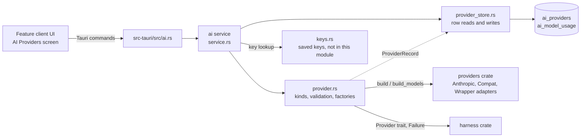
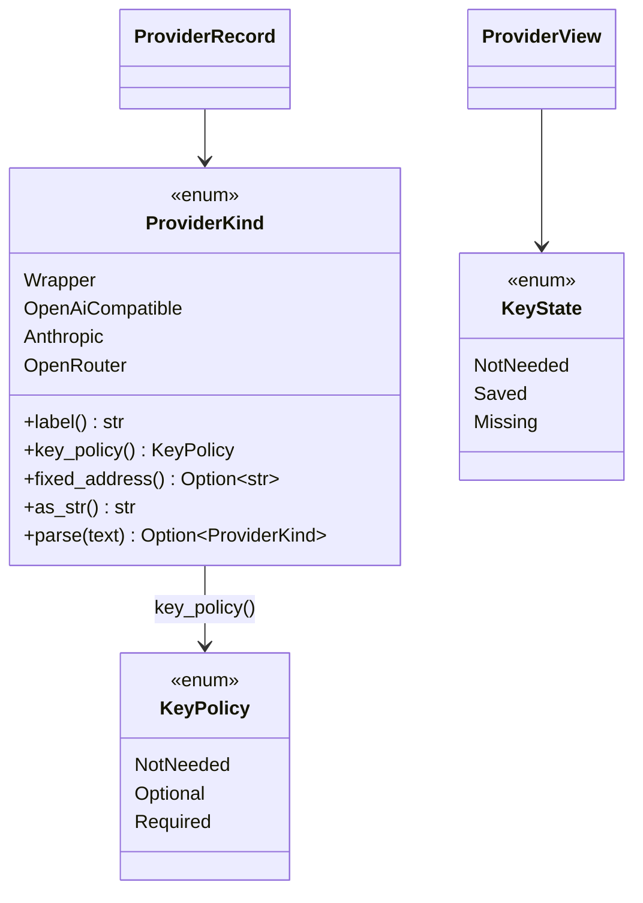
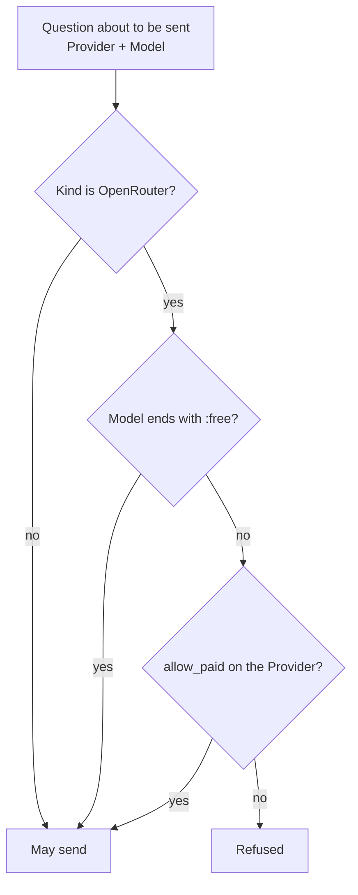
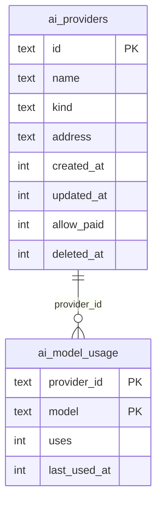
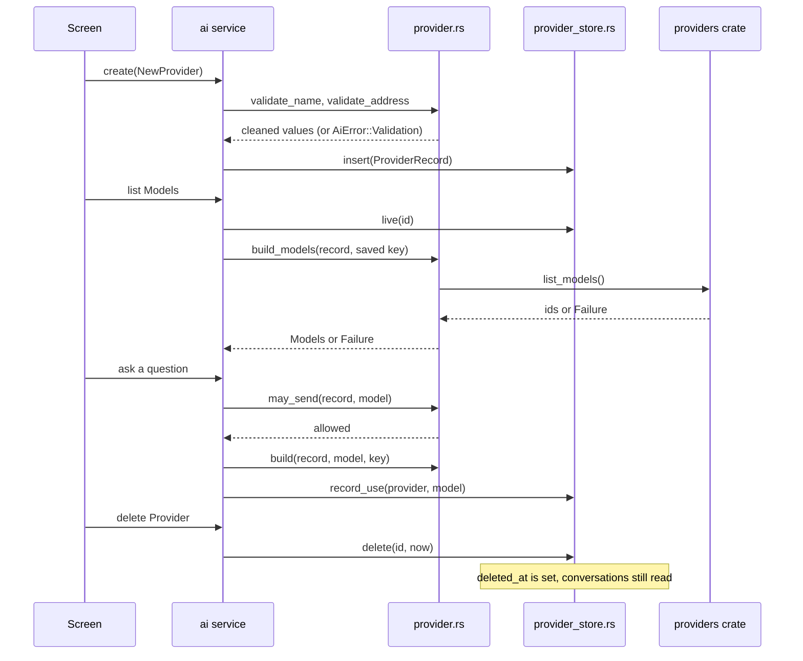

# AI Providers (`ai_providers`)

The `ai_providers` part of the AI Assistant Engine defines **what a Provider is on this device**: the services the assistant can ask, the kinds they come in, the rules their fields must follow, and how they are stored. It is the bridge between the person's saved settings and the wire adapters in the `providers` crate.

It covers two files in `crates/ai/src/`:

| File | Responsibility |
|------|----------------|
| `provider.rs` | Kinds, field rules, the screen-facing views, Model usage types, and the factories that turn a stored record into a runnable adapter. |
| `provider_store.rs` | Row-level reads and writes of the `ai_providers` and `ai_model_usage` tables. No rules live here. |

Related documentation (not repeated here):

- [AI Assistant Engine overview](../AI_Assistant_Engine.md) for the module as a whole.
- [Providers (wire adapters)](providers.md) for the `mnemora_providers` crate: `AnthropicProvider`, `CompatProvider`, `WrapperProvider`, the address checker and the JSON envelope.
- [Harness](harness.md) for the `Provider` trait and `Failure` values that the factories return.
- [AI Conversations](ai_conversations.md) for the conversations that name a Provider and Model and keep working after the Provider is deleted.
- [AI Assistant (Tauri host)](ai_assistant.md) for the `ai_provider_*` and `ai_models_*` commands that call into this module.
- [Feature client UI: AI Providers](../Feature_Client_UI/ai-providers.md) for the screen that edits Providers.

---

## 1. Purpose and scope

A **Provider** is a named connection to a model service: a local wrapper, an OpenAI-compatible endpoint, Anthropic, or OpenRouter. Each Provider:

- belongs to **one device** and is **never synced** (the record has no sync path; the Provider's key lives in a separate `keys.rs` module and never in this record);
- has a **kind** that fixes its behaviour (whether a key is needed and whether the address may be edited);
- is **soft-deleted**, so conversations that name it still read correctly.

The module answers four questions:

1. Which kinds exist and what does each one allow? (`ProviderKind`, `KeyPolicy`)
2. Are the person's field values acceptable? (`validate_*` functions)
3. What may the screen see? (`ProviderView`, `KeyState`)
4. How is a stored record turned into something that can be called? (`build`, `build_models`)

---

## 2. Architecture and component relationships

Key design points:

- **`provider.rs` owns the rules; `provider_store.rs` only moves rows.** The store never decides whether a value is valid.
- **The screen never receives a key.** `ProviderView` carries only `KeyState` (`NotNeeded`, `Saved`, `Missing`).
- **Keys are passed in, not stored here.** `build` and `build_models` take `key: Option<String>` as an argument, so the caller supplies the saved key at call time.

---

## 3. Provider kinds

`ProviderKind` is the central type. It is serialised in `snake_case` and stored as text.

| Kind | Stored text | Label | Key policy | Fixed address | Notes |
|------|-------------|-------|------------|---------------|-------|
| `Wrapper` | `wrapper` | Local AI Wrapper | `NotNeeded` | none (person-given) | On this machine or the person's network. Answers in the JSON envelope. |
| `OpenAiCompatible` | `openai_compatible` | OpenAI-compatible | `Optional` | none (person-given) | OpenAI chat format with native tool calls. |
| `Anthropic` | `anthropic` | Anthropic | `Required` | `anthropic::ADDRESS` | Messages API. |
| `OpenRouter` | `openrouter` | OpenRouter | `Required` | `OPENROUTER_ADDRESS` (`https://openrouter.ai/api/v1`) | Free Models by default; paid Models need the Provider's own switch. |

`fixed_address()` returning `Some` means every Provider of that kind uses that address and the person cannot change it.

### Key state as the screen sees it

`ProviderRecord::view(key_saved)` derives the `KeyState`:

| Kind policy | Key saved? | `KeyState` |
|-------------|-----------|------------|
| `NotNeeded` | any | `NotNeeded` |
| `Optional` | no | `NotNeeded` (works without a key) |
| `Optional` | yes | `Saved` |
| `Required` | yes | `Saved` |
| `Required` | no | `Missing` |

---

## 4. Stored record and screen view

Two structs describe a Provider at different trust levels:

| Type | Used by | Contents |
|------|---------|----------|
| `ProviderRecord` | Rules, store, factories | id, name, kind, address, `created_at`, `updated_at`, `allow_paid`. Never leaves the backend. |
| `ProviderView` | Tauri commands and the screen | The same fields minus nothing sensitive, plus `key_state`. Carries no key. |

`allow_paid` is documented as meaningful only for `OpenRouter`; it is "always false elsewhere". The rules that enforce this live in the callers, not in the store.

### Input types

| Type | Fields | Notes |
|------|--------|-------|
| `NewProvider` | `kind`, `name`, `address` | Kind is chosen first. |
| `ProviderUpdate` | `name`, `address`, `allow_paid` (defaults to `false` when absent) | The kind cannot be changed by an update. |

---

## 5. Validation rules

Every field passes through a `validate_*` function that trims the input and returns either the cleaned value or an `AiError::Validation` with a sentence the person can read.

| Function | Rule | Limit constant |
|----------|------|----------------|
| `validate_name` | Non-empty after trimming; at most 40 characters | `NAME_CHARS = 40` |
| `validate_address` | Delegates to `providers::address::check`; maps `Invalid`, `UnsupportedScheme` and `PlainHttpNotAllowed` to specific messages. Plain `http` only for this machine, the local network and Tailscale. | — |
| `validate_key` | Non-empty after trimming; at most 512 **bytes** | `KEY_BYTES = 512` |
| `validate_model` | Non-empty after trimming; at most 200 characters; no control characters. Any id the Provider accepts is allowed, so only shape is checked. | `MODEL_CHARS = 200` |

Address checking is shared with the wire layer; see [Providers (wire adapters)](providers.md) for the address rules themselves.

---

## 6. Sending rules: paid and free Models

- `may_send(record, model)` implements this check.
- `is_free(model)` is true when the id ends with `:free`, the suffix OpenRouter uses for free routes.
- When `build` creates an OpenRouter adapter for a **free** route, it attaches an extra request field `provider.max_price` with `prompt: 0` and `completion: 0`, so the service cannot charge for it even if the route changes price.

---

## 7. Factories: from a record to a callable adapter

Two functions turn a stored record into something the harness can use. Both branch on `ProviderKind`.

### `build_models(record, key)` — list the Models a Provider offers

| Kind | Adapter | Key handling |
|------|---------|--------------|
| `Wrapper` | `WrapperProvider` | Key passed through (usually none). |
| `OpenAiCompatible` | `CompatProvider` | Key passed through; optional. |
| `Anthropic` | `AnthropicProvider` | **Required.** Missing key returns `Failure::KeyRejected`. |
| `OpenRouter` | `CompatProvider` | **Required.** Missing key returns `Failure::KeyRejected`. |

Returns `Result<Vec<String>, Failure>`: the Model ids in the Provider's order, or a `Failure` that explains why the Provider could not be asked.

### `build(record, model, key)` — a runnable adapter

Returns `Arc<dyn Provider>`. The differences from `build_models`:

- `Anthropic` uses `key.as_deref().unwrap_or_default()`, so a missing key is sent as an empty string rather than failing here. The comment states that a run is never prepared without its key, so this path is a fallback, not the normal route.
- `OpenRouter` applies the zero-price cap described in section 6 when the model is free.

Both functions are the only place where kinds are dispatched to concrete adapters. Adding a kind means changing these matches, `key_policy`, `fixed_address`, `label`, `as_str` and `parse` together.

---

## 8. Model usage

The module also records which Models a device has used, so the screen can show "recent" and "most used" lists.

The schema is reconstructed from the SQL in `provider_store.rs`; the migration that creates it lives in `crates/ai/src/migrations.rs` (see [AI Conversations](ai_conversations.md)).

| Type | Contents |
|------|----------|
| `ModelUse` | `provider_id`, `provider_name` (current name), `model`, `uses`, `last_used_at` |
| `ModelUsage` | `recent` (newest first) and `most_used` (most uses first) |
| `ModelList` | `models`, `paid_models`, `failure`, `message` — result of a model search |
| `ConnectionTest` | `connected`, `models` (count), `failure`, `message` — result of a connection test |

---

## 9. Store (`provider_store.rs`)

Every function takes a `rusqlite::Connection`. Errors are `AppResult`.

| Function | SQL behaviour | Notes |
|----------|---------------|-------|
| `insert` | `INSERT` into `ai_providers` with all seven columns. | Stores `allow_paid` as `0`/`1`. |
| `live` | Select by id where `deleted_at IS NULL`. | Returns `None` for deleted or unknown ids. |
| `list` | All live rows, ordered by `created_at, id`. | Oldest first. |
| `update` | Changes `name`, `address`, `allow_paid`, `updated_at` on live rows. | Kind and `created_at` never change. |
| `delete` | Sets `deleted_at` and `updated_at` to `now`. | Soft delete. Does not check whether the row is already deleted. |
| `record_use` | Upsert into `ai_model_usage`: inserts `uses = 1` or increments `uses` and updates `last_used_at`. | Does not check that the Provider is live. |
| `usage` | Joins usage to providers, keeps only live providers, orders by recency or by count (then recency, then model), limited to `limit` rows. | Deleted Providers drop out of the lists but keep their conversations. |

`provider_store.rs` contains a `record` helper that maps a row to `ProviderRecord` and returns an `Internal` error if a stored kind is unknown to this build, so an older build reading a newer database fails loudly rather than guessing.

---

## 10. Lifecycle of a Provider

Notes on the flow:

- Validation happens in `provider.rs` before any row is written.
- A search for Models asks the remote service at call time; it is not cached in this module.
- Deletion is reversible in data terms (the row remains), but this module does not expose an undelete.

---

## 11. Data and sync boundaries

- **Never synced.** Providers, their addresses, and `ai_model_usage` stay on the device. The sync tests for the AI module assert this ("providers, usage and the visible branch never leave their device"); see [Sync Replication Engine](../Sync_Replication_Engine.md) for the engine itself.
- **No key in this module.** The key is a separate concern; `KeyState` is the only key information that crosses to the screen.
- **Soft delete preserves history.** Conversations keep the Provider id and Model they used. Usage lists drop deleted Providers, while conversations continue to read.
- **Device-scoped data version.** Changes to these tables are not in the sync change log, so there is nothing for a peer to reconcile.

---

## 12. Error handling

| Source | Type | Surfaced as |
|--------|------|-------------|
| Bad user input | `AiError::Validation(&'static str)` | A sentence shown next to the field. |
| Stored kind unknown to this build | `AppError` with `ErrorCode::Internal` | Internal error. |
| Remote service cannot be asked (missing key, unreachable, rejected) | `Failure` from the harness | `ModelList.failure` or `ConnectionTest.failure`, plus a `message` the person can read. |
| SQLite errors | `AppError` via `?` | Generic failure. |

Wording for `Failure` messages is owned by the Tauri host and is checked against a shared fixture that the browser mock also uses (see [Tauri Host and IPC Bridge](../Tauri_Host_and_IPC_Bridge.md)).

---

## 13. Configuration constants

| Constant | Value | Where |
|----------|-------|-------|
| `NAME_CHARS` | 40 | `provider.rs` |
| `KEY_BYTES` | 512 | `provider.rs` |
| `MODEL_CHARS` | 200 | `provider.rs` |
| `OPENROUTER_ADDRESS` | `https://openrouter.ai/api/v1` | `provider.rs` |
| `FREE_SUFFIX` | `:free` | `provider.rs` |
| `anthropic::ADDRESS` | Fixed Anthropic address | `mnemora_providers` |

These are compile-time constants; changing a limit changes the validation messages' promise ("Keep the name to 40 characters.") and must be done together with the screen.

---

## 14. Testing

Behaviour is covered by tests in `src-tauri/src/`, not by unit tests in these two files:

- `ai_provider_tests.rs`: name and model-id limits, kinds that take no key, the address rules, several Providers on one device, deleted Providers keeping their conversations readable, connection tests, model search that asks only when called, and usage ordering that drops deleted Providers.
- `ai_wire_tests.rs`: the OpenRouter and Anthropic factory behaviour, the zero-price cap for free routes, and refusal of paid routes while the switch is off.
- `ai_sync_tests.rs`: confirms that providers and usage never reach another device.

Run them with `make test`, and check formatting and lints with `make lint`. See [Build and Packaging](../Build_and_Packaging.md) for the commands.

---

## 15. Known gaps and things to check when changing this module

- `allow_paid` is documented as always `false` for non-OpenRouter kinds, but this module does not enforce it; callers must set it correctly.
- `delete` on an already-deleted row rewrites `deleted_at` and `updated_at`. Callers should check `live` first if the original deletion time matters.
- `record_use` can count uses for a Provider that has been deleted; the `usage` query hides it, so this is harmless to the screen but the table keeps the rows.
- The Anthropic branch of `build` falls back to an empty key rather than failing. Keep it that way only if `prepare_run` continues to refuse runs without a key.
- `ProviderKind` drives five separate matches (`label`, `key_policy`, `fixed_address`, `as_str`, `parse`) plus the two factories. A new kind has to be added to all of them; the compiler will catch the exhaustive matches, but not the wording or the Feature UI.
