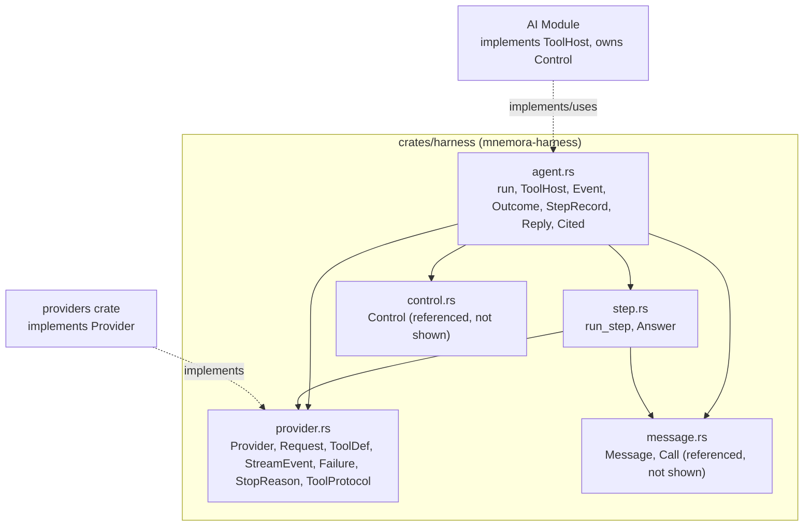
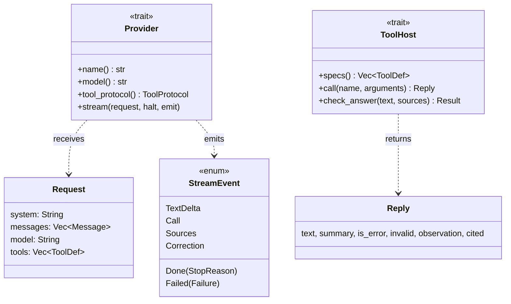
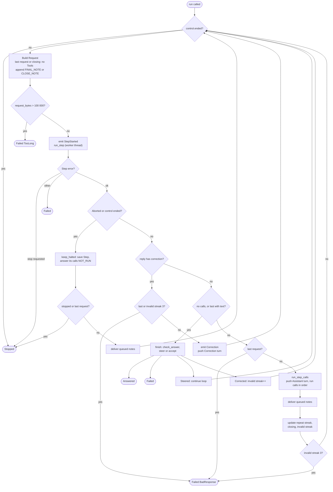
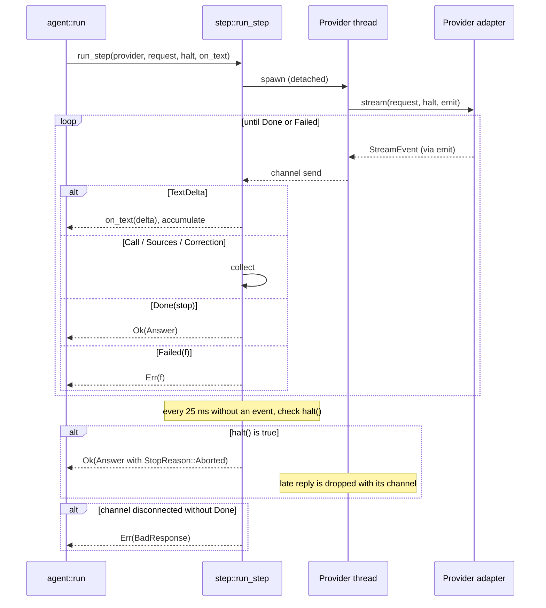
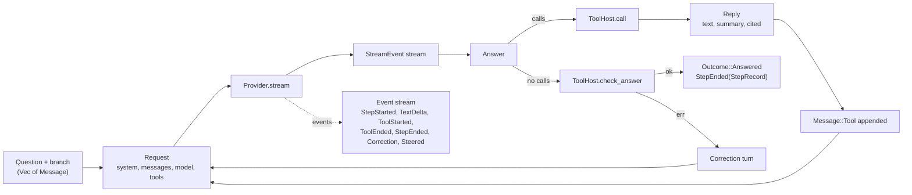

# Harness (`mnemora-harness`)

The harness is the provider-agnostic agent core of the AI Assistant Engine. It defines the typed messages and the `Provider` contract, runs one **Step** (one request to a model and its collected reply), and drives the **agent loop** that alternates model requests with Tool calls until the model gives an answer, the person stops the run, or the run fails.

It is a pure Rust crate (`crates/harness/`). Its only dependencies are `serde` and `specta` (for type export), so it knows nothing about SQLite, HTTP, the Tauri host or any concrete AI service. Concrete service adapters live in the [providers](providers.md) module, and the AI Module that supplies Tools and stores answers is described in [ai_assistant](ai_assistant.md), [ai_conversations](ai_conversations.md) and [ai_providers](ai_providers.md). See the parent overview in [AI_Assistant_Engine](../AI_Assistant_Engine.md).

## Responsibilities at a glance

| Concern | Where it lives |
|---|---|
| Limits on requests, calls, prompt size and repeats | `agent.rs` constants |
| The agent loop (Step → Tools → next Step → answer) | `agent.rs::run` |
| Answer acceptance, correction turns, steering notes | `agent.rs` (`finish`, `deliver`) |
| Tool execution contract (what the loop asks of the AI Module) | `agent.rs::ToolHost` |
| Provider contract (what an adapter must implement) | `provider.rs::Provider` |
| Streaming one Step on a worker thread with a halt poll | `step.rs::run_step` |
| Failure and stop vocabulary shared with the AI Module | `provider.rs` (`Failure`, `StopReason`) |

## Module structure

`message.rs` and `control.rs` are used throughout but are outside the provided component set; this document treats `Message` as the branch entry type (`User`, `Assistant { text, calls }`, `Tool { call_id, name, text, is_error }`, `Correction`) and `Control` as the shared stop/skip flag with `ended()`, `halts_step()`, `skipped()` and `begin_step()`.

## The two contracts

Two traits are the seam of the whole engine.

- **`Provider`** (`provider.rs`) is implemented by each AI service adapter. It exposes `name`, `model`, `tool_protocol` (`None`, `Native` or `Envelope`) and a streaming `stream` method. The contract is strict: a Provider never panics or throws, and every Step ends with exactly one `StreamEvent::Done(StopReason)` or `StreamEvent::Failed(Failure)`. Raw service error text stays inside the adapter; only the typed `Failure` crosses the boundary.
- **`ToolHost`** (`agent.rs`) is implemented by the AI Module over its data. It provides `specs()` (the Tools offered this Run, empty when the Provider cannot call Tools), `call(name, arguments) -> Reply` (never fails; a refusal is a `Reply` with `is_error`), and `check_answer(text, sources) -> Result<(), String>` (an `Err` becomes the correction the model is sent).

## Constants and the notes they produce

All limits are defined in `agent.rs` and enforced by `run`:

| Constant | Value | Effect |
|---|---|---|
| `MAX_REQUESTS` | 12 | Model requests per Run. The 12th is answer-only: it is sent no Tools and gets `FINAL_NOTE`. |
| `MAX_CALLS_PER_STEP` | 8 | Calls beyond the eighth in one Step are refused with `TOO_MANY`. |
| `MAX_PROMPT_BYTES` | 100 000 | A request (system + branch + Tool schemas) above this ends the Run as `Failure::TooLong`. |
| `MAX_REPEATS` | 3 | Consecutive Steps whose calls all repeat an earlier call set `closing`; the model then gets `CLOSE_NOTE` and no Tools. |
| `MAX_INVALID_STEPS` | 3 | Consecutive Steps with unknown or badly formed calls, or unreadable/uncheckable replies, fail the Run as `Failure::BadResponse`. |

Fixed texts the model reads (not shown to the person as failures): `FINAL_NOTE`, `CLOSE_NOTE`, `CUT_OFF` (calls in a reply cut off by the output limit do not run), `NOT_RUN_STOPPED`, `NOT_RUN_SKIPPED` (a note from the person came first), `TOO_MANY`, and `NO_TOOLS_NOW`.

The design principle, stated in the module docs: a mistake the model can fix is sent back to it as a correction or a tool error; it is never shown to the person as a failure unless the limits above are exhausted.

## The agent loop

`agent::run` takes the branch so far (ending with the question), the Provider, a `ToolHost`, the `Control`, a `steer` closure that yields queued person notes, and an `emit` sink for `Event`s. It returns an `Outcome`: `Answered`, `Stopped`, or `Failed(Failure)`.

Key behaviours of each branch:

- **Stop or skip mid-Step.** `keep_halted` saves what the Step wrote. A stopped Step is saved even when empty, so the thread can say it was stopped; its calls are answered `NOT_RUN_STOPPED`. A *skipped* Step (the person chose "send now") is saved as an ordinary finished Step with its calls answered `NOT_RUN_SKIPPED`, and the loop continues so the note is delivered. A stop on the last request ends the Run.
- **Correction.** A reply the protocol could not read (for example an envelope Provider's malformed JSON) is not kept in the branch. The model receives the correction and answers again. Three in a row fail the Run.
- **Finish.** An empty answer fails with `BadResponse`. If `check_answer` rejects the answer (unknown citation or listed source), the answer is kept as a Step, the correction is sent, and `invalid_streak` rises. If a note is queued before the answer is accepted, the answer becomes a Step of the branch, the note becomes a `User` turn, and the loop continues (`Steered`), so the person's note is never lost.
- **Tools.** Each call runs in order through `run_step_calls`. A call runs only if no stop/skip/cut-off/no-tools condition blocks it, is within the first eight, and does not repeat a successful earlier call with identical name and arguments. A repeat is answered with a reference to the earlier observation (for example "e1"). Calls that fail as unknown or malformed (`Reply.invalid`) are not recorded as run, so the model may retry them.
- **Steering.** After Tools finish, `deliver` drains the `steer` closure, appending each note as a `User` turn and emitting `Event::Steered`.

### Repetition and closing

`repeat_streak` counts consecutive Steps in which every call was a repeat. When it reaches `MAX_REPEATS`, `closing` becomes sticky: the next request carries `CLOSE_NOTE` and no Tools, so the model must answer from what it already has. `invalid_streak` counts consecutive Steps containing an invalid call (reset by any clean Step).

## Running one Step

`step::run_step` is the only place that talks to the Provider. It exists so a blocking HTTP call cannot hold the Run.

`Answer` carries the whole text, the `StopReason`, the calls, the `sources` list (envelope Providers), and an optional `correction`. Because the Provider runs on its own detached thread, the halt poll is independent of how long a single network read takes.

## Data flow across one Run

The `Event` stream is how the AI Module observes the Run: it persists `StepRecord`s, relays `TextDelta`s to the live UI, and tracks tool activity. `Outcome::Answered` is returned only after the final `StepEnded` has been emitted, so the AI Module can rely on that ordering.

## Failure and stop vocabulary

`Failure` (in `provider.rs`) is the only error vocabulary the harness hands up: `NoProvider`, `Unreachable`, `Timeout`, `KeyRejected`, `RateLimited`, `ModelUnavailable`, `ModelCannotUseTools`, `BadResponse`, `TooLong`, `Interrupted`, `Offline`, `Unexpected`. The AI Module words each one for the person; the harness itself produces `TooLong` (request size), `BadResponse` (empty answer, invalid streaks, a disconnected stream) and never invents wording.

`StopReason` distinguishes a finished reply (`Stop`), an output-limit cut-off (`Length`, whose calls are not run and are answered `CUT_OFF`), and a halted Step (`Aborted`, whose text is kept).

`Outcome::Stopped` is returned when the person stops the Run; it is distinct from `Failed`, so a stop never looks like an error.

## Interaction with other modules

| Module | Relationship |
|---|---|
| [providers](providers.md) | Implements `Provider` for each AI service (OpenAI-compatible, Anthropic, OpenRouter, the envelope wrapper). Chooses the `ToolProtocol` and emits `StreamEvent`s. |
| [ai_assistant](ai_assistant.md) | Owns the Tauri commands that start, steer, stop and retry Runs. Passes the branch, `Control` and `steer` closure into `run`, and consumes `Event`s. |
| [ai_conversations](ai_conversations.md) | Persists the `StepRecord`s and answers that `run` emits, forming the branch that the next Run reads. |
| [ai_providers](ai_providers.md) | Supplies the configured Provider (name, model, key policy) that `run` receives as `Arc<dyn Provider>`. |

The harness depends on none of these; the dependency is always inward, through the two traits.

## Testing

The unit tests in `step.rs` cover the Step boundary: deltas collected in order, a correction and sources carried with the Step, a failure returned with its partial text dropped, a halt ending a blocked Provider at once with its late reply ignored, and a stream that ends without `Done` treated as `BadResponse`. These use a `ScriptedProvider` from a `scripted` test helper (outside the provided components). The loop-level behaviour (limits, repeats, steering, stop semantics) is exercised through the AI Module's test suites listed in [ai_assistant](ai_assistant.md), such as `ai_tools_tests.rs`, `ai_run_control_tests.rs` and `ai_tracer_tests.rs`.

Build and lint commands for the workspace are summarised in [Build_and_Packaging](../Build_and_Packaging.md). The crate's manifest is `crates/harness/Cargo.toml`; it inherits version, edition, lints and license from the workspace root `Cargo.toml`.

## Maintenance notes

- Changing a limit in `agent.rs` changes Run behaviour for every Provider; the AI Module tests quote these numbers, so update them together.
- Any new `StreamEvent` variant must be handled in `step.rs::run_step`; a Provider must still end with `Done` or `Failed`.
- A new `Failure` variant must also be worded by the AI Module, or the person will see no message.
- Keep the harness free of service-specific wire formats. Anything that knows about a particular API belongs in the providers module.
