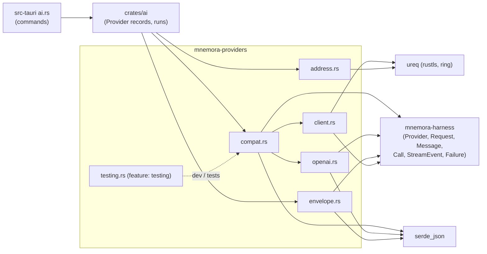
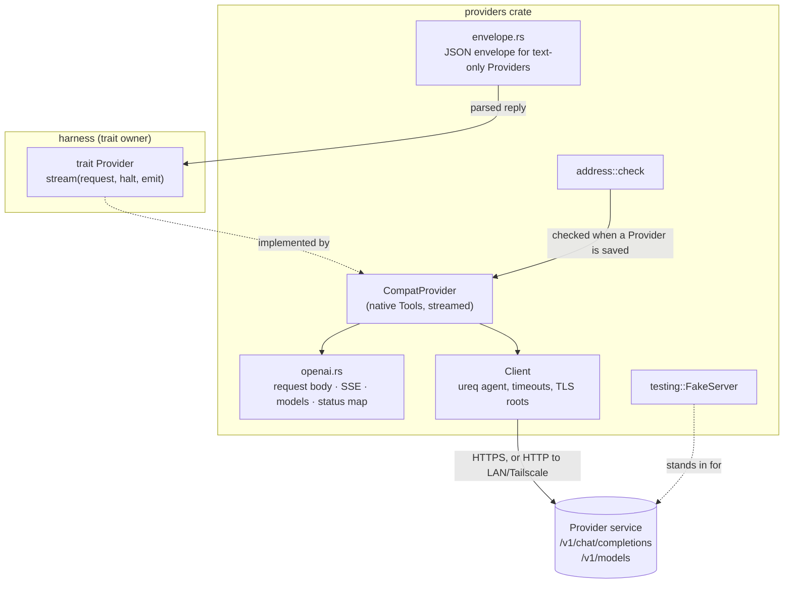
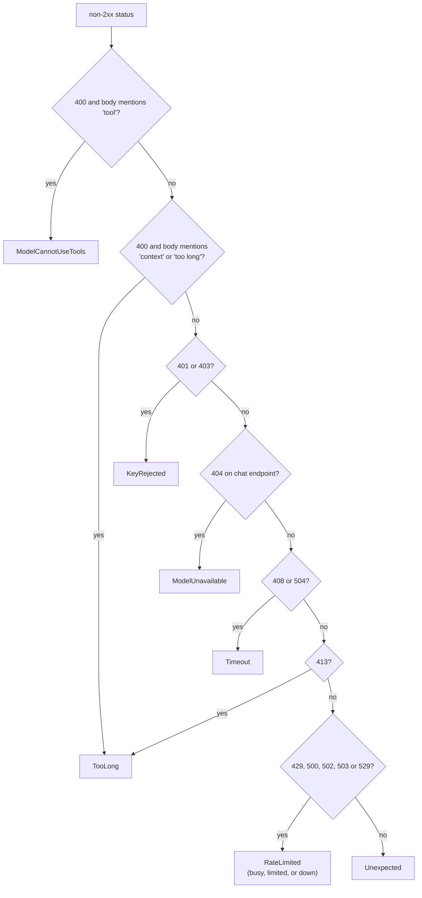
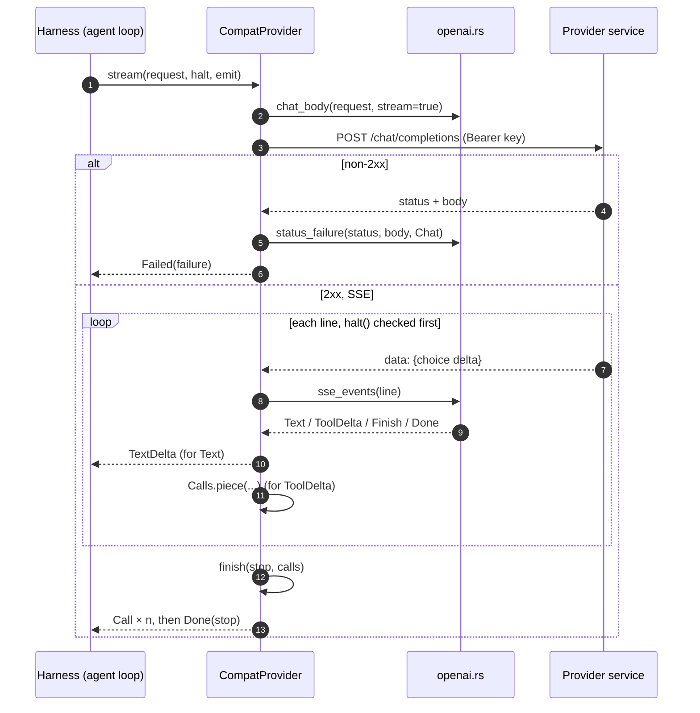
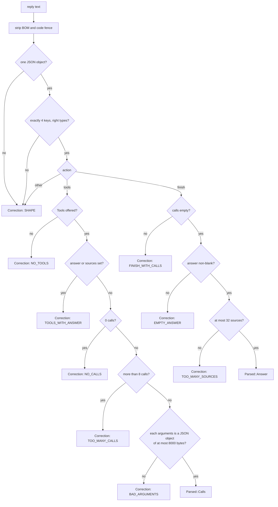

# Providers (`mnemora-providers`)

The `providers` crate is the wire layer between the AI Module and the outside world. It turns a `Request` from the [harness](harness.md) into an HTTP(S) call to a Provider (an OpenAI-compatible service, OpenRouter, or a Provider that only answers in text), and turns the reply, streamed or whole, back into the `StreamEvent`s the harness understands. It also decides which addresses a Provider may use, maps every transport or service failure to a short, person-readable `Failure`, and ships an in-process fake server so tests exercise the real protocol without calling a real Provider (ADR 0018).

For where this crate sits in the AI feature as a whole, see [AI_Assistant_Engine](../AI_Assistant_Engine.md). Per-Provider records, keys and usage live in [ai_providers](ai_providers.md); conversations and runs are in [ai_conversations](ai_conversations.md) and [ai_assistant](ai_assistant.md).

## Responsibilities

| Concern | Where it lives |
|---|---|
| Which addresses a Provider may use (`https` anywhere; plain `http` only for this machine, the LAN and Tailscale) | `address.rs` |
| The shared HTTP(S) client: timeouts, TLS roots, bearer and custom headers, size limit | `client.rs` |
| The `OpenAI` chat wire format: request bodies, whole replies, SSE lines, model lists, status-to-failure mapping | `openai.rs` |
| Streaming adapter for native-Tool Providers (`OpenAI`-compatible endpoints, OpenRouter) | `compat.rs` |
| The JSON envelope used by Providers without native Tool calls: schema, instructions, parsing, corrections | `envelope.rs` |
| In-process fake HTTP server for tests (behind the `testing` feature) | `testing.rs` |

The crate has no persistence and no UI. It is called by the AI crate's Provider layer, which owns the records (see [ai_providers](ai_providers.md)).

## Dependencies



From `crates/providers/Cargo.toml`:

- Runtime: `mnemora-harness`, `serde_json`, `ureq` (workspace versions).
- Dev only: `rcgen` and `rustls`, used by the TLS tests that pin a self-signed certificate.
- Feature `testing = []` enables the fake server. It is the only thing the command-layer tests point a real adapter at.
- `[lints]` inherits the workspace lint policy.

The crate depends on the harness only for its shared types: `Provider`, `Request`, `Message`, `Call`, `ToolDef`, `StreamEvent`, `StopReason`, `ToolProtocol` and `Failure`. The harness never depends on providers; it sees a Provider only through the trait. See [harness](harness.md) for the loop that drives it.

## Architecture



`CompatProvider` is the only type in this crate that implements the harness `Provider` trait. Its `tool_protocol()` is always `ToolProtocol::Native`. The envelope module is a set of pure functions: a Provider without native Tools builds its request with `response_format` and `instructions`, reads the reply with `parse`, and writes history with `turns`. The adapter that performs those calls is not part of the files reviewed here, so it is described only through the functions this crate exposes.

## Components

### `address.rs` — which addresses are allowed

`check(raw) -> Result<String, AddressError>` trims whitespace and trailing slashes, then parses the address with `ureq::http::Uri`. It returns the trimmed address on success.

| Rule | Result |
|---|---|
| Missing scheme or host, or any query string | `AddressError::Invalid` |
| Scheme other than `http` or `https` | `AddressError::UnsupportedScheme` |
| `https` to any host | accepted |
| `http` to a host that is "local" | accepted |
| `http` to any other host | `AddressError::PlainHttpNotAllowed` |

"Local" means:

- IPv4 loopback, private (RFC 1918), link-local, and Tailscale's `100.64.0.0/10`.
- IPv6 loopback, unique-local `fc00::/7` (which includes Tailscale's `fd7a:115c:a1e0::/48`), and link-local `fe80::/10`.
- The name `localhost`, any `*.local` name, and any `*.ts.net` name.

The purpose is that a key is never sent unencrypted across the internet. The same rule is enforced when a Provider is added or edited (see [ai_providers](ai_providers.md)).

### `client.rs` — the shared HTTP client

`Client` wraps one `ureq::Agent`, configured once:

| Setting | Value |
|---|---|
| Connect timeout | `CONNECT_TIMEOUT` = 10 s |
| Whole-reply timeout (`timeout_global`) | `REPLY_TIMEOUT` = 120 s (`Options::reply`) |
| Status codes | not treated as errors (`http_status_as_error(false)`); every status is returned as a reply |
| TLS | `RootCerts::WebPki` (built-in Mozilla roots) unless `Options::roots` supplies DER certificates, which only tests do |
| Reply size | `read_body` caps reads at `MAX_REPLY_BYTES` = 16 MiB |

Request helpers:

- `post_json(url, body, key)` and `get(url, key)` add `Authorization: Bearer <key>` when a key is given.
- `post_with(url, body, headers)` and `get_with(url, headers)` add arbitrary headers. These serve Providers with their own key or version headers.
- Every POST sends `Content-Type: application/json` and `Accept: application/json, text/event-stream`. GETs send `Accept: application/json`.

`transport_failure(ureq::Error) -> Failure` is the only place transport errors are translated. The error's own text is dropped:

| `ureq::Error` | `Failure` |
|---|---|
| `Timeout` | `Timeout` |
| `HostNotFound` | `Offline` |
| `ConnectionFailed`, `Io`, `Tls`, `Rustls` | `Unreachable` |
| `Protocol`, `LargeResponseHeader` | `BadResponse` |
| anything else | `Unexpected` |

### `openai.rs` — the OpenAI-compatible wire format

This module holds pure functions over text, so the fixtures in its tests exercise them directly.

- **`chat_body(request, stream)`** builds the request JSON. The system prompt becomes the first message, skipped when empty. History maps as follows:
  - `User` and `Correction` become `user` messages.
  - `Assistant` with no calls becomes an `assistant` message.
  - `Assistant` with calls becomes an `assistant` message with `tool_calls`. A call's `thought_signature` is echoed back under `extra_content.google.thought_signature`, because Gemini rejects a later step that drops it.
  - `Tool` becomes a `tool` message with `tool_call_id`.
  - `tools` is sent only when Tools are offered. No `max_tokens` is sent; the Provider's default applies.
- **`function_tool(ToolDef)`** wraps a Tool as `{type: function, function: {name, description, parameters}}`, where `parameters` is the Tool's JSON schema text.
- **`parse_answer(body)`** reads a whole, non-streamed reply: the first choice's `message.content` (must be non-empty) and its finish reason. A reply that finished with `tool_calls` or `function_call` is a `BadResponse` here, because a text-only read must not receive native calls.
- **`sse_events(line)`** parses one `data:` line into `SseEvent`s: `Text`, `ToolDelta { index, id, name, arguments, thought_signature }`, `Finish(StopReason)` and `Done`. Blank and comment lines produce nothing. A usage chunk with no `choices` produces nothing. An `error` object in the stream is `Failure::Unexpected`, and its text is discarded.
- **`stop_reason`** maps `stop`, `tool_calls` and `function_call` to `StopReason::Stop`, `length` to `StopReason::Length`, and `None` (not yet) to no value. Any other reason (for example a content filter) is `BadResponse`.
- **`parse_model_ids(body)`** reads `data[].id` from `GET /models`. Any entry without a non-empty `id` makes the whole list a `BadResponse`.
- **`status_failure(status, body, endpoint)`** maps a non-success status to a `Failure`. The body is searched only for wording (`tool`, `context`, `too long`), and never kept:



Note that 404 on `/models` falls through to `Unexpected`; only the chat endpoint reads 404 as "model not found".

### `compat.rs` — streamed native-Tool Providers

`CompatProvider` serves two kinds of Provider:

- an OpenAI-compatible endpoint at a custom address, where the key is optional;
- OpenRouter, at its fixed address, with a key and an extra field merged into every request (its price cap).

Construction is `CompatProvider::new(name, model, address, key)` or `with_client(...)`, and `with_extra(value)` merges fields into each chat body. The address is stored without a trailing slash.

`list_models()` calls `GET {address}/models`. It doubles as the connection test: any answer means the Provider is reachable.

`stream(request, halt, emit)` (the harness trait method) works as follows:

1. If `halt()` is already true, emit `Done(Aborted)` and return.
2. Call `streamed`. On any error, emit `Failed(failure)`.

`streamed` posts `chat_body(request, true)` and then:

- For a non-2xx status it reads the body and returns `status_failure(..., Endpoint::Chat)`.
- Otherwise it reads lines from the response body. Before each line it checks `halt()`. If halted, it emits `Done(Aborted)` and returns. Calls still being assembled are dropped, and the text emitted so far is the answer.
- Each SSE event is handled: `Text` emits `TextDelta`; `ToolDelta` is fed to `Calls`; `Finish` records the stop reason; `Done` ends the stream.
- If the stream ends without `[DONE]`, it still finishes, so an answer counts only if a finish reason was seen.

The `Calls` assembler pieces tool calls together:

- A piece with an `index` continues the call that index is filling. A new index starts a new call.
- A piece with no index continues the latest call only when it carries no `id`, or its `id` matches the latest call. Gemini sends parallel calls with no index, each with its own id, so an unindexed piece with a new id starts a new call.
- Name and argument text are appended. The id and thought signature are set when they arrive.

`finish` decides the outcome:

- No finish reason: `BadResponse`.
- Any call with an empty name: `BadResponse`.
- Otherwise each call is emitted as `StreamEvent::Call` (empty arguments become `{}`; a missing id becomes `call-<position>`), then `Done(stop)`.

`stream_failure(io::Error)` maps a read error to `Timeout` when the kind is `TimedOut`, and to `Interrupted` otherwise.



### `envelope.rs` — the JSON envelope

For Providers that cannot make native Tool calls, every step is written as one JSON object. Ported from Sphinx's reviewer, it has four keys, exactly:

```json
{ "action": "tools" | "finish", "calls": [{"name": "...", "arguments": "<JSON object as text>"}], "answer": "...", "sources": ["id", ...] }
```

Limits:

| Constant | Value | Meaning |
|---|---|---|
| `MAX_CALLS` | 8 | calls per tools step |
| `MAX_ARGUMENT_BYTES` | 8000 | size of one call's arguments text |
| `MAX_SOURCES` | 32 | ids in one answer |

The functions:

- **`response_format(finish_only)`** returns a strict `json_schema` (`mnemora_step`). `action` is limited to `tools` and `finish`, or to `finish` alone when no Tools are offered. `calls` has `maxItems` 0 in that case. `additionalProperties` is false everywhere.
- **`instructions(tools)`** is appended to the system prompt. With Tools, it lists each as `- name: about Arguments: schema`. With none, it asks only for a finish step, written as a "last reply".
- **`turns(messages)`** flattens history for a text-only Provider. An assistant step with calls is rewritten as the envelope it was sent in. Each tool result becomes a `user` turn `Result of <name>` (suffixed ` (refused)` on error).
- **`parse(content, tools_offered, next_id)`** returns one of three outcomes:
  - `Parsed::Calls(Vec<Call>)`: valid tools step; ids come from `next_id`.
  - `Parsed::Answer { text, sources }`: valid finish step.
  - `Parsed::Correction(&'static str)`: the reply broke the protocol. The correction text is sent back as a message and the Model answers again. This is not an error.

A reply is first stripped of a byte-order mark and of a code fence (three backticks, optional `json` tag). It must then be one JSON object with exactly four keys, of the right types, and each call must have exactly `name` and `arguments` as strings.



The correction strings are constants (`SHAPE`, `NO_TOOLS`, and so on) written to be read by the Model, so each one tells it exactly what to fix.

### `testing.rs` — the fake server

Compiled only with the `testing` feature. `FakeServer::start(respond)` binds `127.0.0.1:0`, serves each connection on its own thread, records every request as `Seen` (method, path, `Authorization`, all headers in lower case, body), and answers with a `Canned` reply (status, content type, body, optional delay). `address()` returns `http://127.0.0.1:<port>/v1`, the form a Provider is given. `closed_address()` returns an address with nothing listening, for "unreachable" cases. `reason(status)` supplies HTTP reason phrases.

Because it speaks real HTTP over loopback, the command-layer tests in `src-tauri` and `crates/ai` exercise the same `Client` and parsers as production. No real Provider is called from tests.

## Failure vocabulary

Every error leaves this crate as a `mnemora_harness::Failure`. The harness and the AI crate turn these into the one-sentence messages shown to the person. The variants this crate produces:

| `Failure` | Produced by |
|---|---|
| `Timeout` | connect or reply timeout (`transport_failure`), HTTP 408/504, a read timeout mid-stream |
| `Offline` | host not found |
| `Unreachable` | connection refused or failed, IO, TLS |
| `BadResponse` | malformed JSON, missing choices or content, unexpected finish reason, a model list without ids, a stream with no finish reason, a call with no name |
| `Interrupted` | a stream that breaks mid-answer |
| `Unexpected` | an in-stream `error` object, unmapped transport or status errors |
| `KeyRejected` | HTTP 401/403 |
| `ModelUnavailable` | HTTP 404 on the chat endpoint |
| `ModelCannotUseTools` | HTTP 400 whose body mentions tools |
| `TooLong` | HTTP 413, or 400 mentioning context length |
| `RateLimited` | HTTP 429, 500, 502, 503, 529 |

The service's own error text is never stored or shown; only its status and a few keywords are used.

## Key flows

### Connection test and model listing

`CompatProvider::list_models()` → `Client::get` with the key → `status_failure` on non-2xx → `parse_model_ids`. A successful list is also the reachability result.

### Answer with native Tools (streamed)

Described in the sequence diagram under `compat.rs`. The harness receives `TextDelta`s as text arrives, then zero or more `Call`s, then one `Done`. A `Failed` may arrive instead of `Done` at any point.

### Stop mid-stream

`halt()` is polled before every line. When it turns true the adapter emits `Done(Aborted)`. The text received so far is kept as the answer, and calls still being assembled are discarded. The harness decides what an aborted answer means for the conversation (see [harness](harness.md)).

### Envelope step (text-only Provider)

`response_format` and `instructions` shape the request. The reply goes through `parse`. `Calls` are run by the harness and their results added with `turns`-style history on the next step. A `Correction` is appended as a user turn and the step is repeated. Three bad replies in a row end the run as a bad response, as the AI module's tests describe.

## Configuration and build notes

- Timeouts are fixed constants in `client.rs`; there is no per-Provider timeout setting.
- The `testing` feature is off in production builds. Tests that need the fake server enable it.
- TLS uses `rustls` with the `ring` provider and WebPki roots, which matches the app's other TLS use and avoids OpenSSL and native TLS.
- The build and lint setup is shared with the rest of the workspace; see the root `Cargo.toml` and `crates/providers/Cargo.toml` listed in the repository artifacts.

## Invariants worth knowing

- **Plain HTTP never leaves the local network.** Enforced by `address::check`, and the address is checked again whenever a Provider is added or edited.
- **Keys are sent only as `Authorization: Bearer` (or a Provider-specific header) and never echoed.** Error bodies are inspected for wording and then dropped.
- **Service error text never reaches the person.** Only the `Failure` kind does.
- **An answer counts only after its finish reason.** Streams that end early are `BadResponse`, not a truncated answer. A `length` finish is kept as `StopReason::Length`.
- **A protocol break from a text-only Model is a correction, not a failure**, so the run can recover; only repeated breaks end it.
- **Replies are capped** at 16 MiB and calls at 8 per step, 8000 argument bytes each, so a runaway Model cannot exhaust memory or the run budget.

## Related documentation

- [AI_Assistant_Engine](../AI_Assistant_Engine.md): the feature this crate serves.
- [harness](harness.md): the `Provider` trait, `Request`, `Message`, `StreamEvent` and the agent loop that calls `stream`.
- [ai_providers](ai_providers.md): Provider records, keys, usage, and the address rules as they apply to saved Providers.
- [ai_conversations](ai_conversations.md) and [ai_assistant](ai_assistant.md): where streamed text and calls become history and commands.
