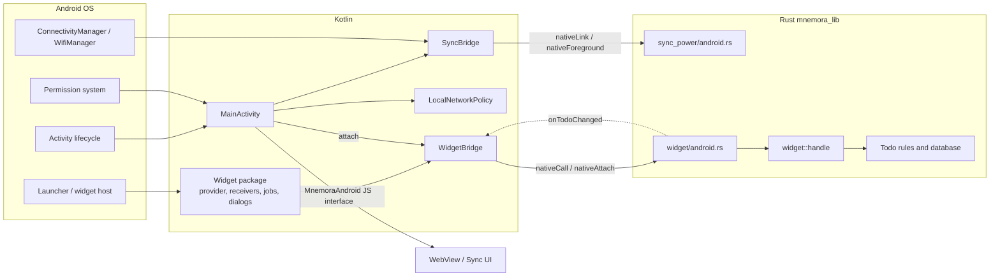
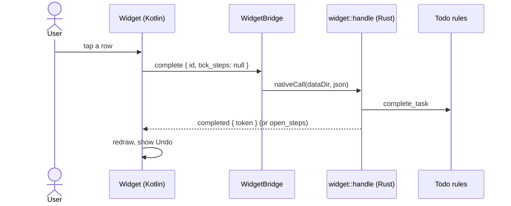
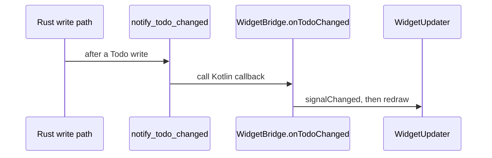

# Android Integration

## Purpose

The Android Integration module is the native Android layer around Mnemora's Tauri app. It has two parts:

1. **App shell** (`MainActivity` and its helpers). This wraps the Tauri WebView and bridges four platform concerns into the Rust side: lifecycle (so Sync starts, pauses and flushes correctly), networking (the Wi-Fi multicast lock for mDNS discovery and the network kind), the Android 17 local network permission, and system UI (system bar colours and the Back button).
2. **Todo home-screen widget**. A Kotlin widget and its satellite screens (setup, steps dialog, Quick add) draw Todo rows and take actions. Every read and write goes through a JNI bridge into Rust, so the widget follows the same Todo rules as the app.

The module owns no product data. The Kotlin code draws and collects input, and Rust decides what a Task is and how it changes.

## Architecture

The shell and the widget share one native library, `mnemora_lib`. The shell reaches the Sync engine through `sync_power/android.rs`, and the widget reaches the Todo rules through `widget/android.rs`.

## Components and core documentation

### App shell

- [Android App Shell](Android_Integration/android_app_shell.md) covers `MainActivity`, the `window.MnemoraAndroid` JavaScript interface, the lifecycle hooks, the Wi-Fi multicast lock, the Android 17 local network permission flow, and the Back button and system bars. It is the entry point for understanding how Sync behaves on the phone.

### Home-screen widget

- [Android Home Widget](Android_Integration/android_home_widget.md) covers the widget provider, the tap receiver, the midnight and Undo-expiry jobs, the steps dialog, and the Quick add sheet. It explains how a tap becomes a Rust call.
- [Android Home Widget Setup](Android_Integration/android_home_widget_setup.md) covers the configuration screen (View, Theme, Background), its live preview, and its save and cleanup hooks.
- [Widget](Android_Integration/widget.md) covers the Rust widget module. It defines the JSON request protocol (`snapshot`, `lists`, `complete`, `undo`, `capture_context`, `parse`, `add`), the Live and Standalone database sources, and the redraw signal.
- [Widget Android Bridge](Android_Integration/widget_android_bridge.md) covers the three JNI entry points (`nativeCall`, `nativeAttach`, `register_app`) and the notification path back to Kotlin.
- [Widget Tests](Android_Integration/widget_tests.md) describes the Rust test suite that pins the bridge's replies, views, undo tokens, parity with the app, and redraw signals.

## Key flows

**Widget tap (for example, ticking a Task)**

**Todo change anywhere (app, sync or widget)**

If the write happens before Android attaches the bridge, the signal is held and sent once when `nativeAttach` runs.

**Sync lifecycle**

`onCreate` registers the network watcher before Tauri starts, so Rust never dials over mobile data it was not allowed to use. `onResume` takes the multicast lock and reports foreground. `onPause` releases the lock and triggers a best-effort flush of pending Sync changes.

## Design constraints

- **Rust never panics across the bridge.** Every failure becomes an `err` or `not_set_up` reply, or a null string. The Kotlin side catches `UnsatisfiedLinkError`, so a build without the native library still starts.
- **The bridge never creates or migrates the database.** If the app has not run, or its schema is out of date, the widget gets a status reply. Only the app can change the schema.
- **Sandbox and Production stay separate.** The environment guard refuses a Sandbox build pointed at Production data.
- **Only the app's shell owns lifecycle.** The widget and its jobs run in the widget's own package and go through the bridge for every data operation.
- **Renaming JNI-bound names breaks the bridge at run time.** `WidgetBridge`, `nativeCall`, `nativeAttach` and `onTodoChanged` are looked up by name, so renaming them requires a matching Rust change.

## Related modules

- [Sync_Connectivity_and_Pairing](Sync_Connectivity_and_Pairing.md) for what Rust does with foreground, link and permission signals.
- [Sync_Client_Surface](Sync_Client_Surface.md) for the web code that calls `MnemoraAndroid`.
- [Task_and_Journal_Domain_Services](Task_and_Journal_Domain_Services.md) for the Todo rules every widget method calls.
- [Tauri_Host_and_IPC_Bridge](Tauri_Host_and_IPC_Bridge.md) for the Tauri host that creates the WebView.