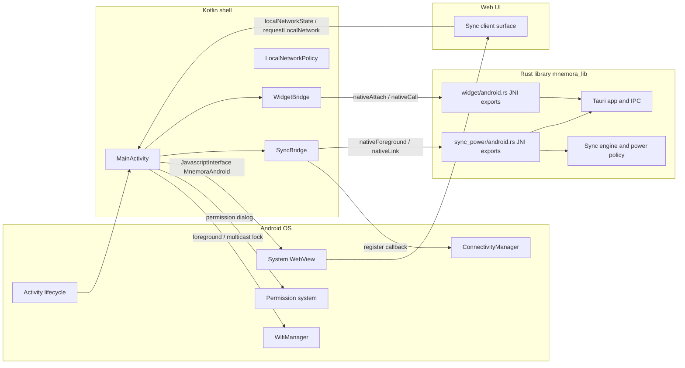
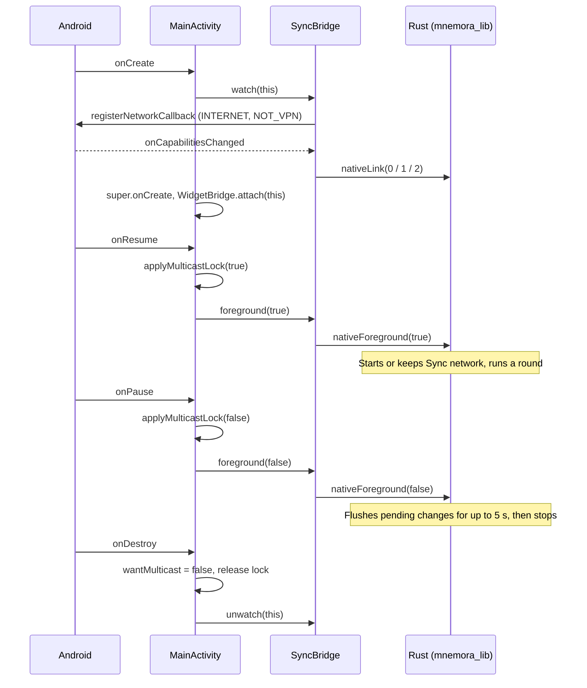
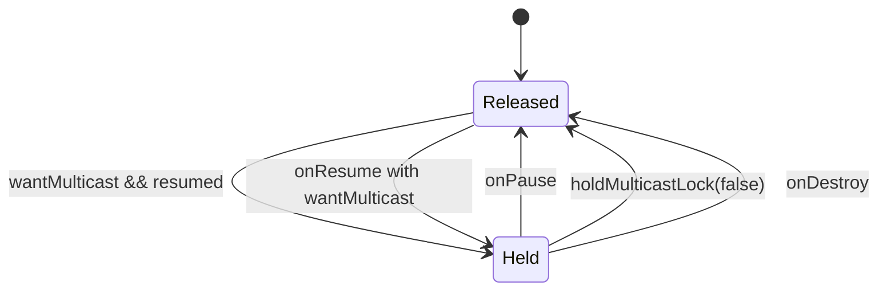
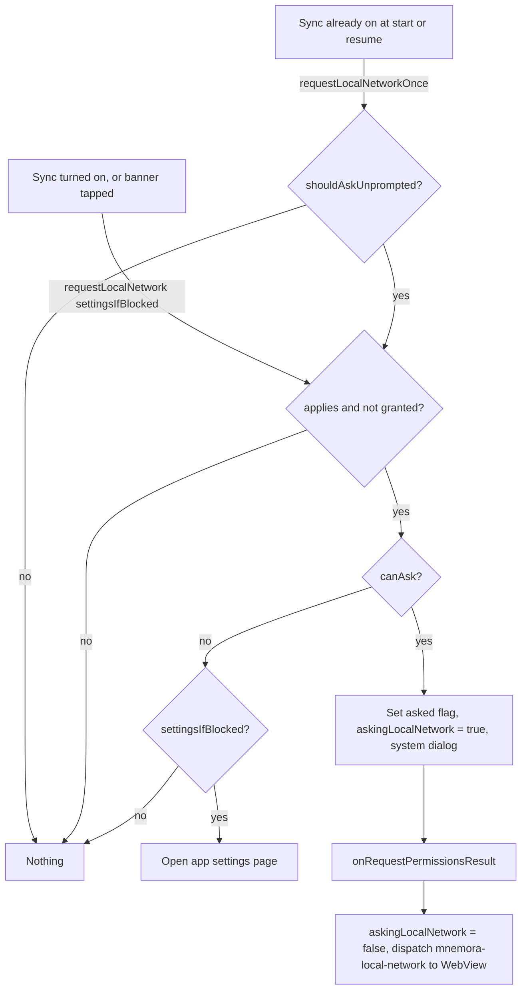
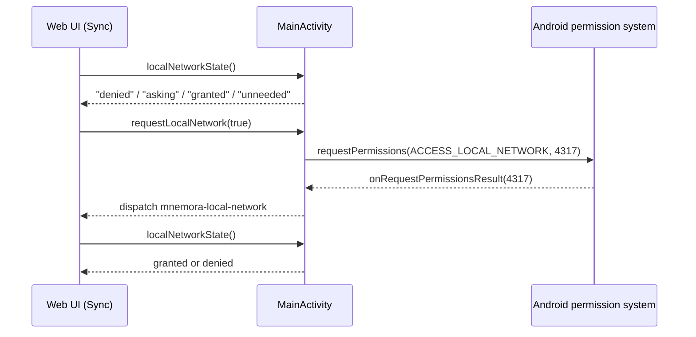

# Android App Shell

## Introduction

The Android app shell is the native host that wraps Mnemora's Tauri WebView on Android. It is one Kotlin class, `MainActivity`, plus two small companion objects (`SyncBridge` and `LocalNetworkPolicy`) in the same package. The shell does not own any product data. Its job is to bridge four platform concerns into the rest of the system:

1. **Lifecycle**: telling the Rust side when the app is in front, so Sync starts, pauses or flushes correctly.
2. **Network**: holding a Wi-Fi multicast lock so mDNS discovery works, and reporting the kind of network (offline, Wi-Fi/other, mobile data) to Rust.
3. **Permissions**: exposing Android 17's local network permission to the web UI and asking for it on the user's behalf.
4. **Platform UI and navigation**: colouring the system bars and turning the Back button into "leave the app" instead of destroying the activity.

The Todo home-screen widget and its quick-add/steps dialogs are separate Android components documented in [Android_Home_Widget](android_home_widget.md) and [Android Widget Bridge](widget_android_bridge.md). This shell only attaches the widget bridge at startup.

For the Sync behaviour that these hooks drive, see [Sync_Connectivity_and_Pairing](../Sync_Connectivity_and_Pairing.md) and [Sync_Replication_Engine](../Sync_Replication_Engine.md). For the Tauri host and the JavaScript side of the bridge, see [Tauri_Host_and_IPC_Bridge](../Tauri_Host_and_IPC_Bridge.md) and [Sync_Client_Surface](../Sync_Client_Surface.md).

## Where it sits in the system

`MainActivity` extends `TauriActivity`, so the Tauri runtime, the WebView and the Rust library are created by the framework. The shell adds its hooks on top of that lifecycle.

## Components

| Component | Kind | Responsibility |
|---|---|---|
| `MainActivity` | Activity | Lifecycle hooks, multicast lock, local network permission flow, the `MnemoraAndroid` JavaScript interface |
| `SyncBridge` | Object | Registers a `ConnectivityManager` callback, reports network kind to Rust, forwards foreground state, loads `mnemora_lib` |
| `LocalNetworkPolicy` | Object (pure) | Decides whether the Android 17 permission applies, its reported state, and whether asking can still show the dialog |
| `WidgetBridge` | Object (imported) | Attaches the Rust side so Todo widgets can be redrawn after app changes. Documented in [widget_android_bridge](widget_android_bridge.md) |

### MainActivity

`MainActivity` holds four pieces of state:

- `multicastLock`: the `WifiManager.MulticastLock`, created lazily and not reference-counted.
- `wantMulticast`: what the web side last asked for (Sync on and page visible).
- `page`: the `WebView`, kept so the activity can send events back to it.
- `askingLocalNetwork`: true while the system's permission dialog is on screen, so a missing grant is not treated as a refusal yet.

### JavaScript interface: `window.MnemoraAndroid`

`onWebViewCreate` registers `MnemoraBridge` under the name `MnemoraAndroid`. Every method is annotated `@JavascriptInterface` and marshals onto the UI thread with `runOnUiThread`.

| Method | Called by the web side for | Effect |
|---|---|---|
| `moveTaskToBack()` | Back at the root of the app | Sends the task to the background instead of destroying the activity (see issue #51 in source comments) |
| `holdMulticastLock(hold)` | Sync on and page visible | Sets `wantMulticast`, then applies the lock if the activity is resumed |
| `localNetworkState()` | Sync UI state checks | Returns `unneeded`, `granted`, `asking` or `denied` |
| `requestLocalNetwork(settingsIfBlocked)` | Turning Sync on, or the banner | Shows the system dialog if allowed, otherwise optionally opens app settings |
| `requestLocalNetworkOnce()` | Sync already on at start or resume | Asks once if the permission was never requested (for example after an update to Android 17) |
| `openAppSettings()` | Banner action | Opens this app's system settings page |
| `setSystemBars(dark, colorHex)` | Theme changes | Sets light/dark status and navigation icons and the bar colours |

The web-side callers of these methods are described in [Sync_Client_Surface](../Sync_Client_Surface.md) (`local-network.ts`, `multicast.ts`, `welcome.ts`) and in [Design_System](../Design_System.md) (theme and system bars).

## Lifecycle hooks

The order of hooks is what keeps Sync and the widget correct. `onCreate` registers the network watcher before Tauri starts, so Rust never dials over mobile data it was not allowed to use.

Important details:

- `onPause` cannot hold a wake lock, so when the screen turns off the CPU may sleep before the 5 second flush finishes. The flush is best effort. This is stated in the source comment and is a known trade-off.
- `onDestroy` clears `wantMulticast` before releasing the lock. A late `holdMulticastLock` call from the WebView after destruction therefore cannot reacquire it.
- `SyncBridge.unwatch` only removes the callback if the same context registered it. A rotated or recreated activity registers anew, and the old instance's late `onDestroy` does not remove the new callback.

### Native event relay (SyncBridge)

`SyncBridge` is a Kotlin `object` that is safe to call without the native library. `loaded` tries `System.loadLibrary("mnemora_lib")` lazily, and every external call is wrapped so a build without the bridge simply does nothing.

Network kind is reduced to a single integer code:

| Code | Meaning | Rust `Link` |
|---|---|---|
| 0 | Offline | offline |
| 1 | Wi-Fi or other (including Ethernet) | Wi-Fi or other |
| 2 | Mobile data (cellular) | mobile data |

`SyncBridge.report()` computes the most permissive link across all non-VPN networks that are up (`SyncLink.of`), then calls `nativeLink`. The callback reports only when the kind of a network changes. Signal strength changes are ignored by comparing `SyncLink.Net` values. VPN networks are excluded by `NET_CAPABILITY_NOT_VPN`, so the reported state is the underlying network (for example, Tailscale does not hide Wi-Fi).

Without a network-state permission, `registerNetworkCallback` throws `SecurityException`. In that case `watch` returns without registering, and Rust sees the state as unknown. Unknown never blocks Sync.

The Rust side of these exports lives in `src-tauri/src/sync_power/android.rs`. It stores the most recent foreground and link values in `EARLY`, so reports that arrive before Tauri's `setup` are kept and applied by `register_app` once the app handle exists. The policy that uses them (for example `paused_on_mobile_data`) is described in [Sync_Connectivity_and_Pairing](../Sync_Connectivity_and_Pairing.md) under the power and pause sub-module.

## Wi-Fi multicast lock

mDNS discovery used by Sync needs multicast packets. Android's Wi-Fi chip drops them unless an app holds a `MulticastLock`. The shell keeps the lock only while **both** conditions hold:

1. The web side wants it (`wantMulticast`, set by `holdMulticastLock(true)`, which the page sends when Sync is on and the page is visible).
2. The activity is in front (`lifecycle.currentState` is at least `RESUMED`, or `onResume` has run).

The lock is created with `setReferenceCounted(false)`, so one `release()` always frees it. The activity lifecycle is the final authority: even if the WebView never reports the page as hidden, the lock cannot outlive the screen.

## Local network permission (Android 17)

Android 17 introduces `android.permission.ACCESS_LOCAL_NETWORK`. `LocalNetworkPolicy` contains the pure decisions, so they can be unit tested (`LocalNetworkPolicyTest.kt`):

| Function | Rule |
|---|---|
| `applies(sdk)` | True from API 37 (`FIRST_SDK`) |
| `state(sdk, granted, answered)` | `unneeded` before 37; `granted`; `asking` if not yet answered (not a refusal); else `denied` |
| `shouldAskUnprompted(sdk, granted, askedBefore)` | Ask on start or resume only if the permission applies, is not granted and was never requested |
| `canAsk(askedBefore, rationaleDue)` | The system dialog can be shown the first time, and again while the system says a rationale is due |

`MainActivity` stores `asked_local_network` in the `sync` SharedPreferences. Two entry points use the policy:

Points worth knowing:

- After "Don't ask again", the system dialog never reappears. Only the app's settings page can grant the permission, so the banner passes `settingsIfBlocked = true`.
- The request code is `4317` (`REQUEST_LOCAL_NETWORK`).
- After the answer, the activity dispatches a `mnemora-local-network` DOM event so the page re-reads `localNetworkState()`. The dialog may not have paused the page, so the page cannot rely on a lifecycle event.
- Sync never asks while it is off. The "asking" state exists so that a dialog that is still on screen is not reported as a denial.

The web-side banner and welcome text that consume these states are in [Sync_Client_Surface](../Sync_Client_Surface.md) (`local-network.ts`). The Rust side reports the resulting blocked state as a Sync activity line; see [sync_activity](../Sync_Client_Surface/sync_conflicts_and_activity.md).

## Back button and system bars

- **Back button**: `moveTaskToBack()` sends the task to the background at the app root. Android apps normally behave this way, and the process is kept alive so Sync and the widget keep working. The router-side handling is described in [Shell_and_Navigation](../Shell_and_Navigation.md).
- **System bars**: `setSystemBars` runs on the UI thread through `WindowCompat.getInsetsController`. `dark` is inverted to produce "light" appearance (dark icons on a light theme). The colour is parsed with `Color.parseColor`, and an invalid hex is ignored. The bar colours use the deprecated `statusBarColor` and `navigationBarColor` setters because they are still what colours the bars on API 26 to 34.

## Process flows across layers

## Configuration and build

The shell is generated Android project code under `src-tauri/gen/android/`. The Gradle files that build it are:

- `src-tauri/gen/android/app/build.gradle.kts`: application module, including the `mnemora` namespace and signing.
- `src-tauri/gen/android/build.gradle.kts` and `settings.gradle`: project and module wiring.
- `src-tauri/gen/android/buildSrc/` (`RustPlugin.kt`, `BuildTask.kt`): compiles the Rust library that provides `mnemora_lib`. See [Build_and_Packaging](../Build_and_Packaging.md).

The Makefile targets `android`, `android-dev`, `android-sandbox` and `android-test` drive these builds. The Android environment is set up by `scripts/setup-android.sh`. The sandbox and production builds share the Android package namespace, so the Rust side refuses to pair across environments (see [Sync_Connectivity_and_Pairing](../Sync_Connectivity_and_Pairing.md)).

Two build-time facts matter for this module:

- `System.loadLibrary("mnemora_lib")` is inside a `lazy` block that catches `UnsatisfiedLinkError`. A build without the native library still starts, with Sync's lifecycle reports silently dropped.
- The `MulticastLock` and local network permission only take effect on real devices. The unit test for `LocalNetworkPolicy` runs on the JVM.

## Testing

| Test | What it covers |
|---|---|
| `src-tauri/gen/android/app/src/test/java/com/hemang/mnemora/LocalNetworkPolicyTest.kt` | Permission applicability, reported state, ask-once rule and rationale rule |
| `src-tauri/src/sync_power_tests.rs` | Rust decisions that these JNI calls drive: leaving and returning inside the flush window, mobile data stops Sync, rapid leave/return never duplicates the network |
| `src-tauri/src/sync_pairing_tests.rs` and `sync_live_tests.rs` | Behaviour when Sync is turned on or off, which is the moment `requestLocalNetwork` is called |

Browser-based QA of the web side of these flows is outside this module. Phone checks follow the team's device-testing rules and are not part of the automated suite.

## Known limitations

- The 5 second background flush has no wake lock. On a screen-off transition the OS may suspend the process first.
- `onPause` cannot tell whether the app is leaving for another app or being destroyed. The flush is the same in both cases.
- `SyncBridge.watch` only starts if the app has the network-state permission. Without it, the link is unknown and Sync is never blocked, which means mobile-data restrictions cannot be enforced on that install.
- Multicast is held only in the resumed state. Discovery of other devices is therefore only live while the app is open.
- The shell has no unit tests of its own for the activity. Behaviour is covered through the Rust and web test suites listed above.

## Related modules

- [Android_Home_Widget](android_home_widget.md): the widget providers and quick-add dialogs that run alongside this activity.
- [widget_android_bridge](widget_android_bridge.md): the JNI side of `WidgetBridge`, attached in `onCreate`.
- [Sync_Connectivity_and_Pairing](../Sync_Connectivity_and_Pairing.md): what Rust does with foreground, link and permission signals.
- [Sync_Client_Surface](../Sync_Client_Surface.md): the web code that calls `MnemoraAndroid`.
- [Tauri_Host_and_IPC_Bridge](../Tauri_Host_and_IPC_Bridge.md): the Tauri host that creates the WebView.
- [Build_and_Packaging](../Build_and_Packaging.md): Gradle, Makefile targets and signing.
