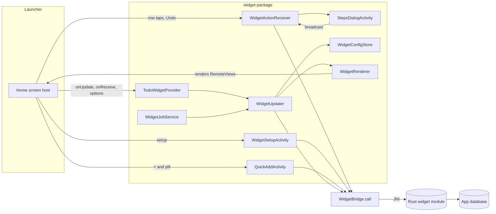
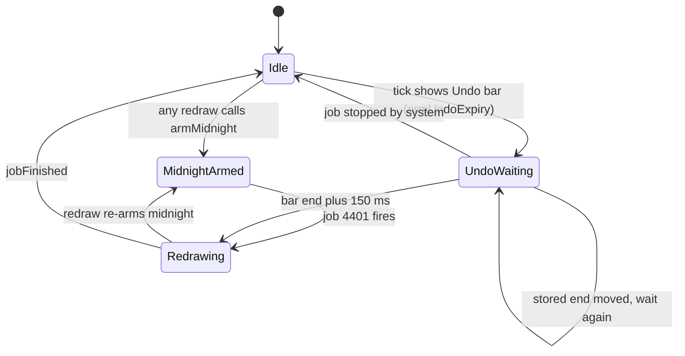
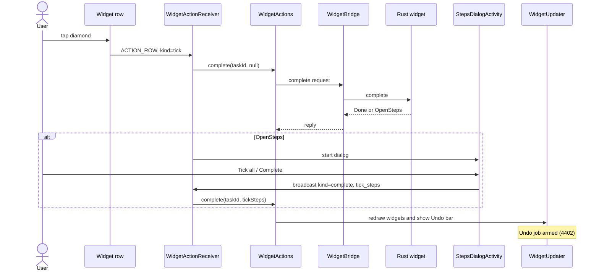

# android_home_widget

The `android_home_widget` module is the Android home-screen Todo widget and its native satellites: the widget provider, the tap receiver, the timed-redraw jobs, the configuration screen, the steps dialog, and the Quick add sheet. It is pure Android (Kotlin) code under `src-tauri/gen/android/app/src/main/java/com/hemang/mnemora/widget/`. It never decides anything about Tasks itself. Every read and write goes through the Rust bridge (see [widget.md](widget.md) and [widget_android_bridge.md](widget_android_bridge.md)), so the widget obeys the same rules as the app.

Only the widget's own package is covered here. The Rust side of the widget, the bridge entry points, and the Rust tests are documented in their own modules. Setup screen details are in [android_home_widget_setup](android_home_widget_setup.md). The surrounding Android shell is in [android_app_shell.md](android_app_shell.md), and the parent is [Android_Integration.md](../Android_Integration.md).

## Responsibilities

| Concern | Owned here | Owned elsewhere |
|---|---|---|
| Drawing the widget and its preview | `WidgetRenderer`, `WidgetTheme`, `Palette`, `RowItems`, `HeaderDate` | Snapshot content comes from Rust ([widget.md](widget.md)) |
| Per-widget settings (view, theme, background) | `WidgetConfig`, `WidgetConfigStore` | Settings the app owns (for example the grouping preference) are read via the bridge |
| Ticking, undoing, and the steps question | `WidgetActionReceiver`, `WidgetActions`, `StepsDialogActivity`, `UndoBar` | The completion rules are in Rust (`TickReply`, complete and undo commands) |
| Timed redraws (midnight, Undo bar end) | `WidgetJobs`, `WidgetJobService`, `Midnight` | Redraw itself is `WidgetUpdater` |
| Adding a Task from the home screen | `QuickAddActivity`, `quickadd/*` | Word reading and the add are done by Rust |
| Choosing what the widget shows | `WidgetSetupActivity` | Lists and theme are read from the bridge |

## Architecture

All the Kotlin classes above call the bridge through `WidgetBridge.call`, which takes a request string built by `WidgetRequests` and returns a reply string that the Kotlin side parses. Nothing in this package opens the database.

## Components

### TodoWidgetProvider

The `AppWidgetProvider` for the Todo widget. It is offered on Android 12 and later only (ADR 0015). It delegates almost everything to `WidgetUpdater`:

- `onUpdate` and the redraw action call `WidgetUpdater.redrawAsync(context, goAsync())`.
- `onAppWidgetOptionsChanged` calls `redrawOnResize`, so the responsive layout (see `ResizeRedraw` and `SizeMode`) re-picks its size.
- `onDeleted` calls `WidgetConfigStore.remove`, so a removed widget takes its settings with it.
- `onRestored` calls `WidgetConfigStore.move`, because after a backup restore widgets come back under new ids.
- `onDisabled` cancels the midnight job (`WidgetUpdater.cancelMidnight`).

### WidgetActionReceiver

A non-exported `BroadcastReceiver` that handles the two actions the widget's own PendingIntents send: `ACTION_ROW` and `ACTION_UNDO`. Anything else is ignored.

For `ACTION_ROW` the extra `kind` decides what happens:

- `tick` completes the Task by calling `WidgetActions.complete(context, id, null)`. If Rust replies `TickReply.OpenSteps`, the receiver starts `StepsDialogActivity` for that Task.
- `complete` carries the steps dialog's answer in `tick_steps`, and completes the Task with that choice.
- `open` or any other part of a row opens the Task. If the row carries a widget link (`WidgetLinks.isLink`), it goes to `WidgetLinks.intent`. Otherwise it opens the launcher `MainActivity`.

Work runs on a single-thread executor under `goAsync()`, so the main thread is never blocked. The receiver logs and swallows exceptions so a failed tap cannot crash the process.

### WidgetJobs and WidgetJobService

These are framework jobs, not alarms. The file comment explains why: the vivo freezer deletes a process's alarms, and `DATE_CHANGED` is not delivered to manifest receivers. A job belongs to the system and needs no permission. It is not exact. It runs at the first device wake after its time, and within about half a minute while the screen is on.

Two job IDs are used:

| Job | ID | Delay | What it does |
|---|---|---|---|
| Midnight | `MIDNIGHT_ID = 4401` | `Midnight.delayFrom(now, zone)` to just after the next local midnight | Redraws every Todo widget. Each redraw re-arms it, so a clock or time-zone change self-corrects. |
| Undo expiry | `UNDO_ID = 4402` | none (`0 ms`) | Keeps the process alive while the Undo bar is showing, then redraws so the bar disappears. |

The Undo job has no delay on purpose. A running job keeps the process out of the freezer, which a timer cannot. `WidgetJobService` reads the bar's end time from `UndoBar.storedUntil`, sleeps until it plus `UNDO_SLACK_MS` (150 ms), then redraws. If the end moves (a newer tick replaces the job), it loops. A stop request interrupts the waiting thread and is not retried, because the next redraw hides a stale bar by its timestamp anyway.

### WidgetSetupActivity

The configuration screen, opened when a widget is dropped and again from the launcher's reconfigure action. It is `@RequiresApi(31)` and themed by the app's current theme. Full behaviour, including the live preview, is in [android_home_widget_setup](android_home_widget_setup.md). The key points for this module:

- It refuses any widget that is not of `TodoWidgetProvider` (`isOurWidget`), because the activity is exported for the launcher.
- Result is `RESULT_CANCELED` until Done. Backing out is a cancel, and on first placement the launcher then removes the widget.
- Done calls `WidgetConfigStore.put`, sets `RESULT_OK`, and triggers a redraw.
- If the chosen List was deleted, the view resets to `WidgetConfig.DEFAULT_VIEW`, so Done always means something.
- The preview uses the same `WidgetRenderer` as the real widget. When Rust cannot supply Tasks (not set up, or an error), it falls back to `SampleSnapshot`.

### StepsDialogActivity

A translucent card over the home screen that asks "N steps are still open" when a Task's notes contain unticked checklist items. The choices are the app's own: Tick all and complete, Complete, and Cancel (which changes nothing). A tap outside the card is Cancel.

The dialog does not do the work itself. `answer()` finishes the activity first with no animation, then broadcasts `WidgetActionReceiver.complete(...)`. The file comment explains why: a process whose activity has closed is cached and its threads are throttled, while a receiver's `goAsync` keeps it alive. A tick from the dialog once took 3.4 s when done in the activity.

### QuickAddActivity

A bottom sheet for adding a Task from the home screen, opened by the widget's + button or its "Add a task..." pill. It is a native copy of the app's Quick add (ADR 0016), but it has no word rules of its own. `CaptureRules` holds only pure text helpers (hash queries, suggestion application, paste splitting). Everything about meaning comes from Rust through `QuickAddRequests` and `QuickAddReplies`.

Key behaviours:

- **Reading as you type.** Each change calls `requestReading()` with a sequence number. Stale answers are dropped, so only the latest reading is shown. The reply's spans are drawn as marks on the field.
- **Chips.** Recognised words show as `word → meaning ×`. The × keeps a word as plain text (`CaptureRules.ignoreWord`). Alternatives show "use instead" (`preferWord`). Words kept as text show "kept as text ↺" (`recogniseAgain`).
- **Backspace after a word** keeps it as text instead of deleting a letter (`backspaceFilter`), once per word, so a second backspace deletes normally.
- **Properties row.** List, When (read-only here: there is no date or repeat picker in the sheet), Priority, and Notes. List and Priority open small pickers. A pick is recorded as a decision, which turns the matching typed words into text so the field and the chips agree.
- **#List suggestions.** A `#` at the caret opens up to five matching Lists, or a "new list" row, via `CaptureRules.listSuggestions`. Enter takes the first suggestion rather than adding the Task.
- **Keys.** Enter adds. Shift+Enter opens notes. In notes, Ctrl or Meta+Enter adds and Backspace on empty notes closes them. Back closes a picker first, then discards. Tapping outside discards.
- **Paste.** A multi-line paste becomes one Task: the first line is the title and the rest go to notes (`pasteFilter`).
- **Adding.** `submit()` sends the draft through the bridge on an executor. On success it shows the app's toast, redraws the widgets, and closes. On a refused add it keeps the text and shows why.

The launch intent uses `FLAG_ACTIVITY_NEW_TASK | FLAG_ACTIVITY_CLEAR_TASK`. `QuickAddActivity.pending(...)` builds one immutable PendingIntent per widget, using request code `0x51410000 + widgetId`, so each widget's + button opens for its own view.

### Supporting files

These files are in the same package. Their roles are inferred from their names and from how the components above call them. Read each file for its exact contract.

- `WidgetRenderer`, `RowItems`, `HeaderDate`, `ResizeRedraw`, `SizeMode`: build the RemoteViews for the widget, its rows, header, and size.
- `WidgetTheme`, `Palette`, `WidgetColors`: resolve the theme (app, light, dark, true black) and the colours used everywhere.
- `WidgetConfig`, `WidgetConfigStore`: the per-widget view, theme, and background, and the app theme cache.
- `WidgetBridge`, `WidgetRequests`, `WidgetActions`: the JNI call and request builders, and the complete and undo actions.
- `WidgetUpdater`: the common redraw path (`redrawAsync`, `redrawOnResize`, `cancelMidnight`, `isRedrawAction`).
- `Midnight`: computes the delay to the next local midnight.
- `UndoBar`: stores and checks the Undo bar's end time and token.
- `Snapshot`, `SampleSnapshot`: the data model the renderer draws, and built-in samples for previews.
- `WidgetLinks`: the links a row can carry to open a Task.
- `quickadd/QuickAddModels`, `quickadd/CaptureRules`, `quickadd/CaptureEditText`, `quickadd/FlowLayout`: the Quick add data model, pure text rules, the field with caret and back handling, and the wrapping chip layout.

## Data flow

### Ticking a row

Undo follows the same pattern: `ACTION_UNDO` calls `WidgetActions.undo`, which asks Rust to reverse the last tick, then redraws.

### Redraw paths

Every redraw ends in `WidgetUpdater`, which reads a snapshot through the bridge, renders it with `WidgetRenderer`, and re-arms the midnight job. Five things cause one: a system update, a resize, a timed job, a completed write from the widget, and a write from the running app (the Rust side signals it through the bridge, see [widget.md](widget.md)).

## Configuration

Each widget has three settings, stored by `WidgetConfigStore` and set in `WidgetSetupActivity`:

| Setting | Values | Default |
|---|---|---|
| `view` | `today`, `upcoming`, `inbox`, `all`, `list:<id>` | `WidgetConfig.DEFAULT_VIEW` |
| `theme` | `APP`, `LIGHT`, `DARK`, `TRUE_BLACK` | `APP` |
| `background` | `SOLID`, `SEE_THROUGH`, `NONE` | set by config |

The app theme is cached through `WidgetConfigStore.appTheme` and `rememberAppTheme`, so the widget keeps its colours even when the app process is not running. Sizing is set by the manifest and the provider's `onAppWidgetOptionsChanged`.

Build and packaging inputs that matter here are in `src-tauri/gen/android/app/build.gradle.kts` (the minimum SDK and the Compose-free view code) and in the Android build tasks described in [Build_and_Packaging](../Build_and_Packaging.md). The manifest entries for the provider, receiver, jobs service, and activities are declared in the generated Android manifest and must stay non-exported except for the setup activity, which the launcher needs.

## Error handling and limits

- Every receiver, job, and executor path catches exceptions and logs under the tag `TodoWidget`. A bad reply shows a user-facing line (for example "not set up", "needs update", or the Rust failure message) instead of crashing.
- A Quick add that fails in Rust keeps the typed text and the sheet open. A reading failure simply shows no chips.
- If the bridge is not set up, the setup screen and Quick add close with a toast, and the widget shows its set-up state.
- A widget whose List has been deleted falls back to the default view on the next setup, and Rust reports `ListMissing` for the preview.
- Jobs are approximate in time by design (see above). Anything that must be exact, such as the Undo token, is checked by timestamp when the next redraw runs.

## Testing

The Kotlin side is thin and has no unit tests in this package. Behaviour is tested from the Rust side: the widget's Rust tests cover ticks, undo, quick add, parsing, rows, headings, and settings, and are documented in [widget_tests.md](widget_tests.md). The bridge contract that the Kotlin code depends on is described in [widget_android_bridge.md](widget_android_bridge.md). Device testing of the widget is done on the Android test phone, not in the browser.

## Related modules

- [widget.md](widget.md): the Rust widget module that produces snapshots, parses quick-add text, and performs completes and undos.
- [widget_android_bridge.md](widget_android_bridge.md): the JNI entry points that `WidgetBridge` calls.
- [widget_tests.md](widget_tests.md): Rust tests for the widget behaviour.
- [android_app_shell.md](android_app_shell.md): `MainActivity`, which the widget opens for rows that have no link.
- [android_home_widget_setup](android_home_widget_setup.md): the setup screen in detail.
- [Android_Integration.md](../Android_Integration.md): the parent section.
