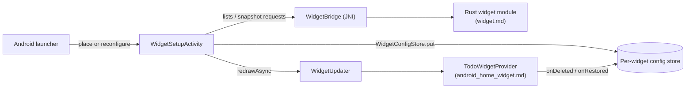
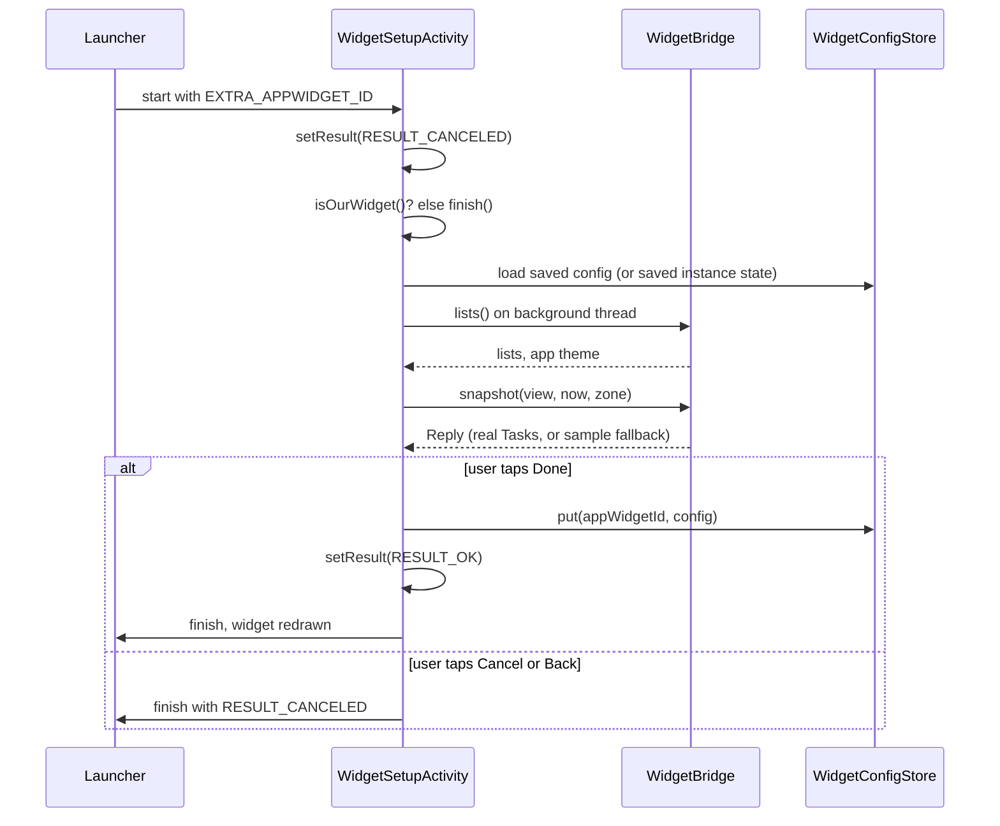
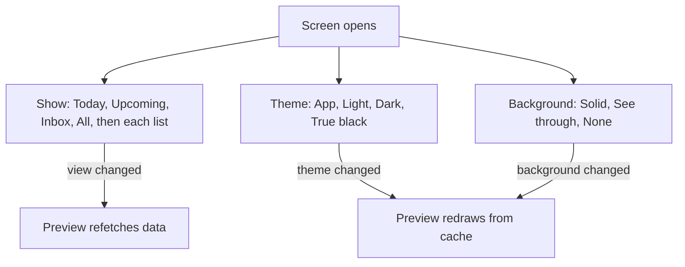
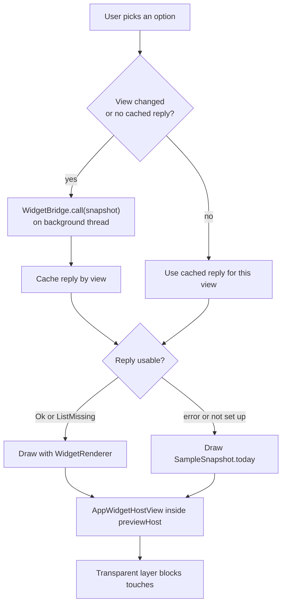

# Android Home Widget Setup

## Introduction

The setup module is the configuration screen that opens when a user places the Mnemora Todo widget on the Android home screen, or chooses to reconfigure it from the launcher. It is implemented by a single Kotlin activity, `WidgetSetupActivity`, which lets the user pick what the widget shows (View), how it is coloured (Theme), and what sits behind it (Background), while showing a live preview drawn by the widget's own renderer.

This page covers only the setup screen. For the widget itself, its provider and its RemoteViews rendering, see [android_home_widget.md](android_home_widget.md). For the Rust side that answers the widget's data requests, see [widget.md](widget.md) and [widget_android_bridge.md](widget_android_bridge.md). The parent overview is in [Android_Integration.md](../Android_Integration.md).

## Responsibilities

| Responsibility | Where it happens |
|---|---|
| Accept only widgets of this provider | `isOurWidget()` checks the widget's provider class |
| Load the user's lists for the View picker | `WidgetBridge.call(WidgetRequests.lists())` on a background thread |
| Show a live preview of the chosen configuration | `refreshPreview()` / `drawPreview()` |
| Persist the chosen configuration | `done()` calls `WidgetConfigStore.put` and then redraws the widget |
| Treat Cancel or Back as a cancel | `setResult(RESULT_CANCELED)` set at the start of `onCreate` |
| Survive screen rotation | `onSaveInstanceState` stores the in-progress `WidgetConfig` |

The screen is annotated `@RequiresApi(31)`, matching the provider, which is offered on Android 12 and later only.

## Where It Fits

The setup activity never reads the database directly. All list and task data comes from the Rust side through the bridge, so the preview and the real widget always agree with the app's data.

## Launch and Result Flow

Because the result is `RESULT_CANCELED` until Done is tapped, backing out during first placement lets the launcher remove the widget. Reconfiguring an existing widget and cancelling simply leaves its previous settings in place.

## Configuration Model

The screen edits a `WidgetConfig` value with three fields:

| Field | Options | Source of options |
|---|---|---|
| `view` | `today`, `upcoming`, `inbox`, `all`, or `list:<id>` | Four fixed views, plus one row per user list from `lists()` |
| `theme` | `ThemeChoice.APP`, `LIGHT`, `DARK`, `TRUE_BLACK` | Fixed set; `APP` follows the app's own theme |
| `background` | `Background.SOLID`, `SEE_THROUGH`, `NONE` | Fixed set |

Each option is rendered as a row with a radio button, a label and an optional hint. Selecting a row copies the config with the new value through `pick()`. A change to `view` forces the preview to re-request data. A change to theme or background redraws the preview from cached replies.

### Edge cases handled in `show()`

- **Deleted list.** If the saved `view` is `list:<id>` but that list no longer exists, the config falls back to `WidgetConfig.DEFAULT_VIEW` (Today). This keeps the Done button meaningful instead of leaving an empty selection.
- **Lists unavailable.** If `lists()` returns nothing (for example, the app has never run), only the four fixed views appear.
- **App theme memory.** The app theme returned by `lists()` is stored with `WidgetConfigStore.rememberAppTheme`, so the screen and widget keep a sensible colour scheme even when the app is not reachable.

## Live Preview

The preview is the most involved part of the screen. It deliberately reuses the widget's own renderer so the user sees what the home screen will show.

Key details:

- **Sequence guard.** Each refresh increments `previewSeq`. A result that arrives after a newer request is discarded, so fast option changes cannot paint a stale preview.
- **Real host view.** The preview is an `AppWidgetHostView` bound to the real widget id. Collection items such as the task list only inflate inside a host view, as they do on the home screen. If the widget info is unavailable, the host is created without it to avoid a null-pointer log.
- **Sample fallback.** When there is nothing real to show, the preview uses built-in sample tasks so the user still sees the layout.
- **Non-interactive.** A transparent clickable view covers the preview, so taps do not reach the rendered rows.
- **Line limit.** The preview is capped at `PREVIEW_LINES = 4` so a row is never cut mid-line.
- **Orientation.** In landscape the whole page scrolls, so the preview does not take most of a short screen. In portrait, the preview stays fixed and only the options scroll.

## Saving and Lifecycle

- **Done** writes the config, sets `RESULT_OK`, asks the updater to redraw the widget asynchronously, and finishes the activity.
- **Cancel** and the system Back action finish without writing anything. Back is treated as a cancel on purpose.
- **Rotation** keeps the in-progress config in the saved instance state under `STATE_CONFIG`, so choices made before the rotation survive it.
- **Background work** runs on a single-thread executor created in the activity. It is shut down in `onDestroy`, and every UI update checks `isDestroyed` first.

## Storage and Cleanup Hooks

The setup screen writes only through `WidgetConfigStore`. Other lifecycle events in the provider keep that store consistent:

| Event | Provider hook | Effect on settings |
|---|---|---|
| Widget removed | `onDeleted` | `WidgetConfigStore.remove` deletes its config |
| Backup restored | `onRestored` | `WidgetConfigStore.move` re-keys configs from old ids to new ids |
| Last widget removed | `onDisabled` | Cancels the midnight redraw |

Details of the store and the provider are in [android_home_widget.md](android_home_widget.md).

## Manifest and Resources

The activity must be exported so the launcher can start it, which is why `isOurWidget()` exists: the check is the only guard against other callers configuring a widget they do not own. User-facing strings come from string resources (`widget_setup_*`, `widget_view_*`, `widget_theme_*`, `widget_background_*`), so translations apply without code changes. The activity declaration lives in the generated Android project under `src-tauri/gen/android/app/src/main/AndroidManifest.xml`; the Gradle configuration that builds it is in [build_and_packaging](../Build_and_Packaging/build_and_packaging.md).

## Maintenance Notes

- **Adding a view.** Add an entry to `fixedViews()`. The Rust side must also accept the new `view` string in its snapshot request, otherwise the preview falls back to sample data.
- **Adding a theme or background.** Add it to `themeChoices()` or `backgroundChoices()`, and make sure `WidgetTheme` and `WidgetRenderer` know how to draw it.
- **Changing what the preview shows.** Preview output comes from the same renderer as the real widget. Change the renderer, not the setup screen.
- **Strings.** Never hard-code labels; always use the resource keys.
- **Tests.** Behaviour of the snapshot and list replies is tested on the Rust side (see [widget_tests.md](widget_tests.md)). The setup screen itself has no unit tests in this module.
