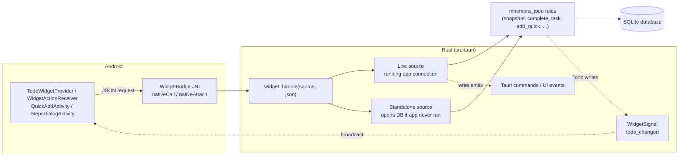
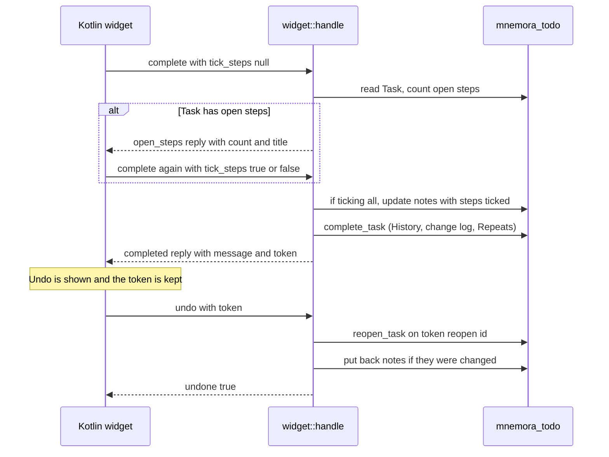
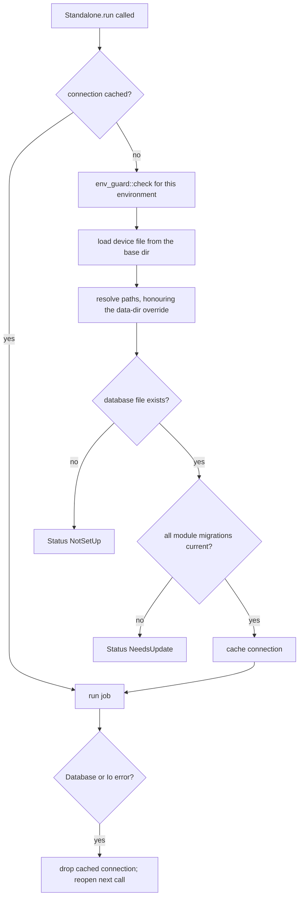
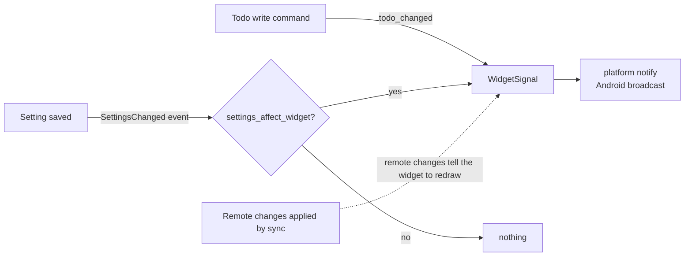

# Widget Bridge (`src-tauri/src/widget`)

The widget bridge is the Rust side of the Android Todo home-screen widget. The widget's Kotlin code never touches SQLite or Todo rules itself. Instead it sends one JSON request per user action into this module, and gets one JSON reply back. The bridge answers using the same Todo functions the desktop and phone UI call, so a tick, a Quick add or a Quick edit from the widget behaves exactly like the same action in the app. The design is recorded in ADR 0014.

The module has three jobs:

1. **Answer requests** (`mod.rs`): parse a JSON request, run it against the Todo rules, and return a JSON reply that never panics.
2. **Choose a database connection** (`source.rs`): either reuse the running app's connection, or open the database itself when the widget starts the process before the app has.
3. **Tell the widget to redraw** (`signal.rs`): hold a single "Todo changed" signal that every Todo write raises, and that Settings changes which affect the widget raise too.

The Android-only JNI glue (`widget/android.rs`) and the Kotlin receivers that call it are documented elsewhere; see [widget_android_bridge](android_home_widget.md) and [android_home_widget](android_home_widget.md).

## Where it sits

The bridge depends on the Todo domain for every rule (see [Task_and_Journal_Domain_Services](../Task_and_Journal_Domain_Services.md) and its [todo](../Task_and_Journal_Domain_Services/todo.md) page), on the shared database and migrations (see [Data_Foundation](../Data_Foundation.md)), and on the Tauri host state (see [app_shell](../Tauri_Host_and_IPC_Bridge/app_shell.md)).

## The request protocol

`handle(source, request)` takes a JSON string and returns a JSON string. The request is an object with a `method` tag. The reply is one of three shapes:

| Reply | Meaning |
|---|---|
| `{"ok": ...}` | Success; the payload depends on the method. |
| `{"status": "not_set_up"}` | The app has never run on this device, so there is no database. Only the app can create it. |
| `{"status": "needs_update"}` | The app was updated and its migrations have not run yet. Only the app can migrate. |
| `{"err": {"code", "message"}}` | The request failed. The message is user-readable; the parser's own text is never returned for a bad request, so titles do not leak into logs. |

### Methods

| `method` | Fields | Purpose |
|---|---|---|
| `snapshot` | `view`, `local` | The rows the widget draws for a view (Today, Inbox, All, Upcoming, or a List), as of the device clock. The reply carries `app_theme`. |
| `lists` | — | The Lists the setup screen offers, with the app's theme. |
| `complete` | `id`, `tick_steps?`, `local` | Ticks a Task. A Task with open steps first replies `kind: open_steps` and changes nothing until the request is repeated with `tick_steps` set. |
| `undo` | `token` | Reverses a tick, using the opaque token the tick returned. |
| `capture_context` | `view`, `local` | What the Quick add sheet needs when it opens: placeholder, the place inherited from the view, Lists and Settings. |
| `parse` | `QuickRequest` | Reads typed text the way the app's Capture box does and returns highlighted words, chips and the fields the Task would get. Writes nothing. |
| `add` | `QuickRequest` | Adds the Task the sheet describes, returning a message and the created Task. |

`local` is a `LocalNow` value sent by the widget so that "today" and time formatting follow the device's clock and zone, not the server's.

### The tick and undo flow

Ticking is the only method with a two-step conversation, and it is the one most likely to be misread, so it is shown in full:

The `UndoToken` is serialised into the reply and handed back unchanged. It holds the id to reopen (for a repeating Task, the occurrence it recorded, not the Task itself) and the original notes when "Tick all and complete" rewrote them. Kotlin treats the token as opaque.

For a repeating Task the completed message is split into a `lead` (the title line) and a `suffix` (where the next occurrence went), so the widget can keep the suffix whole and cut the title.

## Choosing the database connection

Two implementations of the `Source` trait decide which database is used. Both are chosen by the platform glue, based on whether the app process is already running.

| Source | When | How it reads | Writes |
|---|---|---|---|
| `Live<R>` | The Tauri app is running (its `AppState` exists). | Locks the app's shared connection (`state.db`). | Runs the job, then emits `TodoChangedEvent` so open app screens refresh. |
| `Standalone` | The widget woke the process before the app. | Opens the existing database file once and caches the connection. | No app event; there is no running UI. |

`Live::is_ready` reports whether the app's state exists yet. `Live::app_theme` and `Standalone::app_theme` read the theme from the device settings file, falling back to `system` for an unknown value.

`Standalone::open` follows app start-up exactly, in two steps:

Key properties:

- The bridge **never creates a database and never migrates**. A missing or outdated database is a status reply, so a widget can never change the schema behind the app's back.
- The environment guard runs first, so a Sandbox build cannot be pointed at Production data (see [Build_and_Packaging](../Build_and_Packaging.md) for how the environments are built).
- The device file is read before the database path is resolved, because the device file can move the data directory.

## Keeping the widget in step

`WidgetSignal` is one shared counter plus a platform notify function. On Android it sends a package-scoped broadcast; on desktop it does nothing; tests use a silent version and read the count.

- **Todo writes** raise the signal. Reads and Comments do not. A refused write does not raise it.
- **Settings** raise it only when they change what the widget draws: the app's theme, the time format, the week start, and how Todo views group and sort. Other Settings are ignored.
- **Remote changes** from sync also reach the widget through the same signal; see [Sync_Replication_Engine](../Sync_Replication_Engine.md) and its [todo_sync](../Sync_Replication_Engine/todo_sync.md) page.

The rule that matters for maintainers: **any new Todo write path must go through the signal**, or the widget will show stale rows until the next unrelated change.

## Error and safety rules

- No function in this module may panic. Release builds abort on panic and the caller is a broadcast receiver. Malformed JSON, unknown views, bad tokens and missing Tasks all return `err` replies.
- Error replies log only the error code. The message and details may carry the user's own text, so they are not logged.
- A failed tick after its steps were already ticked tries to restore the original notes. That restore's own failure is ignored, so a rare double failure can leave the steps ticked; the reply still reports the original error.
- `Standalone` drops its cached connection on `Database` and `Io` errors, so a replaced or damaged file is reopened on the next call.

## Testing

The bridge is tested without Android. Tests drive `handle` directly with a fake `Source` and a real database, and check the reply, the stored rows, the signal count and the change log. The test list is kept in [widget_tests](android_home_widget.md) and covers: snapshots per view, Quick add parsing and adding, ticking and undo (including repeats and "Tick all"), status replies before the app has run or after an update, sandbox refusal of a production data directory, and the rule that only Todo writes signal the widget.

## Related modules

- [android_home_widget](android_home_widget.md) — the Kotlin widget that calls this bridge.
- [widget_android_bridge](android_home_widget.md) — the JNI entry points (`nativeCall`, `nativeAttach`, `register_app`).
- [widget_tests](android_home_widget.md) — the behaviour tests described above.
- [Task_and_Journal_Domain_Services / todo](../Task_and_Journal_Domain_Services/todo.md) — the Todo rules every method calls.
- [Tauri_Host_and_IPC_Bridge](../Tauri_Host_and_IPC_Bridge.md) — the app state and the `TodoChangedEvent` the desktop and phone UI listen for.
- [Sync_Replication_Engine](../Sync_Replication_Engine.md) — the remote changes that also redraw the widget.
