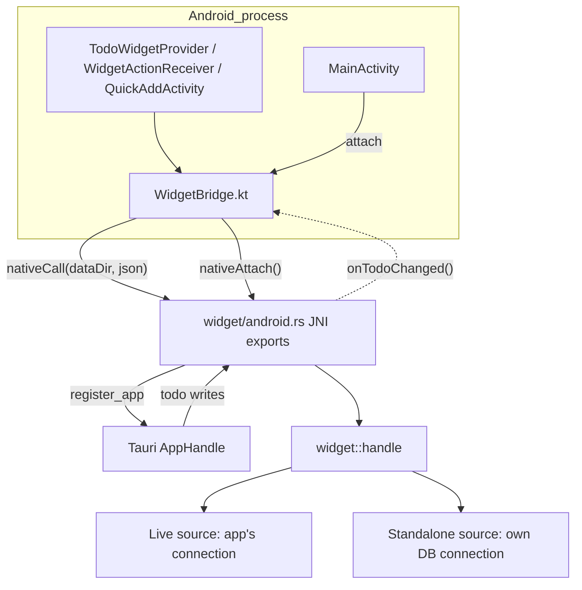
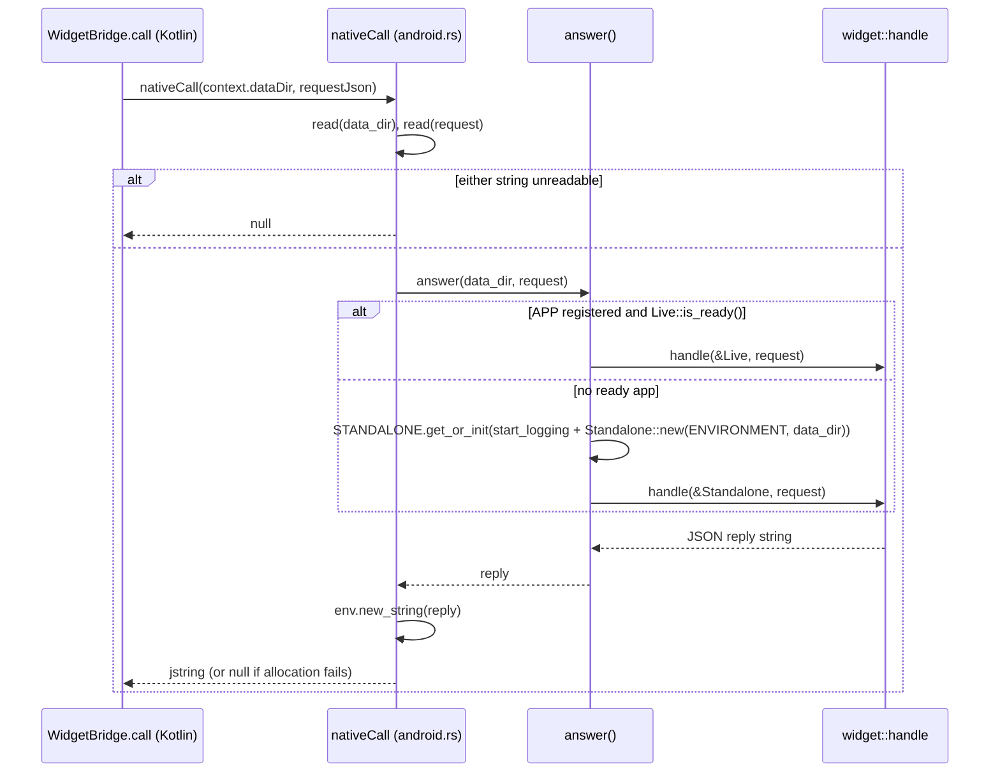
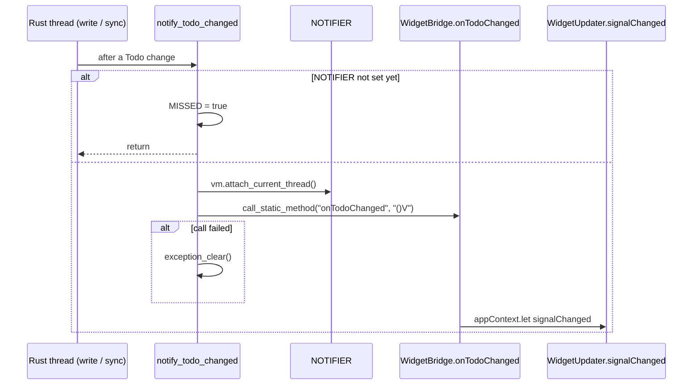

# widget_android_bridge

## Introduction

`widget_android_bridge` is the Rust side of the Android Todo home-screen widget's bridge (ADR 0014). It exposes three JNI entry points in `src-tauri/src/widget/android.rs` that the Kotlin object `WidgetBridge` calls:

- one call that sends a JSON request in and gets a JSON reply out (`nativeCall`),
- one call that lets Rust call back into Kotlin when Todo data changes (`nativeAttach`),
- a registration function that hands the running Tauri app to the bridge (`register_app`).

The module is deliberately small. Its job is to choose *which* Rust connection answers a widget request (the live app or a standalone one), start logging when the widget runs without the app, and translate between JNI strings and the shared request handler in `widget/mod.rs`. All widget behaviour (snapshots, ticks, quick add, parsing) lives in the `widget` module and the Todo domain; see [widget](widget.md) and [android_home_widget](android_home_widget.md).

## Where it sits in the system

The bridge is the only path from Android widget code into Rust. The Kotlin widget classes are described in [android_home_widget](android_home_widget.md); the Android activity that loads the app is described in [android_app_shell](android_app_shell.md) (see the Android Integration index at [Android_Integration](../Android_Integration.md)).

## Components

| Component | Kind | Role |
|---|---|---|
| `Java_com_hemang_mnemora_widget_WidgetBridge_nativeCall` | JNI export | Reads two Java strings, answers one request, returns a Java string or `null`. |
| `Java_com_hemang_mnemora_widget_WidgetBridge_nativeAttach` | JNI export | Stores a global reference to the Kotlin class and its `JavaVM`; replays a missed notification. |
| `register_app` | Rust fn | Stores the `AppHandle<tauri::Wry>` in a `OnceLock` so later calls can use the app's connection. |
| `notify_todo_changed` | Rust fn (crate-internal) | Calls `WidgetBridge.onTodoChanged()` on any thread; swallows failures. |
| `answer` | Rust fn | Chooses the live app or the standalone source, then calls `widget::handle`. |
| `start_logging` | Rust fn | Starts the same file logger the app uses, when the widget runs first. |
| `read` | Rust fn | Converts a `JString` to a Rust `String`, returning `None` on failure. |

Statics kept by the module:

| Static | Type | Purpose |
|---|---|---|
| `APP` | `OnceLock<AppHandle<Wry>>` | The running app, once `setup` has made its state. |
| `STANDALONE` | `OnceLock<Standalone>` | The bridge used when there is no app connection. Created once per process. |
| `LOG` | `OnceLock<LogHandle>` | Keeps the log writer alive. |
| `NOTIFIER` | `OnceLock<Notifier>` | `JavaVM` plus global class ref, used to reach `onTodoChanged`. |
| `MISSED` | `AtomicBool` | Records a change signal that arrived before `nativeAttach`. |

Related types from `widget/mod.rs` and `widget/source.rs`: `Outcome` (`Ok` payload, `Status`, or `Err`), `Request` (the JSON request enum: `Snapshot`, `Lists`, `Complete`, `Undo`, `CaptureContext`, `Parse`, `Add`), and `Live<R>` (wraps `AppHandle<R>`). See [widget](widget.md) for these.

## Request path: `nativeCall`

`nativeCall` is the only data path. It is a synchronous call made from Kotlin, usually on a background thread from a broadcast receiver or activity.

Key points:

- **Source selection.** If `register_app` has run and the app reports `is_ready()`, the request uses the app's own connection (`Live`). This avoids a second SQLite connection while the app is alive.
- **Standalone fallback.** Otherwise the first call creates a `Standalone` source for `data_dir` with the build's `ENVIRONMENT`. `get_or_init` means this happens once per process. This is what lets the widget work with the app closed.
- **Logging on first standalone use.** `start_logging` resolves `AppPaths` for the data directory and initialises the same logger the app uses (level `info`), then logs `todo widget bridge started without the app`. The returned handle is stored in `LOG` so the writer lives for the process.
- **Reply shape.** `handle` always returns a JSON string. Errors are encoded by the shared handler (`Outcome::Err`) rather than raised across JNI.

## Notification path: `notify_todo_changed` and `nativeAttach`

Rust must tell the widget to redraw after any Todo write, including writes made by the app, sync, or a widget write. It uses a stored `JavaVM` and global class reference so the call works from any Rust thread.

`nativeAttach` runs when Kotlin `WidgetBridge.attach(context)` is called from the activity. It:

1. obtains the `JavaVM` and a global reference to the `WidgetBridge` class,
2. stores them in `NOTIFIER` (only the first call wins; `set` is ignored afterwards),
3. if `MISSED` was set, clears it and sends one notification now.

Step 3 covers the race where app setup finishes (database created or migrated) before the Android side attaches. Without it, the first widget draw after a cold start could be stale.

Failure handling in this path is intentional: a missing notifier, a failed attach, or a Java exception only means the widget does not redraw immediately. The pending Java exception is cleared so it cannot poison the thread's next JNI call.

## Safety rules

The module is built into a release library that aborts on panic. Its header comment states the rules every change must keep:

- **No panics.** No `unwrap`, `expect`, or indexing. Every failed conversion becomes an `err` reply or a null string.
- **No Tauri start-up.** Loading `mnemora_lib` from a broadcast receiver must not start Tauri, so the only Tauri type touched is `AppHandle`, obtained from `register_app`.
- **Error text stays out of logs.** The request parser's message is returned in the reply; request text (which may contain task titles) is not logged. This is enforced in `widget::handle`.
- **Clear Java exceptions.** Any exception from a Kotlin callback is cleared before returning.

## Kotlin counterpart

`src-tauri/gen/android/app/src/main/java/com/hemang/mnemora/widget/WidgetBridge.kt` is the only Kotlin caller:

- `System.loadLibrary("mnemora_lib")` is loaded lazily. If it fails, `call` returns `null` and the widget shows its read-error state.
- `call(context, request)` passes `context.dataDir.absolutePath` as the first argument, so Rust always receives the app's private data directory.
- `attach(context)` remembers the application context and calls `nativeAttach`. `MainActivity` calls it, so an attach happens whenever the app's activity starts.
- `onTodoChanged()` is `@JvmStatic` because Rust calls it by name; it forwards to `WidgetUpdater.signalChanged`.

Because the JNI symbol names are fixed by package and class, renaming `WidgetBridge`, moving it to another package, or renaming `nativeCall`/`nativeAttach` breaks the bridge at run time (`UnsatisfiedLinkError`, which Kotlin already catches and turns into the error state). The same applies to `onTodoChanged`, which Rust looks up by name.

## Build and packaging

- The Rust code is compiled into the `mnemora_lib` shared library that the Android app loads. Build wiring is described in [Build_and_Packaging](../Build_and_Packaging.md) and its [build_and_packaging](../Build_and_Packaging/build_and_packaging.md) page.
- `ENVIRONMENT` (used when creating the standalone source) is a compile-time environment constant from the crate root. Sandbox and production builds therefore use different data locations and refuse each other's data; the test cases for this are in [widget_tests](widget_tests.md).

## Behaviour summary

| Situation | What happens |
|---|---|
| Widget tapped, app closed | `nativeCall` → `answer` → `Standalone` on the app's data dir. |
| Widget tapped, app open and ready | `nativeCall` → `answer` → `Live` on the app's connection. |
| App open but not yet ready (migration pending) | Falls through to `Standalone`; reply reports status instead of data. |
| Todo change in app, sync or widget | `notify_todo_changed` → `WidgetBridge.onTodoChanged` → widget redraw. |
| Change before Android attaches | Flag stored in `MISSED`; sent once when `nativeAttach` runs. |
| Library missing, or call throws | Kotlin returns `null`; widget shows its read-error state. |
| Request text is not valid JSON | `handle` returns an `Err` reply; nothing is written. |

## Related documentation

- [widget](widget.md): request types, outcomes, the `Source` abstraction and the Live/Standalone sources.
- [android_home_widget](android_home_widget.md): the Kotlin widget providers, receivers, and quick-add screens that call this bridge.
- [widget_tests](widget_tests.md): behaviour tests for requests and the sandbox data-dir guard.
- [Data_Foundation](../Data_Foundation.md): the database and change log the standalone source reads and writes.
- [Task_and_Journal_Domain_Services](../Task_and_Journal_Domain_Services.md): the Todo operations behind each request.
- [Sync_Replication_Engine](../Sync_Replication_Engine.md): remote changes that also trigger the redraw signal.
- [Tauri_Host_and_IPC_Bridge](../Tauri_Host_and_IPC_Bridge.md): the desktop/app IPC layer, the other bridge in the system.
