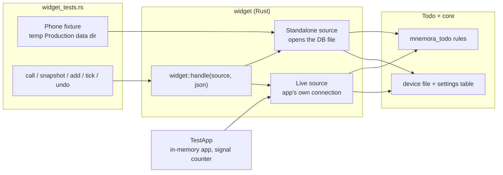
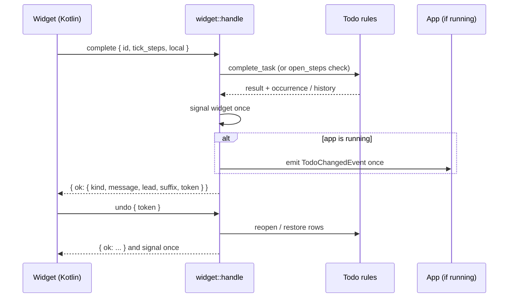
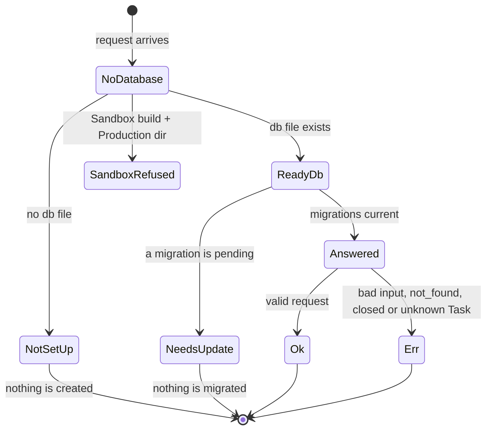

# widget_tests

`widget_tests` is the Rust test suite for the Todo home-screen widget's bridge. It drives the widget's single JSON entry point, `widget::handle`, exactly as the Android Kotlin side calls it, and checks the replies, the rows and headings the widget draws, the Undo tokens, and the signals sent to the widget. The module contains no production code. It is the executable specification for the bridge described in [widget](widget.md) and [widget_android_bridge](widget_android_bridge.md), and it relies on the Todo rules implemented in [Task_and_Journal_Domain_Services/todo](../Task_and_Journal_Domain_Services/todo.md).

Source: `src-tauri/src/widget_tests.rs`. It is compiled only under `cargo test` (see [Build_and_Packaging](../Build_and_Packaging.md)).

## What the tests cover

| Area | Representative tests | Behaviour pinned |
|---|---|---|
| Not set up | `before_the_app_ever_ran_*`, `lists_before_the_app_ran_is_not_set_up` | With no database, the widget gets `not_set_up`, and nothing is created on disk. |
| Migration gate | `a_pending_migration_means_needs_update_and_nothing_is_migrated` | An older database answers `needs_update`. The widget never migrates. |
| Location and safety | `the_database_is_found_where_the_device_setting_moved_it`, `a_sandbox_build_refuses_a_production_data_dir` | The database is found through the device file's data-dir setting. A Sandbox build refuses a Production folder. |
| Views | `today_*`, `upcoming_*`, `inbox_*`, `all_*`, `a_list_*`, `an_empty_*` | Headings, row order, day labels, overdue tone, header counts and empty-state text. |
| Theme | `every_snapshot_carries_the_apps_theme`, `lists_returns_*` | Each reply carries the app's theme. |
| Quick add | `the_sheet_opens_in_the_place_each_view_stands_for`, `parse_*`, `adding_*` | Capture context, read-as-you-type spans, and the add rules. |
| Tick and Undo | `ticking_*`, `tick_all_*`, `open_steps_*`, `undoing_*` | Completing, Undo tokens, repeating tasks, and the notes' steps. |
| Parity with the app | `ticking_on_the_widget_is_the_same_as_the_apps_complete_command`, `a_task_added_by_the_widget_is_the_task_the_app_would_add` | The widget writes the same rows, change-log records and History as the app. |
| Signals | `every_list_write_signals_the_widget_once`, `every_task_write_signals_the_widget_once`, `todo_reads_comments_and_settings_never_signal_the_widget`, `settings_that_change_the_drawing_signal_once_and_others_do_not` | Each write signals the widget exactly once. Reads and unrelated settings signal nothing. |
| Live app | `a_live_app_answers_from_its_own_connection`, `a_widget_write_while_the_app_is_alive_emits_todo_changed_once_per_write`, `adding_tells_a_running_app_once_and_a_refused_add_says_nothing` | With the app running, the bridge uses the app's connection and emits `TodoChangedEvent` once per successful write. |
| Bad input | `bad_requests_get_an_err_and_never_a_panic`, `bad_ticks_and_undos_are_errors_not_panics`, `bad_quick_add_requests_are_errors_and_create_nothing` | Every malformed request gets an `err` reply, never a panic, and writes nothing. |

## Where the tests sit

Two kinds of source are exercised, and each has its own fixture:

- **`Phone`** (the "phone is off" case). It creates a temporary folder shaped like Android's app data dir, resolves `AppPaths` for `Environment::Production`, and creates or migrates a real database file with the Modules a test chooses. Tests then reach the bridge through `Standalone::new(...)`. This is how the widget behaves when the app has never run, has been closed, or has an older schema.
- **`TestApp`** (the "app is running" case). It is an in-memory application harness from `test_support`. It exposes `invoke` (the app's own Tauri commands), `with_db`, `set_pref`, and `widget_signals()`, a counter of widget redraw signals. Tests wrap it in `Live::new(app.handle())`.

The `Phone` helper also writes the theme into the device file, the same way Settings does, so the tests check the widget reads the value the app saved.

## The JSON protocol the tests pin

Every call is one JSON request in, one JSON reply out. The `call` helper parses the reply and most assertions look at one of three shapes.

| Reply | Meaning | Seen in |
|---|---|---|
| `{"ok": ...}` | Success; the payload depends on the method. | every successful test |
| `{"err": {"code", "message"}}` | A refused request. Codes seen: `internal` (Sandbox guard), `not_found` (a List that is gone or never existed). Bad input gives an `err` with a message. | `bad_*`, `a_missing_list_*`, `a_sandbox_build_*` |
| `{"status": "not_set_up" \| "needs_update"}` | The database is missing, or its migrations are pending. Nothing is created or migrated. | `before_the_app_*`, `a_pending_migration_*` |

Methods exercised, with the request fields the tests send:

| Method | Request fields | Result |
|---|---|---|
| `snapshot` | `view`, `local` (`today`, `now`, `offset_min`) | `view`, `title`, `count` (`text`, `tone`), `groups` (`heading`, `tone`, `rows`), `empty`, `app_theme` |
| `lists` | none | `app_theme`, `lists` (`id`, `name`, `emoji`, `label`) |
| `capture_context` | `view`, `local` | `placeholder`, `place` (`date`, `list_id`), `lists`, `parse_dates`, `week_start`, `time_format` |
| `parse` | `view`, `text`, `local`, optional `hand`, `prefer`, `ignored` | `spans`, `alternatives`, `fields`, `list_label`, `list_is_new`, `when_label`, `ignored` |
| `add` | as `parse`, plus optional `notes` | `task`, `message` |
| `complete` | `id`, `tick_steps` (`null`, `true`, or `false`), `local` | `kind` (`completed` or `open_steps`), `message`, `lead`, `suffix`, `token` |
| `undo` | `token` | `ok` on success; `err` if the Task is already open or the token is bad |

The `view` string is one of `today`, `upcoming`, `inbox`, `all`, or `list:<id>`. The `list:<id>` form is rejected when the id is empty, and an unknown id reports `not_found` with the message "That List no longer exists".

## Key behaviours

### Snapshots

- **Today** shows Overdue first, oldest date first, each row showing the day it was due (`Yesterday`, `Mon`). Then Today, in the app's default order: Priority, then timed Tasks by time. Markdown marks are stripped from titles.
- **Grouping follows the app's preference.** `todo.group_today = "none"` gives a flat list ordered by time. Upcoming ignores that preference and always groups by day.
- **Upcoming** shows Overdue, then each day for the next seven days. Headings name the day (`Tomorrow · Thu 22`, `Fri 23`); a day past the week, such as `Mon 2 Nov`, is named in full.
- **Inbox** has two groups: undated Tasks with no List, then undated Tasks that sit in a List (titled "No date, in a List"). The Inbox's own sort applies to both groups.
- **All** groups by List in the sidebar's order, Inbox first. Empty Lists are left out, and done Tasks are hidden.
- **A List view** follows that List's own sort and grouping. Rows do not repeat the List name.
- **Row time labels.** Today rows show the time. Other views show a day name where the row is not due today (`Tomorrow 11:00`, `Wed 4 Nov`), in grey. Overdue rows keep the red day and no time. Times follow the `core.time_format` setting (`6:00 PM` under `12h`).
- **Header count** is the number of open Tasks shown, or `N overdue` in the overdue tone when any are late.
- **Empty states** give fixed copy: "Nothing due today" with the next Task named (`Next: Dentist, tomorrow 11:00`), "Inbox zero", "No open Tasks", and "Nothing coming up". Their wording is part of the test contract.

### Ticking and Undo

- `complete` on a task with open steps in its notes returns `open_steps` and changes nothing until the person answers. Answering with `tick_steps: true` ticks every step and completes the Task. `false` completes it and keeps the notes as they are.
- A repeating task is not done. It moves to its next date and the reply says so: `Completed “Call mum” · next Thu 22 Oct`. The `lead` and `suffix` fields split that line so the bar can shorten the title and keep the date whole.
- `undo` takes the token from the reply. It restores the Task (and for a repeating Task, rewinds the date and removes the occurrence record). Undo is exactly the app's reopen.

### Quick add

- `capture_context` gives the placeholder and the place the sheet opens in, per view: Today sets today's date, Upcoming sets tomorrow, Inbox and All set nothing, and a List view sets that List. A List deleted since setup falls back to the Inbox, and the hint says so.
- `parse` returns spans with UTF-16 offsets (the offsets a Kotlin string uses) for every recognised word: date, time, priority, list, repeat. Conflicting dates are offered as `alternatives`; `prefer` swaps which one wins; `ignored` turns a word back into plain text.
- `#Name` that matches no List is read as a new List. `add` creates it, so the reply says "to Garage". The second use reuses the List.
- Typed words beat the place the view opened. Hand-set chips (`hand`) apply when no word overrides them, and the Inbox chosen by hand beats the List being viewed.
- `add` writes one `create` row in the change log per Task, plus one for a new List. A widget-created Task matches the one the app's Capture box would create: same fields, same change-log shape, same History. `log_shape` and `history` are the comparison tools.

## Signals and live updates

The widget is redrawn by a signal. The tests count it to pin when it fires:

- Every successful write sends one signal. A refused write sends none.
- Reads (`snapshot`, `lists`, `capture_context`, `parse`, and the app's read commands) send none.
- A setting that changes how the widget draws (theme, time format, week start, the Today and Inbox grouping and sort) sends one signal per save. Unrelated settings (density, display name, motion, date parsing) send none.
- When the app is running, a widget write also emits `TodoChangedEvent` once, so the open app refreshes. `wait_for` polls the counter with a short timeout because the event is delivered asynchronously.

The sync-driven refresh (a remote change refreshing the widget) is covered by the sync suites, not here. See [Sync_Replication_Engine](../Sync_Replication_Engine.md).

## Reply states

## Test fixtures and conventions

- **Fixed clock.** Most tests use `TODAY = "2026-10-21"` (a Wednesday) and `now = "14:05"`, so day labels are deterministic. `at_json` and `at` build the `local` block.
- **Phone folder.** Created under `tempfile::tempdir()`, shaped like an Android data dir. Nothing outside it is touched.
- **Settings.** Tests insert settings rows directly (`set_pref`, `set_raw_pref`) to exercise the same keys the app writes: `todo.group_today`, `todo.inbox_sort`, `todo.lists_sort`, `todo.parse_dates`, `core.time_format`, `core.week_start`, `core.theme`.
- **Helpers.** `add`, `repeat_daily`, and `with_notes` create Tasks through `mnemora_todo`'s own functions, so fixtures follow the domain rules rather than hand-written rows.
- **Parity checks.** `log_shape` strips ids and timestamps from change-log snapshots so two Tasks from different paths can be compared. `completed_rows` and `history` do the same for the Task row and its History.

## Dependencies

| Depends on | For |
|---|---|
| [widget](widget.md) | the `handle`, `Source`, `Standalone`, and `Live` types under test |
| [widget_android_bridge](widget_android_bridge.md) | the JNI entry the Kotlin side uses in production (not exercised here; the tests call `handle` directly) |
| [Task_and_Journal_Domain_Services/todo](../Task_and_Journal_Domain_Services/todo.md) | Task, List, repeat, History and sidebar rules |
| [Data_Foundation](../Data_Foundation.md) | migrations (`db::migrate::run`), device settings file, change log, `AppPaths` |
| [Tauri_Host_and_IPC_Bridge](../Tauri_Host_and_IPC_Bridge.md) | the app's commands used by `TestApp::invoke` and the `TodoChangedEvent` emitter |
| [Android_Integration](../Android_Integration.md) | the home-screen widget this bridge serves |

## Maintaining these tests

- A new widget method, view, or reply field needs a test here, in the same style: one behaviour per test, with the expected JSON written out.
- Any new write command must be added to `every_task_write_signals_the_widget_once` or `every_list_write_signals_the_widget_once`, or it will signal the widget without the suite noticing.
- Copy such as "Nothing due today" or "Inbox zero" is asserted verbatim. Change the test in the same commit as the copy.
- Keep the Phone fixture's folder layout in line with `AppPaths`. If the Android data dir layout changes, the `the_database_is_found_where_the_device_setting_moved_it` and `a_sandbox_build_refuses_a_production_data_dir` tests are the first to fail.
