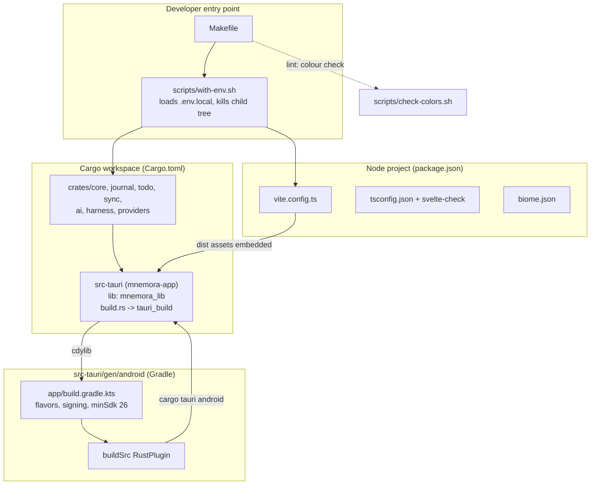
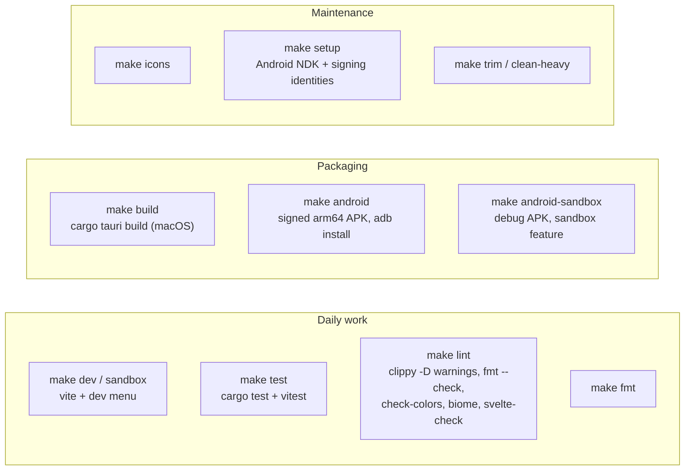

# Build and Packaging

## Purpose

Build and Packaging is the set of files that turn the Mnemora repo into runnable and distributable artifacts. The repo has three parts: a Rust workspace of domain crates, a Svelte/Vite frontend, and a Tauri 2 shell that targets macOS and Android. This module covers the manifests and configs that define those builds, the developer entry points (`Makefile`, `package.json` scripts), the quality gates (lint, format, colour check), and the signing and icon pipelines. It does not contain application logic.

Day-to-day commands such as `make dev`, `make test`, `make lint`, and `make android` are thin wrappers over the tools configured here.

## Architecture

The Makefile is the entry point. Below it, the Cargo workspace and the npm/pnpm project handle dependencies and compilation. Shell scripts in `scripts/` handle environment, signing, icons, and the colour lint. The Tauri host (`src-tauri`) builds into one library, `mnemora_lib`, which embeds the frontend bundle at compile time.

Key points:

- **Thin host.** `src-tauri/Cargo.toml` is described as wiring only. Business rules live in `crates/*`, so changing them rarely touches build files.
- **Three crate types.** `mnemora_lib` builds as `staticlib` (macOS bundle), `cdylib` (Android), and `rlib` (tests).
- **Frontend embedded at compile time.** The frontend must be built before a Rust release build.
- **Pinned versions.** Rust pins live in `[workspace.dependencies]` as exact `=x.y.z` versions. JavaScript pins are exact in `package.json`.

## Developer and release flows

## Key design choices

- **Resource limits.** The dev machine has 8 GB RAM. Builds use `CARGO_BUILD_JOBS=2`, `incremental = false`, and line-table debug info. Gradle runs without a daemon and with a 1536 MB heap. The Android NDK is pruned to arm64.
- **Sandbox is a separate build identity.** The `sandbox` Cargo feature and `MNEMORA_ANDROID_SANDBOX=1` give a separate data directory and app id, so Sandbox installs beside Production.
- **Secrets stay in the Keychain.** Signing passwords are read from the macOS login Keychain at build time. Nothing secret is written to a tracked file.
- **Generated icons.** Icons come from SVG masters through `make icons`, never by hand.
- **Colour lint.** `check-colors.sh` blocks raw colour literals in `src/`, enforcing the token-only UI rule.

## Core component documentation

- [build_config](Build_and_Packaging/build_config.md): workspace, package, and tooling config (Cargo, pnpm, Makefile, Biome, rustfmt, clippy, editorconfig).
- [build_scripts](Build_and_Packaging/build_scripts.md): shell helpers for environment wrapping, signing, Android setup, icons, and the colour check.
- [build-config](Build_and_Packaging/build-config.md): the `src-tauri` crate manifest, including the `sandbox` feature, Android-only JNI dependency, and dev dependencies.
- [build_and_packaging](Build_and_Packaging/build_and_packaging.md): the overall build, packaging, Android Gradle pipeline, and icon generation.
- [typescript_config](Build_and_Packaging/typescript_config.md): `tsconfig.json`, which `svelte-check` uses for type checking.
- [vite_build_config](Build_and_Packaging/vite_build_config.md): `vite.config.ts`, covering the dev server on port 47821 and the production build.

## Known gaps

- The Makefile header says every build uses `CARGO_BUILD_JOBS=2`, but the Makefile does not set it. `with-env.sh` is documented as the place that does.
- The dev port (47821) is duplicated across `vite.config.ts`, `scripts/dev/config.mjs`, and `src-tauri/tauri.conf.json`. Nothing in the repo checks that the three values agree.
- `make test` does not run lint, and `pnpm lint` covers only part of `make lint`.