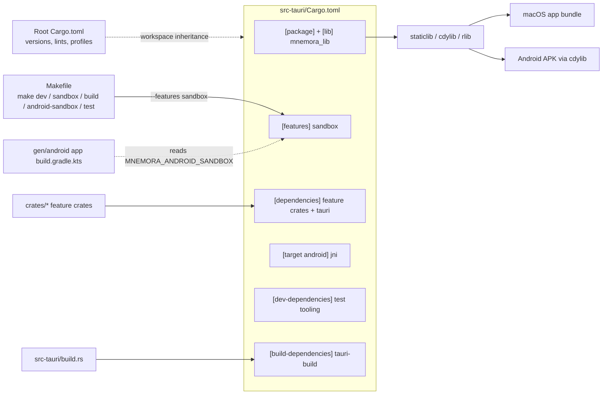
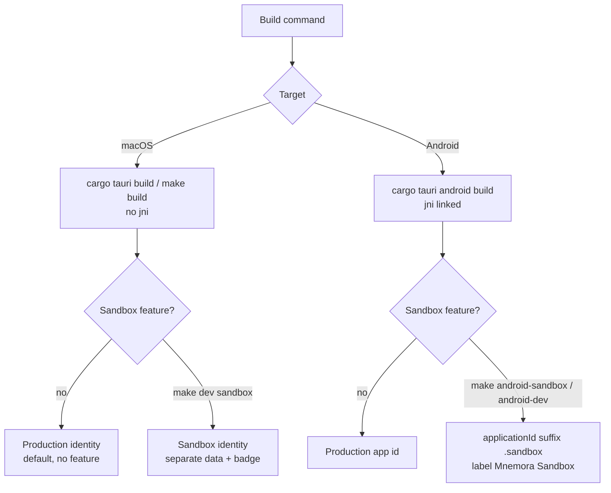

# build-config

## Introduction

The `build-config` module describes how the Tauri application crate `mnemora-app` (`src-tauri/`) is compiled, linked and configured. Its single core artifact is `src-tauri/Cargo.toml`. That manifest is intentionally thin: the file header states the app is "thin: wiring only, logic lives in mnemora-core". Every feature crate (journal, todo, sync, ai, harness, providers) is pulled in as a workspace path dependency, so this manifest is mostly a list of wiring points plus two switches that change what gets built: the `sandbox` feature and the Android-only dependency block.

Workspace-wide policy (pinned versions, lints, release profile) lives in the root `Cargo.toml`, which is documented under [Build and Packaging](build_and_packaging.md). Frontend and Android build tooling are documented in [build_config](build_config.md), [build_scripts](build_scripts.md), [typescript_config](typescript_config.md) and [vite_build_config](vite_build_config.md).

## Purpose and scope

| Concern | Where it is decided |
|---|---|
| Crate name, library name, output types | `src-tauri/Cargo.toml` (this page) |
| Which feature crates the app links | `src-tauri/Cargo.toml` `[dependencies]` |
| Sandbox vs Production build identity | `[features] sandbox` here, selected by Makefile targets |
| Android-only native glue | `[target.'cfg(target_os = "android")'.dependencies]` here |
| Test-only tooling for the command layer | `[dev-dependencies]` here |
| Pinned versions, lints, profiles | Root `Cargo.toml` (see [build_and_packaging](build_and_packaging.md)) |
| Compile-time icon and capability generation | `src-tauri/build.rs` (see [build_and_packaging](build_and_packaging.md)) |

## Manifest anatomy

Source: `src-tauri/Cargo.toml`.

### Package and library identity

```toml
[package]
name = "mnemora-app"
version.workspace = true
edition.workspace = true
rust-version.workspace = true
license.workspace = true
publish.workspace = true

[lib]
name = "mnemora_lib"
crate-type = ["staticlib", "cdylib", "rlib"]
```

- Version, edition, Rust version, license and `publish = false` are inherited from `[workspace.package]` in the root manifest, so the app always matches the workspace (0.2.0, edition 2024, Rust 1.90).
- The library is named `mnemora_lib` with a `_lib` suffix. The file comment explains why: it avoids a Windows name clash between the lib and bin outputs.
- Three crate types are produced, each for a different consumer:
  - `staticlib`: linked into the Apple (macOS) bundle.
  - `cdylib`: loaded as a shared library by the Android side (see [Android_Integration](../Android_Integration.md)).
  - `rlib`: the standard Rust library form, which the workspace's Rust tests link against.

### The `sandbox` feature

```toml
[features]
sandbox = []
```

The feature has no dependencies of its own. Its only job is to select `Environment::Sandbox` in the Rust code, which gives the Sandbox build a separate data directory, bundle identifier and badge. It is switched on from the Makefile:

- `make android-sandbox` runs `cargo tauri android build --debug ... --features sandbox`.
- On Android, the Gradle script reads the same intent from the `MNEMORA_ANDROID_SANDBOX=1` environment variable or the `mnemora.sandbox` property. It then changes the application id (`.sandbox` suffix), the launcher label and icon, and the Todo widget label. See [Android_Integration](../Android_Integration.md) and `src-tauri/gen/android/app/build.gradle.kts`.

Because Sandbox has its own application id (`.sandbox` suffix) and launcher label, it installs alongside Production rather than over it. This is why the Sandbox switch is treated as a build-time identity, not a runtime setting.

### Internal crate dependencies

```toml
[dependencies]
mnemora-core.workspace = true
mnemora-journal.workspace = true
mnemora-todo.workspace = true
mnemora-sync.workspace = true
mnemora-ai.workspace = true
mnemora-harness.workspace = true
```

These are the feature crates. Each is a path dependency declared once in the root `[workspace.dependencies]`. The app crate adds no logic of its own, so changing a feature usually touches a crate under `crates/`, not this manifest. Which module owns which crate is described in the module tree pages:

- [Data_Foundation](../Data_Foundation.md) for `mnemora-core`.
- [Task_and_Journal_Domain_Services](../Task_and_Journal_Domain_Services.md) for `mnemora-todo` (and journal, see [Feature_Client_UI](../Feature_Client_UI.md)).
- [Sync_Replication_Engine](../Sync_Replication_Engine.md) and [Sync_Connectivity_and_Pairing](../Sync_Connectivity_and_Pairing.md) for `mnemora-sync`.
- [AI_Assistant_Engine](../AI_Assistant_Engine.md) for `mnemora-ai`, `mnemora-harness` and `mnemora-providers`.

### Shared third-party dependencies

The following are declared with `.workspace = true`, so their exact versions are pinned in the root manifest:

| Dependency | Role in the app crate |
|---|---|
| `tauri` | Desktop and mobile shell. Enabled features: `wry`, `compression`, `common-controls-v6`, `dynamic-acl`, `x11`. |
| `tauri-plugin-opener` | Opening external links. |
| `tauri-specta`, `specta`, `specta-typescript` | Generates the typed IPC bindings (`src/lib/ipc/bindings.ts`). Must be the same rc, as the root manifest notes. |
| `serde`, `serde_json` | Serialization of command arguments and events. |
| `tracing` | Logging. |
| `whoami` | Device identity. |

The `tauri` dependency is declared in the root with `default-features = false`. The app adds the feature list above, so the shell's runtime features are chosen here rather than in the workspace.

### Build dependency

```toml
[build-dependencies]
tauri-build.workspace = true
```

`tauri-build` runs `src-tauri/build.rs`. That script generates the context and capability schemas and re-runs when `icons/` changes, so `make icons` takes effect in the binary.

### Android-only dependency

```toml
[target.'cfg(target_os = "android")'.dependencies]
jni.workspace = true
```

`jni` is compiled only for Android. It provides the JNI glue for the Todo home-screen widget (the root manifest records this as ADR 0014). The Rust functions it backs are exported under the `Java_com_hemang_mnemora_*` names, documented in [Android_Integration](../Android_Integration.md). On desktop targets this dependency is absent, so desktop builds never link JNI.

### Development-only dependencies

```toml
[dev-dependencies]
tauri = { workspace = true, features = ["test"] }
mnemora-providers = { workspace = true, features = ["testing"] }
tempfile.workspace = true
tokio = { workspace = true, features = ["macros", "rt", "time", "net"] }
```

These never reach a release build:

- `tauri` with the `test` feature adds the mock runtime used by the command-layer tests (`src-tauri/src/*_tests.rs`).
- `mnemora-providers` with the `testing` feature supplies an in-process fake provider that the AI command tests point a real adapter at (see [providers](../AI_Assistant_Engine/providers.md)).
- `tokio` with `net` and `rt` supports the pairing tests, which run real loopback sockets (see [Sync_Connectivity_and_Pairing](../Sync_Connectivity_and_Pairing.md)).
- `tempfile` provides throwaway data directories for database tests.

### Lints

```toml
[lints]
workspace = true
```

The app opts into the workspace lint policy from the root manifest. That policy sets `unsafe_code = "deny"`, `unwrap_used` and `expect_used` to deny, and clippy `all` to deny. Test code is exempted via `clippy.toml` (`allow-unwrap-in-tests`, `allow-expect-in-tests`).

## How the manifest is used



## Build variants



The Makefile shows two ways the `sandbox` feature is selected. `make android-sandbox` passes `--features sandbox` to `cargo tauri android build` directly, and the Android Gradle script reads `MNEMORA_ANDROID_SANDBOX`. `make dev` and `make sandbox` both start `scripts/dev.mjs`; how that script selects the Sandbox build is not visible in this manifest. See [build_scripts](build_scripts.md) for the scripts.

## Test-time configuration

| Command | What it runs | Relevant manifest parts |
|---|---|---|
| `make test` | `cargo test --workspace` | `[dev-dependencies]` (tauri `test`, providers `testing`, tempfile, tokio) |
| `make bindings` | `cargo test -p mnemora-app regenerate_bindings -- --ignored` | the specta/tauri-specta dependencies |
| `make lint` | `cargo clippy --workspace --all-targets -- -D warnings` | `[lints] workspace = true` |
| `make android-test` | Gradle unit tests (not part of `make test`) | none in this manifest |

Every cargo command is run with `CARGO_BUILD_JOBS=2`, set in the developer workflow, because the dev machine has 8 GB of RAM. The app crate itself adds no build-time switches for this.

## Maintenance guidance

- **Adding a feature crate:** add it to the root `[workspace.dependencies]` and `members`, then add `name.workspace = true` under `[dependencies]` here. Do not pin a version here.
- **Adding a runtime-only test tool:** put it under `[dev-dependencies]` so it stays out of release builds.
- **Adding Android-only native code:** put it under the `cfg(target_os = "android")` table, not `[dependencies]`, so desktop builds stay free of it.
- **Changing the Sandbox identity:** the Rust side reads the `sandbox` feature, and the Android side reads `MNEMORA_ANDROID_SANDBOX`. Both must change together; the Makefile is the single place that sets them.
- **Changing `tauri` features:** this is a shared decision. The feature list is the desktop and mobile runtime surface, so check the Tauri host pages in [Tauri_Host_and_IPC_Bridge](../Tauri_Host_and_IPC_Bridge.md) before editing.
- **Versions are exact pins** (`=x.y.z`) in the root manifest. Do not add version ranges in this file.
