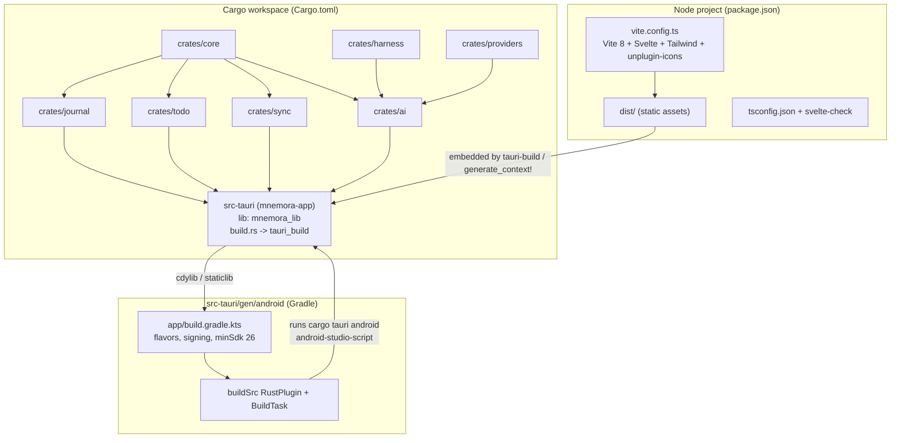
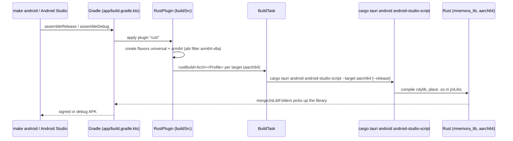
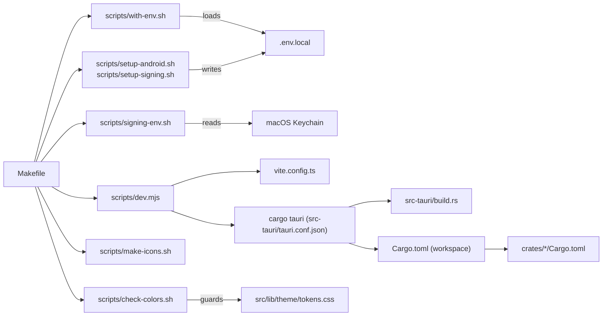

# Build and Packaging

## Introduction

Build and Packaging is the set of files that turn the Mnemora workspace into runnable and distributable artifacts: a Rust workspace of domain crates, a Svelte/Vite frontend, a Tauri 2 desktop and mobile shell, and a Gradle-based Android project. It also covers the developer entry points (`Makefile`, `package.json` scripts), the code-quality gates (lint, format, colour check), and the signing and icon pipelines.

This page explains how those pieces fit together. It does not re-document the code they build. For the sub-areas, see:

- [build_config.md](build_config.md): workspace, package and tooling configuration (Cargo, pnpm, Biome, rustfmt, clippy, editorconfig).
- [build_scripts.md](build_scripts.md): shell scripts for environment, signing, Android setup, icons and colour checks.
- [build-config.md](build-config.md): the `src-tauri` crate manifest.
- [typescript_config.md](typescript_config.md): TypeScript compiler settings.
- [vite_build_config.md](vite_build_config.md): the Vite dev server and production build.
- The Android Gradle sources (`src-tauri/gen/android/**`) are described in this page under [Android pipeline](#android) rather than in a separate sub-page.

The runtime behaviour of the Android app and the Tauri host is documented in [Android_Integration](../Android_Integration.md) and [Tauri_Host_and_IPC_Bridge](../Tauri_Host_and_IPC_Bridge.md). The theme and token system that the colour check protects is in [Design_System](../Design_System.md).

## Scope and Artifacts

| Class | Files | Role |
|---|---|---|
| Rust workspace manifest | `Cargo.toml` | Workspace members, pinned dependency versions, lint policy, build profiles |
| Crate manifests | `crates/*/Cargo.toml`, `src-tauri/Cargo.toml` | Per-crate dependencies and features (`sandbox`) |
| Frontend manifest | `package.json`, `pnpm-workspace.yaml` | Scripts, pinned npm dependencies, pnpm version |
| Frontend build | `vite.config.ts`, `tsconfig.json` | Dev server, bundling, TypeScript checking |
| Quality config | `biome.json`, `clippy.toml`, `rustfmt.toml`, `.editorconfig` | Formatting and lint rules |
| Task runner | `Makefile` | Developer entry points (`make dev`, `make build`, `make android`, ...) |
| Rust build hook | `src-tauri/build.rs` | Runs `tauri_build::build()` and tracks the icons directory |
| Android project | `src-tauri/gen/android/**` | Gradle build, flavors, signing, and a custom Rust build plugin |
| Scripts | `scripts/*.sh`, `scripts/dev.mjs` (referenced) | Environment wrapping, signing, icons, Android toolchain, colour check |

## Build Architecture

Mnemora builds as one Rust workspace plus one Node project. The Tauri host links the domain crates into a single library (`mnemora_lib`), and the frontend bundle is embedded into that library by Tauri at compile time.

Key points:

- **One native library.** `src-tauri/Cargo.toml` builds `mnemora_lib` as `staticlib`, `cdylib` and `rlib`. The Android build consumes the `cdylib`; desktop uses the Rust binary.
- **Thin host.** The `mnemora-app` crate is described in its manifest as wiring only; domain logic lives in the `crates/*` members. Changes to business rules therefore rarely touch build files.
- **Frontend embedded at compile time.** `src-tauri/build.rs` calls `tauri_build::build()`, and `generate_context!()` embeds the assets, so the frontend must be built before a Rust release build.

## Rust Workspace Configuration

The root `Cargo.toml` (`resolver = "3"`, edition 2024, `rust-version = 1.90`) defines the workspace and centralises versions.

- **Members:** `crates/core`, `crates/journal`, `crates/todo`, `crates/sync`, `crates/harness`, `crates/providers`, `crates/ai`, and `src-tauri`.
- **Pinned versions.** Every entry in `[workspace.dependencies]` uses an exact `=` version (for example `tauri = "=2.12.4"`, `rusqlite = "=0.40.2"`). Member crates reference them with `.workspace = true`. Tauri is deliberately held on 2.x.
- **Crypto and transport choices** are recorded inline: `ring` as the rustls provider (no cmake/NASM, cross-builds for Android), `spake2` for pairing, `mdns-sd` for discovery, `ureq` with the rustls feature for AI providers.
- **Lints** (`[workspace.lints]`): `unsafe_code = "deny"`, `missing_docs = "warn"`, clippy `all` and `pedantic` at deny/warn, with `unwrap_used` and `expect_used` denied. Member crates opt in with `[lints] workspace = true` (see `src-tauri/Cargo.toml`).
- **Profiles.**
  - `dev`: `debug = "line-tables-only"`, `incremental = false`, and dependencies compiled without debug info, to keep `target/` small on an 8 GB machine.
  - `release`: `opt-level = "s"`, `codegen-units = 16`, `strip = true`, `panic = "abort"`, LTO off. `build-override` keeps proc-macros unstripped because stripped dylibs break macOS release builds with `MACOSX_DEPLOYMENT_TARGET=12.0`.

The `sandbox` feature in `src-tauri/Cargo.toml` is the only build-time switch that changes runtime identity: it selects a separate data directory, identifier and badge. It is enabled by `make sandbox`/`make android-sandbox` and the `--features sandbox` flag.

## Frontend Build Configuration

`package.json` declares `"type": "module"`, pins `pnpm@11.20.0` through `packageManager`, and exposes these scripts:

| Script | Command | Purpose |
|---|---|---|
| `dev` | `vite` | Dev server on port 47821 |
| `dev:menu` | `node scripts/dev.mjs` | Vite plus a key menu (used by `make dev`) |
| `build` | `vite build` | Production bundle |
| `check` | `svelte-check --tsconfig ./tsconfig.json` | Type checking of Svelte and TypeScript |
| `lint` | `biome check .` | Lint and format check |
| `test` | `vitest run --passWithNoTests` | Frontend unit tests |

`vite.config.ts` sets:

- Plugins: Tailwind CSS (`@tailwindcss/vite`), `unplugin-icons` (Lucide icons compiled for Svelte), and `@sveltejs/vite-plugin-svelte`.
- `server.port: 47821` with `strictPort: true`. The same port is repeated in `scripts/dev/config.mjs` and `src-tauri/tauri.conf.json`, and the comment says they must stay equal.
- `TAURI_DEV_HOST`: when set (Android dev), the server binds to that host and uses HMR on port 47822.
- `watch.ignored` excludes `src-tauri`, `crates` and `target`, so Rust edits do not trigger Vite reloads.
- `build.target: 'safari15'` and `sourcemap: false`.
- `envPrefix: ['VITE_', 'TAURI_']`.

`tsconfig.json` extends `@tsconfig/svelte` and enables `strict`, `noUncheckedIndexedAccess`, `noImplicitOverride` and `verbatimModuleSyntax`. It includes `src/**` and `vite.config.ts`.

## Developer Entry Points (Makefile)

The `Makefile` is the supported interface. Every long-running target runs through `scripts/with-env.sh`, which sets `CARGO_BUILD_JOBS=2`, loads `.env.local`, and kills the whole child process tree on exit.

| Target | What it runs | Notes |
|---|---|---|
| `make dev` | `node scripts/dev.mjs` | Production data; key menu |
| `make sandbox` | `dev.mjs --sandbox` | Separate Sandbox data and badge |
| `make build` | `cargo tauri build` | Release `.app`/`.dmg`; signed if signing is set up |
| `make android` | `cargo tauri android build --target aarch64 --apk`, then `adb install -r` | Signed arm64 release APK |
| `make android-dev` | `dev.mjs --sandbox --android` | Hot reload on a USB phone |
| `make android-sandbox` | Debug Sandbox APK with `--features sandbox` | No dev server |
| `make test` | `cargo test --workspace` and `vitest run` | Rust and frontend tests |
| `make android-test` | Gradle `:app:testDebugUnitTest` | Kotlin widget tests; kept out of `make test` because Gradle is heavy |
| `make lint` | clippy `-D warnings`, `cargo fmt --check`, `check-colors.sh`, `biome check`, `svelte-check` | Full quality gate |
| `make fmt` | `cargo fmt --all` and `biome check --write` | Formatting |
| `make bindings` | `cargo test -p mnemora-app regenerate_bindings -- --ignored` | Regenerates `src/lib/ipc/bindings.ts` without launching the app |
| `make icons` | `scripts/make-icons.sh` | Regenerates icons from SVG masters |
| `make setup` | `setup-android.sh` then `setup-signing.sh` | One-time, modifies the system |
| `make trim` / `make clean-heavy` | Removes incremental caches, or `target/`, `node_modules/`, Android build dirs (asks first) | Disk management |

## Packaging Pipelines

### Desktop (macOS)

`make build` runs `cargo tauri build`. Before it, `eval "$(./scripts/signing-env.sh mac)"` exports `APPLE_SIGNING_IDENTITY` from the `mnemora-signing` keychain, if setup has been run. Nothing is written to disk in plain text: secrets are read from the macOS Keychain.

### Android

The Android project under `src-tauri/gen/android` is generated by Tauri but customised:

Details from the Gradle sources:

- **Plugin (`buildSrc/.../RustPlugin.kt`).** Registers the `rust` extension (`rootDirRel`), creates `universal` and `arm64` product flavors, and, after evaluation, creates `rustBuildUniversal{Debug,Release}` and `rustBuildArm64{Debug,Release}` tasks. Each `merge*JniLibFolders` task depends on its Rust build task. Properties `abiList`, `archList` and `targetList` can override the defaults; the defaults are arm64 only.
- **Task (`buildSrc/.../BuildTask.kt`).** Runs `cargo tauri android android-studio-script` in the Tauri root, adds `-v`/`-vv` from the Gradle log level, `--release` for release, and `--target`. On Windows it retries `cargo.exe`, `.cmd` and `.bat`.
- **App module (`app/build.gradle.kts`).**
  - `compileSdk = 36`, `targetSdk = 36`, `minSdk = 26`, namespace `com.hemang.mnemora`.
  - **Sandbox is a separate app.** `MNEMORA_ANDROID_SANDBOX=1` or `-Pmnemora.sandbox=true` appends `.sandbox` to the application id, uses the label "Mnemora Sandbox", the `ic_launcher_sandbox` icon, a "Todo (Sandbox)" widget label, and a `SANDBOX` tag. It can therefore install beside Production. `BuildConfig.SANDBOX` exposes the flag to code.
  - **ABI.** Only `arm64-v8a` is packaged (`ndk.abiFilters`), keeping builds fast and the NDK pruned.
  - **Signing.** A `release` signing config is created only when both `MNEMORA_KEYSTORE_PASSWORD` and a `storeFile` in `keystore.properties` exist. A release build without them fails early with a message pointing to `make setup`. The password comes from the environment (exported from the Keychain by `signing-env.sh android`), never from a file.
  - **Build types.** Debug enables cleartext traffic, debuggable JNI and keeps debug symbols for arm64. Release disables R8 (`isMinifyEnabled = false`) because the app is almost entirely Rust.
  - **Dependencies** include `androidx.webkit`, `appcompat`, `activity-ktx`, `material`, `lifecycle-process`, plus JUnit and `org.json` for local unit tests (the Android SDK's `org.json` is a stub in local tests).
- **Manifest placeholders** `usesCleartextTraffic`, `appLabel` and `appIcon` feed the Android manifest; `resValue` injects the widget label and tag strings.
- **Root build (`build.gradle.kts`).** Pins the Android Gradle Plugin `8.13.0` and Kotlin `1.9.25`, with `google()` and `mavenCentral()` repositories and a `clean` task. `settings.gradle` includes `:app` and applies `tauri.settings.gradle`, which Tauri generates.

Shell-level Android setup lives in [build_scripts.md](build_scripts.md): `setup-android.sh` installs the NDK, prunes it to arm64, adds the single Rust target, and writes a git-ignored `.env.local` with `ANDROID_HOME`, `NDK_HOME`, `JAVA_HOME` and capped Gradle options.

### Icons

Icons are generated, not hand-edited. `make icons` runs `scripts/make-icons.sh`, which renders three SVG masters in `src-tauri/icons/source/` with `cargo tauri icon`:

- `app-icon.svg` for macOS, Linux, iOS and the dev Dock icon;
- `app-icon-sandbox.svg` for the Mac Sandbox;
- `app-icon-fullbleed.svg` for Windows, store logos and the web favicon.

Android icons are written as vector drawables directly into the generated Android project. `src-tauri/build.rs` emits `cargo:rerun-if-changed=icons` so that `generate_context!()` re-embeds the icons after `make icons`. Without that line, the old icon would remain in the binary.

## Build-Time Dependency Graph

## Quality Gates

Quality checks run from `make lint` and `make test`:

1. **Rust.** `clippy --workspace --all-targets -D warnings` with the workspace lint policy, and `cargo fmt --check` using `rustfmt.toml`.
2. **Colours.** `scripts/check-colors.sh` fails when a raw hex, `rgb(`, `hsl(` or `oklch(` literal appears in `src/` outside the token file (`tokens.css`), the `AppMark` brand exception, test files and generated `bindings.ts`. It enforces the token-only rule in the UI system.
3. **Frontend lint.** `biome check .` using `biome.json`, with the editorconfig applied.
4. **Types.** `svelte-check` against `tsconfig.json`.
5. **Tests.** `cargo test --workspace` and `vitest`. Android Kotlin tests are a separate, explicit target.

`make test` does not run lint; CI-style checks are the user's responsibility to invoke.

## Environment and Resource Constraints

The build is shaped by the development machine (8 GB RAM, limited disk). These settings are deliberate and should be preserved when editing build files:

- `CARGO_BUILD_JOBS=2` is exported by `with-env.sh` for every wrapped command.
- Incremental compilation is off in `dev`, and debug info is line-tables-only.
- Gradle runs without a daemon and without parallel workers, with a 1536 MB heap; Kotlin runs in-process.
- The NDK is pruned to arm64 and one Rust target is installed.
- R8 is disabled and only one ABI is packaged.
- `make trim` and `make clean-heavy` exist to reclaim disk.

## Making Changes

| To change | Edit | Notes |
|---|---|---|
| A dependency version | Root `Cargo.toml` `[workspace.dependencies]` or `package.json` | Keep exact pins; check the Tauri and specta pairing comments |
| A new workspace crate | Root `Cargo.toml` `members` and `[workspace.dependencies]` | Add `[lints] workspace = true` to the crate |
| Dev port | `vite.config.ts`, `scripts/dev/config.mjs`, `src-tauri/tauri.conf.json` | Must stay equal |
| Android application id, label or icon | `app/build.gradle.kts` | Sandbox variant is derived from one flag |
| Android ABI or Rust target | `RustPlugin.kt` properties and `scripts/setup-android.sh` | Currently arm64 only |
| Icons | SVG masters in `src-tauri/icons/source/`, then `make icons` | Never edit generated PNG/ICO files |
| Signing | `scripts/setup-signing.sh`, `keystore.properties` | Secrets stay in the Keychain |

## Related Documentation

- [Android_Integration](../Android_Integration.md): the Kotlin app shell and home widget that this Gradle project packages.
- [Tauri_Host_and_IPC_Bridge](../Tauri_Host_and_IPC_Bridge.md): the host crate built as `mnemora_lib`, and the generated IPC bindings.
- [Design_System](../Design_System.md): the tokens guarded by `check-colors.sh`.
- [Data_Foundation](../Data_Foundation.md) and [Sync_Replication_Engine](../Sync_Replication_Engine.md): domain crates compiled into the workspace.
- Sub-pages: [build_config.md](build_config.md), [build_scripts.md](build_scripts.md), [build-config.md](build-config.md), [typescript_config.md](typescript_config.md), [vite_build_config.md](vite_build_config.md).
