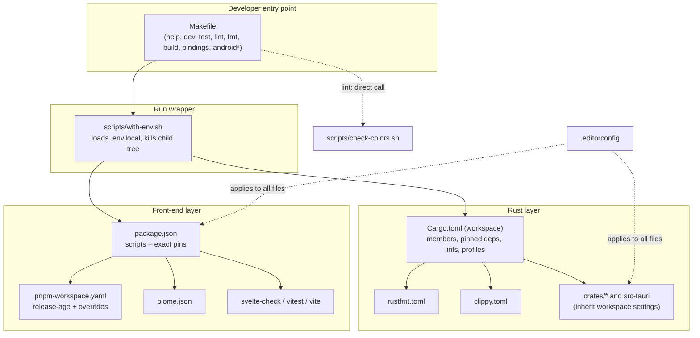
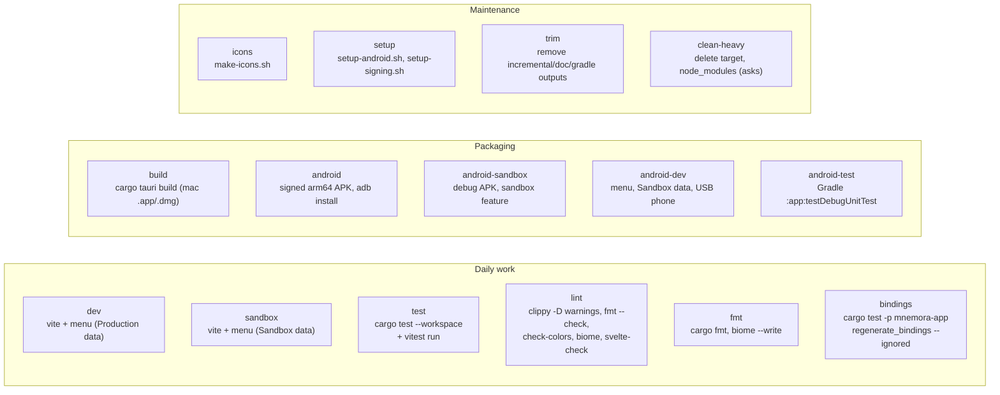
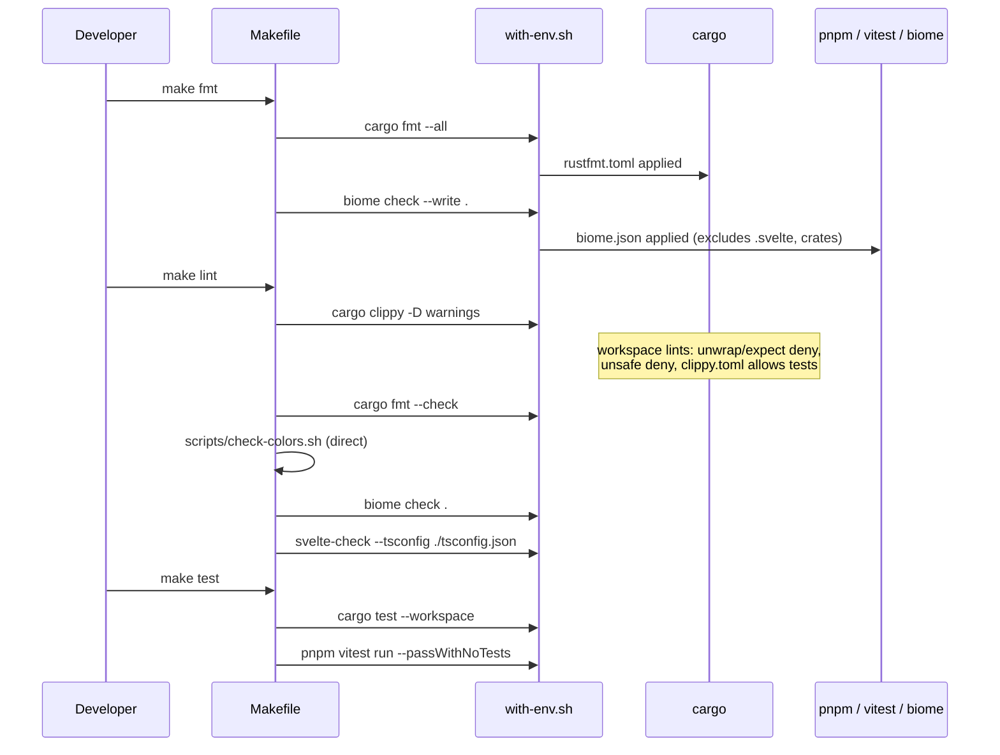

# Build Config

## Introduction

The `build_config` module is the set of repository-level configuration files that decide **how Mnemora is compiled, checked, formatted, linted, tested and started**. It does not contain application logic. It defines:

- the Rust workspace (members, pinned dependency versions, shared lints, compiler profiles) in `Cargo.toml`
- the JavaScript/Svelte toolchain entry points and exact dependency pins in `package.json` and `pnpm-workspace.yaml`
- the developer task runner in `Makefile`
- the formatting and lint rules in `.editorconfig`, `biome.json`, `rustfmt.toml` and `clippy.toml`

Everything a developer runs day to day (`make dev`, `make test`, `make lint`, `make fmt`, `make bindings`) is a thin wrapper over the tools configured here. Packaging for the desktop and Android targets, the build scripts, and the TypeScript and Vite configuration are covered by sibling pages (see [Related modules](#related-modules)).

---

## Module scope

| File | Role | Ecosystem |
|---|---|---|
| `Cargo.toml` | Rust workspace root, shared dependency pins, lints, profiles | Cargo |
| `package.json` | Front-end package manifest, npm scripts, exact dev/runtime pins | pnpm / npm |
| `pnpm-workspace.yaml` | Release-age exclusions and single-copy overrides for CodeMirror and Lezer | pnpm |
| `Makefile` | Single entry point for all developer tasks | GNU make + bash |
| `.editorconfig` | Editor-level whitespace and line-ending rules | Editors |
| `biome.json` | JS/TS/CSS/JSON formatter and linter scope and rules | Biome |
| `rustfmt.toml` | Rust formatter settings | rustfmt |
| `clippy.toml` | Clippy behaviour inside tests | clippy |

Build-time helpers the Makefile calls (`scripts/with-env.sh`, `scripts/signing-env.sh`, `scripts/make-icons.sh`, `scripts/check-colors.sh`, and others) are documented in [Build scripts](build_scripts.md).

---

## Architecture

The configuration forms three layers. The Makefile is the human-facing layer, the package managers and the Cargo workspace are the dependency layer, and the formatter and linter files are the policy layer.



### Two-tier pinning

Both ecosystems pin every version exactly. The workspace file and the npm manifest state the rule in their comments:

- Rust: every entry in `[workspace.dependencies]` uses `=x.y.z`. Crates depend on them with `workspace = true` (member manifests are documented in [build_and_packaging](build_and_packaging.md) and their own pages).
- JavaScript: every entry in `dependencies` and `devDependencies` in `package.json` is an exact version, with `pnpm-workspace.yaml` adding a release-age policy on top.

The project's `CLAUDE.md` rule is that dependency changes need a stated reason and must be pinned exactly.

---

## Cargo workspace (`Cargo.toml`)

### Members

The workspace resolves with `resolver = "3"` and has eight members:

| Member | Purpose (from module tree) |
|---|---|
| `crates/core` | Shared data foundation (`mnemora-core`), see [Data_Foundation](../Data_Foundation.md) |
| `crates/journal` | Journal domain (`mnemora-journal`) |
| `crates/todo` | Task domain (`mnemora-todo`), see [Task_and_Journal_Domain_Services](../Task_and_Journal_Domain_Services.md) |
| `crates/sync` | Sync engine (`mnemora-sync`), see [Sync_Replication_Engine](../Sync_Replication_Engine.md) |
| `crates/harness` | Agent loop (`mnemora-harness`), see [AI_Assistant_Engine](../AI_Assistant_Engine.md) |
| `crates/providers` | Model-provider wire layer (`mnemora-providers`) |
| `crates/ai` | AI module (`mnemora-ai`) |
| `src-tauri` | Tauri host application, see [Tauri_Host_and_IPC_Bridge](../Tauri_Host_and_IPC_Bridge.md) |

Local crates are also declared under `[workspace.dependencies]` as path dependencies (`mnemora-core = { path = "crates/core" }` and so on), so every member refers to them by the same name and version source.

### Shared package metadata

`[workspace.package]` sets `version = "0.2.0"`, `edition = "2024"`, `rust-version = "1.90"`, `license = "UNLICENSED"` and `publish = false`. Members inherit these fields. The same `0.2.0` appears in `package.json`, so a version bump has to be made in both places.

### Pinned dependency groups

The pins are grouped by the subsystem that needs them. The comments in the file record the reasons.

| Group | Pins | Why it matters for the build |
|---|---|---|
| Tauri | `tauri =2.12.4` (no default features), `tauri-build =2.7.3`, `tauri-plugin-opener =2.7.2` | Stays on Tauri 2.x; the comment says 3.0 alpha is deliberately not used |
| Type bindings | `tauri-specta`, `specta` at `=2.0.0-rc.25`, `specta-typescript =0.0.12` | Must be the same rc; generates `src/lib/ipc/bindings.ts` (see `make bindings`) |
| Storage | `rusqlite =0.40.2` with `bundled`, `backup`, `functions`, `hooks`; `rusqlite_migration =2.6.0` | `bundled` compiles SQLite from source, so no system SQLite is needed |
| Sync transport | `rustls` and `tokio-rustls` with `ring`; `rcgen` with `ring` | Uses `ring` rather than `aws-lc-rs` so there is no cmake or NASM step and Android cross-builds work with the NDK clang |
| Pairing | `spake2 =0.4.0`, `mdns-sd =0.21.6` (`async`), `if-addrs =0.15.0` | Code-based pairing and LAN discovery |
| Networking | `socket2 =0.6.5` with `all` | IPv6 listener on the same port (`IPV6_V6ONLY`) and keepalive tuning on Android |
| Merge | `similar =2.7.0` with no default features | Three-way text merge, with no further dependencies |
| AI HTTP | `ureq =3.3.0` with only `rustls` | Blocking HTTPS with the ring provider and bundled roots; no OpenSSL, no gzip or cookies |
| Android JNI | `jni =0.21.1` | Todo widget bridge, Android only |
| Tokio | `tokio =1.54.0` with `default-features = false` | Features are added per crate |

The `tokio` and `rustls` lines show a general pattern: default features are switched off and only the needed features are turned on, which keeps the Android and macOS dependency graphs small.

### Workspace lints

```toml
[workspace.lints.rust]    unsafe_code = "deny"      missing_docs = "warn"
[workspace.lints.clippy]  all = deny (priority -1)  pedantic = warn (priority -1)
                          unwrap_used = deny        expect_used = deny
```

Curated pedantic opt-outs are `module_name_repetitions`, `missing_errors_doc`, `missing_panics_doc`, `must_use_candidate` and `needless_pass_by_value`, each with a reason noted in the file.

Two consequences follow:

- `make lint` runs `cargo clippy --workspace --all-targets -- -D warnings`, so any warning fails the build.
- `unwrap` and `expect` are denied in production code. `clippy.toml` (below) allows them in tests only.

### Compiler profiles

| Profile | Setting | Effect |
|---|---|---|
| `profile.dev` | `debug = "line-tables-only"`, `incremental = false` | Smaller `target/`. The comment notes incremental caches cost about 450 MB and are not worth it for small crates |
| `profile.dev.package."*"` | `debug = false` | Dependencies carry no debug info |
| `profile.release` | `lto = false`, `codegen-units = 16`, `strip = true`, `opt-level = "s"`, `panic = "abort"` | Build speed over binary size, sized for the 8 GB dev machine |
| `profile.release.build-override` | `strip = false` | Keeps proc-macro and build-script metadata. Stripping them breaks macOS release builds with `MACOSX_DEPLOYMENT_TARGET=12.0` (error E0463) |

The comment on the release profile gives the shipping-size alternative (`lto = "thin"`, `codegen-units = 1`) but leaves it off for now.

---

## Front-end manifest (`package.json`, `pnpm-workspace.yaml`)

### Scripts

| Script | Command | Used by |
|---|---|---|
| `dev` | `vite` | Vite dev server |
| `dev:menu` | `node scripts/dev.mjs` | Key-driven dev menu, which `make dev`, `make sandbox` and `make android-dev` run with flags |
| `build` | `vite build` | Front-end bundle for Tauri (see [vite_build_config](vite_build_config.md)) |
| `check` | `svelte-check --tsconfig ./tsconfig.json` | Type-checks `.svelte` and `.ts` (see [typescript_config](typescript_config.md)) |
| `lint` | `biome check .` | Biome lint and format check |
| `test` | `vitest run --passWithNoTests` | Front-end unit tests |

`"type": "module"` is set, and `packageManager` pins `pnpm@11.20.0`, so corepack and pnpm agree on the package manager.

### Dependency pins

- Runtime: CodeMirror (`@codemirror/*`, `@lezer/markdown`), Tauri JS API and opener plugin, TanStack Query and Virtual, `bits-ui`, `paneforge`, `sv-router`, `svelte-sonner`, Tailwind 4 with its Vite plugin, and Fraunces, Inter and JetBrains Mono fonts.
- Dev: Biome, Svelte 5 with the Vite plugin, `svelte-check`, TypeScript, Vite 8, Vitest 5, `unplugin-icons` with Lucide icons, `@types/node`.

`bits-ui` is a runtime dependency here, but the UI rules say it may only be imported inside `src/lib/ui`. That rule is enforced by convention, not by this config.

### Release-age policy and single copies (`pnpm-workspace.yaml`)

```yaml
minimumReleaseAgeExclude: [ '@codemirror/view@6.43.15', '@lezer/markdown@1.8.1' ]
overrides:
  '@codemirror/view': 6.43.15
  '@lezer/markdown': 1.8.1
```

- `minimumReleaseAgeExclude` lets these two exact versions install even though they are newer than pnpm's release-age threshold.
- `overrides` forces one copy of each package across the whole tree. The comment explains that CodeMirror breaks when two copies of `view` or `state` are loaded, and that without the override a transitive range could resolve to the previous patch.

---

## Developer task runner (`Makefile`)

### Conventions

- `SHELL := /bin/bash`, `.DEFAULT_GOAL := help`.
- `RUN := ./scripts/with-env.sh`. Long-running commands go through it. It loads `.env.local` and kills the whole child process tree on exit or Ctrl-C.
- The header says every build runs with `CARGO_BUILD_JOBS=2`. The Makefile itself does not set that variable, so the limit has to come from `with-env.sh` or from the developer's environment. The `CLAUDE.md` resource rules ask for `CARGO_BUILD_JOBS=2` on every cargo command, so check `with-env.sh` ([build_scripts](build_scripts.md)) before relying on it.
- `make help` builds its listing from `## ` comments with an awk expression, so every target needs that comment to show up.

### Targets



| Target | What it runs | Notes |
|---|---|---|
| `help` | awk over `## ` comments | Default goal |
| `dev` | `with-env.sh node scripts/dev.mjs $(ARGS)` | Production data. `ARGS` passes flags such as `--mac --android` |
| `sandbox` | `with-env.sh node scripts/dev.mjs --sandbox $(ARGS)` | Separate Sandbox data, SANDBOX badge |
| `build` | `eval signing-env.sh mac`, then `cargo tauri build` | Signed when `setup-signing` has run |
| `android-dev` | `dev.mjs --sandbox --android` | Phone over USB, Sandbox data |
| `android` | `unset MNEMORA_ANDROID_SANDBOX`, signing env, `cargo tauri android build --target aarch64 --apk`, then `adb install -r` on the newest release APK | Fails if no signed APK is found |
| `android-sandbox` | sets `MNEMORA_ANDROID_SANDBOX=1`, debug build with `--features sandbox`, then installs | No dev server |
| `android-test` | `./gradlew :app:testDebugUnitTest` then `./gradlew --stop` | Kept out of `make test` because Gradle is heavy |
| `test` | `cargo test --workspace`, then `pnpm vitest run --passWithNoTests` | Rust and front-end tests |
| `lint` | clippy, `cargo fmt --check`, `scripts/check-colors.sh`, `biome check`, `svelte-check` | The most complete gate. `check-colors.sh` runs without `RUN` |
| `fmt` | `cargo fmt --all`, `biome check --write .` | Writes files |
| `icons` | `scripts/make-icons.sh` | Regenerates icons from `src-tauri/icons/source/*.svg`. Runs without `RUN` |
| `bindings` | `cargo test -p mnemora-app regenerate_bindings -- --ignored` | Rewrites `src/lib/ipc/bindings.ts` without starting the app |
| `trim` | deletes `target/*/incremental`, `target/*/doc`, Android build dirs | Keeps compiled dependencies |
| `clean-heavy` | `rm -rf target node_modules dist` and Android build dirs, after a `y/N` prompt | Destructive, so it asks first |
| `setup` | `setup-android.sh`, `setup-signing.sh` | Modifies system state; read the scripts first. Runs without `RUN` |

`make bindings` depends on the package name `mnemora-app`. That name is set in `src-tauri/Cargo.toml`, which is not among the supplied files, so it is not verified here.

### Commands that bypass the wrapper

`lint` calls `./scripts/check-colors.sh` directly, and `icons` and `setup` call their scripts directly. Those scripts are not wrapped in `with-env.sh`, so they do not get the `.env.local` loading or the process-tree cleanup.

---

## Formatting and lint policy

| File | Scope | Key rules |
|---|---|---|
| `.editorconfig` | Everything | UTF-8, LF, final newline, trim trailing whitespace, spaces; 2 spaces by default, 4 for `*.rs`, tabs for `Makefile`, trailing whitespace kept in `*.md` |
| `rustfmt.toml` | Rust | `edition = "2024"`, `max_width = 100`, Unix newlines, field-init and `?` shorthand. Import grouping is kept by hand because the grouping options are nightly-only |
| `clippy.toml` | Clippy | `allow-unwrap-in-tests`, `allow-expect-in-tests` |
| `biome.json` | JS/TS/CSS/JSON | 2-space indent, line width 100, single quotes, `recommended` lint rules, Tailwind directives parsed |

### Biome scope

`biome.json` includes everything except `dist`, `node_modules`, `src-tauri`, `docs`, `.claude`, `crates`, `target`, the generated `src/lib/ipc/bindings.ts`, and all `**/*.svelte` files. So:

- Rust is formatted and linted only by cargo tools.
- Svelte files are not covered by Biome. They are checked by `svelte-check` (see [typescript_config](typescript_config.md)).
- The generated bindings are never reformatted by hand edits.

### Colour check

`make lint` runs `scripts/check-colors.sh`. That enforces the design rule that UI code uses tokens rather than raw colours. The rule itself is documented in [Design_System](../Design_System.md) and [docs/design/ui-system.md](../design/ui-system.md).

---

## How a change flows through the configuration



---

## Versioning and upgrade rules

- Rust pins live only in `[workspace.dependencies]`. Crates use `workspace = true`, so one edit changes every member.
- JavaScript pins are exact in `package.json`. Changing one means updating the lockfile through pnpm 11.20.0.
- The two CodeMirror/Lezer packages are pinned in three places: `package.json`, and `pnpm-workspace.yaml` (`overrides` and `minimumReleaseAgeExclude`). These must move together.
- The app version `0.2.0` lives in `Cargo.toml` (`[workspace.package]`) and `package.json`. Neither is generated from the other.

---

## Known gaps and observations

1. **`CARGO_BUILD_JOBS=2` is documented but not set in the Makefile.** The header comment says every build uses it, while the variable is not in the file. Confirm it is exported by `with-env.sh` or by the shell.
2. **`lint` mixes wrapped and unwrapped commands.** Only some steps go through `with-env.sh`.
3. **`make bindings` depends on a package name** (`mnemora-app`) that is defined outside the supplied files.
4. **`package.json` `lint` is a subset of `make lint`.** Running `pnpm lint` skips clippy, format checks, the colour check and `svelte-check`.
5. **`pnpm lint` and `make lint` disagree on `.svelte` coverage.** Biome skips Svelte files, so that coverage comes only from `svelte-check`.

---

## Related modules

- [build_and_packaging](build_and_packaging.md): Tauri build, Android Gradle project and the `src-tauri` build script that these files drive.
- [build_scripts](build_scripts.md): the shell scripts called from the Makefile (`with-env.sh`, `signing-env.sh`, `setup-android.sh`, `setup-signing.sh`, `make-icons.sh`, `check-colors.sh`).
- [typescript_config](typescript_config.md): `tsconfig.json`, which `svelte-check` reads.
- [vite_build_config](vite_build_config.md): `vite.config.ts`, which `dev`, `build` and the dev menu use.
- [Tauri_Host_and_IPC_Bridge](../Tauri_Host_and_IPC_Bridge.md): the host crate that `make bindings` regenerates bindings for.
- [Android_Integration](../Android_Integration.md): the Android app and widget that `make android*` targets build and install.
- [Data_Foundation](../Data_Foundation.md), [Sync_Replication_Engine](../Sync_Replication_Engine.md), [AI_Assistant_Engine](../AI_Assistant_Engine.md): the crates whose dependency pins are listed above.
