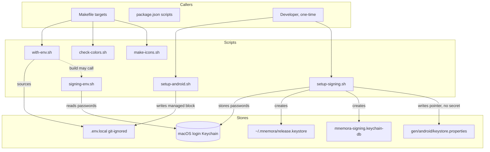
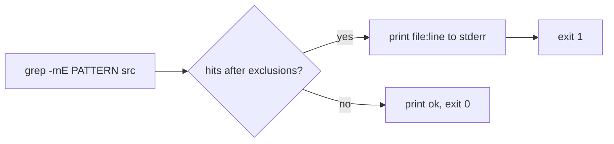
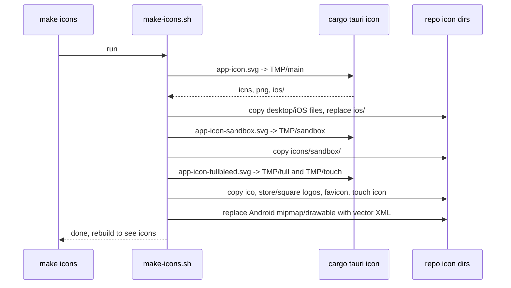
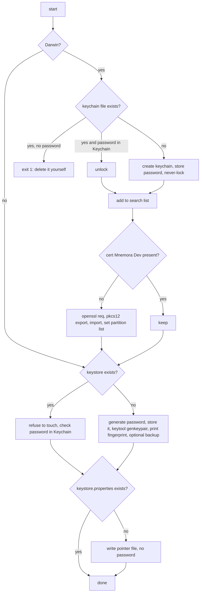
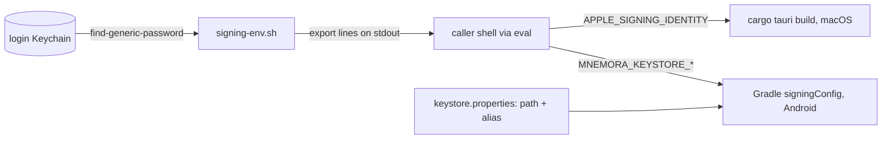
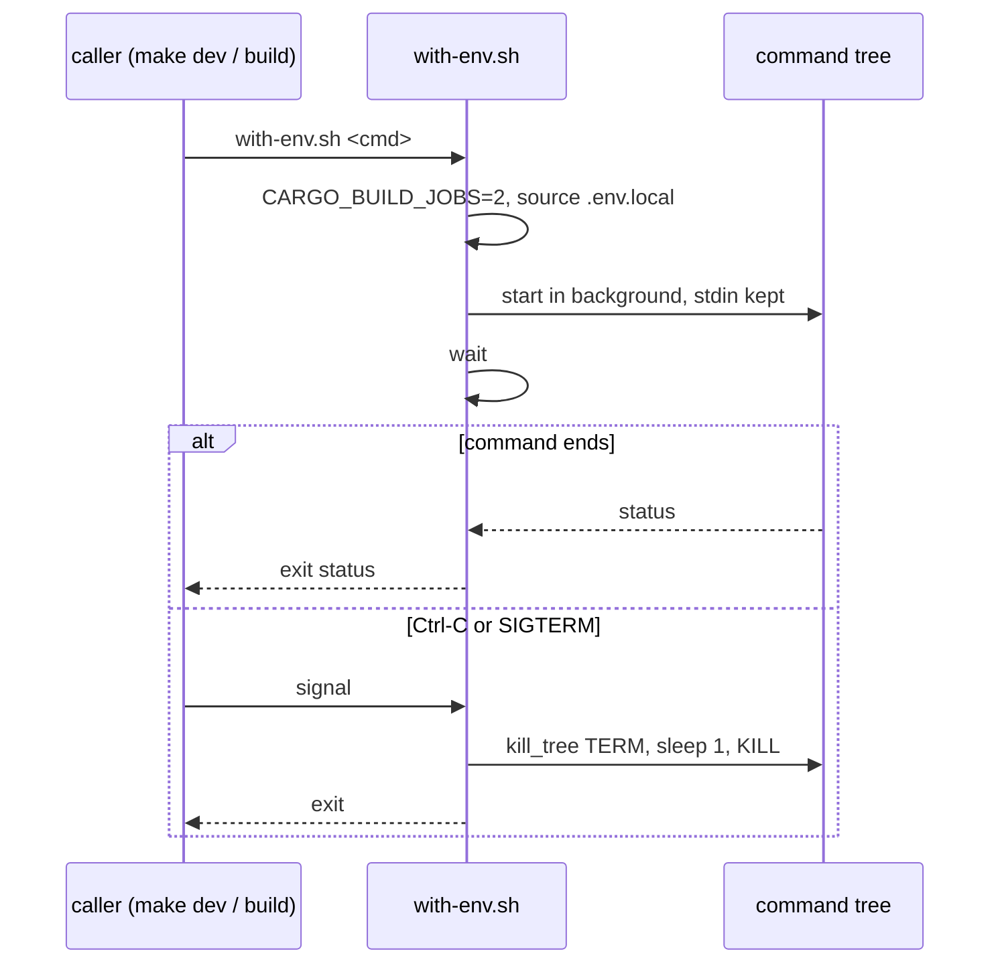

# build_scripts

## Introduction

The `build_scripts` module is the set of Bash helpers in `scripts/` that the Makefile and npm scripts call around the normal Tauri/Cargo/Gradle build. They handle things the toolchain does not: a colour-token lint, icon generation, a minimal Android NDK install for an 8 GB machine, locally generated code-signing identities, injecting secrets into a build from the macOS Keychain, and a wrapper that guarantees no child process outlives the command.

Project-level build configuration (Cargo workspace, `package.json`, Makefile targets, Gradle files) lives in [build_config](build_config.md) and [Build_and_Packaging](../Build_and_Packaging.md). This page covers only the six scripts and how they fit together.

| Script | Role | Entry point |
|---|---|---|
| `scripts/check-colors.sh` | Lint: fails on raw colour literals in `src/` | lint / check step |
| `scripts/make-icons.sh` | Regenerates every app icon from SVG masters | `make icons` |
| `scripts/setup-android.sh` | One-time Android NDK and Rust target setup, env file | run once by hand |
| `scripts/setup-signing.sh` | One-time creation of macOS and Android signing identities | run once by hand |
| `scripts/signing-env.sh` | Prints `export` lines for signing secrets from Keychain | `eval "$(scripts/signing-env.sh mac\|android)"` |
| `scripts/with-env.sh` | Runs a command with project env and kills its process tree on exit | wraps dev/build commands |

All six use `#!/usr/bin/env bash` and resolve the repository root relative to their own location, so they work from any working directory.

## Architecture and Component Relationships

Two independent concerns meet only through the environment:

- **Toolchain environment** (`with-env.sh`, `setup-android.sh`) — `CARGO_BUILD_JOBS`, `ANDROID_HOME`, `NDK_HOME`, `JAVA_HOME`, `GRADLE_OPTS`, all stored in the git-ignored `.env.local`.
- **Signing environment** (`setup-signing.sh`, `signing-env.sh`) — secrets never touch disk in plain text. They live in the login Keychain and are exported at build time as `APPLE_SIGNING_IDENTITY`, `MNEMORA_KEYSTORE_PATH`, `MNEMORA_KEYSTORE_PASSWORD`, `MNEMORA_KEY_ALIAS`.

Asset and lint scripts (`make-icons.sh`, `check-colors.sh`) have no shared state with the rest.

## Component Reference

### check-colors.sh — colour-token lint

Fails the build when a raw colour literal appears in `src/`. The design rule is that colours come only from tokens in `src/lib/theme/tokens.css` (see [Design_System](../Design_System.md)).

- Pattern: hex (`#rgb` to `#rrggbbaa`), `rgb(`/`rgba(`, `hsl(`/`hsla(`, `oklch(`.
- Searched file types: `*.svelte`, `*.ts`, `*.css`.
- Exclusions: `tokens.css` (the definitions), `AppMark.svelte` (the brand-mark exception), `*.test.ts`, and generated `bindings.ts`.
- On a hit it prints `file:line` pairs to stderr and exits 1; otherwise it prints `check-colors: ok`.

Note the `|| true` on the grep: an empty result is not a grep error, so the script only fails on real hits.

### make-icons.sh — icon generation

Regenerates all platform icons from three SVG masters in `src-tauri/icons/source/`, using `cargo tauri icon` (built-in resvg renderer). It is run through `make icons`.

| Master | Output |
|---|---|
| `app-icon.svg` (824 px tile, 100 px transparent margin) | `icon.icns`, `icon.png`, `32x32.png`, `64x64.png`, `128x128*.png`, `ios/` |
| `app-icon-sandbox.svg` | `icons/sandbox/` (Mac Sandbox build) |
| `app-icon-fullbleed.svg` (no margin) | `icon.ico`, `StoreLogo.png`, `Square*Logo.png`, `public/favicon.svg`, `public/favicon-32.png`, `public/apple-touch-icon.png` |
| `android/*.xml` vector drawables | `gen/android/app/src/main/res/` |

Design decisions visible in the script:

- Android icons are not taken from Tauri's PNGs, because those are composited on white. The script deletes the Tauri defaults (`mipmap-*dpi/ic_launcher*.png`, `drawable-v24/ic_launcher_foreground.xml`) and copies adaptive vector XML instead, including the Sandbox launcher icon that `build.gradle.kts` selects through the `appIcon` placeholder (see [Android_Integration](../Android_Integration.md)).
- The script warns about `qlmanage`: it paints an opaque white background behind transparent margins, so it must not be used.
- Work happens in a `mktemp -d` directory removed by an `EXIT` trap; only the final files are copied into the repo.
- If the Android `res` folder does not exist yet, the Android step is skipped with a message rather than failing.

### setup-android.sh — minimal Android toolchain

A one-time setup for an 8 GB Mac. Safe to re-run. It prompts before changing anything unless given `--yes`.

Steps, in order:

1. Requires Homebrew `sdkmanager` (`android-commandlinetools`) and OpenJDK 21; exits with an install hint otherwise.
2. Resolves the newest stable NDK by parsing `sdkmanager --list`.
3. Installs that NDK; uninstalls `emulator` and `build-tools;35.0.0` if present (the project tests on a real phone).
4. Prunes the NDK to an arm64-only toolchain: deletes simpleperf, shader tools, Python, lldb, other-arch sysroots and clang runtimes, and runs `lipo -thin arm64` on the remaining fat binaries. Result is about 2.9 GB down to about 0.5 GB.
5. Adds the `aarch64-linux-android` Rust target and removes the other Android targets. It warns that `cargo tauri android init` would add them back.
6. Writes a managed block into `.env.local` (`ANDROID_HOME`, `ANDROID_SDK_ROOT`, `NDK_HOME`, `JAVA_HOME`, `GRADLE_OPTS` with daemon off, no parallel workers, `-Xmx1536m`). The block is delimited by `# >>> mnemora android ...` markers so re-runs replace it rather than append. The file is `chmod 600`.
7. If `src-tauri/gen/android/gradle.properties` exists, sets the same memory limits there, with a `sed` replace for existing keys and an append for missing ones.

The script does not edit the shell profile or global Gradle config.

### setup-signing.sh — local signing identities

Creates two identities. The project has no Apple Developer or Play Store account; these keep dev and release builds consistently signed.

**macOS**
- Dedicated keychain `~/Library/Keychains/mnemora-signing.keychain-db`, password generated with `openssl rand`, stored in the login Keychain under service `mnemora-signing-keychain`. Set to never auto-lock.
- Adds the keychain to the user keychain search list so `codesign` finds the identity without `-k`.
- Self-signed code-signing certificate `Mnemora Dev` (RSA 2048, 10-year validity), generated with Apple's `/usr/bin/openssl` because Homebrew OpenSSL 3 writes PKCS12 that `security import` rejects.
- `set-key-partition-list` so `codesign` does not prompt on every run.

**Android**
- Release keystore `~/.mnemora/release.keystore` (RSA 2048, alias `mnemora`, validity 10000 days). The store and key password are one generated value, because PKCS12 ignores a separate key password.
- Password is stored in the Keychain under `mnemora-android-keystore`.
- Prints the SHA-256 fingerprint and offers to copy the keystore to a backup folder.
- Writes `src-tauri/gen/android/keystore.properties` with `storeFile` and `keyAlias` only. It contains no password.

**Safety rules encoded in the script**

- Existing keystore is never overwritten. The warning says a new key cannot sign upgrades over installed copies, and that cannot be undone.
- An existing keychain whose password is missing from the Keychain makes the script exit with instructions, rather than guessing.
- Existing certificate is kept if `find-certificate` finds `Mnemora Dev`.

### signing-env.sh — secret export

Read-only at build time. Usage is `eval "$(scripts/signing-env.sh mac|android)"`.

- `mac`: if the keychain file exists and its password is in the Keychain, unlocks the keychain and prints `APPLE_SIGNING_IDENTITY=Mnemora Dev`.
- `android`: if the keystore password is in the Keychain, prints `MNEMORA_KEYSTORE_PATH`, `MNEMORA_KEYSTORE_PASSWORD`, and `MNEMORA_KEY_ALIAS=mnemora`.
- Values are emitted with `printf '%q'` so they are shell-safe.
- Prints nothing and exits 0 when not set up, so builds without signing still run. Unknown argument exits 2.

Gradle reads `MNEMORA_KEYSTORE_PASSWORD` from the environment, which is why `keystore.properties` carries no password. The Tauri macOS bundler reads `APPLE_SIGNING_IDENTITY` the same way.

### with-env.sh — environment wrapper and process cleanup

Runs any command passed as arguments, with project environment, and guarantees the descendant tree is killed on exit.

1. `cd` to the repo root, export `CARGO_BUILD_JOBS=2` (keeps the 8 GB machine out of swap).
2. Source `.env.local` with `set -a` so its variables are exported.
3. Start the command in the background with `<&0` so it keeps the terminal. Without this, async commands get `/dev/null`, which breaks interactive prompts such as Android device selection.
4. `wait` for it and exit with its status.
5. A trap on `EXIT`, `INT` and `TERM` runs `kill_tree`, which recursively sends `SIGTERM` to children first, waits one second, then `SIGKILL`s the root. This covers vite, cargo and gradle.

The project rule that every process started must be killed (see the project `CLAUDE.md` resource constraints) is implemented here for commands run through this wrapper. Processes started outside it are not covered.

## Dependencies and Interactions

| Script | Depends on | Consumed by |
|---|---|---|
| `check-colors.sh` | `src/lib/theme/tokens.css` as the allowed location; `ui-system.md` rule | lint step ([build_config](build_config.md) `make lint`) |
| `make-icons.sh` | `cargo tauri icon`; SVG masters in `src-tauri/icons/source/`; Android project under `gen/android` | `make icons` |
| `setup-android.sh` | Homebrew `sdkmanager`, OpenJDK 21, `rustup`, `lipo` | Manual; writes `.env.local` read by `with-env.sh` |
| `setup-signing.sh` | `security`, `/usr/bin/openssl`, `keytool` (OpenJDK 21) | Manual; output consumed by `signing-env.sh` |
| `signing-env.sh` | Keychain entries created by `setup-signing.sh` | Build commands via `eval` |
| `with-env.sh` | `.env.local` | Makefile and npm dev/build targets |

Android build wiring that reads the signing and icon outputs is documented in [Android_Integration](../Android_Integration.md). The Gradle files that consume `keystore.properties` and the `appIcon` placeholder are in the `build_and_packaging` sub-module.

## Operational Notes

- **Run order on a new machine:** `setup-android.sh` (if building Android), `setup-signing.sh`, then `make icons` only when SVG masters change.
- **Re-running is safe** for both setup scripts, but `setup-signing.sh` refuses to replace an existing release keystore. Keep the backup it offers; losing the keystore means installed Android apps can only be reinstalled.
- **Secrets never appear in the repo.** `keystore.properties` and `.env.local` are git-ignored; passwords are only in the Keychain.
- **`check-colors.sh` exclusions are a contract.** Adding a new file that legitimately needs a literal colour requires adding it to the exclusion list in the script, not weakening the pattern.
- **Keep Android NDK pruning in mind.** If a build needs a removed NDK component, the script's comment says to delete the NDK folder and re-run `setup-android.sh`.
- **Dock icon caching:** after `make icons`, macOS may show the old Dock icon until relaunch, as the script's final message notes.
