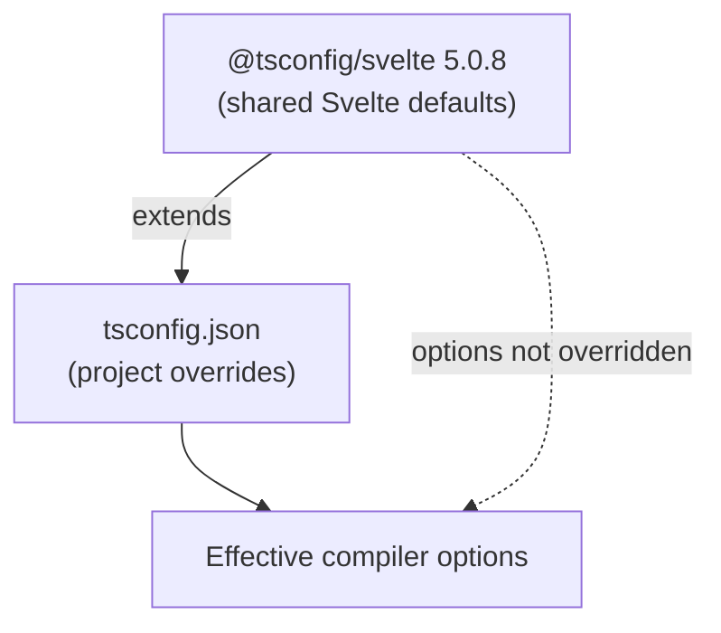
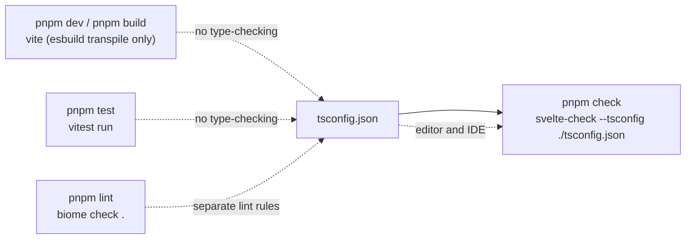

# typescript_config

## Introduction

`typescript_config` is the single TypeScript compiler configuration for the Mnemora front end (the Svelte 5 app under `src/`). It lives in the root file [`tsconfig.json`](../../tsconfig.json) and defines which files are type-checked and how strictly. It does not compile or bundle anything itself: Vite transpiles TypeScript during development and builds, and `svelte-check` is the step that actually reports type errors against this configuration.

The module is small (one file, no code), but it sets rules that every front-end module must follow, so it is worth understanding before adding files, imports or new `tsconfig` settings. For how the surrounding build is wired, see [Build_and_Packaging](../Build_and_Packaging.md), [build_config](build_config.md) and [vite_build_config](vite_build_config.md).

## The configuration file

Source: [`tsconfig.json`](../../tsconfig.json)

```json
{
  "extends": "@tsconfig/svelte/tsconfig.json",
  "compilerOptions": {
    "target": "ES2022",
    "module": "ESNext",
    "moduleResolution": "bundler",
    "strict": true,
    "noUncheckedIndexedAccess": true,
    "noImplicitOverride": true,
    "verbatimModuleSyntax": true,
    "skipLibCheck": true
  },
  "include": ["src/**/*.ts", "src/**/*.svelte", "vite.config.ts"]
}
```

### Inheritance

The project extends `@tsconfig/svelte` (pinned at `5.0.8` in `devDependencies`, see [`package.json`](../../package.json)). That shared base supplies the Svelte-oriented defaults. The local file only overrides or adds the keys listed above, so any option not listed here comes from the base package and changes when that package is upgraded.



## Option reference

| Option | Value | Effect in this project |
|---|---|---|
| `target` | `ES2022` | Language level used for type-checking and any emit `svelte-check` performs. Does not control the browser build target, which is set separately in `vite.config.ts` (`safari15`). |
| `module` | `ESNext` | Emits and checks ES module syntax; there is no CommonJS output. |
| `moduleResolution` | `bundler` | Resolves imports the way Vite does, including package `exports` maps. Relative imports still need their file extensions where the bundler requires them. |
| `strict` | `true` | Enables the full strict family (`strictNullChecks`, `noImplicitAny`, and the rest). |
| `noUncheckedIndexedAccess` | `true` | Indexing an array or record yields `T \| undefined`. Code must narrow before use. |
| `noImplicitOverride` | `true` | A subclass member that overrides a base member must be marked `override`. |
| `verbatimModuleSyntax` | `true` | Imports and exports are emitted exactly as written. Type-only imports must use `import type`, otherwise the build keeps a runtime import of a type that does not exist. |
| `skipLibCheck` | `true` | Skips type-checking of `.d.ts` files in dependencies. Errors in third-party declaration files are not reported. |

### Include set

The `include` array decides what is checked:

- `src/**/*.ts` and `src/**/*.svelte`: all front-end code, including the `*.test.ts` files that sit beside their modules and the `src/lib/ipc` bindings.
- `vite.config.ts`: the Vite configuration file itself, so its imports are checked too.

Not included: the Rust crates under `crates/` and `src-tauri/`, and the Node helper scripts under `scripts/`. Those have their own toolchains (Cargo, and plain Node/shell scripts). Generated Android files under `src-tauri/gen/` are also outside the check.

## How the configuration is consumed



Key points for maintainers:

- **Type errors come only from `pnpm check`.** The Vite plugin and Vitest transpile TypeScript without type-checking, so a passing dev server or passing test run does not prove the types are correct. Run `pnpm check` (defined in [`package.json`](../../package.json)) before relying on a change.
- **Vite's build target is independent.** `target: ES2022` here does not change the output of `vite build`; the output target is `safari15` in [`vite.config.ts`](../../vite.config.ts), which is the WebView baseline on the desktop and mobile shells.
- **Linting is separate.** Biome (`pnpm lint`, configured in `biome.json`) checks style and some correctness rules but does not replace `svelte-check`. See [build_config](build_config.md) for the lint and format toolchain.

## Practical consequences for contributors

| When you write... | The compiler requires... |
|---|---|
| A type-only import | `import type { X } from '...'` (because of `verbatimModuleSyntax`) |
| `arr[i]` or `record[key]` | A check for `undefined` before using the value (because of `noUncheckedIndexedAccess`) |
| A method overriding a base class method | The `override` keyword (because of `noImplicitOverride`) |
| A new file outside `src/` that TypeScript should check | Adding its glob to `include`; otherwise `pnpm check` ignores it |
| A `.ts` file that uses `any` implicitly | An explicit type (because of `strict`) |

Project-wide coding rules, including naming and testing conventions for front-end files, are in [`docs/engineering/standards.md`](../../docs/engineering/standards.md).

## Changing this module

- Prefer adding the narrowest option possible. The strict flags are deliberate; loosening one needs a reason recorded in the commit.
- After any change, run `pnpm check` and `pnpm test`. A change to `include` can add or remove checked files silently, so confirm the file count reported by `svelte-check` is what you expect.
- Upgrading `@tsconfig/svelte` or `typescript` (both pinned in `package.json`) can change inherited defaults. Re-run `pnpm check` after any version bump.
- Do not add `paths` aliases here without also checking the Vite configuration; the bundler resolves imports by its own rules, and an alias present only in `tsconfig` will type-check but fail at runtime.

## Related modules

- [Build_and_Packaging](../Build_and_Packaging.md): overall build, packaging and tooling overview.
- [build_config](build_config.md): package scripts, Biome, rustfmt and editor settings.
- [vite_build_config](vite_build_config.md): the Vite bundler configuration, which consumes the TypeScript sources this file checks.
