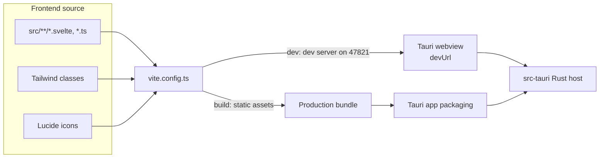
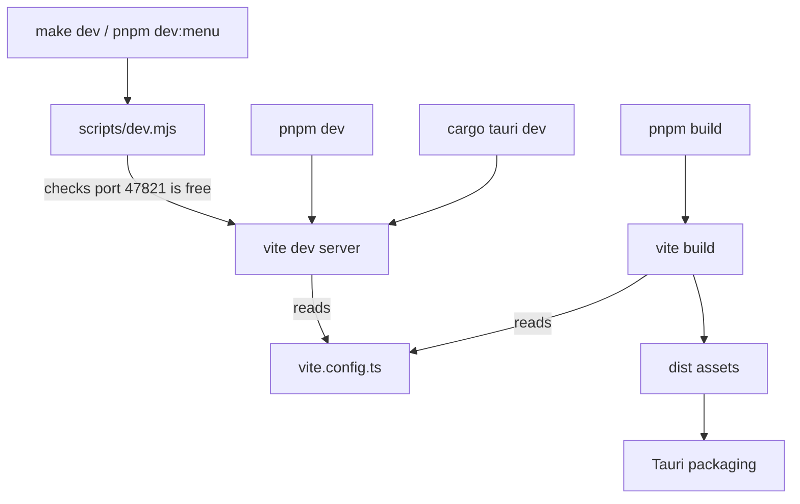

# Vite build configuration

## Introduction

`vite.config.ts` at the repository root is the single Vite configuration for the Mnemora Svelte frontend. It decides how the UI is served during development (`pnpm dev`, and through the Tauri dev flow), how the production bundle is built (`pnpm build`), and which plugins transform the Svelte, Tailwind and icon sources. The Rust side (`src-tauri/`, `crates/`) is not built by Vite; Vite only produces the web assets that the Tauri shell loads. See [Build and Packaging](../Build_and_Packaging.md) for the wider build picture and [build_config](build_config.md) for the manifest-level configuration (`package.json`, `Makefile`, lint and format settings).

The whole file is one exported object, `defineConfig({...})`. It has no custom functions, no aliases and no environment-specific branches except the `TAURI_DEV_HOST` variable.

## Where it sits in the system

The dev server URL is not discovered from Vite; it is hard-coded in `src-tauri/tauri.conf.json` (`devUrl`). See [Tauri_Host_and_IPC_Bridge](../Tauri_Host_and_IPC_Bridge.md) for how the webview and the Rust host talk once the page is loaded.

## Configuration breakdown

### Plugins

| Plugin | Source | Purpose |
|---|---|---|
| `tailwindcss()` | `@tailwindcss/vite` (pinned 4.3.3) | Runs Tailwind CSS v4 as a Vite plugin, so utility classes are generated during dev and build. |
| `Icons({ compiler: 'svelte' })` | `unplugin-icons/vite` (24.0.0) | Turns icon imports into Svelte components. Icon data comes from `@iconify-json/lucide`. |
| `svelte()` | `@sveltejs/vite-plugin-svelte` (7.3.1) | Compiles `.svelte` files. Must be last in the list so the other transforms see plain JavaScript and CSS. |

Plugin order is the order in the array. The file keeps `svelte()` last; changing that order is not covered by any documented rule and should be tested with a build.

The design rules for which UI building blocks and tokens may be used are in [Design_System](../Design_System.md); this file only provides the tooling that makes them work.

### Terminal output

`clearScreen: false` stops Vite from clearing the terminal on start. The comment in the file states the reason: Rust compiler errors from the Tauri side must stay visible when both processes share a terminal.

### Environment variables

`envPrefix: ['VITE_', 'TAURI_']` controls which variables from the environment are exposed to client code as `import.meta.env.*`. The default is only `VITE_`; adding `TAURI_` lets Tauri's own variables (for example the platform and debug flags Tauri sets while building) reach the frontend. Do not put secrets in any variable with these prefixes, because they end up in the shipped bundle.

### Development server

| Option | Value | Effect |
|---|---|---|
| `server.port` | `47821` | Fixed port the webview loads. |
| `server.strictPort` | `true` | Vite fails instead of picking another port. A different port would break the webview's `devUrl`. |
| `server.host` | `TAURI_DEV_HOST` or `false` | Local only by default. When set, the server binds to that host so a device can reach it. |
| `server.hmr` | when `TAURI_DEV_HOST` is set: `ws` on host, port `47822` | Hot module replacement goes over a separate websocket port so a phone can reach it. When the variable is unset, `hmr` is `undefined` and Vite uses its defaults. |
| `server.watch.ignored` | `**/src-tauri/**`, `**/crates/**`, `**/target/**` | Rust edits and build output do not trigger frontend reloads. Rust changes are handled by Cargo and Tauri. |

`TAURI_DEV_HOST` is set by `cargo tauri android dev` and iOS dev, as the comment in the file says. The Android dev flow forwards the port to the phone with `adb reverse` (see `scripts/dev/android.mjs` and [Android_Integration](../Android_Integration.md)).

The port number is duplicated in three places that must match:

- `vite.config.ts` (`server.port`), this file
- `scripts/dev/config.mjs` (`DEV_PORT`, used by `pnpm dev:menu`)
- `src-tauri/tauri.conf.json` (`devUrl`, and the `devCsp` entries for `localhost:47821` and `47822`)

The comment in the file asks for them to be changed together. A test in `scripts/dev/port.test.mjs` checks the message for the port in use, but nothing in the repo checks that the three values agree.

### Production build

| Option | Value | Effect |
|---|---|---|
| `build.target` | `safari15` | The browser baseline the output is transpiled for. The file gives no reason; the value is the only build target setting. |
| `build.sourcemap` | `false` | No source maps in the shipped bundle. |

No `outDir` is set, so Vite uses its default output folder. Build outputs are not committed, and the Tauri packaging step reads them from there.

The mock IPC backend (`src/lib/ipc/mock.ts`) is loaded through a dynamic import guarded by `import.meta.env.DEV`. In a production build that branch is removed, so the mock code is not shipped. See [Tauri_Host_and_IPC_Bridge](../Tauri_Host_and_IPC_Bridge.md) and [ipc-mock-backend](../Tauri_Host_and_IPC_Bridge/ipc-mock-backend.md).

## How the config is used

### Commands

- `pnpm dev` runs `vite` directly. The Makefile `dev` target and `pnpm dev:menu` go through `scripts/dev.mjs`, which first refuses to start if port 47821 is already in use (see [build_scripts](build_scripts.md)).
- `pnpm build` runs `vite build`.
- Vitest (`pnpm test`) also loads `vite.config.ts` by default, so the same plugins run in tests. This file has no separate `vitest` section, so test-only settings belong elsewhere.

The lint (`biome check .`) and type check (`svelte-check`) commands do not read this file. See [build_config](build_config.md) and [typescript_config](typescript_config.md).

### Dependencies on other build files

| File | Relation to this config |
|---|---|
| `package.json` | Pins the Vite (8.3.4), Svelte plugin, Tailwind and unplugin-icons versions used here. |
| `src-tauri/tauri.conf.json` | Holds `devUrl` and `devCsp`; must agree with `server.port`. |
| `scripts/dev/config.mjs` | Holds `DEV_PORT`; must agree with `server.port`. |
| `tsconfig.json` | Type checking of the same sources; unaffected by this file. |

## Change checklist

1. Changing the port: update `vite.config.ts`, `scripts/dev/config.mjs`, and `src-tauri/tauri.conf.json` (both `devUrl` and the CSP) in the same change. Then run `make dev` once to check the port is free and the webview loads.
2. Adding a plugin: keep `svelte()` last. Run `pnpm build` to confirm the bundle compiles.
3. Adding a `VITE_` or `TAURI_` variable: it becomes public in the bundle; do not put secrets there.
4. Changing `build.target`: the Tauri WebViews on each platform decide what runs. Test the packaged app, not only the dev server.
5. Dependency changes follow the repo rule of pinned exact versions; see [build_config](build_config.md).

## Related documentation

- [Build and Packaging](../Build_and_Packaging.md): overall build, packaging and scripts.
- [build_config](build_config.md): `package.json`, `Makefile`, lint and format configuration.
- [build_scripts](build_scripts.md): the dev menu and port check that start Vite.
- [typescript_config](typescript_config.md): TypeScript settings for the same sources.
- [Tauri_Host_and_IPC_Bridge](../Tauri_Host_and_IPC_Bridge.md): the webview host that loads the dev server or the bundle.
- [Android_Integration](../Android_Integration.md): device dev flow that uses `TAURI_DEV_HOST` and port forwarding.
- [Design_System](../Design_System.md): the Tailwind-based styling this build supports.
