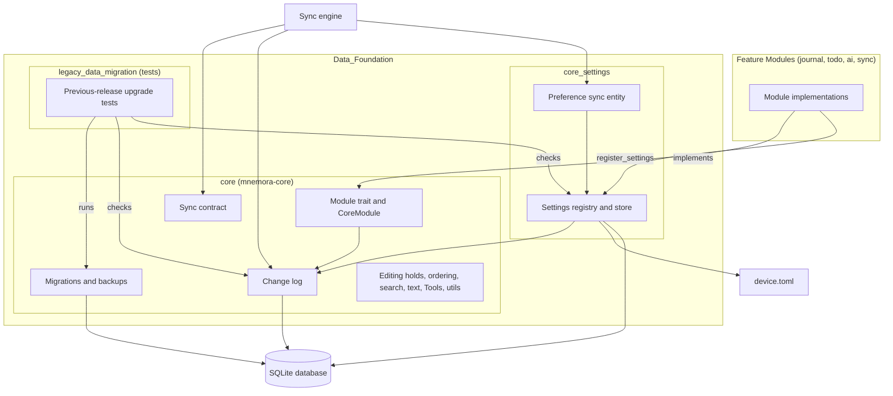
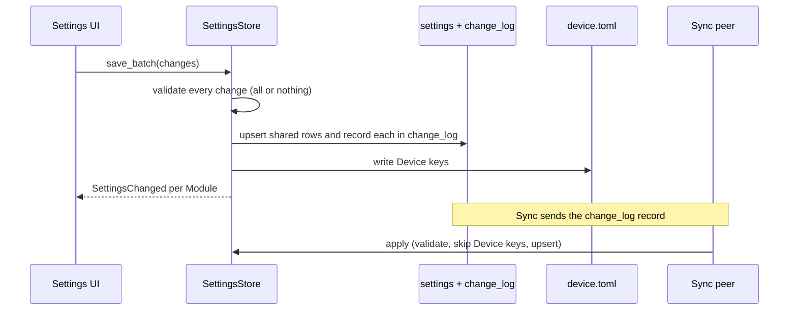

# Data_Foundation

## Purpose

Data_Foundation is the shared base layer of Mnemora. It holds the contracts that every feature Module builds on, and it has no screens or product logic of its own. It covers three things:

- **The Module contract and shared data services.** The `Module` trait, the app-wide change log that Sync reads, schema migrations and backups, editing holds, ordering keys, search query safety, text folding, and the read-only Tool contract for the AI Module.
- **Preferences.** A typed, validated settings registry. Shared Preferences sync between devices. Device-only look-and-feel settings stay in a local file.
- **Upgrade safety.** Tests that prove a database written by the previous release still migrates, reads and syncs correctly.

Modules depend on Data_Foundation, and Data_Foundation depends on no Module.

## Components

| Component | Role | Docs |
|---|---|---|
| `core` (`crates/core`) | Module trait, change log, sync contract, migrations and backups, editing holds, ordering, search parsing, text folding, Tool contract, utilities | [core](Data_Foundation/core.md) |
| `core_settings` (`crates/core/src/settings`) | Settings registry, validated batch saves, device file, Preference sync entity | [core_settings](Data_Foundation/core_settings.md) |
| `legacy_data_migration` (`src-tauri/src/legacy_db_tests.rs`) | Seven upgrade tests that build a previous-release database and check migrations, reads, change-log stamping and Sync staying off | [legacy_data_migration](Data_Foundation/legacy_data_migration.md) |

## Architecture

Key relationships:

- **`core` is a leaf.** It is the only place where the Module contract, change log and sync vocabulary are defined. Sync reads these contracts but never imports a Module.
- **`core_settings` builds on `core`.** It uses the change log for shared Preferences and the device file for Device settings. Each Module registers its own keys, so `core` never hard-codes another Module's preferences.
- **`legacy_data_migration` is test-only.** It reuses each Module's real migration list to build an old-schema database, then checks the upgrade path.

## Data flow for a shared Preference

## Design rules

- **Change log first.** Every shared write goes through `changelog::record`, in the same transaction as the write. Only the owning Module reads its own records.
- **Migrations are append-only.** Each Module has its own migration counter. Installed devices have already applied earlier steps.
- **Remote changes are not local edits.** `apply_remote` does not record changes. Follow-up changes go in `settle_remote`, which must be idempotent.
- **Query text is sanitised.** `search::query` is the only route from user text to FTS5.
- **Settings values are never logged.** Only keys are logged.

## Known gaps

- A batch that mixes shared and Device settings is not atomic across the database and `device.toml`. A file error after the database commit leaves the shared part saved. See [core_settings](Data_Foundation/core_settings.md).
- The legacy upgrade tests have no old-version constant for Sync, so they cannot yet cover a database that already has Sync data. Once Sync has shipped a release, that constant must be added. See [legacy_data_migration](Data_Foundation/legacy_data_migration.md).