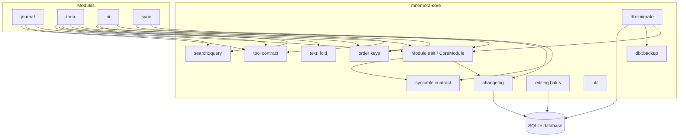
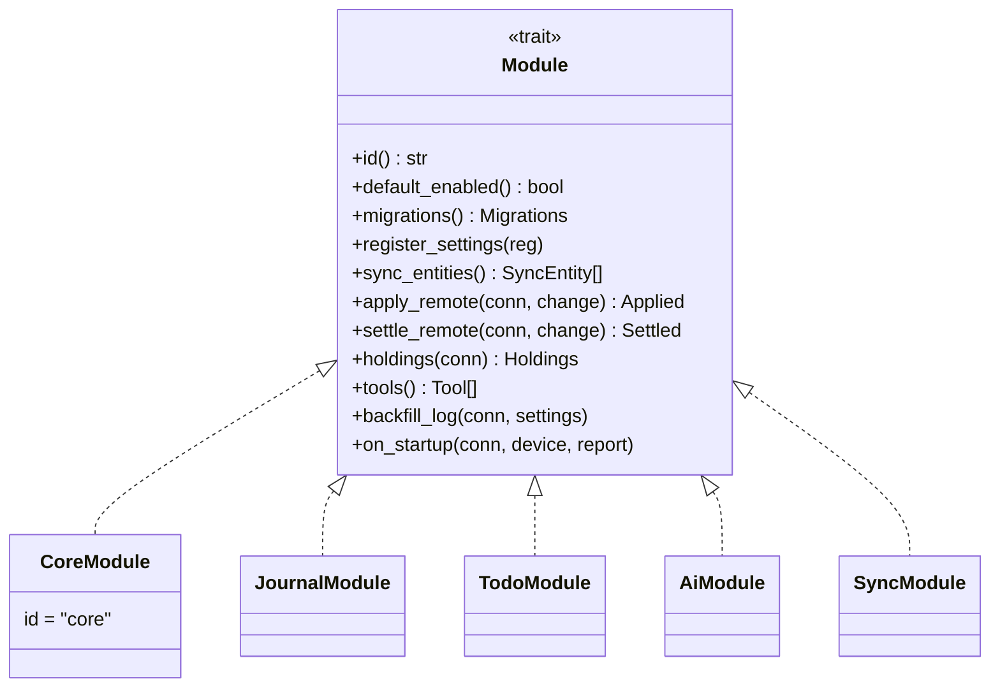
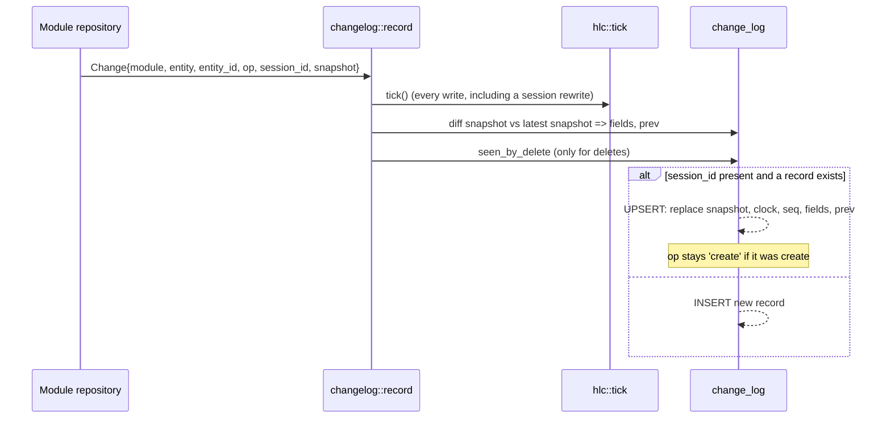
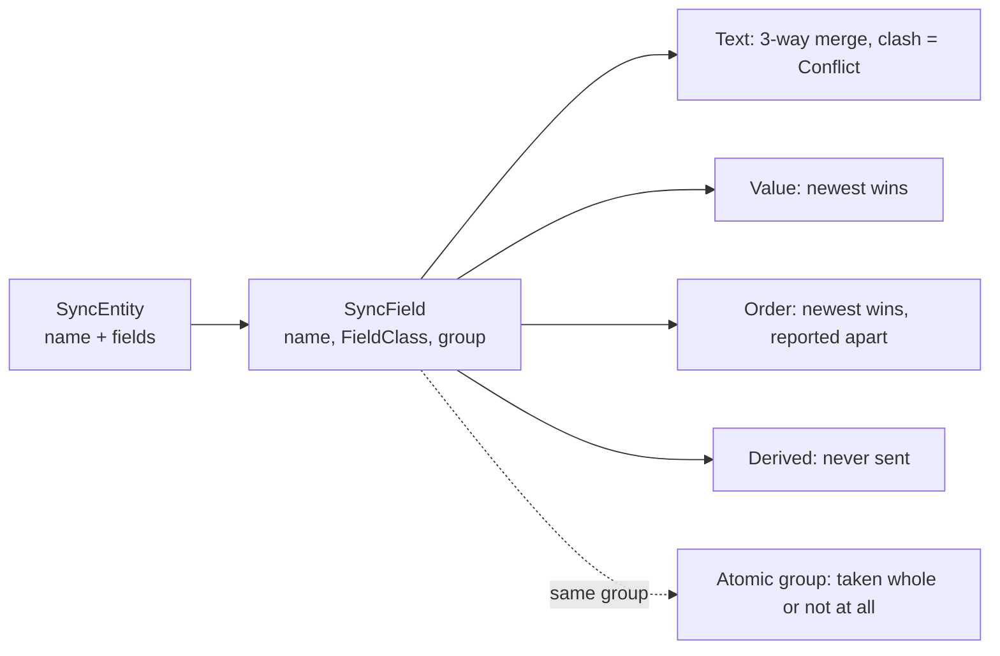
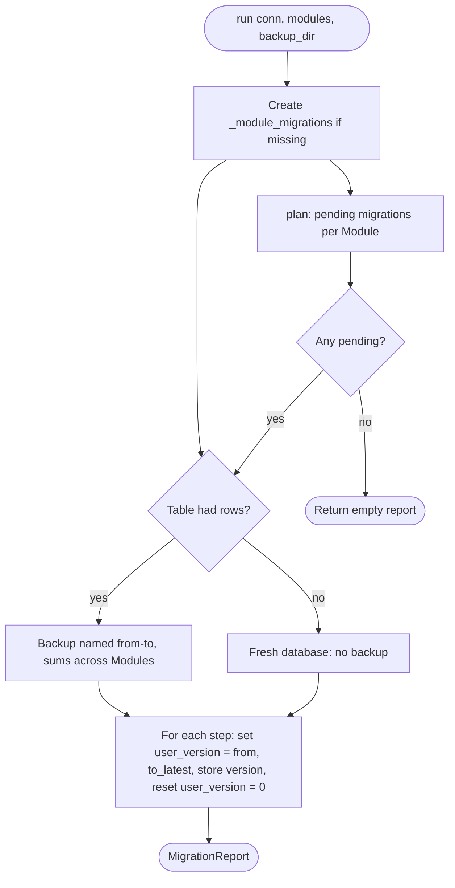
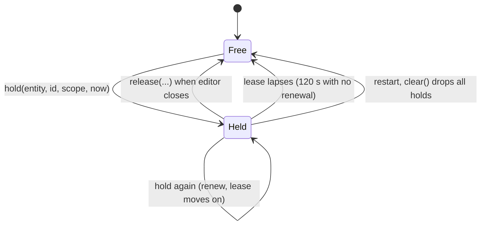
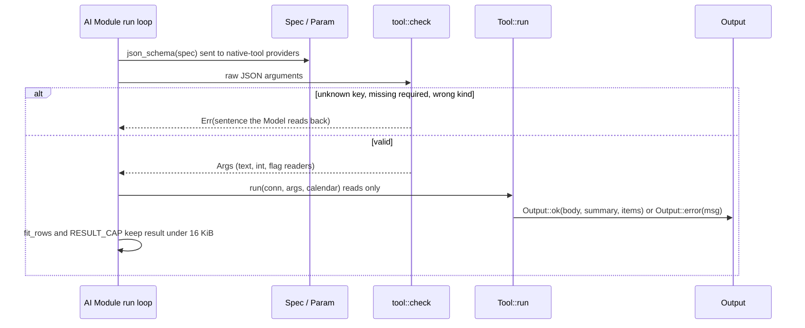
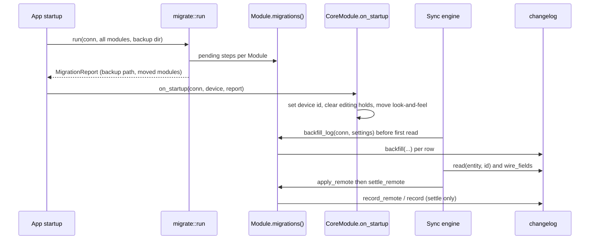

# core (mnemora-core)

`mnemora-core` is the shared foundation crate of Mnemora. It defines the compile-time contract every Module implements, the app-wide change log that Sync reads, the migration runner and backups, and a handful of pure helpers (fractional ordering keys, search query parsing, text folding, the read-only Tool contract, and id/time utilities). It has no screens and no product logic: Modules depend on it, and it depends on no Module.

Two sibling pages cover the parts of this module that are large enough to stand alone: [core_settings](core_settings.md) (the settings registry and its sync entity) and [legacy_data_migration](legacy_data_migration.md) (the tests that prove an upgraded database still works).

## Scope of this page

| Area | Source | Summary |
|------|--------|---------|
| Module contract | `crates/core/src/module.rs` | The `Module` trait and `CoreModule`, Core's own Module |
| Change log | `crates/core/src/changelog.rs` | Session-collapsed snapshot records, backfill, remote records, reads |
| Sync contract | `crates/core/src/syncable.rs` | Field classes, entity declarations, merge inputs and outputs |
| Migrations and backups | `crates/core/src/db/migrate.rs`, `crates/core/src/db/backup.rs` | Per-Module schema versions, pre-upgrade and pairing backups |
| Editing holds | `crates/core/src/editing.rs` | Leases that stop Sync replacing text being typed |
| Ordering keys | `crates/core/src/order.rs` | Fractional-index keys for manual order |
| Search parsing | `crates/core/src/search/query.rs` | Safe conversion of typed text into FTS5 MATCH expressions |
| Text folding | `crates/core/src/text.rs` | Lowercase and strip accents |
| Tool contract | `crates/core/src/tool.rs` | Read-only Tools the AI Module runs, argument checks, result caps |
| Utilities | `crates/core/src/util.rs` | UUIDv7 ids, epoch milliseconds, compact UTC file-name stamps |
| Build | `crates/core/Cargo.toml` | Crate manifest (see [Build and packaging](../Build_and_Packaging/build_config.md)) |

Referenced by this crate but not part of the reviewed components: the `hlc` (hybrid logical clock), `settings`, `device`, `error` and `db` root modules. Where this page mentions them, it names only what the reviewed code calls.

## Architecture

Core is a leaf in the dependency graph. Modules never import each other; they share only core contracts and the event bus. Sync reads core's contracts but never imports a Module: it reaches Modules through the `Module` trait object (see [Sync Replication Engine](../Sync_Replication_Engine.md)).

## The Module contract

Every area of the app implements `Module` ([`module.rs`](../../crates/core/src/module.rs)). Registration happens in one place, in the app crate. The trait is mostly defaults: a Module overrides only what it has.

Each method has a fixed role:

- **`id`**: a stable id. It is also the Settings key prefix and the migration namespace.
- **`default_enabled`**: `true` means on until switched off; `false` means off until the user opts in. Enablement is resolved by `tool::is_enabled` from two Preferences, `core.disabled_modules` and `core.enabled_optional_modules`. Sync's own switch is a Device setting instead.
- **`migrations`**: the Module's own, independently versioned schema migrations.
- **`register_settings`**: declares keys, defaults and validators. Details are in [core_settings](core_settings.md).
- **`sync_entities`**: the entities the Module keeps in step, with the class of every field. Default is none, so a Module that declares none never syncs.
- **`apply_remote`**: applies winning field values from another device through the Module's own repository, creating the entity if new here. The result is *not* a new local change: nothing is recorded in the change log and nothing is re-stamped.
- **`settle_remote`**: runs right after a remote change is stored, in the same transaction. Used for rules that compare the change with the rest of the data (Todo's List name clash). Anything it records is stamped later than the record it follows. It must be idempotent.
- **`holdings`**: counts what a person would count (entries, tasks, list names), for the preview shown before two devices with data merge for the first time.
- **`tools`**: read-only Tools offered to the AI Module, available only while this Module is on.
- **`backfill_log`**: adds to the change log whatever the log does not describe (pre-log rows, older versions, imports). Sync calls it before it first reads the log.
- **`on_startup`**: once-per-start work after all migrations ran. It is never polled.

### CoreModule

`CoreModule` ([`module.rs`](../../crates/core/src/module.rs)) owns the `settings` table, the change log, the clock, the editing holds and the device-appearance move. Its migrations build the schema in six steps:

| Step | Adds |
|------|------|
| 1 | `settings(module, key, value, updated_at)` |
| 2 | `change_log` with a partial unique index per session |
| 3 | Sync columns on `change_log` (`origin_device`, `hlc_ms`, `hlc_counter`, `seq`, `origin_seq`), `device_clock`, and the `seq`/origin indexes; existing rows are back-filled in the order History always showed |
| 4 | `change_log.fields` and per-entity indexes |
| 5 | `editing_sessions` (local holds, never synced) |
| 6 | `change_log.prev` (text the change replaced) |
| 7 | `change_log.seen` (what a delete's author had seen) |

`on_startup` does three things, in order:

1. Sets the device id in the clock (`hlc::set_device_id`), so every later write is stamped with this device.
2. Calls `editing::clear`: no editor survives a restart.
3. Moves look-and-feel Preferences into the device file.

## Change log

The change log ([`changelog.rs`](../../crates/core/src/changelog.rs)) is the app-wide record of what changed (ADR 0008). Each record is a full JSON snapshot of the entity after the change. The raw log is never sent over IPC; only the owning Module reads its own records to build a readable history.

### Writing

Key rules:

- **One record per editing session.** The partial unique index on `(entity, entity_id, session_id)` makes a session's later saves replace its record. A record created in a session stays `create` even after edits in the same session.
- **Every write is stamped.** A rewrite also gets a new clock and a new `seq`, because peers pick records up by sequence.
- **`fields` keeps only what changed.** A session rewrite keeps what the session changed earlier and adds what it changed since. A key that another device changed since, and that this write did not touch, is dropped from the session's claim.
- **`prev` keeps what was replaced.** For each touched field, the value it held before. A session keeps measuring from the text it began with, so a long editing session does not lose the original text.
- **Deletes record `seen`.** A delete stores, per origin device, the highest sequence it had of the entity kind. Sync uses this to tell an edit made without knowing of the delete from one the delete's author had already seen.

### Backfill

`changelog::backfill` brings rows that the log never fully described into it. Each row is an `Unlogged` item:

- Its snapshot is compared with the latest record on the schema's non-derived fields. A row with no record gets a `create`; one that differs gets an `update` of only the differing fields; one that matches writes nothing. Running it again writes nothing more.
- If the entity has no `create` yet but the Module says it needs one (`needs_create`, e.g. a Task), a whole-entity `create` is written, since a receiver builds an entity from a `create` alone.
- Each record is stamped at the row's own time (never later than now), so unlogged history never outranks a real edit made afterwards. The clock is raised past the entity's newest record and past the first record of anything it is `after` (a Task's List), so the local story stays in order.

Modules call this through `backfill_log`; the Todo and Journal Sync code paths are described in [Sync Replication Engine](../Sync_Replication_Engine.md).

### Remote records

`changelog::record_remote` stores a record received from another device exactly as sent: origin device, origin sequence, clock, `fields`, `prev` and `seen`. It gets a fresh local `seq` so this device can relay it, and it observes the remote clock first so the next local record sorts after it. A received record of a session this device already holds replaces it, which is how an origin's rewrite arrives.

### Reading

`changelog::read(conn, entity, entity_id)` returns every record of one entity, ordered by `(hlc_ms, hlc_counter, origin_device, origin_seq)`. That is the same order on every device, and on one device it is the order the changes were made. Each `Record` carries `op`, `session_id`, `snapshot`, `at`, `fields` (`None` for rows older than the column, meaning "every field") and a `local` flag. Snapshots that cannot be parsed are skipped, so the log never stops a screen from loading.

`changelog::creator` returns the origin device of the earliest `create` for an entity.

## Sync contract

[`syncable.rs`](../../crates/core/src/syncable.rs) is the vocabulary Sync and Modules share (ADR 0017). Sync never imports a Module; it only reads these types.

- `FieldClass` decides how a field merges when two devices changed it (text, value, order, derived).
- `SyncField::in_group` ties fields that must never be split: the When of a Task (its date, repeat and state), for example. A change to any member sends every member.
- `wire_fields` builds the outgoing `{field: value}` map from a record. It drops derived fields and unlisted keys. With `complete_groups`, a group with any member present gets all members read from the snapshot. That completion is only for records made on this device; a received record already carries whole groups.
- `RemoteChange` is what a Module receives in `apply_remote` and `settle_remote`: the entity, op, origin time, the winning fields (whole groups only, possibly empty) and the registered settings.
- `Applied` is what `apply_remote` returns: the full state afterwards, whether anything visible changed, and a list of `SyncEvent`s.
- `SyncEvent` is the hook for the Sync Module's Activity log and "resolved automatically" rows. Variants cover tasks moved to the Inbox, deletes seen on another device, merged Lists, raised and auto-resolved text conflicts, changed Preferences, and a device renamed from another device. A Module never fills in the `device` field of a delete; the engine does.
- `Holdings` is what a device holds, summed across Modules for the first-merge preview. `Holdings::is_empty` tells a fresh device from one with data.

Conflict handling itself (raising, showing and resolving conflicts) belongs to the Sync crate; see [Sync Replication Engine](../Sync_Replication_Engine.md) and its [sync_conflicts](../Sync_Replication_Engine.md) page.

## Migrations and backups

### Per-Module versions

Each Module has its own migration counter in the `_module_migrations` table. SQLite's single `PRAGMA user_version` is lent to the `rusqlite_migration` library one Module at a time and reset to `0` afterwards, even if a migration fails ([`migrate.rs`](../../crates/core/src/db/migrate.rs)).

- `plan` refuses a database whose version is newer than the app (`ErrorCode::Database`). A version *older* than the app simply has pending steps.
- `is_current` answers "is every Module at its latest version?" without writing anything, using a scratch in-memory connection for the counting. A reader that must never migrate, such as the Todo widget, asks this first. A missing migration table counts as behind.
- `versions` returns each Module's schema version by id. The Sync handshake compares these, so two devices with different data versions do not merge.
- `MigrationReport` holds the backup path (if any) and `(module, from, to)` for each Module that moved. `CoreModule::on_startup` receives it.

### Backups

[`backup.rs`](../../crates/core/src/db/backup.rs) uses SQLite's online-backup API, so backups are safe while connections are open. A backup is written to `<name>.partial` and renamed into place, so a crash never leaves a half file that looks valid. Then the directory is rotated.

| Function | When | File name |
|----------|------|-----------|
| `create_backup` (internal to migrate) | Before an upgrade of existing data | `<timestamp>-<from>-to-<to>.db` |
| `backup_now` | User asks for a backup | Current total migration version on both sides |
| `backup_for_pairing` | Before merging with another device | `<timestamp>-pairing-<version>.db` |

`rotate` keeps the newest `KEEP_BACKUPS` (5) of each kind. Pairing backups carry a marker, so frequent pairings never push out the backups taken before a migration (ADR 0004). Names sort chronologically, which is what rotation relies on.

## Editing holds

[`editing.rs`](../../crates/core/src/editing.rs) stops Sync from replacing text a person is typing. While an editor is open it takes a **hold** on what it edits and renews it about every 30 seconds. Sync stores what other devices send for held fields and applies it when the hold ends.

- A scope is a field unit of the entity, or `WHOLE` (`"*"`) for an entity edited as one unit, such as a Journal Entry. `is_held` treats `WHOLE` as holding every unit.
- The hold is a lease of `LEASE_MS` (120 000 ms). An editor that vanished (backgrounded, killed, crashed) cannot hold changes back forever.
- The table is local and never synced. It is cleared at every start.

## Ordering keys

[`order.rs`](../../crates/core/src/order.rs) makes manual order work without renumbering. A key is a base-62 string read as a fraction in (0, 1), and keys sort bytewise. Any two keys have a key strictly between them, so a move rewrites one row (ADR 0012).

- `key_between(lo, hi)` returns a key strictly between two neighbours, either of which may be `None` (the ends). It fails when a bound is not a key, when `lo >= hi` after trailing zeros are ignored, or when `hi` is the empty key. Callers fall back to a neighbour.
- `key_after(last)` returns a key past the last one. Appends step the first growable digit up and drop the rest, so a new digit is needed only about once per 31 appends.
- `canonical` strips trailing zeros. Keys made by the first Todo slices (for example `V0000000`) still work, and they sort the same way.

Tests check that 1 000 inserts into one gap, and 3 000 random moves, keep a list sorted, and that keys stay short.

Todo uses this for Tasks and Lists (see [Task and Journal Domain Services](../Task_and_Journal_Domain_Services.md)); the AI Module uses it for Saved questions.

## Search query parsing

[`search/query.rs`](../../crates/core/src/search/query.rs) turns typed text into an FTS5 `MATCH` expression. It is the only way user text reaches FTS5.

- `parse` splits input on double quotes. Text inside quotes is a `Term::Phrase`, and an unclosed quote runs to the end. Other text splits into `Term::Word`s. All terms are folded, and empty ones are dropped.
- `exact_match` produces a MATCH expression in which words are prefixes and phrases are exact, all required.
- `expand_match` lets a word also match any of the `near` alternatives given for it (a whole-word match, not a prefix).

Only letters and digits reach the expression, each inside double quotes, so no FTS5 operator, column filter, `*`, `-`, `NEAR` or parenthesis can be injected. A test feeds `a OR b NOT c* -d NEAR(x y) body:z ((` and gets only quoted words.

Consumers include Todo search and Journal search (see [Task and Journal Domain Services](../Task_and_Journal_Domain_Services.md)).

## Text folding

[`text.rs`](../../crates/core/src/text.rs) lowercases text and removes accents for common Latin letters, and drops combining marks (U+0300 to U+036F). It matches what the search tokenizer's `remove_diacritics` does, so Rust-side matching and FTS agree. Other characters are only lowercased. `fold("Łódź")` gives `lodz`; `Ł` is folded to `l` as a letter in the table.

## Tool contract

[`tool.rs`](../../crates/core/src/tool.rs) defines the read-only capability the AI Module runs (ADR 0002 amendment, ADR 0018). A Tool only reads: it gets a connection, checked arguments and a calendar, and returns an `Output`. Failures are error results, never panics.

- `Kind` describes a parameter: bounded text, integer range, `YYYY-MM-DD` date, flag, or one of a list of words. `check` enforces each, and `json_schema` emits a schema with `additionalProperties: false`.
- `Output` carries the body, a plain summary line, the `Item`s the answer may cite (Entries and Tasks, with module, title and date), and an `is_error` flag.
- `fit_rows` keeps the longest prefix of rows under `RESULT_CAP` (16 KiB) minus a 512-byte envelope allowance, and says whether rows were left out so the Model can page. `cut` truncates text on a character boundary.
- `count` and `number` convert between the Model's signed integers and `usize`, with defaults and saturation.
- `is_enabled` resolves whether a Module is on from the two Preferences that list its exceptions (see [The Module contract](#the-module-contract)).

Each Tool's concrete implementations live in the Modules that own the data. The AI side that runs them is described in [AI Assistant Engine](../AI_Assistant_Engine.md).

## Utilities

[`util.rs`](../../crates/core/src/util.rs) holds three helpers:

- `new_id` returns a UUIDv7 string. Time ordering keeps B-tree inserts local and makes sync merges easier to reason about.
- `now_ms` returns Unix epoch milliseconds (UTC) and never fails.
- `compact_utc` formats epoch milliseconds as `YYYYMMDDTHHMMSSmmm` for backup file names. It uses a hand-rolled civil-date conversion to avoid a date-time dependency.

## Dependencies

From [`crates/core/Cargo.toml`](../../crates/core/Cargo.toml) (package `mnemora-core`, workspace-inherited version, edition and lints):

- Storage: `rusqlite`, `rusqlite_migration`.
- Data and schemas: `serde`, `serde_json`, `specta` (with `derive` and `serde_json`, so types such as `Holdings` reach the frontend bindings), `toml`.
- Errors and logs: `thiserror`, `tracing`, `tracing-appender`, `tracing-subscriber`.
- Ids: `uuid`.
- Dev only: `tempfile`.

No dependency is added without a stated need; versions are pinned at the workspace level (see [Build and packaging](../Build_and_Packaging/build_config.md)).

## How the pieces fit together at runtime

## Testing

The module is tested inside each file (`#[cfg(test)]`), against in-memory SQLite and temporary directories. Coverage includes:

- Session collapse, delete `seen` values, and rewrites keeping what the session changed (`changelog.rs`).
- Clock ordering across devices and ties, and the upgrade that back-fills older rows in History order (`changelog.rs`, `migrate.rs`).
- Backup naming, rotation of migration and pairing kinds separately, and a missing directory (`backup.rs`).
- Per-Module migrations, `user_version` being lent and returned, refusing a newer database, and `is_current` writing nothing (`migrate.rs`).
- Lease expiry and restart clearing for editing holds (`editing.rs`).
- Key generation between any neighbours, appends staying short, and random moves (`order.rs`).
- Query sanitising (`search/query.rs`), folding (`text.rs`), argument checks and result capping (`tool.rs`), and `compact_utc` on known instants (`util.rs`).

Upgrade behaviour across real previous-release databases is covered by [legacy_data_migration](legacy_data_migration.md). The app-level tests that exercise this module through Sync are described in [Sync Replication Engine](../Sync_Replication_Engine.md).

## Maintenance notes

- A new migration in `CoreModule::migrations` must be appended, never edited: installed devices have already applied the earlier steps.
- Any new `Change` must go through `changelog::record`, so that the session, clock and `fields` rules hold. Never write `change_log` rows directly, except in tests.
- Never log snapshots, `prev` or `fields`; they hold user content.
- `apply_remote` must not record changes. Changes that follow a received record belong in `settle_remote`, which must be idempotent.
- A new Tool must be read-only and must return errors as `Output::error`, not panic.
- Keep the query sanitising in `search::query` as the only route from user text to FTS5.
