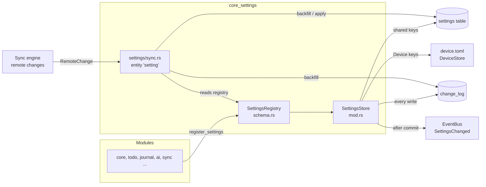
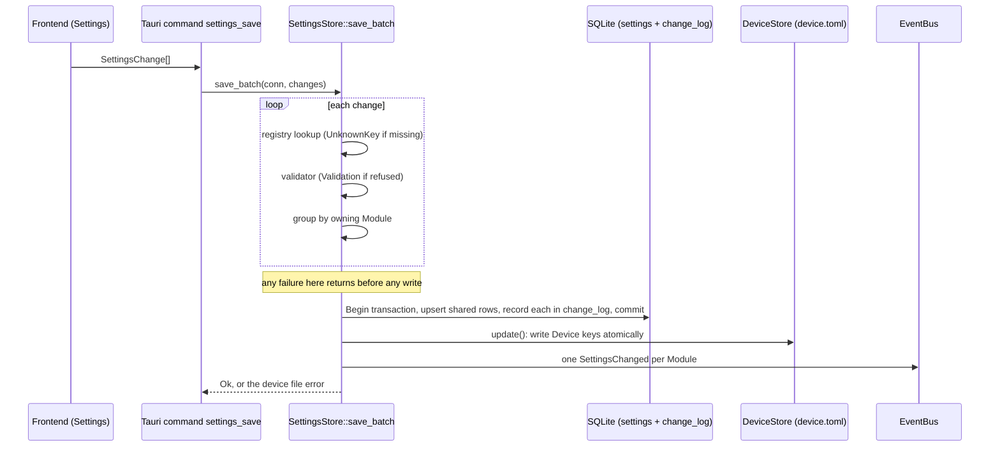
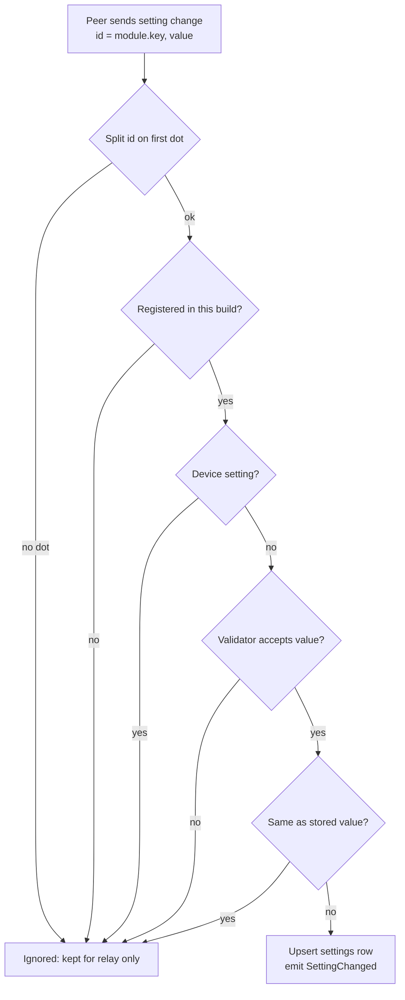
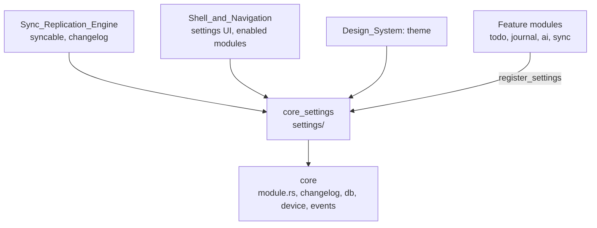

# core_settings

The `core_settings` module is the typed Settings layer of the Core crate (`crates/core/src/settings/`). It owns the registry of every user preference key, validates every write, persists values to the right place (the `settings` table or the per-device `device.toml` file), announces changes on the event bus, and exposes the Preferences to the sync engine as a shared entity. It is a child of the [core](core.md) module in the Data Foundation layer.

## Purpose at a glance

| Responsibility | Where |
|---|---|
| Declare keys, defaults and validators | `settings/schema.rs` |
| Read the merged snapshot (defaults + device file + database rows) | `settings/mod.rs` (`SettingsStore::get_all`, `device_values`) |
| Validate and atomically save a batch of changes | `settings/mod.rs` (`SettingsStore::save_batch`) |
| Write a Preference into the change log so it syncs | `settings/mod.rs` (`record`, `save_if_unset`) |
| Move look and feel from the database to the device file | `settings/mod.rs` (`move_look_and_feel_to_device`) |
| Accept and back-fill shared Preferences for sync | `settings/sync.rs` (`apply`, `backfill`) |

Settings are the only place where a `module.key` pair is interpreted. Modules register their own keys through `Module::register_settings`, so the Core never hard-codes another module's preferences.

## Key concepts

- **Full key.** Every Preference is addressed as `module.key`, for example `core.theme` or `core.week_start`. The module part is the owning Module id.
- **Registry.** `SettingsRegistry` maps full keys to `SettingDef` (module, key, default, validator, device flag). A duplicate registration is logged as an error and the first one wins, so one Module cannot silently override another.
- **Validator.** A boxed closure `Fn(&Value) -> Result<(), String>`. Reusable validators live in `schema::validate`: `boolean`, `one_of`, `text(max)` (counts characters, not bytes), and `string_list(max_items)`.
- **Shared vs. Device setting.** A shared Preference is stored in the `settings` table, change-logged, and synced. A Device setting (registered with `register_device`) is stored only in `device.toml`, is never change-logged and never leaves the device. The look-and-feel keys in `device::LOOK_KEYS` are the Device settings that exist today.
- **Stored row.** One row per saved key: `settings(module, key, value, updated_at)`, where `value` is the JSON text of the value.

## Architecture

The registry is built once at start-up and is then read-only. `SettingsStore` holds it behind an `Arc`, together with the event bus and the device file store. The sync module reads the same registry through `RemoteChange::settings`, which is how it knows whether an incoming key is registered, shared and valid.

## Registered keys (core module)

The Core module registers twelve keys (see the schema test in `settings/mod.rs`). Defaults, as shipped:

| Key | Default | Storage |
|---|---|---|
| `core.theme` | `system` | Device (look) |
| `core.density` | `comfortable` | Device (look) |
| `core.text_size` | `m` | Device (look) |
| `core.reduce_motion` | `false` | Device (look) |
| `core.display_name` | `""` | Shared |
| `core.time_format` | `24h` | Shared |
| `core.date_format` | `long` | Shared |
| `core.week_start` | `mon` | Shared |
| `core.phone_tabs` | `["home","journal","todo"]` (at most four) | Shared, with `phone_tabs_edited` |
| `core.phone_tabs_edited` | `false` | Device (set to `true` when `core.phone_tabs` is saved) |
| `core.disabled_modules` | `[]` | Shared |
| `core.enabled_optional_modules` | `[]` | Shared |

The look keys are the ones listed in `device::LOOK_KEYS`; see [core](core.md) for the device file itself. Registration of the individual Core keys happens in `CoreModule::register_settings` (`crates/core/src/module.rs`), and the UI-facing consequences of these keys are described in [Shell and Navigation: settings module](../Shell_and_Navigation/settings-module.md) and [Design System: theme](../Design_System/theme.md).

## Core flows

### Reading settings

`SettingsStore::get_all(conn)` builds the snapshot in three steps:

1. Start with every registered key at its default.
2. Overlay the Device settings from the device file (`device_values`), which never touches the database. An invalid file value falls back to the default.
3. Read every row of `settings`. Rows with no registered key, or that are Device keys, are ignored with a debug log. Rows whose JSON does not parse or fails its validator are ignored with a warning log and the default stays. A bad row never fails the whole read.

`device_values` is also used directly by the window before first paint, so the theme can be applied without a database round trip.

### Saving settings

Key rules:

- **All or nothing for validation.** Every change is validated before anything is written. One unknown key or one invalid value rejects the whole batch with `ErrorCode::UnknownKey` or `ErrorCode::Validation`.
- **Shared rows are transactional.** Every upsert into `settings` is followed by `record()` in the same transaction, so a sync peer always sees the change (ADR 0008).
- **Device rows go to the file after the database.** The file write is not part of the SQLite transaction. If it fails, the shared rows are already committed, the event is still published so the UI learns the session values, and the error is returned to the caller. A batch that mixes shared and Device keys can therefore end half-saved on a file error; callers should treat that error as "retry".
- **Events are per Module, after commit.** Keys are grouped by owning Module and one `SettingsChanged { module, keys }` is published for each. Nothing is published for a rejected batch, and an empty batch does nothing.
- **Phone tabs side effect.** Saving `core.phone_tabs` also writes `phone_tabs_edited = true` to the device file, so the phone's tab bar knows the user customised it.

### Saving a value once (`save_if_unset`)

`save_if_unset(conn, module, key, value)` uses `INSERT OR IGNORE` and returns whether it wrote. It is for Modules that pin a value at upgrade time so that a later change to the registered default cannot reach existing installs. It does not validate and does not publish an event; a real write is still recorded in the change log. Only a write that actually happened produces a change-log row.

### Look and feel migration

`move_look_and_feel_to_device` is a one-time, idempotent upgrade (ADR 0005, amended). It copies `core` rows for the look keys into the device file, but a value the file already has wins. Rows that do not parse are treated as unset. The rows are deleted only after the file is saved, so a failed write is retried on the next start. It writes no change-log entries because it is housekeeping, not a user edit. The broader legacy upgrade path, with its tests, is covered in [legacy_data_migration](legacy_data_migration.md).

## Sync integration

Preferences take part in sync as entity `setting` with id `module.key` and a single merged `value` field. The newest write of each key wins, per key. The `updated_at` field is derived, recomputed on the receiving side. The contract is described in [Sync Replication Engine](../Sync_Replication_Engine/sync_engine.md); this module supplies the Preference-specific parts.

- **`apply`** handles one incoming change. Anything that fails a check is not stored, but the returned snapshot still carries the current local value so the change can be relayed onward. A Device setting is never accepted from a peer.
- **`backfill`** logs every shared row that the change log does not yet know about: values written before Preferences were logged, or around the log. It is stamped with the row's own `updated_at`, so a later real write on any device still wins. Device settings and unparseable values are skipped because there is nothing valid to send.
- **Conflict rule.** Per key, the newest write wins. Two unlogged values are ordered by the time they were written, as described in the back-fill tests of [Sync Replication Engine](../Sync_Replication_Engine/sync_engine.md).
- **Privacy.** Values never appear in log lines; only keys are logged.

Behaviour that users see for synced Preferences, and the rule that the theme does not sync, is covered in [Sync Client Surface](../Sync_Client_Surface/sync_conflicts_and_activity.md) and tested in `sync_lists_tests.rs` ("a preference changed on one device appears on the other and the theme does not").

## Module dependencies

- Depends on [core](core.md) for the change log (`changelog::record`, `changelog::backfill`), the device file (`DeviceStore`, `LOOK_KEYS`), the event bus (`SettingsChanged`), errors (`AppError`, `ErrorCode`) and the `Module` trait.
- Used by the sync engine through `syncable::RemoteChange` and `SyncEvent::SettingChanged`; see [Sync Replication Engine](../Sync_Replication_Engine/sync_engine.md).
- Used by the Tauri host through the `settings_get_all` and `settings_save` commands and the device commands in `commands.rs`; see [Tauri Host and IPC Bridge](../Tauri_Host_and_IPC_Bridge.md).
- Feature modules such as [Task and Journal Domain Services](../Task_and_Journal_Domain_Services/todo.md) read their own Preferences with `settings::stored`, which needs no registry or event bus. For example the Todo grouping and recognition preferences are read this way.

## Data model

| Store | Shape | Notes |
|---|---|---|
| `settings` table | `module`, `key`, `value` (JSON text), `updated_at` (ms) | Primary key `(module, key)`. Shared keys only. |
| `change_log` rows | entity `setting`, entity id `module.key`, snapshot `{module, key, value, updated_at}` | Written by `record`, `save_if_unset`, `backfill`. |
| `device.toml` | `look` section with one optional field per look key, plus `phone_tabs_edited` | Per device, never synced. |

## Error handling

| Situation | Result |
|---|---|
| Unknown key in a batch | `ErrorCode::UnknownKey`, details = the key; nothing saved |
| Invalid value in a batch | `ErrorCode::Validation`, message names the key; nothing saved |
| Device file cannot be written | Error returned after the shared rows committed; event still published |
| Stored row unknown or invalid on read | Ignored, default used, logged |
| Remote change unknown, device-only, malformed or invalid | Not stored; the current value is still returned for relay |
| Duplicate registration | Logged as an error, first registration kept |

## Testing

The unit tests in `settings/mod.rs`, `settings/schema.rs` and `settings/sync.rs` cover:

- the fresh-install defaults, and that every default passes its own validator;
- batch atomicity (unknown key and invalid value both leave the database untouched);
- the phone-tab limit of four entries;
- one event per Module per successful batch;
- Device settings written to the file and not to the database or change log;
- `save_if_unset` never overwriting and recording only when it writes;
- the look-and-feel migration: file wins, unreadable rows count as unset, repeatable, and rows survive a failed file write;
- rejection of stray, unregistered, device-only and invalid remote values.

Integration behaviour across devices (Preference convergence, the theme staying local, the backfill ordering) is tested in the sync test suites listed in [Sync Replication Engine](../Sync_Replication_Engine/sync_engine.md) and [legacy_data_migration](legacy_data_migration.md).

## Maintenance notes

- **Adding a shared key:** register it in the owning module with `register`, give it a validator and a default that passes that validator, and add it to the defaults list the tests check. It will sync automatically once the sync contract includes the `setting` entity, which it does today.
- **Adding a device key:** only the `core` look keys have a home in the device file. Use `register_device` and add the key to `device::LOOK_KEYS` and to `DeviceSettings`; otherwise a device write has nowhere to go.
- **Never** read a Device setting from the database or add it to the change log; the sync code relies on the `device` flag to keep it local.
- **Do not** log values. Log keys only, as the existing code does.
- **Known gap:** a batch that mixes shared and Device keys is not atomic across the database and `device.toml`. A file error after the database commit leaves the shared part saved.
