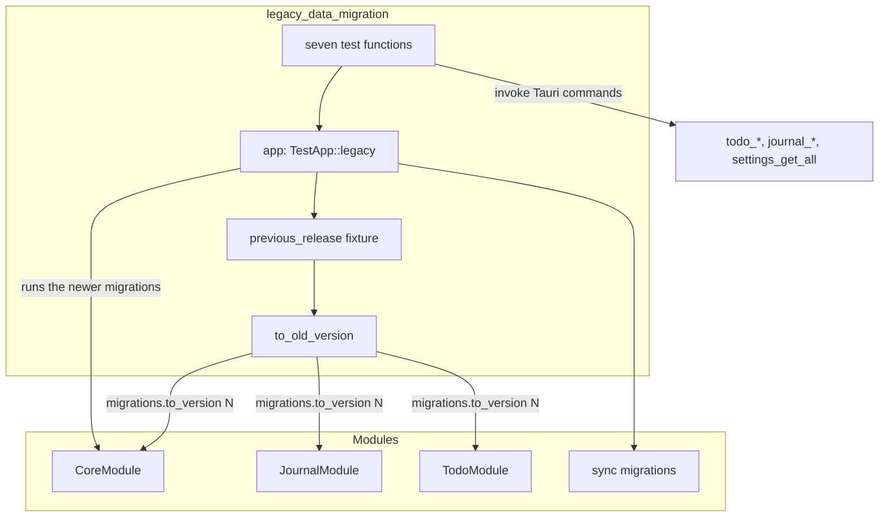
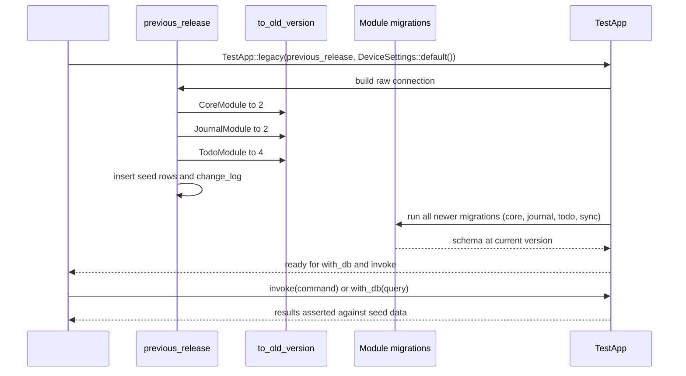
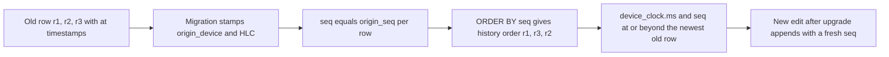

# legacy_data_migration

## Introduction

`legacy_data_migration` is the test module that proves the current release can open a database left behind by the **previous release**. It lives in `src-tauri/src/legacy_db_tests.rs` and contains seven integration tests. Each test builds a realistic "a year of use" database with the old schema, starts the app on it through `TestApp::legacy`, and then checks that migrations, data reads, the change log, and the sync-off default all behave.

It belongs to the [Data_Foundation](../Data_Foundation.md) area. It depends on the migration and change-log machinery in [core](core.md) and [core_settings](core_settings.md), and it exercises the Todo and Journal data models and the Sync tables. It does not contain production code of its own.

## Why this module exists

Every release adds migrations to the Modules' schemas. A user upgrading from the previous release has a database at the old schema version. The test module guards that upgrade path:

- every migration after the old version runs without error on real-looking data,
- existing rows stay readable through the same Tauri commands the screens use,
- records written before the upgrade gain change-log stamps and a stable order,
- nothing from the Sync feature becomes active or stored until the user turns Sync on.

## Scope

| Area | Test(s) | What is asserted |
|---|---|---|
| Schema upgrade | `every_migration_runs_on_a_previous_release_database` | `integrity_check` is `ok`, no foreign-key violations, and `core`, `todo` and `sync` migration versions are past the old ones |
| Change log | `the_change_log_keeps_its_rows_and_gets_a_stable_order` | No old record is lost, each is stamped with this device, and rows sort by time then insertion |
| Reads | `old_data_is_still_read_by_the_screens` | `todo_task` and `todo_task_history` return old data, and `journal_pages` returns both old entries |
| Comments | `comments_edited_before_the_upgrade_still_read_as_edited` | An old edited comment reads with `edited = 1`, an unedited one with `edited = 0` |
| Preferences | `look_preferences_move_to_the_device_file_and_others_stay` | `theme` and `phone_tabs` leave the shared `settings` table; `display_name` stays |
| Sync off | `nothing_syncs_and_nothing_is_stored_by_sync_until_it_is_turned_on` | Sync tables are empty and the sync probe reports no listeners, advertisements or tasks |
| New edits | `an_edit_after_the_upgrade_is_recorded_and_the_old_session_is_untouched` | A new task update adds change-log rows and creates no duplicate `seq` values |

## Architecture

The module is a set of tests over three collaborating pieces: the old-schema builder, the seeded fixture, and the test harness.

### The old-schema builder

`to_old_version(conn, module, version)` does three things for one Module:

1. Runs that Module's own migrations only up to `version` through `module.migrations().to_version(...)`.
2. Resets SQLite `user_version` to 0.
3. Inserts a row into `_module_migrations` recording the Module id and old version.

Because it reuses each Module's real migration list, the old schema cannot drift from the real migration history. The version constants are:

| Constant | Value | Meaning |
|---|---|---|
| `OLD_CORE` | 2 | Core migrations the previous release had |
| `OLD_JOURNAL` | 2 | Journal migrations the previous release had |
| `OLD_TODO` | 4 | Todo migrations the previous release had |

Sync has no old-version constant. The fixture never builds a Sync schema, so the Sync migrations all run as new on upgrade.

### The fixture

`previous_release(conn)` seeds one year of use, relative to `T0` (2023-11-14 UTC in milliseconds) with one-day steps:

| Table | Seeded data | Why it matters |
|---|---|---|
| `settings` | `core.theme`, `core.phone_tabs` (device-level now), `core.display_name` | Tests the preference split |
| `todo_lists` | `l1` live "Groceries", `l2` deleted "Old list" | Deleted-list handling |
| `todo_tasks` | `t1` repeating weekly with an old-style done occurrence `t1-old`, `t2` in the Inbox, `t3` deleted | Repeat and delete paths |
| `todo_comments` | `c1` plain, `c2` edited later | The `edited` flag |
| `journal_entries` | `e1` and `e2` with timezone offsets | Journal paging |
| `change_log` | `r1` create, `r2` update with a session id, `r3` journal create | Log retention and ordering |

The `change_log` rows are inserted with `NULL` or caller-given sync stamps. The migrations then have to fill in device and clock fields. This is what the change-log test checks.

## Core flow: upgrading a database

The harness owns the migration run. The test code only provides the seed and then reads or writes through `invoke` (Tauri command handlers) or `with_db` (direct SQL). The command handlers are the same ones the Tauri front end calls; see [Tauri_Host_and_IPC_Bridge](../Tauri_Host_and_IPC_Bridge.md).

## Change-log stamping

Old `change_log` rows have no stable order and no device stamp. After the upgrade each one must get:

- `origin_device` set to this device,
- `hlc_ms` and `hlc_counter` derived from the old `at` time,
- `seq` and `origin_seq` set to the same value (no gap, no reordering),
- a `device_clock` that starts at or after the newest old record.

The expected history order is `r1, r3, r2`. Those are sorted by time, and `r3` (journal, `t0`) sits before `r2` (todo, `t1`). Ties would fall back to insertion order.

## Sync stays dormant

Turning Sync on is the only way its tables get data. On a freshly upgraded database:

- `sync_peers`, `sync_conflicts`, `sync_resolutions`, `sync_activity`, and `sync_group` have zero rows,
- the sync probe reports no running engine, no listeners, no advertisements, and no tasks.

The sync engine itself is described in [Sync_Replication_Engine](../Sync_Replication_Engine.md) and its connectivity in [Sync_Connectivity_and_Pairing](../Sync_Connectivity_and_Pairing.md). This module only checks that the default is off.

## Preference split

Look preferences (`theme`, `phone_tabs`) used to live in the shared `settings` table. After the upgrade they move to the device settings file, while other settings such as `display_name` remain in the database. The settings mechanism is described in [core_settings](core_settings.md).

## Reading old data through the screens

`old_data_is_still_read_by_the_screens` calls the same commands the UI uses:

| Command | Assertion |
|---|---|
| `todo_task` with `t1` | Title `Buy milk` and notes `two litres` |
| `todo_task_history` with `t1` | Returns an array |
| `journal_pages` (older, limit 50) | Two entries across all pages |

Task and history behaviour is described in [todo](../Task_and_Journal_Domain_Services/todo.md) and [todo_views](../Task_and_Journal_Domain_Services/todo_views.md). Journal paging is in [journal](../Feature_Client_UI/journal.md).

## Running the tests

These tests run as part of the Rust test suite of `src-tauri`. Use the repository's `make test` target; see [Build_and_Packaging](../Build_and_Packaging.md) for how the Rust crates are built and tested. Keep the local resource limits in mind: run one cargo build at a time.

## Maintenance guidance

- **When a release adds a migration**, the fixture does not change. The new migration runs automatically on every old-version database. Add a test only if the migration changes data users will see.
- **When a release ships**, bump `OLD_CORE`, `OLD_JOURNAL`, and `OLD_TODO` to the versions that release shipped with, and update the seed rows if the old schema has new columns. Sync needs an old-version constant once Sync has shipped a release.
- **Keep the fixture realistic.** Include deleted rows, repeating tasks, edited comments, and session ids, because those are the paths that broke in the past.
- **Do not assert on Sync tables being empty after Sync has shipped.** That test is valid only while Sync is off by default.
