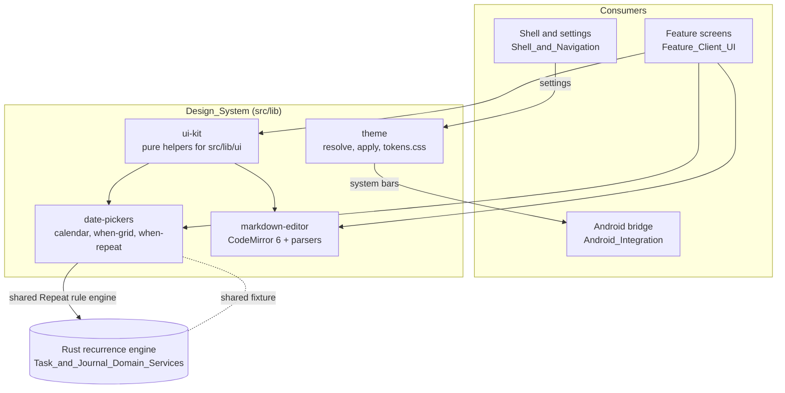
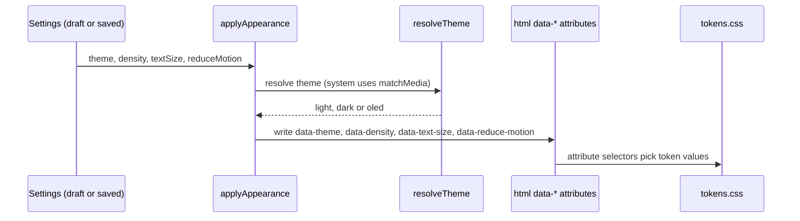

# Design_System

## Purpose

`Design_System` is the shared UI foundation under `src/lib`. It holds the parts that the Svelte components and feature screens build on:

- **Theme** turns appearance settings (theme, density, text size, reduced motion) into `data-*` attributes on `<html>`. The CSS token layer reads those attributes. The theme also keeps the Android system bars in step with the page background.
- **UI kit** is the set of framework-light helpers behind the `src/lib/ui` components. Most of it is pure TypeScript that Vitest can test without a browser.
- **Date pickers** is pure date maths for calendar grids, keyboard moves, ranges and Repeat rules. It has no Svelte code and no I/O.
- **Markdown editor** is the CodeMirror 6 writing surface used by Journal entries and Todo notes, plus the read-side Markdown parsers.

Components and feature code consume semantic tokens and `src/lib/ui` components only. They do not use raw colours or import `bits-ui` directly.

## Architecture

The four parts depend on each other in one direction only:

- `date-pickers` does not depend on the others. `calendar.ts` is the base; `when-grid.ts` and `when-repeat.ts` build on it.
- `markdown-editor` uses the `ui-kit` helpers through its Svelte host.
- `theme` is the only part that touches the DOM root and the native bridge.

## Core components

| Component | Responsibility | Documentation |
|---|---|---|
| Theme (`src/lib/theme`) | Resolves `system` to `light` or `dark`, writes `data-*` attributes, defines OLED, density and text-size tokens, and keeps first paint in step with `index.html`. Guard tests cover WCAG contrast and first paint. | [theme](Design_System/theme.md) |
| UI kit (`src/lib/ui`) | Pure rules for text entry, word marking, emoji, pane widths, sticky rows, scroll anchoring, bottom-sheet swipes, held pointers, tooltip gating, tab focus handoff, and the page header state. | [ui-kit](Design_System/ui-kit.md) |
| Date pickers (`src/lib/ui/calendar.ts`, `when-grid.ts`, `when-repeat.ts`) | Six-row month grid, five-week When grid, keyboard focus moves, range picking, and the Repeat rule engine (labels, presets, next due date, previews). A shared JSON fixture keeps the TypeScript and Rust engines in step. | [date-pickers](Design_System/date-pickers.md) |
| Markdown editor (`src/lib/ui/markdown`) | Live-styled CodeMirror 6 editor with auto-pairing, list editing, shortcuts, a `/` menu, rich paste, and clickable Todo checklist boxes. Also provides `parseMarkdown` and `parseInlineMarkdown` for read views. | [markdown-editor](Design_System/markdown-editor.md) |

## How a preference reaches the screen

Drafts preview immediately, except `reduceMotion`, which waits for Save.

## Notes for contributors

- Put a token in `tokens.css` first. Add a contrast row when it carries text or an edge, so `contrast.test.ts` covers it.
- Keep pure rules free of DOM access. Put DOM wiring in its own file and return a cleanup function.
- Change recurrence logic in the Rust engine, the TypeScript copy and the shared fixture together.
- Keep the page background in `tokens.css` and the `index.html` first-paint block in step. `first-paint.test.ts` fails otherwise.

## Related documentation

- [Theme](Design_System/theme.md)
- [UI kit](Design_System/ui-kit.md)
- [Date pickers](Design_System/date-pickers.md)
- [Markdown editor](Design_System/markdown-editor.md)