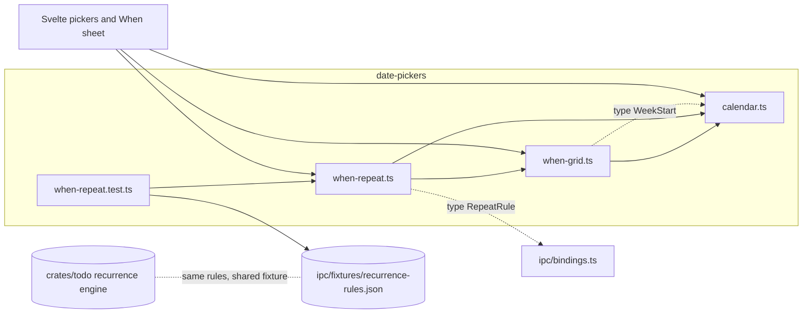
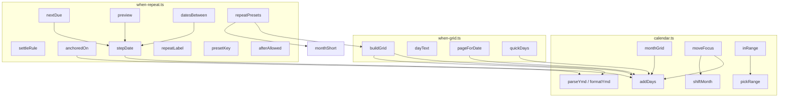
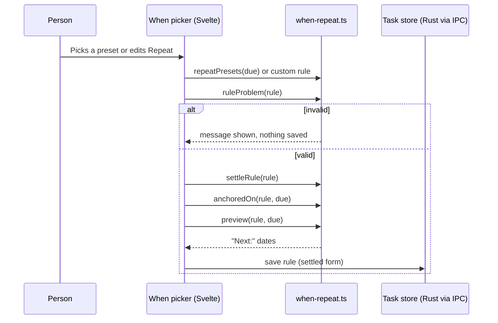
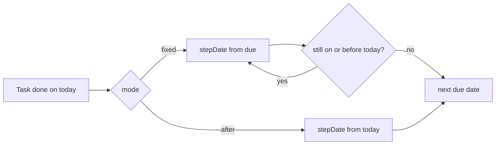
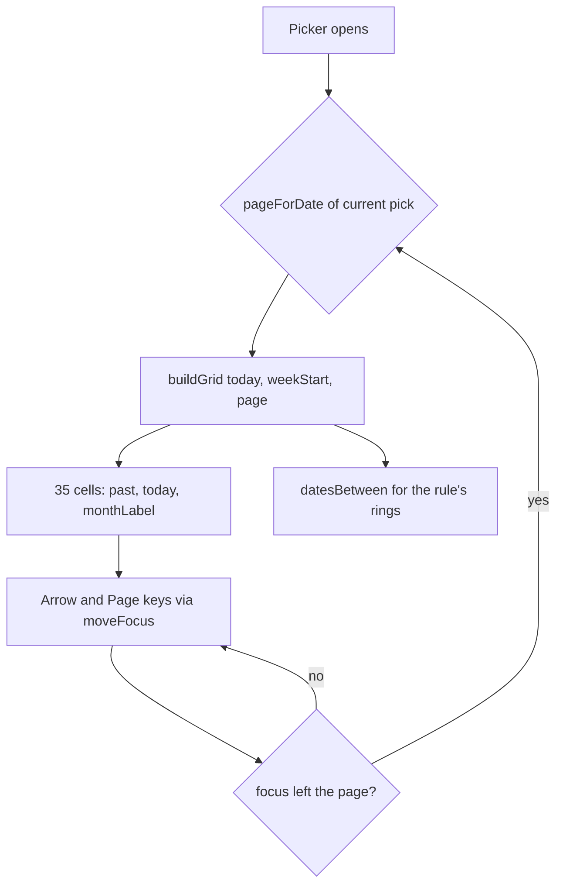

# Date Pickers

## Introduction

The date-pickers module is the pure date maths behind the app's date-selection UI. It has no Svelte code and no IO: it turns `YYYY-MM-DD` strings into calendar grids, keyboard moves, range selections, and Repeat rules (for example "every 3 days after done" or "weekly on Mon, Thu"). Everything here is deterministic and unit-tested, so the picker components stay thin.

The module has three parts:

| Part | File | Role |
|---|---|---|
| Generic calendar maths | `src/lib/ui/calendar.ts` | Month grid, keyboard navigation, range picking |
| When picker grid | `src/lib/ui/when-grid.ts` | Rolling five-week grid, quick days, day labels |
| Repeat rules | `src/lib/ui/when-repeat.ts` | Recurrence engine copy, labels, presets, calendar rings |

A fourth file, `src/lib/ui/when-repeat.test.ts`, runs a shared JSON fixture against this TypeScript engine and the Rust engine, which keeps the two in step.

Related documentation: the surrounding UI rules and component inventory are in [UI Kit](ui-kit.md) and the parent [Design System](../Design_System.md). The Rust recurrence engine that these rules mirror is part of the todo domain described in [Task and Journal Domain Services](../Task_and_Journal_Domain_Services/todo.md). Where these pickers are used in task editing and capture, see [Feature Client UI](../Feature_Client_UI.md).

---

## Conventions

- **Dates** are `YYYY-MM-DD` strings with no time zone. Months are `YYYY-MM`.
- **Week start** is either `'mon'` or `'sun'` (the Week start preference). Weeks never start on a day the preference does not name.
- **Weekday masks** use bit 0 for Sunday. Mondays to Fridays is `WEEKDAYS_MASK = 0b011_1110`.
- **Pure functions only.** Nothing here reads the clock. The caller passes `today` in, which is why the grid and quick-day functions take it as an argument.
- **Date arithmetic goes through UTC.** `addDays`, `daysBetween` and `weekdayOf` build `Date.UTC` values, so daylight saving changes cannot shift a day.

---

## Architecture

### Module dependency graph



Dependencies run one way. `calendar.ts` has no imports from the rest of the module, `when-grid.ts` depends only on `calendar.ts`, and `when-repeat.ts` depends on both. The Svelte components that render the pickers are the only consumers, and they are outside this module.

### Component interaction



The shared helpers in `calendar.ts` are the common base. The `when-repeat` engine calls `stepDate` for every date it produces, so `nextDue`, `preview` and `datesBetween` all share one step rule.

---

## Core Components

### Calendar maths (`calendar.ts`)

- **`monthGrid(month, weekStart)`** returns 42 `GridDay` cells (six full weeks) covering `YYYY-MM`. The grid is always six rows so the calendar does not change height between months. Cells outside the month have `inMonth: false`.
- **`moveFocus(date, key, weekStart)`** maps a key to the new focused day:

  | Key | Result |
  |---|---|
  | ArrowLeft / ArrowRight | ±1 day |
  | ArrowUp / ArrowDown | ±7 days |
  | Home / End | First or last day of the week, per `weekStart` |
  | PageUp / PageDown | Same day number in the neighbouring month, clamped to that month's length |

  Any other key returns `null`, so the caller knows not to handle it.
- **`pickRange(range, date)`** is a small state machine over a `DateRange { from, to }`:

  ```mermaid
  stateDiagram-v2
      [*] --> Empty
      Empty --> Half: pick(d) → from = d
      Half --> Full: pick(d) with d ≥ from → to = d
      Half --> Full: pick(d) with d < from → swap ends
      Full --> Half: pick(d) → starts over at d
  ```

  A second pick on the same day makes a one-day range. An earlier second pick swaps the ends.
- **`inRange(range, date)`** is inclusive at both ends. A half-chosen range (only `from`) contains just that day.

### When grid (`when-grid.ts`)

- **`buildGrid(today, weekStart, page)`** returns a `GridModel` of 35 cells (`GRID_WEEKS = 5`). Page 0 starts at the current week, so the picker never shows anything before this week. Each cell carries `past`, `today` and an optional `monthLabel` (for example `"Nov"` on the 1st of a month). The heading is one of `"October 2026"`, `"Oct – Nov 2026"` or `"Dec 2026 – Jan 2027"`. `canGoBack` is false on page 0.
- **`pageForDate(date, today, weekStart)`** returns the page that shows `date`, or 0 for today and earlier days.
- **`dayText(date, today)`** formats a date for a sentence or chip (`"Fri 23 Oct"`). The year is added only when it differs from `today`'s year.
- **`quickDays(today, weekStart)`** (not in the provided core list, but in the same file) gives the four quick choices: Today, Tomorrow, Weekend and Next week. Weekend is today on a Saturday or Sunday, otherwise the coming Saturday. Next week depends on the week-start preference.

Note that this is a different grid from `monthGrid`. `monthGrid` is a six-row calendar of one month; `buildGrid` is a rolling five-week window for the When picker.

### Repeat rules (`when-repeat.ts`)

A repeat rule is the wire type `RepeatRule { freq, every, days, mode }`:

- `freq` is `day`, `week`, `month` or `year`.
- `every` is 1 to 99.
- `days` is a weekday mask for weeks, or a day of the month (1 to 31) for months and years, or `null`/0 for none.
- `mode` is `fixed` (counts from the Due date) or `after` (counts from the day the task is done).

Main functions:

- **`ruleProblem(rule)`** returns a human message, or `null` if the rule is valid. The messages match the Rust side.
- **`settleRule(rule)`** drops `days` where they mean nothing (day rules, and after-done rules for months and years). Stored rules are always settled.
- **`anchoredOn(rule, due)`** sets the day of month of a fixed monthly or yearly rule to the day of the Due date. After-done rules are not anchored.
- **`stepDate(rule, date)`** is the one step rule. It returns the next date strictly after `date`, or `null` past year 9999. For weeks with chosen days, the week runs Monday to Sunday: later days in the same week come first, then the chosen days in the week `every` weeks on. Month and year steps clamp to the end of short months, so 31 Jan plus one month gives 28 or 29 Feb.
- **`nextDue(rule, due, today)`** decides where a task goes when it is completed. In `after` mode it steps from `today`. In `fixed` mode it steps from the Due date and skips missed occurrences, so a task that is late lands on the next future date.
- **`firstMatch(rule, today)`** gives the first day on or after `today` that the rule lands on. Only weekday masks can push it later.
- **`preview(rule, from, count = 3)`** lists the next dates for the "Next:" line.
- **`datesBetween(rule, from, start, to)`** lists the dates inside a window, for the rings on the calendar.
- **`repeatLabel(rule)`** names a rule ("Every 2 weeks on Mon, Thu", "Every 3 days after done").
- **`repeatPresets(date)`** gives the eight presets, worded for the date ("Weekly on Wednesday", "Yearly on 21 Oct").
- **`presetKey(rule)`** tells which preset a rule matches, or `null` for a custom rule. The mode is ignored, so a monthly rule on the 31st is recognised as the monthly preset.
- **`afterAllowed(rule)`** is false for weekday rules, because "from the day it's done" needs an interval.

---

## Data Flow

### Choosing a repeat rule



### Completing a repeating task

The engine that runs on completion is in Rust. The TypeScript copy is used by the picker and the browser mock to show the same dates the app will compute.



### Showing the When grid



---

## Cross-Implementation Contract

`when-repeat.test.ts` is the proof that the TypeScript engine matches the Rust engine. It reads `src/lib/ipc/fixtures/recurrence-rules.json`, a file that the Rust engine's tests also read. Each fixture case has:

- `op`: `first_match`, `next_due`, `preview`, or `invalid`
- a `rule` in the fixture's form (weekdays as a list, anchor as a day number)
- the `today`, `due` or `from` input and the expected output

The test converts the fixture rule to the wire shape (weekday list becomes a bitmask, anchor becomes `days`), then checks the function named by `op`. A fixture change therefore fails both engines at once. Unit tests in the same file cover cases the fixture does not, such as clamping, the year 9999 limit, and label wording.

Changes to recurrence logic must update the Rust engine, the TypeScript copy, and the fixture together.

---

## Behaviour Notes and Limits

- **Two grids.** `monthGrid` (six rows, one month) and `buildGrid` (five rows, rolling) serve different purposes. Do not swap them.
- **Past days are disabled in the When grid**, but `pageForDate` returns page 0 for any earlier date, so an old due date opens on the current week.
- **`datesBetween` has a cap of 4000 steps** from `from`. A daily rule whose window starts more than about eleven years after `from` returns no dates. Callers pass a `from` close to the window start.
- **Weeks differ between the two engines only for interval weeks.** The TypeScript engine runs weeks Monday to Sunday. The comment in the source notes that this matters only for "every N weeks on chosen weekdays", which the shared fixtures cover.
- **`presetKey` ignores the anchor day** for monthly and yearly rules. The preset highlight reflects frequency, and the anchor is handled by `anchoredOn`.
- **Dates past year 9999** return `null` from `stepDate`. Callers must treat `null` as "no further date".

---

## Where to Change What

| Change | Edit | Also update |
|---|---|---|
| New quick day or picker preset | `when-grid.ts` (`quickDays`) or `when-repeat.ts` (`repeatPresets`) | `when-repeat.test.ts` expectations |
| New recurrence rule behaviour | `when-repeat.ts` (`stepDate` and friends) | Rust recurrence engine, shared fixture |
| Keyboard navigation | `calendar.ts` (`moveFocus`) | Picker key handlers |
| Grid size or window | `when-grid.ts` (`GRID_WEEKS`) | Picker layout and paging |
| Label wording | `when-repeat.ts` (`repeatLabel`, `ordinal`) | Label tests, Rust wording |

For the component inventory that uses these functions, see [UI Kit](ui-kit.md). For the rules that govern tokens and components, see the [Design System](../Design_System.md) overview.
