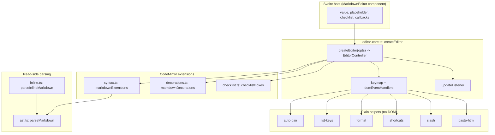
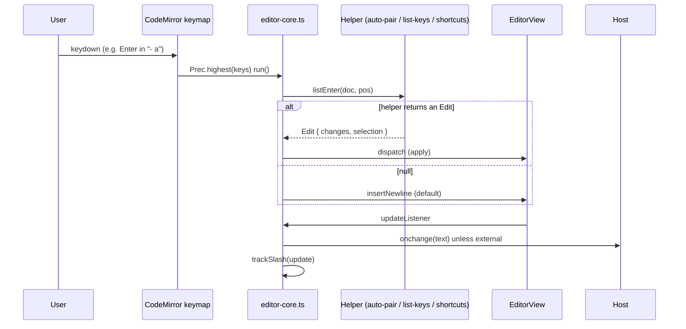
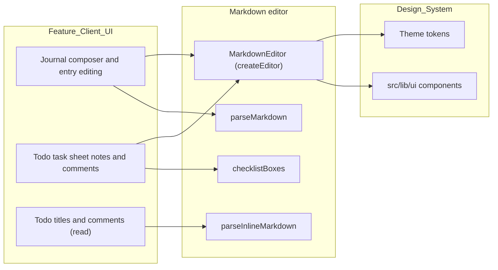

# Markdown Editor

The markdown editor is the writing surface for Mnemora's Journal entries and Todo notes. It is a CodeMirror 6 editor that shows Markdown as you type: marks stay visible but faded, styles are applied in place, and the spacing matches the read view. It also handles the editing conveniences a writer expects: keyboard shortcuts, auto-pairing of brackets and emphasis marks, list continuation, a `/` command menu, rich-text paste conversion, and clickable Todo checklist boxes.

The module lives in `src/lib/ui/markdown/`. Its design rule is that the behaviour is written as plain, testable functions (edits computed from `(text, selection)`), and only a thin layer in `editor-core.ts` connects them to CodeMirror. Most of the logic can therefore be tested in Vitest without a DOM.

Related pages:

- [Design System](../Design_System.md): the token and component rules the editor's look follows.
- [UI Kit](ui-kit.md) is not a separate page here; see [Design System](../Design_System.md) for the `src/lib/ui` component inventory.
- [Feature Client UI](../Feature_Client_UI.md): the Journal and Todo screens that mount the editor and own its content.
- [Theme](../Design_System.md): the colour tokens used by the editor theme.

## Responsibilities

| Concern | What the module does | Where |
|---|---|---|
| Markdown dialect | Defines the supported syntax (strikethrough, task lists, autolinks, `==highlight==`); no tables, HTML or images | `syntax.ts` |
| Parsing for read views | Turns Markdown into a plain data tree (no HTML field), and a single-line inline reading for Task titles and comments | `ast.ts`, `inline.ts` |
| Live styling | Fades syntax marks, styles inline spans, headings, quotes and code, and adds read-view spacing | `decorations.ts` |
| Checklist boxes | Replaces `- [ ]` / `- [x]` markers with clickable boxes (opt-in) | `checklist.ts` |
| Typing help | Auto-pairs `()`, `[]`, `` ` ``, `*`; steps over closers; removes empty pairs on Backspace | `auto-pair.ts` |
| List editing | Continues lists on Enter, indents with Tab, removes markers on Backspace | `list-keys.ts` |
| Formatting | Toggles inline marks and block prefixes; builds links | `format.ts` |
| Shortcuts | Maps physical keys to formatting commands per platform | `shortcuts.ts` |
| Slash menu | Filters block and insert items after a typed `/` | `slash.ts` |
| Paste | Converts rich clipboard HTML into Markdown | `paste-html.ts` |
| Component glue | Creates the CodeMirror view and wires every helper together | `editor-core.ts` |

## Architecture

`editor-core.ts` is the only file that imports CodeMirror's view classes for behaviour. The helpers return an `Edit` value (changes plus an optional selection), and `apply()` in `editor-core.ts` turns it into a transaction. This keeps every editing rule testable with `applyEdit` from `edit.ts`, which the tests use directly.

The file is loaded through a dynamic import, so CodeMirror stays out of the main bundle. Callers should treat `createEditor` as asynchronous in the sense that the editor appears only after that chunk loads.

### Public surface

`createEditor(opts: EditorOptions): EditorController`

Options (`EditorOptions`):

- `parent`, `doc`, `label`, `placeholder`, `spellcheck`: mount point and initial content.
- `bare`: the container draws focus itself, so the editor draws no ring.
- `checklist`: enables `checklistBoxes` (Todo notes). Journal leaves it off, so `- [ ]` stays faded text.
- `onchange(text)`: fires for user edits only. Changes tagged with the `external` annotation (from `setDoc`) are not reported back, which prevents a feedback loop with the host's `value` prop.
- `onfinish()`: Mod+Enter.
- `onescape()`: Escape when no slash menu is open. Kept separate so a host can make Escape leave the editor.
- `onfocuschange(focused)`, `onslash(state | null)`, `slashValues()`, `onopenlink(href)`.

`EditorController` offers `setDoc`, `getDoc`, `focus`, `blur`, `run(command)` (used by toolbar buttons, which pass `fromBar = true`), `pickSlash(id)`, `setSpellcheck`, `setPopup(listId, optionId)` for ARIA active-descendant wiring, and `destroy`.

## Component interactions

### Keystroke flow

Typed characters take a separate path: `EditorView.inputHandler` calls `autoPair` for single characters, outside IME composition. Other keys reach the helpers through the `keymap`, and Mod+letter shortcuts reach them through `domEventHandlers.keydown`.

### Keyboard shortcuts

`resolveEditorShortcut(e, mac)` matches by physical key (`KeyB`, `Digit8`) so Shift does not change the character read:

| Shortcut (macOS / other) | Command |
|---|---|
| Mod+B | bold (`**`) |
| Mod+I | italic (`*`) |
| Mod+E | inline code (`` ` ``) |
| Mod+Shift+X | strikethrough (`~~`) |
| Mod+Shift+H | highlight (`==`) |
| Mod+Shift+8 / 7 / 9 | bullet / numbered / checklist line |
| Mod+Alt+2 (heading 2; other heading levels follow the same Alt pattern) | heading |
| Mod+K | link (see below) |
| Mod+Shift+V | paste as plain text for the next paste (500 ms window) |

Ctrl replaces Mod off macOS, and the two never combine. Shell shortcuts such as Mod+1 and Mod+N are deliberately left to the app. Mod+K with nothing selected returns `false` so the app palette can open; a toolbar call with `fromBar` inserts a `[text](url)` template instead.

## Core behaviour

### Auto-pairing (`auto-pair.ts`)

`autoPair(doc, from, to, ch)` returns an edit or `null` (null means "type normally"):

- Opening `(`, `[`, `` ` `` close immediately with the caret between, but only in front of whitespace or closing punctuation, not in front of a word. A backtick directly after a word is not paired, and a third backtick stays a code fence.
- A second `*` forms a bold pair. A single `*` is plain.
- With a selection, the four openers wrap the selected text and keep it selected, so typing `*` twice around a selection makes it bold.
- A closer (`)`, `]`, closing backtick, closing `**`) already in front of the caret is stepped over. A `*` that opens a new span is not swallowed.
- `pairBackspace` deletes an empty pair (`()`, `[]`, `` `` ``, `****`) as one unit. Non-empty or unmatched pairs fall to normal Backspace.

Quotes and underscores are never paired.

### List editing (`list-keys.ts`)

- Enter on a list item continues it with the same bullet character and indent. Numbered items count up. A checklist continues with a fresh unticked box even after a ticked item.
- Text after the caret moves into the new item.
- Enter on an empty item ends the list. On a nested empty item it lifts one level first.
- Tab and Shift-Tab nest and un-nest selected items by marker width. Outside lists they return `null`, so Tab moves focus as usual.
- Backspace right after a marker (`- `, `1. `, `- [ ] `, `> `, `## `) removes the marker and leaves the text.

### Formatting (`format.ts`)

- `toggleInline(doc, from, to, mark)` wraps the selection with marks kept tight around the words, and unwraps when the marks sit just outside the selection. It also handles stacked bold and italic.
- `toggleBlock(doc, from, to, kind)` prefixes the caret or selected lines with a block marker (`h1`–`h3`, `bullet`, `numbered`, `task`, `quote`) and replaces any other block prefix. Applying the same kind again removes it. Blank lines are skipped when numbering.
- `makeLink` wraps a selection; a selected bare URL becomes the destination with the caret in the label.

### The `/` menu (`slash.ts`, `trackSlash`)

A typed `/` at a line start or after whitespace opens the menu. It does not open inside a word or URL. The query is the text after the slash, and a space closes the menu.

Items come from `SLASH_ITEMS`: headings, lists, task, quote, divider, code block, date and time. `applySlash` replaces the `/query` with the block at the start of the line (or moves it to a new line when picked mid-line), and text after the query moves into the new block. `date` and `time` insert the values from `slashValues()` supplied by the host.

Keys inside the menu: ArrowUp/Down move the active row, Enter or Tab picks, Escape closes the menu (and does not leave the editor). `setPopup` mirrors the active row into `aria-activedescendant`.

### Paste (`paste-html.ts`)

The `paste` handler converts clipboard HTML only when `isRichHtml` finds semantic tags (`a`, `strong`, `em`, `del`, `mark`, `code`, `pre`, `h1`–`h6`, lists, `blockquote`, `hr`). Plain wrappers such as `span` and `div` paste as plain text. Plain paste (Mod+Shift+V) bypasses the converter.

The converter is a small tolerant tokenizer, not a DOM parser. It reads bold, italic and strikethrough from tags and inline styles (including Google Docs' `font-weight: normal` wrapper), turns links into `[label](href)` with only http, https, mailto and tel addresses kept, and flattens table cells into text. Script and style content is dropped. Its output is Markdown text, which the editor inserts as ordinary input.

### Ctrl/⌘-click links

`mousedown` with the platform modifier resolves the `Link`, `Autolink` or `URL` node under the pointer. Only safe schemes (`http:`, `https:`, `mailto:`, `tel:`) reach `onopenlink`; anything else is ignored.

## Syntax and rendering

### Dialect (`syntax.ts`)

`markdownExtensions` is shared by the editor and the read view so both see the same tree:

- `Strikethrough` (`~~x~~`)
- `TaskList` (`- [ ]`, `- [x]`)
- `Autolink` (bare URLs)
- `Highlight` (a local extension for `==x==`, with the flanking rules of the Strikethrough extension, so `a == b == c` is not a highlight)

Tables, HTML and images are not part of the dialect and stay text. `markdownParser` exposes the configured parser for other consumers.

### Live decorations (`decorations.ts`)

`markdownDecorations` is a `StateField` rebuilt on document change or when the syntax tree changes. It does four things:

1. **Fades marks**: emphasis, strikethrough, highlight, code, heading, quote, list and task markers, link brackets and titles, and code-fence info are wrapped with `cm-md-mark`, so they stay visible but faded.
2. **Styles spans**: `cm-md-strong`, `cm-md-em`, `cm-md-del`, `md-mark`, `md-code`, and `md-link` for link labels and bare URLs (link addresses are faded).
3. **Line classes**: `md-hd md-h1`–`md-h3` for headings, `md-q cm-md-quote` for quotes, `cm-md-code` with `cm-md-code-first` and `cm-md-code-last` for fenced code.
4. **Read-view rhythm**: `cm-md-gap` pads the last line of a block that runs straight into another block, and `cm-md-blank` shortens blank lines between blocks. Trailing blank lines stay full height, and blank lines inside a fence are left alone.

The class names are shared with the read view so that writing and reading line up. Visual values come from the design tokens, see [Design System](../Design_System.md).

### Checklist boxes (`checklist.ts`)

When `checklist` is set, each `TaskMarker` is replaced by a `BoxWidget` (a `role="checkbox"` span with a tick SVG when checked). The replacement covers the list mark too, and `EditorView.atomicRanges` makes the box one unit for cursor movement and Backspace. Clicking the box calls `toggleTaskLine` on the line and dispatches a normal change tagged `input.tick`, so ticking is undoable like typing.

### Read-side parsing

Two parsers serve the read views and task text:

- `parseMarkdown` (`ast.ts`) returns a block tree (`p`, `h`, `list`, `quote`, `code`, `hr`) and inline nodes (`text`, `strong`, `em`, `del`, `mark`, `code`, `link`). It returns data only, with no `html` field, so the output cannot inject markup. Headings deeper than 3 remain text; tables, HTML and images remain text.
- `parseInlineMarkdown` (`inline.ts`) reads one line or a short multi-line text (a Todo title or comment) for bold, italic, code, links and bare URLs. Block syntax such as `#`, `-`, `>` or `1.` is escaped with a backslash, so it stays as the text it looks like. Strikethrough and highlight marks come back as plain text, and neighbouring text is merged.

Consumers of these parsers are described in [Feature Client UI](../Feature_Client_UI.md) (Journal read view and Todo titles and comments).

## Where it is used

- The **Journal** mounts the editor without checklist boxes, so `- [ ]` remains visible, faded text. Its read view uses `parseMarkdown`.
- **Todo notes** mount the editor with `checklist: true`, so ticks are clickable boxes. Todo titles and comments are single-line text, read through `parseInlineMarkdown`.
- The **UI rules** (tokens only, `src/lib/ui` components only) apply to the editor's theme and to any control built around it. See [Design System](../Design_System.md).

## Data and state

- **Document** is a plain string owned by the host. The editor is the source of truth while focused; `setDoc` replaces the content and is marked `external` so it is not echoed back through `onchange`.
- **Slash state** (`slash`) lives in the closure of `createEditor`: the anchor position, query and active index. It is mapped through document changes and cleared when the query no longer matches. The host only sees a `SlashState` snapshot through `onslash`.
- **Plain-paste flag** is set for 500 ms after Mod+Shift+V, then cleared.
- **Platform** is detected once per editor (`isMacLike`).

The editor has no persistence and no network access. Saving is the host's job; see [Feature Client UI](../Feature_Client_UI.md).

## Testing

Each helper has a Vitest suite that runs without a DOM:

| Test file | Covers |
|---|---|
| `ast.test.ts` | `parseMarkdown` blocks and inline nodes, unsafe links stay text, no `html` field |
| `auto-pair.test.ts` | `autoPair` opening, wrapping, stepping over closers, `pairBackspace` |
| `checklist.ts` (no test file here) | box decoration is exercised through the editor |
| `decorations.test.ts` | Mark and span classes, heading classes, link styling, read-view gap and blank classes, quote and code lines |
| `format.test.ts` | `toggleInline`, `toggleBlock`, `blockKind`, `makeLink`, `linkTemplate` and caret placement |
| `inline.test.ts` | `parseInlineMarkdown` marks, escaping of block syntax, multi-line text |
| `list-keys.test.ts` | Enter continuation, numbering, checklist continuation, indent and outdent, marker Backspace |
| `shortcuts.test.ts` | Physical-key mapping on each platform, plain-paste shortcut |
| `slash.test.ts` | Opening rules, query, filtering, applying each item and caret placement |

The tests use `applyEdit` from `edit.ts` to apply each returned `Edit` to a string. This is why the helpers return `Edit` values rather than mutating a view.

The provided test files do not cover `paste-html.ts`, `checklist.ts` or the `editor-core.ts` wiring; those are not unit-tested in this module's suites.

## Extending the editor

- **New block shortcut or slash item**: add the kind in `format.ts` (`toggleBlock`) and map its key in `shortcuts.ts`, or add an item in `SLASH_ITEMS` with keywords in `slash.ts`. Add cases to the matching test file. Wire it through `run()` in `editor-core.ts` only if it needs a new `EditorCommand` type.
- **New syntax**: write a `MarkdownConfig` like `Highlight` in `syntax.ts`, add its node names to the decoration map in `decorations.ts` if they need fading or styling, and to `parseMarkdown` in `ast.ts` so the read view agrees.
- **New paste rule**: extend `inlineNode` or `blockOf` in `paste-html.ts`. Keep the converter free of DOM APIs so it still runs in tests.
- **Changing the read-view rhythm**: edit the gap and blank logic in `decorations.ts` and keep the class names in step with the read view.

## Known limits

- Tables, HTML and images are not rendered; they stay as text.
- Strikethrough and highlight are not rendered by `parseInlineMarkdown` (Todo titles and comments); their marks come back as plain text (see `plainDeletions` in `inline.ts`). The editor itself still styles them.
- The `/` menu lists a fixed set of items; there is no user-defined command.
- Paste conversion handles the common clipboard shapes only. Unrecognised markup falls back to its text.
- `editor-core.ts` has no direct unit tests; regressions in key handling show up in feature-level checks.
