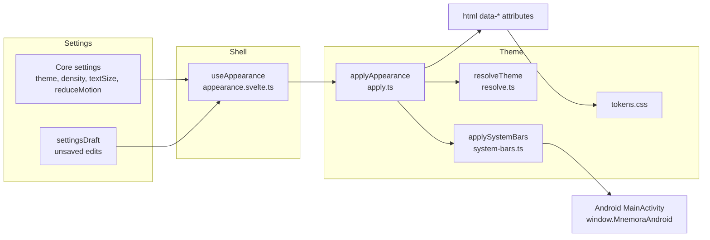
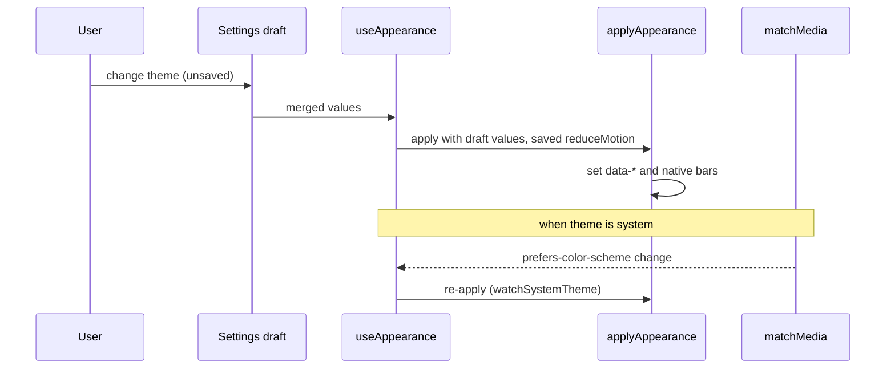
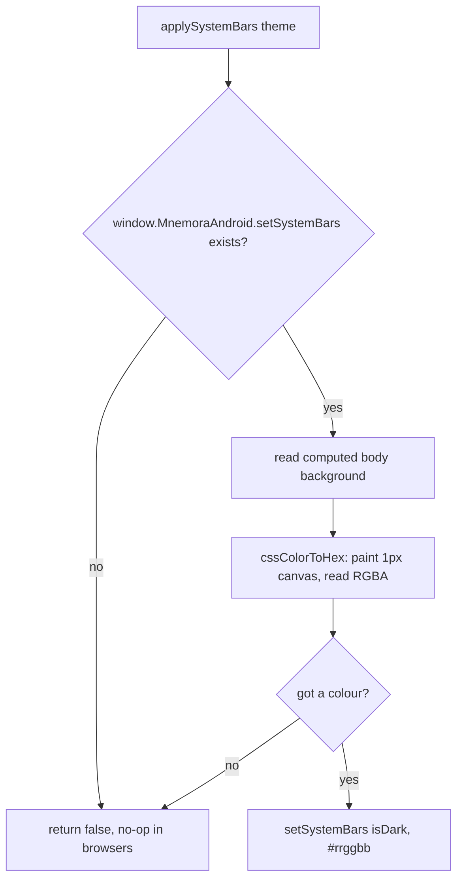

# Theme module

The theme module turns the user's appearance settings (theme, density, text size, reduced motion) into attributes on `<html>`, which the CSS token layer reads. It also keeps the Android status and navigation bars in step with the app's background, and holds the tests that guard colour contrast and first-paint consistency.

Components and tokens are the only consumers of these values. Components read semantic tokens such as `--bg`, `--ink`, and `--accent`, never raw colours (see [UI kit](ui-kit.md) and the [design system overview](../Design_System.md)).

## Scope

| Area | Files | Role |
|---|---|---|
| Preference resolution | `src/lib/theme/resolve.ts` | Maps `system` to `light` or `dark`; passes other choices through |
| Attribute application | `src/lib/theme/apply.ts` | Writes `data-*` attributes on `<html>`; watches OS changes |
| Live binding | `src/shell/appearance.svelte.ts` | Svelte hook connecting settings queries and drafts to `applyAppearance` |
| Native bars | `src/lib/theme/system-bars.ts` | Converts the page background to `#rrggbb` and calls the Android bridge |
| Tokens | `src/lib/theme/tokens.css` | Light, dark, and OLED values; density, text size, and motion overrides |
| Fonts | `src/lib/theme/fonts.css` | Latin-only variable `@font-face` declarations |
| Guard tests | `contrast.test.ts`, `first-paint.test.ts`, `resolve.test.ts`, `system-bars.test.ts` | Enforce WCAG ratios, first-paint parity, and bridge behaviour |

## Architecture

`useAppearance` runs inside a Svelte component. It reads the saved settings through `settingsQuery` and the draft through `settingsDraft`. Each change calls `applyAppearance` on `document.documentElement`.

## How a preference becomes pixels

1. **Resolve the theme.** `applyAppearance` calls `resolveTheme(a.theme, matchMedia)`. Only `system` consults the OS, through `(prefers-color-scheme: dark)`. The result is one of `light`, `dark`, or `oled`.
2. **Write attributes.** The function sets `data-theme` (resolved), `data-theme-pref` (what the user chose), `data-density`, `data-text-size`, and `data-reduce-motion`.
3. **Update native bars.** It then calls `applySystemBars(theme)`, covered below.
4. **Cascade through tokens.** `tokens.css` keys its blocks on these attributes:
   - `:root` holds the light values and `color-scheme: light`.
   - `:root[data-theme="dark"]` and `:root[data-theme="oled"]` share the dark palette and `color-scheme: dark`.
   - `:root[data-theme="oled"]` overrides surfaces to true black and removes card elevation.
   - `:root[data-density="compact"]` shrinks `--row`, `--pad`, `--gap`, and `--fs`.
   - `:root[data-phone]` forces touch sizes (`--row: 44px`) whatever density is set.
   - `:root[data-text-size="s"|"l"]` scales `font-size`, so every `rem` follows.
   - `:root[data-reduce-motion="true"]` and `@media (prefers-reduced-motion: reduce)` set all motion durations to `0ms`.

### Rules that apply to the resolved value

| Preference | Resolved value | Source of truth |
|---|---|---|
| `light` | `light` | Passed through |
| `dark` | `dark` | Passed through |
| `oled` | `oled` | Passed through; OLED is a dark variant with true black |
| `system` | `dark` or `light` | `matchMedia(DARK_QUERY).matches` |

## Live updates

Key behaviours in `useAppearance`:

- **Drafts preview immediately.** Theme, density, and text size use the merged draft, so the user sees changes before saving.
- **Reduce motion waits for Save.** The hook always passes the saved `reduceMotion` value, not the draft one.
- **Pre-paint attributes stay until data loads.** If settings have not arrived, the hook returns without touching the DOM.
- **OS watching is conditional.** `watchSystemTheme` is registered only when the draft theme is `system`. Its returned function removes the listener when the effect re-runs.

## Native status and navigation bars

`system-bars.ts` makes the Android system bars match the page background.

- `cssColorToHex` converts any CSS colour, including `oklch()`, by painting a single canvas pixel and reading it back. This is why `oklch` tokens work here without a colour library.
- `isDarkTheme` returns `true` for `dark` and `oled`. The native side uses it to choose light or dark icons.
- The bridge is defined by the `AndroidBridge` interface. Its other members (`moveTaskToBack`, multicast lock, local-network permission calls) belong to other modules and are not part of the theme. See [Android integration](../Android_Integration.md) and [Sync client surface](../Feature_Client_UI.md) for those.

## Tokens and contrast

`tokens.css` is the single declaration point for colour, shape, elevation, type, and motion. Two rules govern it:

- **Every colour is an `oklch()` value** (or a `color-mix` over one). The contrast test parses only opaque `oklch()` and `var()` references.
- **Light is the default; dark and OLED are attribute-keyed.** Adding a new theme means adding a new attribute block, not changing components.

`contrast.test.ts` reads `tokens.css` from disk and computes WCAG contrast for three themes (light, dark, oled). It enforces:

| Pair | Minimum | Surfaces checked |
|---|---|---|
| `warning-ink` and `success` on `surface-2` (Provider status chips) | 4.5:1 | one surface |
| `muted` (placeholders and secondary text) | 4.5:1 | `pop`, `surface`, `surface-2`, `bg` |
| `warning-ink` (warning icon) | 3:1 | `pop`, `surface`, `surface-2`, `bg` |
| `switch-off` (Switch off track) | 3:1 | `pop`, `surface`, `surface-2`, `bg` |

The test computes the cascade itself: `:root`, then the dark block, then the OLED block on top, so a changed token fails the test even when no component is touched.

## First paint

`index.html` paints the background before `app.css` and the JS load. `first-paint.test.ts` keeps that inline style in step with `tokens.css`:

- The `--bg` value in each theme's `tokens.css` block must equal the `background` of the matching `html` selector in `index.html`.
- `color-scheme` must be `light` for light, and `dark` for both dark and OLED, in both files.

Without this, a dark-mode user would see a white flash on launch. The comment in `apply.ts` notes that a pre-paint script (Rust-side) sets the same attributes so first paint and live changes agree. That script is outside this module; see [Tauri host and IPC bridge](../Tauri_Host_and_IPC_Bridge.md).

## Fonts

`fonts.css` declares three variable families (Inter, Fraunces, JetBrains Mono) with `font-display: swap`. Only the Latin subset and the weight axis are bundled, to keep the app small. The `--f-ui`, `--f-display`, and `--f-mono` tokens in `tokens.css` name these families with system fallbacks.

## Test coverage map

| Test | Guards |
|---|---|
| `resolve.test.ts` | `system` follows the OS; `light`, `dark`, and `oled` pass through |
| `system-bars.test.ts` | No-op without the bridge; `dark` flag for light versus dark and OLED; skip when colour is unreadable |
| `contrast.test.ts` | WCAG ratios for chips, muted text, icons, and Switch track across all themes |
| `first-paint.test.ts` | `index.html` background and `color-scheme` match `tokens.css` |

## Maintenance notes

- **Adding a token:** declare it in the `:root` block and, if it differs, in `:root[data-theme="dark"],:root[data-theme="oled"]`. Add a contrast row if it carries text or an edge.
- **Adding an appearance setting:** add it to `Appearance` in `apply.ts`, write a `data-*` attribute, and add a matching selector in `tokens.css`. Decide whether it previews on draft or waits for Save, as `reduceMotion` does.
- **Changing the page background:** update `tokens.css` and the `index.html` first-paint block together, or `first-paint.test.ts` fails.
- **Settings data model:** the `CoreSettings` shape and the saved and draft stores belong to the settings modules. See [Shell and navigation](../Shell_and_Navigation.md) for the settings surface and [Data foundation](../Data_Foundation.md) for how settings are stored.
