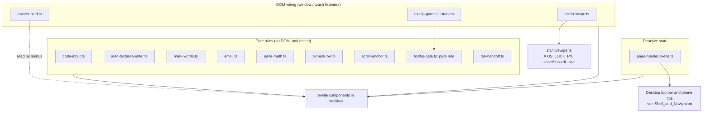
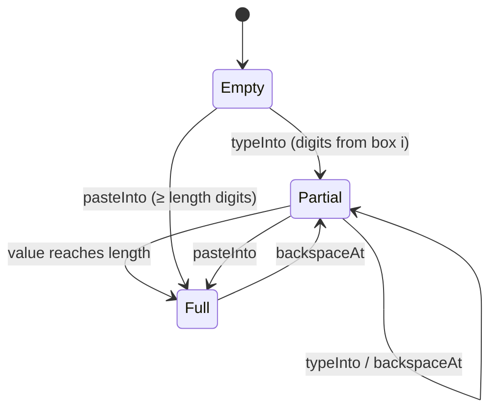
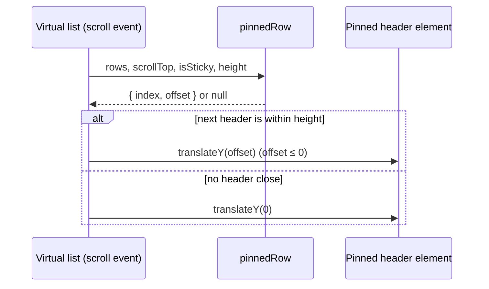
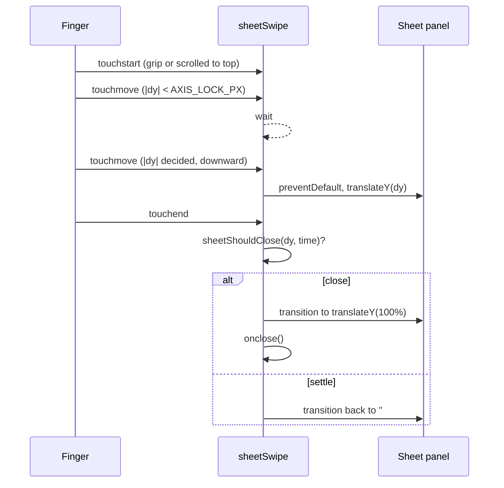
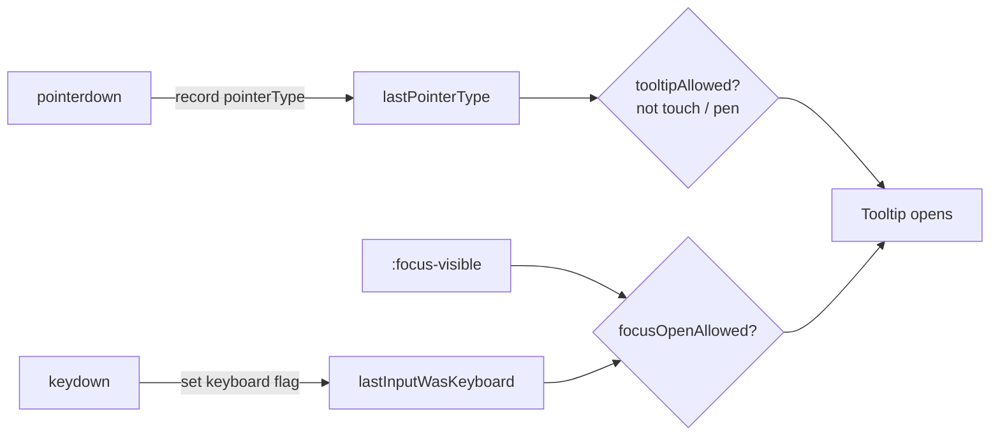

# UI Kit

The UI kit is the set of small, framework-light building blocks that the Svelte components in `src/lib/ui` depend on. Most of it is pure TypeScript: rules for editing a pairing code, marking words in a title, picking which sticky header to pin, deciding whether a tooltip may open, and measuring pane widths. A few files hold reactive state (`page-header.svelte.ts`) or DOM wiring (`sheet-swipe.ts`, `pointer-held.ts`, `tooltip-gate.ts`). Keeping the logic here, separate from the markup, is what lets it be unit-tested with Vitest without a browser.

For visual rules (tokens, colours, the Component inventory) see [docs/design/ui-system.md](../../docs/design/ui-system.md). For the surrounding design system see the parent page [Design_System](../Design_System.md), its [theme](theme.md) sibling, and the feature pages that consume these helpers.

## Scope of this page

| Area | Files | Section |
|---|---|---|
| Text entry | `auto-textarea-enter.ts`, `code-input.ts` | [Input helpers](#input-helpers) |
| Word marking and emoji | `mark-words.ts`, `emoji.ts` | [Text helpers](#text-helpers) |
| Layout and scrolling | `pane-math.ts`, `pinned-row.ts`, `scroll-anchor.ts`, `sheet-swipe.ts` | [Layout and scrolling](#layout-and-scrolling) |
| Input and focus | `pointer-held.ts`, `tooltip-gate.ts`, `tab-handoff.ts` | [Pointer, focus and tooltips](#pointer-focus-and-tooltips) |
| Shared page chrome | `page-header.svelte.ts` | [Page header state](#page-header-state) |
| Command palette filter | `palette-filter.test.ts` (tests `visibleItems` in `palette-filter.ts`) | [Command palette filter](#command-palette-filter) |

Each file has a sibling `*.test.ts` in most cases. The tests are the executable specification for the rules below and are worth reading alongside the source.

## Architecture

The three groups have one rule each:

1. **Pure rules** take plain values and return plain values. Components call them inside `$derived` or event handlers.
2. **DOM wiring** attaches listeners to `window` or to one element and returns a cleanup function. It is always paired with a pure rule that decides the outcome, so the decision can be tested without a DOM.
3. **Reactive state** is one class instance, exported as a singleton, that a page writes and the shell reads.

## Input helpers

### Enter in a textarea

`enterBreaksLine({ shiftKey, multiline, enterBreaks })` answers one question for `AutoTextarea`: should Enter insert a line break?

- `enterBreaks` makes plain Enter break the line. This is used by the AI composer on a phone, where the round button sends instead.
- Otherwise, Shift+Enter breaks the line, but only in a `multiline` field.

It returns `enterBreaks || (multiline && shiftKey)`. In every other case the caller swallows Enter.

### Pairing-code boxes

`code-input.ts` holds the editing rules for `CodeInput`, the eight-box field used to type a pairing code (see [Sync_Client_Surface](../Sync_Client_Surface.md) and [Sync_Connectivity_and_Pairing](../Sync_Connectivity_and_Pairing.md)). `CODE_LENGTH` is 8. Every function returns a `CodeEdit`, which is `{ value, focus }`: the new digits plus the box that should take focus next.

| Function | Behaviour |
|---|---|
| `typeInto(value, index, raw, length)` | Keeps digits only. Writes them from `index` onward, never past `length`, and moves focus past them. Boxes fill in order, so a digit never lands after a gap. |
| `backspaceAt(value, index)` | If box `index` holds a digit, clears it. If it is empty, clears the digit before it and moves back. |
| `pasteInto(text, length)` | Fills every box from the first. Returns `null` when the text has no digit, so the caller can ignore the paste. |
| `newlyTyped(raw, previous)` | Works out what was typed into a box that already held `previous`. The browser may append or prepend the new digit, so when two digits arrive and one of them is the old digit, the new one is returned. |
| `boxes(value, length)` | Gives the digit to show in each box, with `''` for a blank one. |

## Text helpers

### Marking words inside text

`mark-words.ts` is used where a title is rendered in pieces (for example, a task title with its `when` word highlighted).

- `markPieces(texts, marks)` takes a list of texts and a list of `WordMark` values (`{ word, title }`). For each mark it finds the **last** whole-word occurrence across all texts, ignoring case, and cuts that word out as a `Piece` with the tooltip `title`. Overlapping marks are not both applied: the first one wins. The result has one list of pieces per input text, and joining each list gives back its text.
- `litPieces(text, lit)` does the same for search hits. `lit` is a set of folded words (see `foldWord`, which strips accents and lowercases). Every whole word whose folded form is in the set is returned with `lit: true`. Parts of longer words are never lit.
- `foldWord(s)` normalises with NFD, removes combining marks, and lowercases. This is why "Café" matches "cafe".

### Emoji

`emoji.ts` exports:

- `CURATED_EMOJI`: 48 emoji that name areas of life, shown as the picker grid (eight per row). These are the choices offered when a List is given an icon.
- `firstEmoji(text)`: returns the first emoji grapheme in `text`, or `null`. It uses `Intl.Segmenter` when available, so skin tones, joiners and flags stay in one piece. It falls back to code-point splitting on older engines.

## Layout and scrolling

### Pane widths

`pane-math.ts` converts between pixels and percentages, because the resizable pane library (paneforge) works in percent of its group.

- `pxToPercent` and `percentToPx` convert in either direction. A zero-width group yields `0`.
- `paneLimits(minPx, maxPx, groupWidth)` returns `{ min, max }` in percent.
- `draggedWidth(percent, groupWidth, shown)` returns the user's width in pixels, or `null` when the report is only an echo of the width the component just asked for. The tolerance is `ECHO_TOLERANCE_PX` (1.5 px). Ignoring echoes stops the pane from feeding its own size back into a loop.

### Pinned sticky row

`pinnedRow(rows, scrollTop, isSticky, height)` decides which header a virtual list pins at its top (used by the journal feed for its Page headers, see [Feature_Client_UI](../Feature_Client_UI.md)).

1. It takes the sticky rows, sorted by start position.
2. The last one that starts at or above `scrollTop` is pinned.
3. If the next sticky row is within `height` px of the top, the pinned row is offset upward by `gap - height`, so the next header pushes it out smoothly. Otherwise the offset is `0`.
4. It returns `null` when there is no sticky row above the viewport.

### Keeping the read position

`scroll-anchor.ts` keeps the row a person is reading in place when rows are added above it.

- Before a change the list records a `ScrollAnchor`: the row's `key`, its `index`, and `delta`, which is how far the view is into that row.
- `anchoredScrollTop(anchor, keys, startOf)` finds the key's new index. It returns `null` when the row is gone or has not moved. Otherwise it returns the new `top`, which is the row's new start plus `delta`, together with the new `index`.

### Bottom sheets

`sheet-swipe.ts` makes a bottom sheet pull down with a finger. It is the only file here that uses touch events rather than pointer events, because the move must be cancellable to stop the page behind from scrolling.

- A pull starts on the top 32 px grip, or anywhere while the sheet is scrolled to its top and the touch is not on a field, editor or element marked `data-no-sheet-swipe`.
- After the first movement beyond `AXIS_LOCK_PX` (from `src/lib/swipe.ts`), the direction is decided. An upward move, or a sheet that has scrolled meanwhile, hands the gesture back to the content.
- While pulling, the panel follows the finger by `transform` only.
- On release, `sheetShouldClose(dy, durationMs)` (from `src/lib/swipe.ts`) decides between closing and settling back. Closing animates to `translateY(100%)` and then calls `onclose`. Settling animates back to `''`. Both use a 160 ms transition, which is skipped when `reduceMotion()` is true.
- The function returns a cleanup that removes all four listeners.

## Pointer, focus and tooltips

### Held pointers

`pointer-held.ts` counts the pointers that are down, using capture-phase listeners on `window` that are installed when the module loads.

- `pointerHeld()` is `true` while at least one pointer is down.
- `afterRelease(fn, beatMs)` runs `fn` once nothing is held, plus a short beat (120 ms by default) so the release's own click has passed. If nothing is held, `fn` runs at once. A menu opened by a long-press uses it so the finger still on the screen does not trigger an item. It returns a cancel function.

### Tooltips

`tooltip-gate.ts` decides when a tooltip may open. It has two layers.

- **Pointer kind.** `trackPointerType()` (called once by the Tooltip component) remembers the kind of the last `pointerdown`, and whether the last input was a key press. `tooltipAllowed(pointerType)` refuses `touch` and `pen`, because a tap must not leave a tooltip behind. `tooltipAllowedNow()` applies that to the last pointer.
- **Focus.** `focusOpenAllowed(focusVisible, lastInputKeyboard)` opens a tooltip from focus only when focus is visible and the last input was a key press. Focus restored by code (for example, when a Menu or Sheet closes) or by a click does not open one. `focusOpenAllowedFor(trigger)` is the DOM wrapper, which reads `:focus-visible` and stays closed on engines that do not support it.
- `shownShortcut(shortcut, phone)` returns `undefined` on a phone, so keyboard hints are not shown where there is no keyboard.

### Focus across tab changes

`tab-handoff.ts` keeps keyboard focus when a tab change remounts the page.

Each tab is its own route, so the focused tab element is destroyed when the route changes. The code works as a counter:

- `noteTabChange(now)` is called when a change is made through the tabs. It adds one to a pending count and sets a window of `HANDOFF_MS` (1500 ms).
- `claimTabFocus(now)` is called on each mount. It returns `true` and uses up one pending change if the window is open. Otherwise it returns `false` and resets the count.

Using a count rather than a flag matters when arrow keys outrun the route. Two changes before the first page has mounted produce two mounts. The second mount must also get focus, because the first one's tab was replaced.

## Page header state

`page-header.svelte.ts` exports the singleton `pageHeader`, an instance of `PageHeaderState`. It is the channel from a page to the shell's top bar and phone title.

| Member | Purpose |
|---|---|
| `current` | The `PageHeaderEntry` (title, optional Module icon and hue, `actions` and `heading` snippets) shown on desktop. |
| `phoneBar` | A snippet pinned under the large phone title, for example Todo's view segments. |
| `env` | The build's `Environment`, set once by the shell. The phone title shows a SANDBOX badge from it. |
| `set(entry)` | Claims the desktop bar. The returned function releases it only if no newer page has taken over. |
| `setPhoneBar(bar)` | Pins a phone bar. The returned function releases it under the same rule. |

The release rule is the important part. When one page replaces another, the old page's cleanup runs after the new page has set its header. Checking identity (`this.current === entry`) means the old cleanup does not clear the new page's header.

Consumers are the `PageHeader` component (writes), and the shell top bar and phone title (reads). See [Shell_and_Navigation](../Shell_and_Navigation.md).

## Command palette filter

The `palette-filter.test.ts` file tests `visibleItems(items, typed)` from `palette-filter.ts`. The source is not part of this page's core components, so only its contract is listed here, as the tests state it.

- With nothing typed (or only spaces), every plain item is shown and no query item is.
- A plain item is kept when its label contains every typed word, ignoring case.
- An item with a `queryLabel` function gets an extra entry, appended after the plain ones, whose label uses the trimmed typed text (for example, `Search Journal for “river”`).

The `PaletteItem` type comes from the `CommandPalette.svelte` component.

## How the rest of the system uses this module

| Helper | Used by |
|---|---|
| `enterBreaksLine` | AI composer and other `AutoTextarea` fields ([Feature_Client_UI](../Feature_Client_UI.md)) |
| `CodeInput` rules | Pairing code entry ([Sync_Client_Surface](../Sync_Client_Surface.md)) |
| `markPieces`, `litPieces` | Task titles with `when` and list chips ([Feature_Client_UI](../Feature_Client_UI.md)); search hits |
| `firstEmoji`, `CURATED_EMOJI` | List emoji picker |
| `pinnedRow`, `anchoredScrollTop` | Journal feed headers and read position ([Feature_Client_UI](../Feature_Client_UI.md)) |
| `paneLimits`, `draggedWidth` | Resizable panes in the shell ([Shell_and_Navigation](../Shell_and_Navigation.md)) |
| `sheetSwipe` | Bottom sheets on the phone |
| `afterRelease` | Menus opened by long-press |
| `tooltip-gate` | Tooltip component |
| `tab-handoff` | Tabs component on route-based pages |
| `pageHeader` | Every page via `PageHeader`; read by the shell top bar |

Date pickers, the Markdown editor and the theme are documented separately: [date-pickers](date-pickers.md), [markdown-editor](markdown-editor.md), [theme](theme.md).

## Testing

Each pure rule has a Vitest file next to it. Examples:

- `mark-words.test.ts` checks that a marked word is cut out, that joining pieces returns the original text, and that only whole words match.
- `pinned-row.test.ts` covers the pinned-row offset as the next header approaches.
- `code-input` and `emoji` rules are exercised through the components that use them.

Run the tests with `make test` (see [Build_and_Packaging](../Build_and_Packaging.md)). Nothing here needs a browser. DOM-wiring helpers (`sheet-swipe.ts`, `pointer-held.ts`, `tooltip-gate.ts`) are tested by their components, and their decisions come from the pure functions they call.

## Adding a helper

1. Put pure logic in a `.ts` file here with no DOM access, and export a small function.
2. Put DOM wiring in its own file. Return a cleanup function. Keep the decision in a pure function that the wiring calls.
3. Add a `*.test.ts` beside it.
4. Use tokens and `src/lib/ui` components only, as [docs/design/ui-system.md](../../docs/design/ui-system.md) requires.
