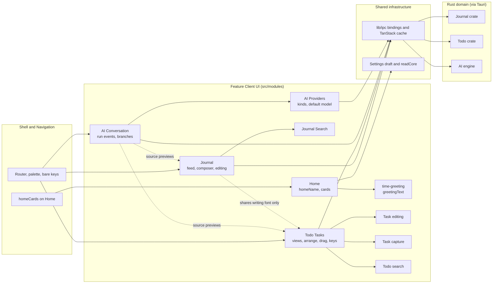
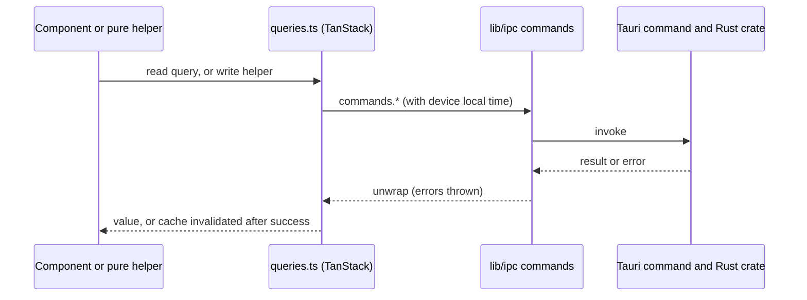

# Feature Client UI

## Purpose

Feature Client UI is the Svelte and TypeScript layer of Mnemora's feature screens. It covers what a person sees and does in the Journal, Todo, AI assistant, Home and the time greeting. The module owns no data. Every read and write goes through Tauri commands into the Rust domain crates, and results are cached with TanStack Query. Most of the logic here is pure TypeScript (state reducers, grouping, wording, keyboard rules), so it can be tested without a DOM or IPC.

The module lives under `src/` and is organised as one folder per feature under `src/modules/`, plus shared time helpers in `src/lib/time/`.

## Architecture

Three rules hold across the module:

1. **The server is the source of truth.** Components call pure helpers or commands, then invalidate the cache. Only a few changes are applied optimistically (for example, removing a row before the write completes).
2. **Pure reducers hold the rules.** Session state machines (composer, editing, search, run events, keyboard maps) are written as pure functions with tests beside them. Svelte classes only wrap them with reactive state.
3. **Journal and Todo are independent.** The only shared item is the writing font setting, which Todo reads as plain setting data.

## Feature areas

| Area | What it does | Documentation |
|---|---|---|
| Journal | Diary of dated Pages holding untitled Markdown Entries: feed paging, composer with autosave, inline editing, delete with Undo, keyboard focus and calendar jumps. | [Journal](Feature_Client_UI/journal.md) |
| Journal Search | Search session (open, park, Back, Esc), debounced query, date-range presets and grouping of hits by Page. A sub-feature of the Journal. | [Journal Search](Feature_Client_UI/journal-search.md) |
| Todo Tasks | Task and List views (Inbox, Today, Upcoming, All, Done, Lists), grouping and sorting, drag and drop, the keyboard key map, touch gestures, counts and the Home badge. | [Todo Tasks](Feature_Client_UI/todo-tasks.md) |
| Task editing | Autosaving title and notes of one open Task, the Task sheet URL state, Undo-backed actions (complete, date, Priority, skip, delete) and remote-delete messages. | [Task editing](Feature_Client_UI/todo-task-editing.md) |
| Task capture | Rules for the capture box: which recognised words are kept as text, `#List` tags, paste rules, field precedence and the stored "understood" record. | [Task capture](Feature_Client_UI/todo-capture.md) |
| Todo search | Search field state with a 150 ms debounce, open-before-done grouping and tinting of matched words. | [Todo search](Feature_Client_UI/todo-search.md) |
| AI Conversation | Folds streamed run events into the thread, Branches and pager, failure banners, History grouping, saved questions, Source previews and copy as Markdown. | [AI Conversation](Feature_Client_UI/ai-conversation.md) |
| AI Providers | Provider kinds and their rules, the default Model for a new question, the Model picker and the cached query options. | [AI Providers](Feature_Client_UI/ai-providers.md) |
| Home | Landing page: a greeting card, a clock tile and module cards from enabled features. `homeName` chooses the name shown. | [Home](Feature_Client_UI/home.md) |
| Time greeting | Maps the local hour to morning, afternoon, evening or night and builds the greeting text. Pure and stateless. | [Time greeting](Feature_Client_UI/time-greeting.md) |

## Data flow

Writes and reads follow one shape in every feature:

Two pieces of device-specific context travel with commands. Todo passes the device's local day and minute, so Rust computes "today" in the device's calendar. The AI feature sends a local context (date, weekday, time zone and week start) with each question.

Live state is kept in memory only. The AI page folds run events into live Runs, which are forgotten on reload, while the saved Conversation is enough to redraw the thread.

## Maintenance notes

- Keep reducers and rules pure, and put network calls in the query, action or source-loading modules.
- Any new Todo query goes under the shared `todoKeys` namespace so `invalidateTodo()` covers it. Any new AI query goes under `ai` for the same reason.
- Shared rules that have Rust or Android twins (Task capture, Journal rules, Task keys) are pinned by shared JSON fixtures. Change the fixture and every port together.
- Journal entry text and search queries must not reach a log line.