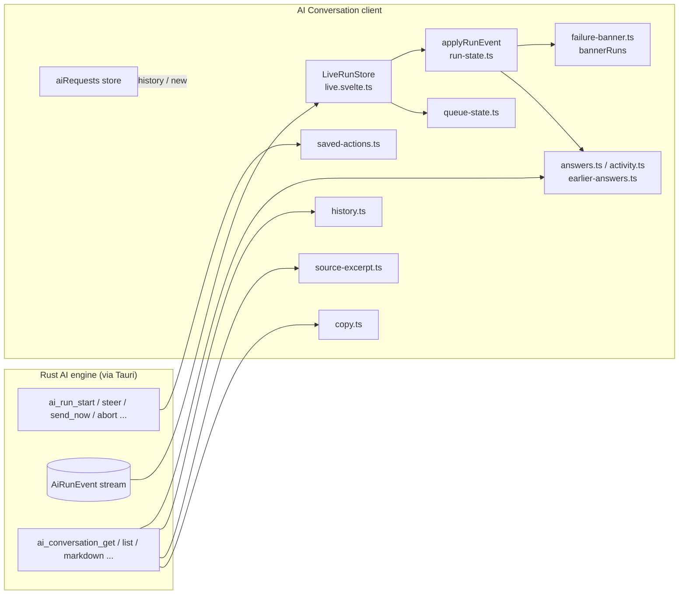
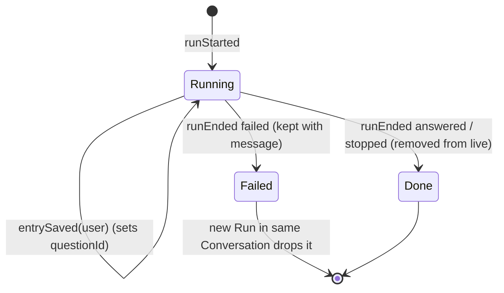
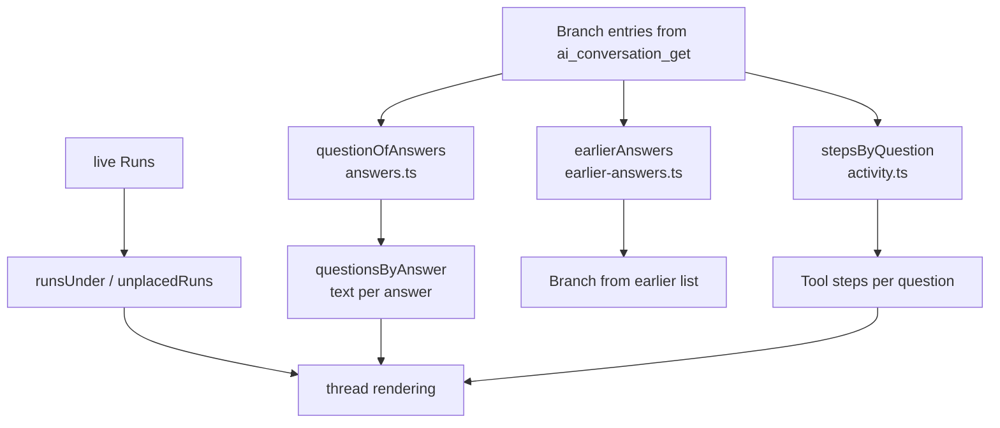
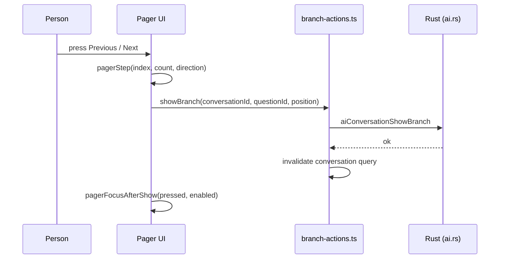
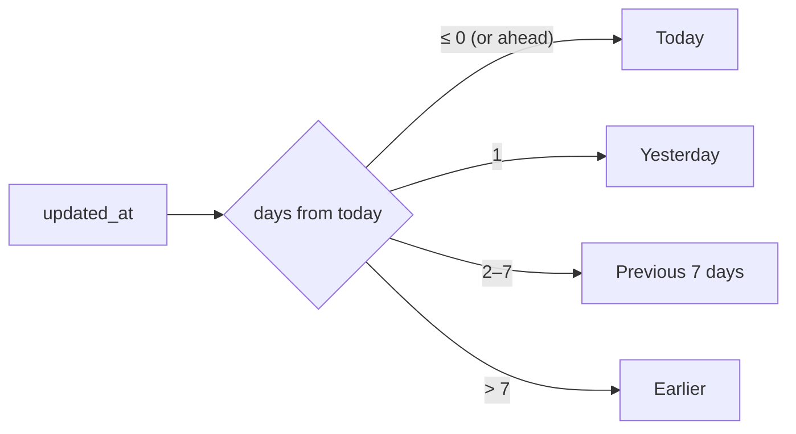
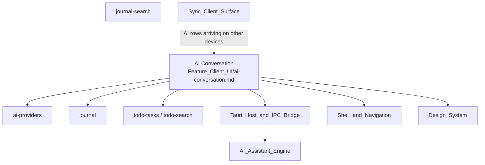

# AI Conversation (Client UI)

The AI Conversation module is the client-side half of the AI assistant page. It turns the events that the Rust AI engine streams (text deltas, Tool steps, saved entries, run outcomes) into what the person sees: a Conversation thread with Branches, live answers that stream in place, failure banners, a history list, saved questions, Source previews, and copy-as-Markdown. It also decides the small, pure rules behind those views (grouping, wording, focus return, keyboard claims) so they can be tested without a DOM or IPC.

The engine itself, the persistence of Conversations and the provider wire protocol are documented in [AI_Assistant_Engine](../AI_Assistant_Engine.md). Provider setup and the model picker are covered in [ai-providers](ai-providers.md). The IPC bridge that carries the commands and run events is described in [Tauri_Host_and_IPC_Bridge](../Tauri_Host_and_IPC_Bridge.md).

## Scope of this page

| Concern | Where it lives |
|---|---|
| Live Run state folded from run events | `src/modules/ai/run-state.ts`, `live.svelte.ts` |
| Queued notes waiting for a Run | `src/modules/ai/queue-state.ts` |
| Tool-step activity lines | `src/modules/ai/activity.ts` |
| Thread placement of questions and answers | `src/modules/ai/answers.ts` |
| Branch picker and pager | `src/modules/ai/earlier-answers.ts`, `branch-actions.ts`, `branch-pager.ts` |
| Failure banners | `src/modules/ai/failure-banner.ts` |
| History grouping | `src/modules/ai/history.ts` |
| Saved questions | `src/modules/ai/saved-actions.ts` |
| Source previews | `src/modules/ai/source-excerpt.ts` |
| Copy as Markdown | `src/modules/ai/copy.ts` |
| Cross-page requests (focus composer, open history, new) | `src/modules/ai/ai-requests.svelte.ts` |
| Keyboard claims for the AI page | `src/modules/ai/keys.test.ts` (asserts the manifest's bare keys) |
| Local calendar sent with each question | `src/modules/ai/local-context.ts` |
| Long press on phones | `src/modules/ai/long-press.ts` |
| Focus return after overlays | `src/modules/ai/focus.ts` |

Provider and model choice (`choice.ts`, `model-picker.ts`, `provider-kinds.ts`, `queries.ts` for models) belongs to [ai-providers](ai-providers.md).

## Architecture

The page holds two sources of truth and joins them at render time:

- **Saved entries** are the record. They come from `ai_conversation_get` and are the only thing the thread shows as settled history.
- **Live Runs** are in-memory only. They exist from `runStarted` until `answered` or `stopped`, and failed Runs stay until the page is reloaded or the Conversation starts another Run.

A reload forgets live state; the saved Conversation is enough to redraw the thread.

## Run event lifecycle

`applyRunEvent` (in [`run-state.ts`](../../src/modules/ai/run-state.ts)) is a pure reducer keyed by `run_id`. It is the core of the page.

Rules encoded in the reducer:

- An **answered** or **stopped** Run is removed. Its saved answer (or saved partial answer, marked stopped) is then read from the Conversation.
- A **failed** Run keeps its `failure` (kind and sentence). It is shown in the answer's place.
- A new `runStarted` in a Conversation removes that Conversation's earlier failed Runs, so stale banners go.
- `queueChanged` is not a Run. It is ignored here and handled by the Conversation-keyed queue (see below).
- `entrySaved` with `kind: 'user'` attaches the question id. This is how a live Run is placed under its question in the thread.

`LiveRunStore` (in [`live.svelte.ts`](../../src/modules/ai/live.svelte.ts)) wraps the reducer with Svelte runes state and adds three maps:

| Field | Meaning |
|---|---|
| `runs` | Live and failed Runs, folded by `applyRunEvent` |
| `sent` | The question each Run was sent with, so "Try again" can resend it (`remember`) |
| `queued` | Notes waiting per Conversation, replaced whole on each `queueChanged` (`setQueued`, `dropQueued`) |

`dismiss(runId)` drops one failed banner once "Try again" has started another Run; `clear()` resets all three.

### Placing live Runs in the thread

A Run is shown where its question sits. Three helpers in `run-state.ts` do the placement:

- `answeringIn` and `failedIn` filter live Runs by Conversation.
- `runsUnder(runs, questionId)` returns the Runs that answer a given saved question.
- `unplacedRuns(runs, entryIds)` returns Runs whose question is not yet among the loaded entries (not saved yet, or not loaded); these render at the end.
- `bannerRuns(failed, lastQuestionId)` shows a failure banner only while its question is the last question of the Branch on screen. Moving to another question or Branch hides it.
- `lastQuestionId` finds that newest question in a Branch.

## Thread building blocks

Key functions:

- **`questionOfAnswers`** pairs each assistant entry with the last user entry before it. `questionsByAnswer` returns just the text. Try again, Edit and Save as question all need the question an answer sits under.
- **`stepsByQuestion`** groups the Tool-result entries that follow each question, up to the next question, into `ActivityStep` rows (`name`, `summary`, `isError`).
- **`runningLabel(done)`** and **`completedLabel(count)`** write the live and collapsed activity lines ("Reading your journal and tasks… · 2 steps done", "Completed 3 steps"), pluralising "step".
- **`withoutCitations`** strips the `[uuid]` markers the model writes. The Sources chips stand for them.
- **`earlierAnswers`** lists every answer on the Branch that the person can branch from, oldest first. It skips assistant entries that carry Tool calls (they are Steps, not answers), and marks aborted answers as `stopped`. `excerpt` collapses whitespace and cuts text at `ANSWER_START_CHARS` (120) with an ellipsis.

### Activity links and sources

- **`openHref(source)`** returns `/todo?task=<id>` for a Task, or `/journal/<date>` for a Journal Entry (falling back to `/journal`).
- **`sourceModule(source)`** returns the reader-facing module name ("Todo" or "Journal").
- **`loadSource`** (in [`source-excerpt.ts`](../../src/modules/ai/source-excerpt.ts)) previews a cited item through the existing Journal and Todo reads (`journalPages` and `todoTask`). It adds no field to a Source. Entries use the Page's entries and their text; Tasks use their notes. The first three non-empty lines, capped at 240 characters, are shown. A missing Entry rejects with "That Entry no longer exists"; the Module's own wording is kept for a missing Task.

## Branches and the pager

A Conversation is a tree of entries. Each question may have sibling questions (from Edit or Try again), and the page shows one Branch at a time.

- `pagerLabel(index, count)` gives "Question 2 of 3".
- `pagerStep` returns the target position, or `null` at either end.
- `pagerFocusAfterShow` keeps focus on the arrow pressed while it is still enabled, moves it to the other arrow if not, or drops it when both are off.
- `branchFromEarlier(conversationId, answerId)` makes the Branch ending at a chosen answer the shown one (`aiConversationSetLeaf`), so the next question continues from there. The Branch after it stays in the Conversation.
- `showBranch` calls `aiConversationShowBranch`. Shown-branch state is device-local and is not written to the change log (see [AI sync](../AI_Assistant_Engine/ai_assistant/ai_assistant_conversations.md)).

Both mutations invalidate the conversation query key and, for branch-from-earlier, the history key.

## Failures

`failureBanner(kind)` in [`failure-banner.ts`](../../src/modules/ai/failure-banner.ts) maps each failure kind from the engine to a tone, a short title, and an ordered list of actions. The sentence under the title is the one Rust wrote, so the title must never be the start of that sentence.

| Kind | Tone | Title | Actions |
|---|---|---|---|
| `offline` | warning | No connection | retry |
| `too_long` | warning | Conversation is full | branch from earlier, new conversation |
| `no_provider` | danger | No Provider yet | change provider |
| `unreachable` | danger | Connection failed | retry, change provider |
| `timeout` | danger | No answer in time | retry, change provider |
| `key_rejected` | danger | Key not accepted | change provider, retry |
| `rate_limited` | danger | Limit reached | retry |
| `model_unavailable` | danger | Choose another Model | change model |
| `model_cannot_use_tools` | danger | Choose another Model | change model |
| `bad_response` | danger | Unreadable reply | retry |
| `interrupted` | danger | Answer stopped | retry |
| `unexpected` | danger | Unexpected error | retry |

Finishing a Run also produces a screen-reader announcement. `announcementFor(outcome)` in [`announce.ts`](../../src/modules/ai/announce.ts) returns one sentence per outcome ("Response complete", "Response stopped", or "Response failed: …"). Streamed tokens are never announced individually.

## Queued notes

A person may send a note while a Run is answering. The engine keeps the queue per Conversation and announces it with `queueChanged`.

- `setQueued` replaces one Conversation's list with the announced list.
- `dropQueued` removes one note once it is sent or taken back.
- `recalledText` joins taken-back notes one per line, in waiting order, to refill the composer.

## History

`groupConversations(items, now)` in [`history.ts`](../../src/modules/ai/history.ts) splits the history list into sections by whole local days since each Conversation last changed:

Rounding absorbs the 23- and 25-hour days of a clock change. Empty sections are dropped; order inside a section is kept as given (newest first). `shortDate` renders a row's date as "Oct 18". The history query itself is in [`queries.ts`](../../src/modules/ai/queries.ts) (`historyOptions`). Its server-side paging and search rules are in [AI_Assistant_Engine](../AI_Assistant_Engine.md).

## Saved questions

`saved-actions.ts` wraps the saved-question commands. Each action refreshes the saved-question query key afterwards.

| Function | Command | Notes |
|---|---|---|
| `saveQuestion(text)` | `aiSavedCreate` | Appended at the end of the list |
| `renameSaved(id, text)` | `aiSavedUpdate` | |
| `moveSaved(list, id, direction)` | `aiSavedReorder` | Uses neighbours from `saved-order`; no-op at the ends |
| `deleteSaved(saved)` | `aiSavedDelete`, then Undo toast | Undo calls `aiSavedRestore` to put it back in place |

Running a saved question is a normal Run that starts a Conversation titled with it (the engine rule is in [AI_Assistant_Engine](../AI_Assistant_Engine.md)).

## Copy as Markdown

`copyAsMarkdown(conversationId, entryId)` asks Rust for the Markdown (`aiConversationMarkdown`), so copies are identical however they are triggered. With an `entryId` it copies one answer; with `null` it copies the visible Branch. The text is written with `navigator.clipboard`, followed by a toast. Failures show a toast with the message.

## Cross-page requests and focus

Keys and palette actions can run on another page before the AI page exists. `aiRequests` (in [`ai-requests.svelte.ts`](../../src/modules/ai/ai-requests.svelte.ts)) holds one pending request of kind `composer`, `history`, or `new`. `request(kind)` sets it; the page calls `take()` once mounted, which returns it and clears it.

Overlays opened from the page (Sheets, Popovers, Dialogs) return focus with `returnFocus(opener, fallback)` from [`focus.ts`](../../src/modules/ai/focus.ts). The opener gets focus if it is still connected; otherwise the question box does. Focus is never left on the body.

### Keyboard claims

`keys.test.ts` asserts the AI Module's bare keys against the other Modules' keys, because the registry itself needs the router:

- `A` opens AI from anywhere except Todo, where `G` then `A` means the All view.
- `C` and `/` mean AI only on the AI page, so Journal and search keep their meanings elsewhere.

The manifest that declares these keys is composed in [`manifest.ts`](../../src/modules/ai/manifest.ts). Shortcut resolution is in [Shell_and_Navigation](../Shell_and_Navigation.md).

## Phone interaction and local context

- `pressMovedTooFar(from, to)` decides whether a press is a scroll or a hold. Movement beyond 10 px cancels the long press. `LONG_PRESS_MS` (500 ms) is the hold time before a question's Edit control shows on phones. Generic press handling is in [Shell_and_Navigation](../Shell_and_Navigation.md).
- `localContext(now, weekStart, timeZone)` builds the `LocalContext` sent with each question: the local date as `YYYY-MM-DD`, the weekday name, the time zone and the week start. The model is told the date, time zone and week start so that "today" and "this week" resolve correctly.

## Dependencies on other modules

- **IPC and commands**: every read and mutation goes through generated bindings in `src/lib/ipc/bindings` via `unwrap` and `queryClient`. See [Tauri_Host_and_IPC_Bridge](../Tauri_Host_and_IPC_Bridge.md).
- **Engine**: run commands (`ai_run_start`, `ai_run_steer`, `ai_run_send_now`, `ai_run_unqueue`, `ai_run_abort`, `ai_run_retry`) and the `AiRunEvent` stream are implemented in Rust. See [AI_Assistant_Engine](../AI_Assistant_Engine.md).
- **Providers and models**: the Provider and model picker shown beside the composer belong to [ai-providers](ai-providers.md).
- **Journal and Todo**: Source previews read Journal Pages and Tasks; the cited item links open [journal](journal.md) and [todo-tasks](todo-tasks.md).
- **Design**: the pager, banners and history use tokens and `src/lib/ui` components; see [Design_System](../Design_System.md).
- **Sync**: Conversations, saved questions and the change log replicate between devices, while the visible Branch, providers and usage never leave the device. Sync surfaces are in [Sync_Client_Surface](../Sync_Client_Surface.md).

## Testing

Each pure module has a colocated test that runs without IPC:

| Test | Covers |
|---|---|
| `run-state.test.ts` | Event folding, failure retention, banner placement, Tool steps, unplaced Runs |
| `queue-state.test.ts` | Queue replacement, drop, recalled text |
| `answers.test.ts` | Question pairing |
| `earlier-answers.test.ts` | Branch picker rows, Step filtering, excerpts |
| `history.test.ts` | Grouping by local day across clock changes |
| `focus.test.ts` | Focus return rules |
| `keys.test.ts` | Bare-key claims against other Modules |
| `source-excerpt.test.ts` | Source loading, including against the browser mock |

Behaviour that depends on the engine is tested in Rust under `src-tauri/src/ai_*_tests.rs`, described in [AI_Assistant_Engine](../AI_Assistant_Engine.md).

## Maintenance notes

- Add a new failure kind in `failure-banner.ts` and in the engine's `Failure` type together. The title must not repeat the start of the Rust sentence.
- Keep the run reducer pure. Anything that needs the network belongs in `copy.ts`, `saved-actions.ts`, `branch-actions.ts` or `source-excerpt.ts`.
- Do not announce streamed text. Extend `announcementFor` when a new run outcome appears.
- When adding a bare key for the AI page, update the claim list in `keys.test.ts`.
